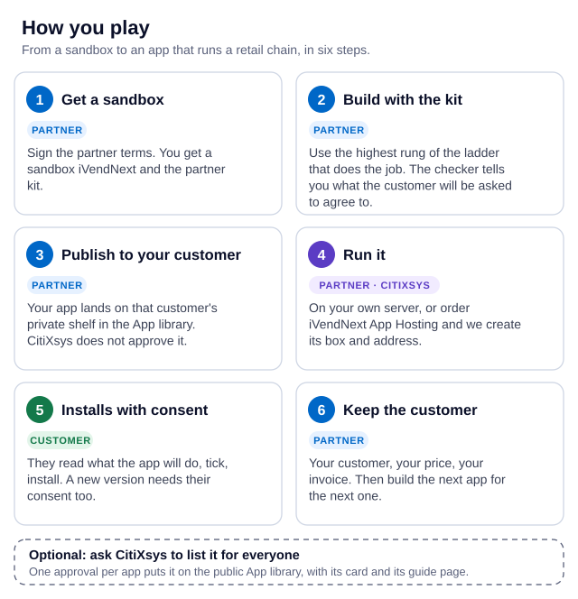

# The iVendNext partner kit

Build the app a retail chain needs — a rule at the till, a record of its own, a link to its systems — without changing iVendNext itself. This kit holds the guide, the recipes, the API description, the extension points' contracts, the tools, forty-seven worked samples, the design kit, the blueprint template and the feedback forms.

**Who it is for:** iVendNext Partners, licensed customers' IT teams, and the CitiXsys Consulting Team.

## Try it in a minute

You need Python 3 and nothing else: no install, no account, no network. Clone the kit and run the tests of a worked sample, a coupon rule that is checked when the cashier presses **Pay**:

```bash
git clone https://github.com/ivendnext-developers/partner-kit.git && cd partner-kit
python3 -m unittest discover -s samples/s32_coupon_rules/tests -p 'test_*.py'
```

Then read [that sample's README](samples/s32_coupon_rules/README.md): what the shop does, what the cashier sees, what leaves the shop, and the limits. Most samples come with tests you run the same way.

**Building with an AI assistant?** Point it at [AGENTS.md](AGENTS.md) first: it holds the rules, the commands and a prompt recipe for each way in, in [`ai/`](ai/README.md).

> **Generally released.** iVendNext POS 2.0.0.652 (18 October 2026) is the general release of the extension points, the API calls the kit describes and the manifest format. From it, each version is served for 12 months after its successor ships ([guide ch. 18](guide/18_versioning_and_support.md)), and every change is a dated entry in [the changelog](CHANGELOG.md).

**Anyone may read the kit. To get a sandbox or build for an iVendNext customer, [become an iVendNext Partner](https://www.ivendnext.com/partners/apply/).**

## What this is, and how you play

**Build apps for a retail chain's own iVendNext, and keep the customer.** A retail chain needs something its business does differently: a rule at the till, a record of its own, a link to its systems. You build it with this kit, on a sandbox, without changing iVendNext itself. We give you the sandbox, the kit, the App library and, if you want it, hosting. You keep the customer and the bill.

<picture>
  <source media="(prefers-color-scheme: dark)" srcset="guide/img/where-your-app-runs-dark.svg">
  
</picture>

Full version, with every way an app runs: [library.ivendnext.app/how-apps-run](https://library.ivendnext.app/how-apps-run).

<picture>
  <source media="(prefers-color-scheme: dark)" srcset="guide/img/how-you-play-dark.svg">
  
</picture>

The same path, step by step, is on [developer.ivendnext.com](https://developer.ivendnext.com/).

## Start here

Use the kit before you quote a customer or start a build.

1. Read [the guide](guide/README.md), starting with [1. Welcome and the one path](guide/01_welcome.md) and [3. The ladder and the four rules](guide/03_ladder_and_never_list.md).
2. Fill in [the blueprint](kit/blueprint.md) for your project before you quote or build.
3. For each need, take the highest rung of the ladder that does the job, and follow its recipe.

## The ladder — the order in which you try the ways in

| Rung | Way in | Your code runs | Start with |
|---|---|---|---|
| 1 | Configure what iVendNext already has | nowhere | [guide ch. 4](guide/04_configure_first.md) |
| 2 | An outside app over the API and the event feed, in any language | your server | [connected app](recipes/connected_app.md) · [event feed](recipes/event_feed.md) |
| 3 | A till key the cashier taps; the till calls your HTTPS service | your server | [till key](recipes/point_handler.md) |
| 4 | A manifest: your own record types, fields and formats, as data | nowhere — it is data | [manifest](recipes/manifest.md) |
| 5 | A sandboxed function compiled to WebAssembly, at an extension point that offers one | a sandbox we run | [guide ch. 8](guide/08_sandboxed_functions.md) |
| 6 | Compose doors, then request an extension point only when no combination meets the need | — | [guide ch. 9](guide/09_points_and_requests.md) |

**The four rules every build keeps** ([guide ch. 3](guide/03_ladder_and_never_list.md)): money enters the sale visibly, before payment; never override or patch iVendNext; your code runs on your server, and inside a customer's site you ship data, not code; your screens use the extension points iVendNext offers (a Desk action, a partner page, a native screen from a manifest), never your JavaScript inside Desk or the till.

## What is in this repository

| Folder | What it holds |
|---|---|
| [`guide/`](guide/README.md) | the partner guide, one chapter per rung, plus testing, AI, integrations and the limits |
| [`recipes/`](recipes/) | one recipe per task: steps, what is refused, behaviour when your service is down or the till is offline, the tests |
| [`contracts/`](contracts/README.md) | the extension points' contracts, copied from the product: a page and a schema for each of sixteen extension points, with accepted and refused samples; the pages of the receipt settings and of the print template readers; the payment connector's page and stand-in; the manifest's own schema |
| [`api/`](api/README.md) | the API description (`openapi.yaml`) and a request collection that runs with curl and jq alone |
| [`tools/`](tools/) | the manifest checker and the `deploy` command, the app template (a service you can deploy, as a container or as a function), the contracts checker, the event-feed client, the Wasm kit, the AI (MCP) server, the scale-profile kit, sign-in, the stand-in caller, the self-check, the money kit, the sandbox check, the sandbox certificate for a payment connector |
| [`samples/`](samples/) | forty-seven worked samples (S1–S48; there is no S15) — S1–S14, S16 (a Desk action), S17 (a partner page), S18 (a check before payment; its README carries a save rule that caps a store's manager approvals a day), S19 (unit codes at the scan), S20 (capture on scan, a customer code and a quantity change), S21 (field rules, and the money words), S22 (a customer's own loyalty: the rules outside, the records inside, the cash back spent at the till), S23 (till guard rules: a check and a capture in one app, with the shop's own settings, and a notice of a shorter-dated batch), S24 (a price-checker kiosk: a page the app serves on the shop floor, priced by the shop), S25 (a gift card for a big spend, spendable after a hold: the shop's own gift cards, issued and released from the feed), S26 (derived price lists), S27 (stock alerts and a draft transfer request, and a reminder before a batch expires), S28 (merge counts, and a customer's history on the till), S29 (a layout of its own for each distributor's invoice, and a price list with photos as a print format or a page), S30 (units as serial numbers), S31 (parent item groups in coupons and promotions), S32 (coupon rules: a coupon for a first purchase only, or for one customer group, refused at Pay), S33 (click and collect: a Desk board of the web orders a store must pick and hand over, from a manifest alone), S34 (purchase orders checked by your ERP: a document check that refuses, asks for approval or fills the ERP's number), S35 (call-centre orders by district: a Desk button whose service sends a draft order to the store that serves its district), S36 (duty-free allowance and boarding pass: the boarding pass scanned into a sale detail and each passenger's allowance, checked at Pay), S37 (age-restricted sale check: the date of birth to check shown at the scan, the check recorded on the sale, and Pay refused without it), S38 (expiry markdown: a Desk button on the Batch list whose service writes each lot's own price by the shop's markdown steps, until its expiry date), S39 (pharmacy counter rules: a prescription, a pharmacist with a licence in date and the patient's identity checked at Pay and at Desk submit, each refill reserved in the shop's own records so two tills cannot spend the last one), S40 (expiry and recall: a recall notice whose button blocks the lots at every till and traces each store's stock and the customers supplied, a disposal that needs the regulator's visit on record, and short-dated deliveries refused at goods-in), S41 (a regulated stock register: each market's books a data set), S42 (optical prescriptions and lab orders: the customer's eye tests and the lab's jobs as the shop's own records with a workflow and a job sheet, and lenses refused at Pay without a prescription of their kind in date) S43 (a third party paying part of a sale: an insurer's or a company's share split by the plan's rules, claimed afterwards from the sales the POS app's payer door books), S44 (a lucky draw: a campaign whose buttons count each till sale's entries by spend and draw the winners and reserves fairly, once), S45 (a restaurant's back office: a dish's recipe takes its ingredients off stock after the sale, one press a day, with allergens on the till and the receipt, food cost by recipe against actual, and sales by item, till user and day part), S46 (payment method rules: which payment methods each customer group may use, the others left off the sale's payment screen at Pay), S47 (customers by store: at which stores each customer group may buy, the customer taken off the sale anywhere else) and S48 (customer code check: a one-time code texted to the customer's phone by the shop's own Notification before their account is used at the till) — each with its README; most come with tests you run on your laptop (S3, S4 and S5 are tested only in our own test environment) |
| [`kit/`](kit/) | the design kit (`kit/design/`) and the blueprint template |
| [`feedback/`](feedback/README.md) | the six feedback forms, for onboarded members; they are filed in the private `partner-feedback` repository |

**Not here yet:** the reference apps (each will have its own repository). (The deploy-to-my-sandbox command is [`tools/deploy/`](tools/deploy/README.md), the AI builder kit is [AGENTS.md](AGENTS.md) with [`ai/`](ai/README.md), and the extension-point contracts are in [`contracts/`](contracts/README.md).)

**`pp_` in the samples** is the samples' own prefix for the record types and fields they create (`pp_wrc`, `pp_bln`, `pp_pda`, `pp_lyl`…). It belongs to the samples only: **replace it with your company's own first word before you ship** (the App library gives each registered company one; [guide ch. 7](guide/07_manifests.md)).

## The WebAssembly verdict

Rung 5 rests on one measured question: can a partner's function give the same answer on our server and on an offline till? We built a pricing function once and ran it on both.

- **Compiled WebAssembly (Rust): yes.** The same function gave the same answer on the server and in a browser host, down to the byte, on every one of 174 baskets both could finish. On the largest baskets it stopped at the same point on both. On a slowed-down stand-in for a slow till it was fast enough; a real low-end till has not been tried.
- **Hostile modules are stopped** on both, each with a named reason.
- **JavaScript compiled with Javy: not on the till.** It gave the same answers, but it starts too slowly for the cashier. You may use it for a function that runs on the server only, where start-up time is not on the cashier's path.

The kit in [`tools/wasm_kit/`](tools/wasm_kit/README.md) builds, meters, checks and runs your function on both hosts locally. Two extension points take a sandboxed function today, the check before payment and pricing, and only one CitiXsys has certified runs ([guide ch. 8](guide/08_sandboxed_functions.md)). The measurements are in the Technical notes below.

## Feedback, contributing and security

- **Found a gap or a defect?** Onboarded members (an iVendNext Partner, a licensed customer's IT team, the CitiXsys Consulting Team) file it with one of the feedback forms in the private `partner-feedback` repository ([how](feedback/README.md)). One subject per form; never a secret or a shopper's personal data. Everyone else: [become an iVendNext Partner](https://www.ivendnext.com/partners/apply/), or propose a fix to a text or a link (see [CONTRIBUTING.md](CONTRIBUTING.md)).
- **Contributing:** see [CONTRIBUTING.md](CONTRIBUTING.md). Contributions are signed off under the Developer Certificate of Origin.
- **A security problem:** never in an issue — see [SECURITY.md](SECURITY.md).
- **Where every file comes from:** [EXPORT_SOURCES.md](EXPORT_SOURCES.md).

## Licence

Apache License 2.0, Copyright 2026 CitiXsys — see [LICENSE](LICENSE) and [NOTICE](NOTICE). Legal information: <https://legal.ivend.com>.

- **It covers this repository's files only.** A tool that runs inside a site, such as the money kit, calls iVendNext code; the licence grants nothing in the code it calls.
- **Copies of our product's files** (the manifest checker, the contracts, three lints, the design tokens and a few others, each with its source named) are licensed here under Apache 2.0 on purpose; [NOTICE](NOTICE) lists them.
- **Copying a sample into your product:** if you ship it to someone, keep the licence and the `NOTICE`, and mark the files you changed; if it only runs on your own server, there is nothing to do.
- **Not under Apache 2.0:** the iVendNext name and logo (`site/assets-src/logo*.svg`) are trademarks of CitiXsys and are not licensed for reuse — the partner terms (at <https://legal.ivend.com>, once published) say how you may refer to iVendNext; the fonts in `site/assets-src/fonts/` are under the SIL Open Font License 1.1 (`site/assets-src/fonts/OFL.txt`); `tools/app_template/service/ed25519.py` is adapted from RFC 8032's reference code, under the IETF Trust's BSD licence.

## Technical notes

### The WebAssembly measurements

- **Compiled WebAssembly (Rust): yes.** The same function gave byte-for-byte the same answer on the server host and the browser host, and matched an independent reading of the rules, on every one of 174 baskets both could finish (golden offline baskets, shop baskets with promotions, edge cases and metering cases). With a work counter compiled into the function, the two hosts also agree on the largest baskets, to the exact stopping point.
- **Hostile modules are stopped.** 25 hostile modules were each refused at load or stopped with a named reason, on both hosts.
- **It fits the till's time budget.** On a throttled stand-in for a slow till, the metered Rust function's largest admitted basket answered in 38 ms against a 50 ms budget.
- **JavaScript compiled with Javy: not on the till.** It also gave identical answers, but its first answer took 69–80 ms on the throttled till, over budget. It is allowed for a function that runs on the server only, where start-up time is not on the cashier's path.

### Where the samples are tested

Most samples have laptop tests; S3, S4 and S5 are tested on our test bench only.
