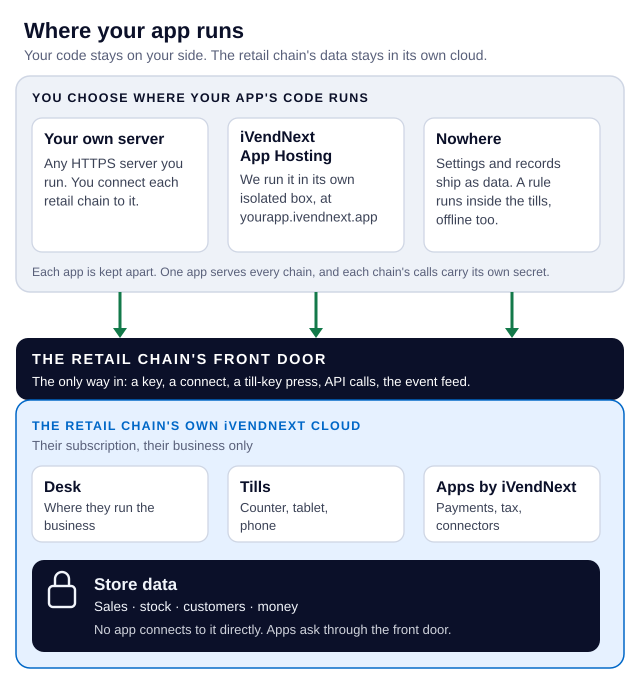

# 1a. How it all works — where your app runs, where the data lives, why customers never collide

A ten-minute read for a developer meeting iVendNext for the first time: what an app is, where it runs (Docker, a container, a function, or nowhere), where a retail chain's data lives, how one app serves many customers (multi-tenant) without a conflict, how many apps and boxes you need, which endpoints call which, and what publishing and hosting cost you. Each section starts with a picture.

**Download:** [How iVendNext apps work](https://developer.ivendnext.com/downloads/how_ivendnext_apps_work.pdf) (PDF, this chapter to read offline or in a meeting). **Have one question?** [Questions developers ask](../site/pages/questions.md).

**For:** anyone about to build for an iVendNext customer: an iVendNext Partner's developer, a licensed customer's IT team, the CitiXsys Consulting Team. No iVendNext knowledge needed.

**The one idea.** An iVendNext app is not software you install at the customer. It is **data that goes into the customer's iVendNext, plus, if it needs one, a single web service that serves every customer.**

## 1. The three pieces

- **The retail chain's own iVendNext.** Each customer (a retail chain) has its own iVendNext site: its Desk (the back office), its tills (counter, tablet, phone) and its store data (sales, stock, customers, money). CitiXsys runs it for that chain. You never get a server, a database or the software; you get the chain's address and, through your app, a key.
- **Your app.** What you build, in two parts (section 2).
- **The App library** (`library.ivendnext.app`). Where you publish your app, and where a chain's administrator finds it and installs it: on the public list for every retailer, or on one chain's private *Made for you* shelf.

Some people call a chain's site a *tenant*. In this guide it is **the chain's iVendNext site**, or **the retailer's site**.

## 2. What your app is made of: data (records, fields, screens), plus an optional service

- **The data part: your manifest.** One JSON file that says what your app adds to the chain's iVendNext: record types and their fields, fields on existing records, roles, print formats, workflows, notifications, reports, till keys, a check at Pay, Desk buttons, and the event feed it reads. The chain's administrator installs it from Desk; iVendNext creates each record from it. Nothing of yours runs inside the site ([chapter 7](07_manifests.md)).
- **The service part: your own web service, if you need one.** A program you write, in any language, that iVendNext calls when a cashier presses your till key or Pay, and that calls iVendNext's API to read and write records. **One service serves every chain that installs your app.**
- **Many apps need no service at all.** Settings and records, field rules, a print format or a workflow are only data.
- **The one exception that runs inside:** a *sandboxed function*, a small sealed WebAssembly module certified by CitiXsys, which runs inside the sale and on an offline till for two extension points: the check before payment and pricing ([chapter 8](08_sandboxed_functions.md)).

## 3. Where your service runs, and whether that is Docker

You choose one of three:

- **On your own server.** Any language, any cloud, your own machines. A Docker container is fine, and the kit's template ships one: one image runs the same on your laptop, on a test copy and in production. You connect each chain to it by hand ([chapter 14b](14b_deploying_your_app.md#where-it-can-run)).
- **On iVendNext App Hosting, run by CitiXsys.** We run your service at `https://<app>.ivendnext.app`, in one of two ways, with the same code:
  - **as a function**, for an app that answers presses (a till key, a check at Pay, a webhook) or works in short runs on a schedule (reading the event feed every minute, a daily job). It runs only when called;
  - **as a container**, for an app that needs a process that stays up (a connection it holds open, a queue it serves) or a job longer than 15 minutes. It runs all the time.
  
  Either way it is priced per app per month, and an app that runs as a function and is listed in the App library carries no hosting charge (section 7). Each chain that installs your app from the App library connects to it by itself ([chapter 14b](14b_deploying_your_app.md#let-citixsys-host-it)).
- **Nowhere.** An app that is only settings and records has no service.

## 4. Where the customer's data lives

![Where the chain's data lives. It stays in the chain's own iVendNext: sales, stock, customers, money, and your app's own record types, which your service reads through the API. Your service keeps nothing between calls by default. On App Hosting it keeps each retailer's connection, its address, secrets and key id, in the app's own encrypted table, and no sales or customers. Anything you keep in a store of your own, or send to an outside system, is declared in your manifest and shown to the chain before it installs. App Hosting and the App library run in AWS us-east-1; other regions are added when a customer needs its data there.](img/where-data-goes.svg)

**The chain's data stays in the chain's iVendNext.** Your app reaches it through the API, as your app's own user, with only the rights the chain gives that user.

- **A till-key or check calculation keeps nothing of the sale.** iVendNext sends your service the sale it needs to judge; your service answers and forgets it. What your service caches between calls, it keeps per chain (S18 keeps each chain's rule for a minute).
- **A link to an outside system declares what leaves.** Each address your app sends data to is in your manifest, and each service that sends data is switched off until the chain's administrator reads exactly which fields go there and ticks consent.
- **Your app's own data** lives in the chain's own records (the record types your manifest adds), or in a store you run yourself. A store of your own is yours to declare and to look after.
- **What App Hosting keeps:** for each chain your hosted app serves, its connection (its address, the secrets its install made and its key's id), in your app's own encrypted table, with the short claims a scheduled run takes on a chain; no chain's sales or customers. Hosting gives your app no database and no lasting disk of its own for anything else.
- **Which region:**
  - App Hosting and the App library run in AWS `us-east-1`. Other regions are added when a customer needs its data there.
  - On your own server, you choose the region: near the chain's site, and where the customer's data may live.
  - The chain's own iVendNext runs where CitiXsys hosts that chain's subscription; ask your partner manager for a given chain.

## 5. The three directions of a call, and which endpoint, key and secret each uses

| | From | To (the endpoint) | Proved by |
|---|---|---|---|
| **1** | Your service | The iVendNext API, at the chain's own address: `https://<chain site>/api/…` | Your app's key, as your app's own user, with one narrow role |
| **2** | The chain's iVendNext (a till key, a check at Pay, a Desk button, a webhook) | Your service, at your one address: `https://<app>.ivendnext.app/…` or your own | A signature made with **that chain's own secret**, and the header naming the chain's site |
| **3** | Your service | An outside system (a loyalty system, a telecom company, an ERP) | That chain's own account for it |

Direction 2 is what other platforms call a webhook or a callback. In iVendNext it is a till key, a check, a Desk button, a webhook or, read the other way round, the event feed, which your service pulls.

## 6. One app, many customers: why calls never collide

![Two retail chains press the same key at the same moment. Each press is its own call: chain A's names chain A and is signed with A's secret, chain B's names chain B and is signed with B's secret. Two copies of your one service answer them at once. Each copy checks the call with that chain's own secret, taken from the retailers' connections, and answers from that chain's data only. A call signed with another chain's secret is refused. Your service keeps nothing between calls, or keeps it by retailer.](img/two-chains-same-press.svg)

Two cashiers at two chains press your key in the same second. There is no conflict:

- **Each press is its own call.** It names its chain's site and is signed with that chain's own secret, made when that chain installed your app. Your service checks the signature with that chain's secret before it reads anything, and answers from that chain's data only. A call signed with another chain's secret, or from a site your app does not know, is refused.
- **Your service runs several copies at once.** A hosted function runs up to 10 copies at the same moment; a hosted container runs one copy, or two on the Managed plan. Each call is handled on its own.
- **The design rule: keep nothing between calls, or key it by retailer.** A value one call leaves in memory must never be read by a call for another chain. The kit's template does this for you: each chain's connection is one row, keyed by its site.

So a multi-tenant app needs nothing special from you beyond the template's handshake: one service, many chains, each call checked and answered on its own.

## 7. How many apps, how many boxes

![One chain needs four things. As one app: one manifest carrying two till keys, a check at Pay, three record types and a Desk button, served by one service at one address; one version, one consent, one removal; on App Hosting one box at one price, free when it runs as a function and is listed in the App library. As four apps: four manifests and four services; four versions, four consents, removed one by one; on App Hosting four boxes at four prices; on your own server they can share one container. A separate copy for one chain only when you choose it.](img/four-needs-one-app-or-four.svg)

A customer asks you for four things. Do you build four apps in four containers, or one?

- **Usually one app.** One manifest can carry many till keys, checks, record types, fields and Desk buttons, all served by one service at one address.
- **No container per customer.** One app serves every chain that installs it (section 6).
- **On App Hosting, each app is one box, priced per app** (Starter $49, Standard $129, Managed $399 a month). An app that runs as a function and is listed in the App library carries no hosting charge. Four apps on App Hosting are four boxes and four prices.
- **On your own server, apps can share one container** if you want them to: that is your own design.
- **Split into separate apps only what has its own life.** Separate apps have separate versions, separate consent screens and separate removal: a chain can remove one without the others. That is the reason to split, not the box.
- **A copy for one customer** only when you choose one: that customer needs its own rules, its own release dates, or its contract asks for it.

## 8. How your app reaches the customer's iVendNext

- **The install creates your records.** The chain's administrator installs your manifest; iVendNext creates each record type, field, role and button it lists. A new version is an update, not a schema migration you run.
- **The install makes your app's own user.** If your manifest has an event feed, the install makes your app's own user, `<app>@integration.invalid`, which works through the API only and holds one role, `<PREFIX> Integration`. The chain grants that role the reads your app needs. An app with no event feed that still calls the API is given a user the chain makes for it ([chapter 2](02_getting_started.md)).
- **The site connects to your service.** For an app hosted on App Hosting and installed from the App library, the chain's site connects by itself once it is installed: it sends your service its library key, its address and the secrets the install made, including your app's user's key. For a service on your own server, the chain sends you those by hand.
- **Then the three directions run.** Your service calls the API; the till calls your service at a till key or at Pay; and the event feed tells your service what changed (a sale, a return, a record), when your service reads it.

## 9. Publishing is not handing us your code

![Who sends what to whom. One: you publish your manifest and its card to the App library, signed with your key. Two, only if CitiXsys runs your service: you send iVendNext App Hosting a hosting order with your app.json and an image, or a function's package of the files it runs, never your repository. Three: the App library shows your app on its public list or on one chain's Made for you shelf. Four: the chain's administrator reads What it will do, ticks consent and installs. Five: the chain's iVendNext connects to your service, handing over its address, its key and the secrets the install made. Your code stays in your own repository.](img/publish-and-host.svg)

Publishing and hosting are **two separate steps**. Publishing never sends your code, and neither gives us your repository.

- **Publish:** your manifest and its card go to an App library shelf, signed with your own key ([Publish your app](../site/pages/publish.md)). This is all a no-service app ever sends.
- **Hosting, only if CitiXsys runs your service:** a separate hosting order, with your `app.json` and either an **image** you built or a **function's package** (the files the function runs, zipped by the kit), never your repository or access to it ([chapter 14b](14b_deploying_your_app.md#let-citixsys-host-it)). On your own server you send us nothing.
- **The customer installs with consent.** The chain's administrator reads *What it will do*, written by iVendNext from your manifest, ticks the box and installs.

## 10. What the customer sees

- **The administrator** finds your app in the App library, reads its card (what it does, where it sends data, whether it needs a key), installs it, reads *What it will do*, ticks consent, and switches each service on for the stores it should serve. *Connected apps* lists every app installed.
- **The cashier** sees your till key on the till, or your answer at Pay (allowed, refused in your words, or a question to ask the customer). They never see where your service runs.
- **When your service is down or late:** the till keeps selling.
  - A till key tells the cashier it *did not answer in time* or *could not finish*, and that *nothing was added to the sale*.
  - A check at Pay does what your manifest says when it is down: allow the sale, or refuse it until your service answers.
- **When the till is offline:** a till key is dimmed and the sale goes on without it. A check at Pay applies the same down answer. A sandboxed function still runs on the till.

## 11. Words we use

| You may say | In iVendNext |
|---|---|
| tenant, instance, customer environment | the chain's iVendNext site (the retailer's site) |
| plugin, extension, add-on | app |
| deployment, provisioning | a hosting order (only when CitiXsys hosts your service) |
| schema migration, database migration | the manifest install, or an update to a higher version |
| webhook, callback | a till key, a check, a Desk button, a webhook, or the event feed |
| API credentials, service account | your app's own user and its key |

## Technical notes

Each claim above, with the page or code that proves it:

- **The one idea, and nothing of yours inside the site:** [chapter 3](03_ladder_and_never_list.md), the four rules; [chapter 14b](14b_deploying_your_app.md), *The short answer*.
- **What a manifest can add:** [chapter 7](07_manifests.md) and the manifest's schema, `tools/manifest/`.
- **The sandboxed function and its two extension points:** [chapter 8](08_sandboxed_functions.md), *Package or module?*
- **A function or a container, and the 15-minute line:** [chapter 14b](14b_deploying_your_app.md#a-function-or-a-container). A function runs Python 3.13 on ARM64, 512 MB, 10 seconds per press (up to 900 on a schedule), at most 10 copies at once (its Technical notes).
- **Copies per plan:** `tools/deploy_app/plans.json`, each plan's `enforced.instances` (Starter 1, Standard 1, Managed 2), the same file App Hosting enforces.
- **Region:** `tools/deploy_app/plans.json`, `regions` (`us` = `us-east-1`) and `regions_on_request`; `deploy_app.py` refuses a region the hosting does not serve.
- **One box per app:** each hosted app has its own address, image registry or package folder, secrets, logs and firewall rule ([chapter 14b](14b_deploying_your_app.md#let-citixsys-host-it), *What you get*); the hosting writes one listener rule per address.
- **When hosting is free:** the hosting takes no charge for an app that runs as a function and that the App library lists as that maker's app, reaching that app's own address. A container is always charged. The plan prices: `tools/deploy_app/plans.json`, `price_usd_month`.
- **What the shops table holds:** `tools/app_template/service/shops.py`, `connect()`: for each site, its call-back address, its secrets and the previous set, the library key's id and kind, and when it connected. On App Hosting the table is the app's own, encrypted at rest.
- **What a function keeps between runs:** nothing but a copy's `/tmp` while that copy lives, a cache only ([chapter 14b](14b_deploying_your_app.md#a-function-or-a-container), *What a run keeps*).
- **The handshake and per-chain secrets:** [chapter 14b](14b_deploying_your_app.md#one-app-many-retailers), *One app, many retailers*, and its call table (`POST /ivendnext/connect`, `/disconnect`, the `X-iVendNext-Site` header, 401 for an unknown site or another site's secret).
- **The signature:** `base64(HMAC-SHA256(secret, "<timestamp>.<raw body>"))`, five minutes of clock skew, 64 KB ([chapter 14b](14b_deploying_your_app.md#what-every-deployable-app-does), item 3).
- **The app's own user:** made at install for a manifest with an event feed, from POS version 2.1.0.667 ([chapter 5](05_outside_apps_and_event_feed.md), step 5; [chapter 7](07_manifests.md)).
- **Consent and declared addresses:** `allowed_urls` and each service's consent ([chapter 7](07_manifests.md); [chapter 14a](14a_deploying_to_a_chain.md)).
- **What the cashier reads:** [chapter 6](06_till_keys.md#when-your-service-is-down-and-when-the-till-is-offline); a check's `down_answer` ([chapter 7](07_manifests.md); sample [S18](../samples/s18_rule_guard/README.md), *Where it shows*).
- **Publishing and hosting:** [Publish your app](../site/pages/publish.md); [chapter 14b](14b_deploying_your_app.md#order-and-pay-online).

**Next:** [1b. One app from your laptop to the till](01b_one_app_end_to_end.md), sample S18 followed step by step.
