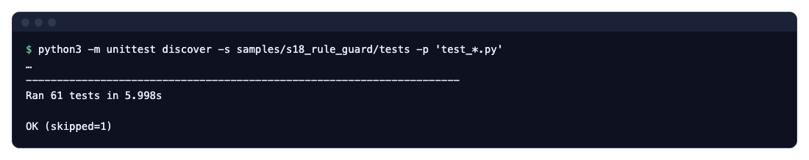
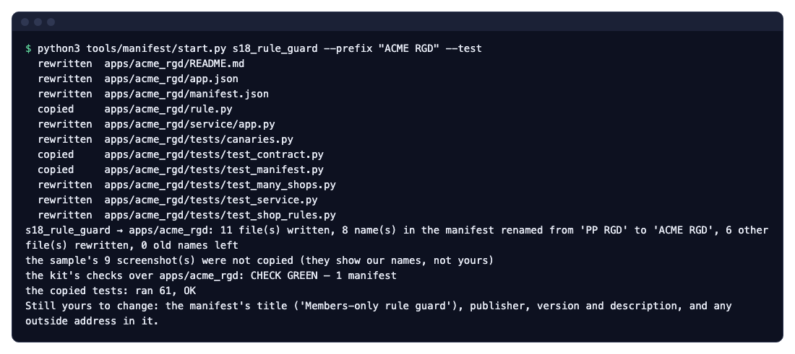
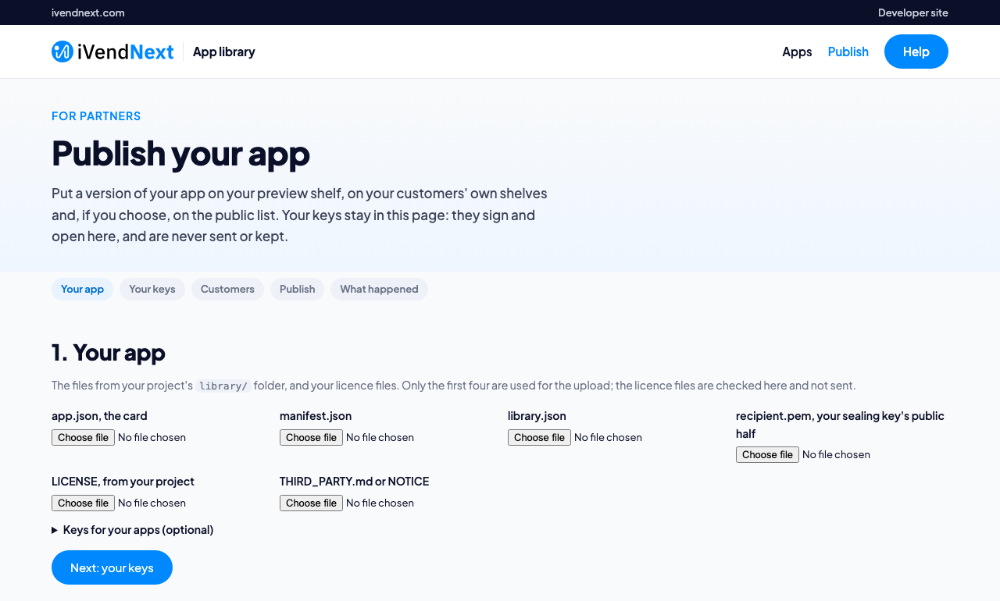
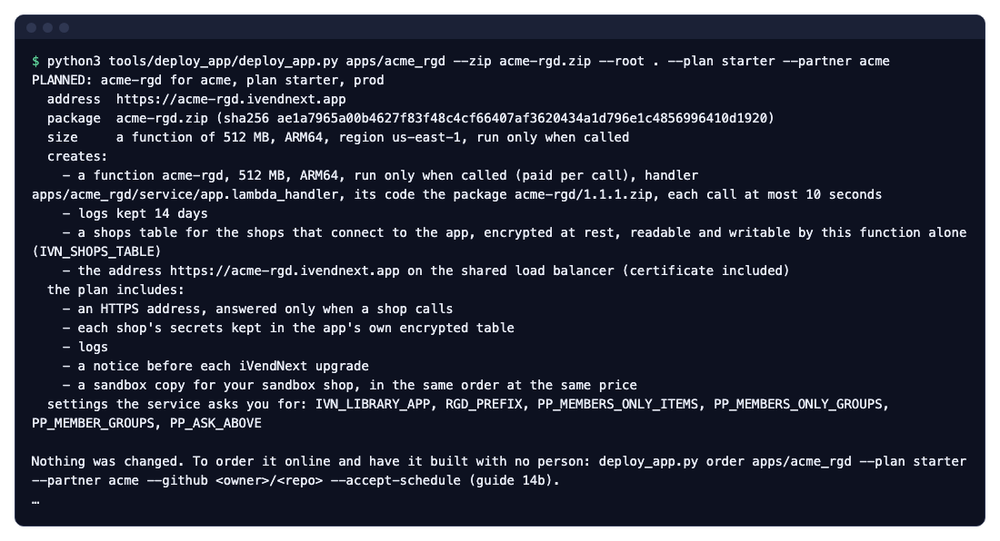
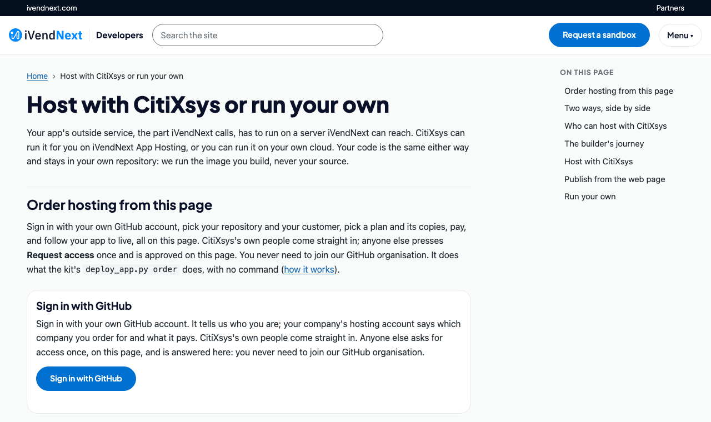

# 1b. One app from your laptop to the till — sample S18, step by step

One real app followed from a clone on your laptop to a cashier's press at the till: run its tests, read its manifest, publish it, order its hosting as a function (not a Docker container), install it on a retail chain's site with consent, connect, press Pay, then update and remove it. Every step has its exact command, and the laptop, web and till steps have a picture of what you see.

**For:** a developer who learns by example, after [1a. How it all works](01a_how_it_all_works.md).

**The app:** sample [S18, the members-only rule guard](../samples/s18_rule_guard/README.md). When the cashier presses **Pay**, the chain's iVendNext asks the app's service about the sale. The service refuses a sale that holds a members-only item for a customer who is not a member, in its own words, and asks for ID on a sale at or above the chain's limit. Each chain keeps its own rule in its own records. The App library lists it as *Members-only check before payment* (`ivendnext_rgd`), hosted by CitiXsys at `https://rule-guard.ivendnext.app` as a function.

| Step | Who | Where |
|---|---|---|
| 1. Clone it and run its tests | you | your laptop |
| 2. Its manifest, under your own name | you | your laptop |
| 3. Publish it | you | the App library |
| 4. Its hosting order | you | App Hosting (only if CitiXsys runs your service) |
| 5. Install, with consent | the chain's administrator | the chain's iVendNext Desk |
| 6. The site connects | the chain's site, by itself | your service |
| 7. The cashier presses Pay | the cashier | the till |
| 8. An update, then a removal | you, then the administrator | the App library, then Desk |

## 1. Clone it and run its tests

You need git and Python 3; nothing else is installed.

```bash
git clone https://github.com/ivendnext-developers/partner-kit.git
cd partner-kit
python3 -m unittest discover -s samples/s18_rule_guard/tests -p 'test_*.py'
python3 samples/s18_rule_guard/tests/canaries.py
```

The tests run the rule, the service over the wire with signed calls, every answer against the published contract, and **two retailers at once, each judged by its own records**. No iVendNext site is needed. The canaries break the code on purpose and show each test catching it.



To run the service itself on your laptop, as one retailer: `python3 service/app.py service/.env.local` from the sample's folder, with the settings its README lists.

## 2. Its manifest, under your own name

`samples/s18_rule_guard/manifest.json` is everything the app adds to a chain's iVendNext. It is data, not code:

- **one record type,** *PP RGD Rule*, where each chain writes its own rule (a members-only item or item group, a member customer group, an ID limit);
- **one check at Pay** (`extension_subscriptions`, extension point `check`): the address the till calls, `timeout_seconds` 3, and `down_answer` `refuse`, so an outage never sells a members-only item;
- **one event feed** (`registered_applications`), so the install makes the app's own user, which reads the rule records;
- `allowed_urls`: the only address the app may send data to.

Make it yours in one command: it copies the sample under your company's prefix, renames every name it creates on a chain's site, checks the manifest and runs the copied tests.

```bash
python3 tools/manifest/start.py s18_rule_guard --prefix "ACME RGD" --test
```



Then write your own title, publisher and description, and put your service's address in the manifest (`https://acme-rgd.ivendnext.app/rgd/check` on App Hosting).

## 3. Publish it

Publishing sends the App library your manifest and your app's card, signed with your company's key. **It never sends your code.** Once, register your company and its key ([Publish your app](../site/pages/publish.md)); then, for each version:

```bash
python3 tools/publish/publish.py publish <your project> --partner acme
```

The same publish runs with no command on the App library's Publish page: give it your project's `library/` files, sign in the browser, and publish.



Your app lands on your preview shelf at once, and on a customer's *Made for you* shelf when your publish names that customer. The public list, for every retailer, follows our approval of its first version.

## 4. Its hosting order

Only if CitiXsys runs your service. S18 only answers a press, so it runs as a **function**: it runs only when a till calls it, and an app that runs as a function and is listed in the App library carries no hosting charge. Its `app.json` says so (`"runs": "function"`, `"shops": true`). First check, on your laptop, what the order would make. It changes nothing:

```bash
python3 tools/deploy_app/deploy_app.py apps/acme_rgd --zip acme-rgd.zip --root . --plan starter --partner acme
```



What you send is the **function's package** (`acme-rgd.zip`, the files `app.json` lists), never your repository. Then order it with `deploy_app.py order …`, or on the developer site's hosting page, signed in with your own GitHub account:



Once it is live, each push to your repository's branch puts the new version live through the same checks ([chapter 14b](14b_deploying_your_app.md#updates-from-your-github)).

## 5. The retailer installs it, with consent

No command: this step is the administrator's, in Desk. The chain's administrator opens the App library in Desk, finds the app on the public list or on the chain's *Made for you* shelf, and presses **Install**. Before anything is installed, iVendNext shows *What it will do*, written from your manifest: the record type and role it adds, the event feed, the check at Pay and the address it calls. The administrator ticks the consent and installs.


The install makes the record type *ACME RGD Rule*, the role *ACME RGD Integration*, the event feed, and your app's own user, `acme_rgd@integration.invalid`, with that role alone. The check arrives **switched off**. The administrator then:

1. writes the chain's rule in *ACME RGD Rule* records;
2. opens the check, reads exactly which details of the sale it is sent, ticks its consent, chooses the stores it answers and switches it on.


## 6. The site connects

Right after the install, the chain's site connects to your hosted service by itself, with one call:

```text
POST https://acme-rgd.ivendnext.app/ivendnext/connect
X-iVendNext-Site: chain-a.ivendnext.com
{"key": "IVN1-…", "site": "chain-a.ivendnext.com", "secrets": {"acme_rgd:sub:guard": "…", "user:acme_rgd@integration.invalid": "…"}}
```

Your service (the template's handshake, already in S18) checks that the key was signed by the App library for your app and for that site, and keeps the chain in its shops table: its address, its secrets, its key's id. From now on, every call from that chain names its site and is signed with that chain's secret. A second chain that installs the app makes a second row, with its own secrets.


For a service on your own server, the site does not connect by itself: the chain's administrator gives you the check's secret and *Generate Keys* on your app's user, by hand ([chapter 14b](14b_deploying_your_app.md#one-app-many-retailers)).

## 7. The cashier presses Pay, and the call goes out and comes back

No command: the cashier presses a button.

1. The cashier rings a sale and presses **Pay**.
2. The chain's iVendNext prices the basket and sends it, signed with that chain's secret, to `https://acme-rgd.ivendnext.app/rgd/check`.
3. Your service checks the signature, reads that chain's rule records through the API with your app's user's key (kept a minute), and decides.
4. It answers within 3 seconds: allow, refuse in its own words, or ask a yes/no question.
5. The till shows the answer. A refused sale books nothing.


**If your service is down or late,** the till applies the check's down answer, `refuse`: *"Member rule guard did not answer. This sale can't be paid until it does. Try again, or get a manager."* **Offline,** the till cannot ask, and applies the same answer.

## 8. An update, then a removal

**An update.** Raise the version in `manifest.json` and `app.json`, publish again (`python3 tools/publish/publish.py publish <your project> --partner acme`, step 3) and push the new code to the branch your hosting order names (step 4). Each chain's administrator sees the higher version, reads what changes, consents again and updates in place. An update adds and changes, and removes nothing while it runs; a service the update changes arrives switched off again, for its consent. To go back, release the earlier code under a new, higher version.


**A removal.** No command: the administrator uninstalls the app in Desk. The site first saves the app's records to a private file, then removes the record type, field, role, check, event feed and your app's user with its key (an app with a sale detail that booked sales use, or a workflow state another workflow uses, keeps that one, switched off). The chain's own records stay. The site tells your service goodbye (`POST /ivendnext/disconnect`), and your service forgets that chain and its secrets.


## Technical notes

- **The tests and canaries:** `samples/s18_rule_guard/tests/` (61 tests, one of them skipped on a laptop: it reads a test-bench run's recorded calls; 15 canaries, each RED on its planted fault). The two-retailer test is `test_shop_rules.py`.
- **The terminal pictures** of steps 1, 2 and 4 are real runs of the commands shown, on a fresh clone of the kit at this chapter's commit; step 4's output is cut after the plan's summary (the rest is the block CitiXsys adds for an app put live by hand).
- **The manifest:** `samples/s18_rule_guard/manifest.json`; its fields: [chapter 7](07_manifests.md). Making it yours: `tools/manifest/start.py` ([Make one of our apps your own](../recipes/make_it_your_own.md)).
- **Publishing:** `tools/publish/` and [Publish your app](../site/pages/publish.md).
- **The function:** `samples/s18_rule_guard/app.json` (`"runs": "function"`, `"handler"`, `"package"`); what App Hosting runs and the package's `--root`: [chapter 14b](14b_deploying_your_app.md#a-function-or-a-container).
- **The connect:** `tools/app_template/service/shops.py`; the call table: [chapter 14b](14b_deploying_your_app.md#one-app-many-retailers). The secrets' names are the install's own: a check's `<app>:sub:<key>`, a user's `user:<email>`.
- **The app's own user:** made by the install of a manifest with an event feed, from POS version 2.1.0.667 ([chapter 5](05_outside_apps_and_event_feed.md), step 5).
- **Steps 5, 6 and 8** happen in the chain's Desk; their words here follow [chapter 14a](14a_deploying_to_a_chain.md) and S18's README.
- **The till pictures** (step 7): S18's own, taken on the programme's test site on the counter frame; the sample's README says how.
- **Update and removal:** [chapter 14a](14a_deploying_to_a_chain.md).

**Next:** [1c. How the data travels](01c_how_the_data_travels.md): two links to outside systems, a chain's own loyalty system and a telecom company, followed hop by hop with two chains at once. Then *Get started* gives you your own sandbox site to do all of this on: [Get started in five steps](../site/pages/start.md).
