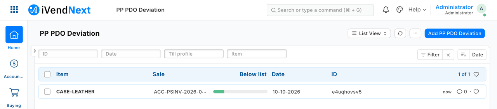

# 5. Outside apps and the event feed


*A cashier sells a covered phone; seconds later a partner's own warranty service, running on its own server, has written a comment on the sale in Desk (sample S1).*

Your service runs on your own server, in any language. It reads a customer's iVendNext, writes to it and reacts to what happens there. This chapter is for a developer building that kind of connected app.

**Reference implementation:** [Building a connected app](../recipes/connected_app.md) · [Making the integration user](../recipes/integration_user.md) · [Reading iVendNext's events reliably](../recipes/event_feed.md) with the client [`../tools/feed_client/`](../tools/feed_client/) · [Receiving webhooks safely](../recipes/webhook_receiver.md) (the nudge only) · [A price checker on the shop floor](../recipes/price_checker.md) · [A gift card for a big spend](../recipes/gift_card_on_spend.md) · the samples [`../samples/s1_warranty/service/`](../samples/s1_warranty/service/) and [`../samples/s2_bins/service/`](../samples/s2_bins/service/). Every call the samples make is in [`../api/collection/`](../api/collection/).

## When to use it

Rung 2 of the ladder (chapter 3), after configuration (chapter 4): anything that can happen before a sale (prepare data) or after it (react to a sale, sync a system, set a status). If the cashier must see an answer **during** the sale, add a till key (chapter 6). If you need your own record types inside the shop, ship them in a manifest (chapter 7).

## Steps

1. **Get a key.** The shop makes one integration user for your app, holding one narrow role (chapter 2; the recipe lists the role the bin sample needs). One app, one user. ⚠ **On a product before 2026-09-30 that key can do what an administrator can:** there every desk user also holds the Workspace Manager role, and with it a key could put content on a shared workspace that runs in the browser of whoever opens it. Since 2026-09-30 only a System Manager gets that role, and the manifest installer refuses an integration user that holds it (chapter 7). Keep the key in a secret store, never in code or chat, and rotate it at any doubt: *Generate Keys* again, and the old secret is refused at once (`401`).
2. **Make the first calls from the collection, not from a library.** Every call is a plain HTTP file; `run.sh` sends them all with `curl` and `jq`:

   ```bash
   BASE=http://<shop>:<port> KEY=<api key> SECRET=<api secret> bash api/collection/run.sh
   ```

3. **Read and write records.** List with `fields` and `filters`; a list returns only `name` unless you ask for more. A list can also bring back every line of the records it lists, or totals already grouped, in one call: never read records one by one for a report (`recipes/bulk_reads.md`). `PUT` changes only the fields you send. ⚠ **A child table sent in a `PUT` replaces the record's rows**: to add one row, send the existing rows plus the new one. Read a stock balance (`Bin.actual_qty`) from the shop; never keep your own copy.
4. **Book a stock movement by asking the shop to book it.** One call creates and books it. Send `purpose` as well as `stock_entry_type`: over the API the purpose is not filled in for you.

   ```json
   POST /api/resource/Stock Entry
   {"stock_entry_type": "Material Transfer", "purpose": "Material Transfer", "company": "<company>", "docstatus": 1,
    "items": [{"item_code": "<item>", "qty": 4, "s_warehouse": "<back room>", "t_warehouse": "<till's warehouse>"}]}
   ```

   Book the movement first, then update your own records with its name as the reason. ⚠ A booking call that times out may still have booked: look for it (a reference in its remarks, say) before you send it again.
5. **Learn what happened from the event feed, not from webhooks.** The shop's administrator registers your application: its name, the user your service reads as, and the record types you follow. From then on every change to a followed record adds one row to **your** queue, after the change commits. Your own writes are not sent back to you. Nothing is pushed, so nothing is lost while you are down: the rows wait. Your loop, in this order:
   - ask for the oldest events not yet done;
   - for each, skip it if you have seen it; otherwise, in **one transaction of your own**, act on it and record its id in your seen-set;
   - mark the page done.

   An event fetched and not marked done comes back. So a crash between acting and marking does no harm: the seen-set skips it. A write you make **somewhere else** (back into the shop, or to a third system) cannot share your transaction. Make that write idempotent too: key it on the record the event names and treat "already exists" as done.

   

   *After a sale, a partner's service read the sale's event, read the sale over the API, and recorded the one line sold more than 10% below list (sample S3, which read the feed through our test bench's stand-in for the door; the event feed extension point itself has since been read on a test shop, see below).*

6. **Know what an event is.** It names *which* record changed and how (`sale.booked`, `return.booked`, `customer.created`, and so on, a published table of labels). It carries **no content**, so read the record over the API when you need it.
   - Expect **several events per sale** (six measured for one till sale): act on the label you need and mark the rest done.
   - Events can **lag** the sale (58 seconds measured with the shop's one background worker busy).
   - A sale rung **offline** produces its events when the till syncs, possibly hours later.
   - The day's close merges till sales into a back-office invoice with `is_consolidated = 1`: skip it if you follow both, or you count every sale twice.
   - **Mark every row done.** The shop clears only done rows (after 30 days), so an application that never marks done grows its queue for ever.
   - An application you stop using keeps its rows waiting: disable or delete its registration.
7. **Run the reference client** instead of writing the loop. It is one file, Python standard library only. Copy it and replace `sample_handler` with your own, which receives the event and an open transaction of yours. Today, run it on the shop's own sync log (`--transport engine`):

   ```bash
   FEED_KEY=… FEED_SECRET=… python3 tools/feed_client/feed_client.py run --base https://shop.example --transport engine --app "<your registered application>" --state state/feed.sqlite --watch 30
   ```

   The key comes from the environment, never the command line, and the client follows no redirect. Two warnings for this transport:
   - ⚠ **It cannot be scoped to one application.** Its key needs read and write on the shop's *Integration Sync Log*, so one application's key can read another's rows and mark them done. The client filters to its own rows, but that is a convention, not a control: use it where your service is the shop's one consumer.
   - **Give the key read on the whole record type you follow.** On this transport a POS Invoice the key cannot read is labelled `pos_invoice.deleted`, not `sale.booked`, and a handler that acts only on `sale.booked` would skip it.

   The scoped feed (`--transport door`, the client's default) is the event feed extension point (chapter 9); the kit's client has not been run against it: until it has, do not rely on it.
8. **Reconcile every night, and after any long outage.** The reconciliation lists the records created in a window that your service never saw an event for. If your working folder was lost at a restart, the records it handled before are listed under `unknown`, not `missing`: look at them in the shop (the recipe, §5, says why). It keeps no other state:

   ```bash
   FEED_KEY=… FEED_SECRET=… python3 tools/feed_client/feed_client.py reconcile --base https://shop.example --transport engine --app "<your registered application>" --state state/feed.sqlite --since "2026-10-04 00:00:00" --doctype "POS Invoice"
   ```

   Run it after a pass that ended with nothing left in your queue. Act on what it names through a handler keyed on the **record**, so acting twice changes nothing.
9. **A webhook is only a doorbell** (optional). If you want to pull *now* rather than on your next poll, the shop may send a thin signed nudge. Check the signature over the **raw body**, before parsing, comparing in constant time. Refuse a bad one with `401`. Keep a seen-set so a replayed call does nothing. Answer quickly. Never treat the nudge as the event: it can be lost, delayed or repeated.
10. **Handle errors by their status:**
    - `401`: a wrong or rotated key (alert, do not loop);
    - `403`: outside your role;
    - `404`: absent;
    - `417`: the shop refused the record (read the message, do not retry unchanged);
    - a timeout or `5xx`: retry later, idempotently.

The same shape (a cursor, a map of record ids, an idempotency key, a reconciliation that reports and never fixes) carries the large-scale recipes in chapter 10.

## What is refused, and why

- **Code inside the shop.** Your server runs your logic; server scripts are switched off for partners. Logic during a sale means a till key answered by your server (chapter 6) or a sandboxed function (chapter 8).
- **Changing money.** Prices, discounts, taxes and totals come from the shop's own data; a connected app never writes them onto a sale.
- **Your own copy of stock.** Your records may say *where* stock sits, never *how much* the shop owns.
- **A shared key, or an API-only user.** Every app has its own desk user, which is how it is meant to be counted and switched off. There is no sign-in grant between servers and no scoped key today: the role is the boundary, so keep it narrow.

## When your service is down, and when the till is offline

- **Your service is down:** the shop keeps selling and your events wait in your queue. Restart and the loop catches up, then run the reconciliation. A webhook is tried three times within a few seconds and then dropped, which is why it is only a nudge.
- **The shop is busy or down:** your calls time out; retry later with the same idempotency rules.
- **The till is offline:** its sales reach the shop when the till syncs, and their events appear then. Do not count on webhooks for till sales: they have not been tested.

## Technical notes

### What the kit has proven

- **The feed:** with the client stopped and sales and a customer booked, then restarted, every event was collected once and none from another application, on both transports (on the engine transport only because the client filters to its own rows). A crash after three handled events and before marking done: the restart skipped exactly those three. With one sale's event deleted on purpose, the reconciliation named exactly that sale.
- **A connected service:** the bin service's own tests passed (putaway, pick, a sale, a forged webhook refused, a replay ignored, a fresh event for a handled sale changing nothing, three failed deliveries recovered once by the reconciliation), and the collection ran green end to end.
- **The key:** a call inside the role answers `200`, one outside it `403`, none `403`; rotating the key refuses the old secret at once.
- **The engine feed's scope:** measured on the test shop, one application's key read 24 of another's rows and marked one done.
- **Workspace Manager (step 1):** on the earlier bench pin (`ivendnext_pos` `457ba607d`, without that commit; 2026-10-03) every desk user held it, and a key carrying it planted content that ran in the administrator's browser (measured on 2026-10-03). Since engine commit `d52056c` (2026-09-30) a desk user gets it only as a System Manager (`ivendnext_pos/doc_events/user.py`, read at the bench's engine pin `f7afcfb61`); the installer's refusal of an integration user holding it was proven on the bench with the older engine simulated (2026-10-07). Not measured: whether a key without that role can reach an administrator's browser another way.

### What it has not

- **The scoped feed** (`--transport door`): the client's calls to the door are POST. The same POST call was read on a test shop on 2026-10-09 (sample S22). The client's crash-and-restart exit check was run against the programme's stand-in for the door, not the event feed extension point itself.
- **The nudge** (a webhook that tells you to pull) was not run; only its signature check was.
- **Till-sale webhooks** were not exercised, and **disabling** an app's user to switch it off was not run (rotation was).
- **Volume:** a few sales per run. Chapter 10's recipes ran larger, still sequentially. Nothing is measured near a large retailer's day.
- **The licence count:** whether the shop's user count counts an enabled app user is not confirmed.
- **The sample bin service's `/pick`** is not retry-safe when its booking call times out; check first, as step 4 says.

### The pictures

- **S1 (under the title):** walked in a real browser on our test bench on 2026-10-10, iVendNext POS app at `87812e141`; the till frame is `/pos?frame=terminal`, then Desk. S1's connected leg is nudged by a signed webhook, with a reconciliation pull; it does not read the event feed.
- **S3 (step 5):** walked on our test bench on 2026-10-10, iVendNext POS app at `87812e141`. S3 read the feed through the programme's stand-in for the event feed extension point, not the live door; S3 itself was not run again on the live door.

## See also

[2. Getting started](02_getting_started.md) · [3. The ladder and the four rules](03_ladder_and_never_list.md) · [6. Till keys](06_till_keys.md) · [7. Manifests](07_manifests.md) · [10. Integrations](10_integrations.md) · [16. Possible, not possible, limits](16_possible_not_possible.md)
