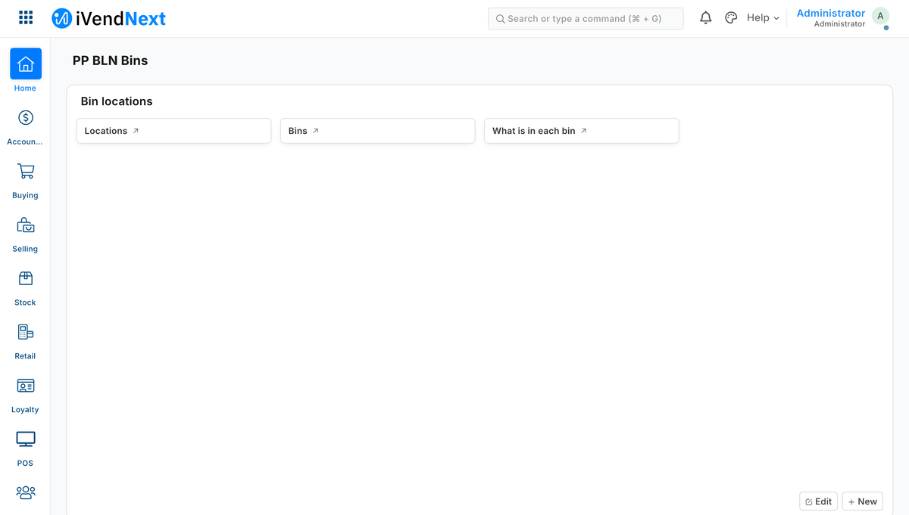

# 7. Manifests — your own data, no code



*What a manifest installs, as staff see it in Desk: a workspace, the bins on their aisles, and what is in each bin (sample S2). The workspace is never in the Desk's menu as this picture shows it: the retailer's administrator opens it from the App library, and your app's users find it with the search bar (below, *Your Desk page*).*

A manifest is a file of data, not code. It adds your own record types, fields, screens, approvals or print formats to a customer's iVendNext, and it may do anything the customer's administrator can do in Desk, on the customer's own record types too. This chapter is for a developer whose app needs its own data inside the retailer's iVendNext.

> **Package or module?** A **package** is your whole app: its records, fields, print formats, buttons, services and label layouts, sent as one manifest. The retailer's administrator presses **Install** in the App library, reads what it will change, ticks **I agree** and presses **Install**; later the retailer can update it or remove it, and *Connected apps* lists every one. A **module** is one small program that does one job at an extension point, such as adjusting a price or checking a sale before payment. **Two extension points take a module today: the check before payment and pricing.** Your package can carry it (`extension_modules`, below), or the retailer's administrator adds your file in Desk, with a certificate our review team signs, and can withdraw it. **In short:** a package is the app, and a module is one program that does one job.
>
> *Technical note:* a package installs from the **App library**, or by hand from the **Retail Extension Package** screen in Desk; a module is a **Retail Extension Module** record that the retailer's administrator adds in Desk, or your package installs, at an extension point that takes one ([the Wasm kit](../tools/wasm_kit/README.md)).

**Reference implementation:** [Shipping your own data in a manifest](../recipes/manifest.md) · [Approvals by workflow](../recipes/approvals.md) · the checker [`../tools/manifest/`](../tools/manifest/) · [`../samples/s11_approvals/manifest.json`](../samples/s11_approvals/manifest.json) (one workflow on the customer's Purchase Order) · [`../samples/s2_bins/manifest.json`](../samples/s2_bins/manifest.json) (five record types, a field on Item, a print format, a workspace, webhooks) · [`../samples/s4_receipt_pack/`](../samples/s4_receipt_pack/) (a print format alone).

## When to use it

Rung 4 of the ladder (chapter 3): configuration cannot hold your data and your app needs it **inside** the retailer's iVendNext, so staff see it in Desk, a till key reads it or a webhook reports on it. A manifest is data, and none of your code runs from it (a print format in it is a template the server runs when it prints, able to read, change and send the retailer's data, which is why the retailer's summary lists each one); your logic stays on your server ([outside apps and the event feed](../recipes/event_feed.md)) or in a till key ([till keys](../contracts/pages/remote_till_key.md)). Every record type it declares gets the native Desk screens ([what you can use](../site/pages/map.md)).

## Steps

1. **Choose your prefix:** one to three upper-case words (`ACME BLN`) and the matching app name (`acme_bln`); `ivn new acme_bln --from s2` sets both. **Its first word is your company's own first word**, which we give your company once: the App library accepts only your apps under it ([Publish your app](../site/pages/publish.md)). The samples' `PP …` prefixes are placeholders. A name needs no prefix: only a field you add to one of the retailer's own record types starts with the lower-case form (`acme_bln_default_bin`), because iVendNext could read another name as one of its own flags. **A prefix whose first word is one the system reads is refused** (`IS`, `IGNORE`, `FOR`, `HAS`, `SET`, `BASE`, `FREE`, `PRICE`, `POST`, `NOT` and twelve more, listed on the [save rules page](../contracts/pages/save_rules.md)): the system acts on fields whose names start that way, so never ask for one of those words as your company's.
2. **Write `manifest.json`.** Set `"manifest_version": 2`. The kinds it may carry:
   - **record data:** record types (child tables allowed), fields (on your record types, and on any of the retailer's own record types and their child tables: a purchase order's lines, a stock transfer's rows, the till close; a field may name the roles that read it and the roles that change it, below), display changes, print formats (which may read other records through `ivn_rows` and `ivn_value`, below), notifications, workspaces, sale details, webhooks, a **multi-select field** and a **settings record** of your own (below), and the **register books** of a regulated-stock register (below);
     - **Room on a shared record.** A record's row has a fixed amount of room, shared by every app on the site and the retailer's own fields, and the sale is the fullest record: on a busy site it has room for only a few more short text fields. A short text field (Data, Link, Select) takes 562 bytes of that room; `Small Text` takes 10. So, before you add a field to the sale, try in this order: **your own record type** (a record linked to the sale has room of its own), **a sale detail** (`sale_attributes`: a short value, up to 140 characters, captured on the sale), and only then **a field on the sale**, declared `Small Text` unless something lists, filters or searches by it. The install measures each record your manifest adds fields to, and each record type it brings, before it makes anything, and refuses fields that would not fit in one line: the room left, what your fields need, and these homes. A rarer database error stops part-way through the install and takes back most of what it made: the field whose column failed can be left behind, and it blocks a second try until the retailer's administrator deletes it (Desk, *Custom Field* list; *Finish* on the package does not remove it).
   - **screens:** Report Builder reports (with columns from one table of the record), number cards, charts, dashboards, list settings, Connections links (your records listed under an iVendNext record), and **list marks** (a coloured label on a row of a Desk list, below);
   - **approvals and numbering:** workflows, on any record type but the till's own records (below, *Worked example*), and numbering rules, on anything but the sale's own records;
   - **wiring:** your event feed: **one feed per app** (`registered_applications`, with every record type your app follows in its `events`). The install also makes **your app's own user**, `<app>@integration.invalid`, and names it on the feed: it holds one role, `<PREFIX> Integration`, works through the API only and is never a person's ([the event feed recipe](../recipes/event_feed.md) says how its key reaches you, and the licence bound). Your remote till key goes on every store's till; a store moves or hides it in the Designer;
   - **extension points** (below): your services' subscriptions (a Desk action, a page, a check before payment, a capture, a document check, fulfil at sale, a payer), a certified module, Desk actions, save rules, a fiscal reader, scan sources and field rules.

   **Everything is on from the moment of install, under the one consent, for every store.** The exceptions are named where they apply: a save rule limited to a role stays off until the customer names the role, a manifest's `"enabled": 0` keeps a save rule off, a payer stays off until the customer names its clearing mode, and a fiscal reader stays off until the customer has set it up. What the customer does after the install is only what is theirs to decide: give staff the roles, fill a setting only they know.

   **Label layouts** may be carried too: the label the till prints for an item or a basket line, as HTML or as Zebra printer commands, with placeholders from a closed list ([the label layout page](../contracts/pages/label_layout.md)). A layout may also name up to three of the item's own fields, `{item.<fieldname>}` (the field name in lower case; each a Data, Select, Int or Check field open to every role), and one line detail, `{detail.<attribute>}`. A retailer's own receipt lines are not a manifest kind: they are two text fields the retailer fills in on its register (*Receipt Header* and *Receipt Footer*; [the receipt page](../contracts/pages/receipt.md)).
3. **Say who may do what.** A permission row names a role and its rights (`read, write, create, delete, report, export, share, print, email`); a right the row leaves out is off. Every record type your app makes also gives System Manager every right, unless your manifest gives System Manager its own row at level 0, so the retailer's administrator can use the app at once. A role the site lacks is made at install, as named, with no one in it, and the retailer gives it to people. A role named with your prefix is your app's own and goes when no installed app uses it; any other name (*PO Approver*) is the retailer's from then on and stays at uninstall. `Guest` and `All` are refused: they open your records to people outside the retailer's staff.
4. **Check it yourself, before anyone installs it:**

   ```bash
   ivn check
   ```

   It runs the same checker your customer's install runs, and your app's own tests, and gives one line. Every refusal names the element and the reason, for example *"REFUSED webhooks[0] (ACME BLN Hook): a webhook calls an address the manifest lists in allowed_urls: the consent shows the shop each one"*. It also warns of three things the install stops on: a feed description over 140 characters, a Dynamic Link that does not name a Link field to DocType or a Select, and a record type's name over 61 characters.
5. **Try it, then the customer installs it.** `ivn try` installs it on your own sandbox: no key, no plan, no card and no questions. `ivn publish --to <site>` puts it on the customer's shelf and prints the message to send their administrator; `ivn publish --public` lists it for every retailer ([Publish your app](../site/pages/publish.md)). The customer's administrator opens **App library**, presses **Install**, reads a summary our code writes from the manifest itself (every record type, field and role, every outside address, everything that runs from the moment of install, and each print format as a template that runs on the server when printed, able to read, change and send the retailer's data), ticks **I agree** and presses **Install**. From a private shelf they first press **Open your shelf** and paste the key you sent. The **Retail Extension Package** screen (paste, **Check**, **Consent and install**) does the same by hand. The site checks the manifest again, refuses names another app holds, and records each element as it creates it, in a background job. If anything fails half-way it removes what it made and shows **Failed** with the reason. An app CitiXsys hosts receives its secrets when the site connects to it; for an app you host, each secret (a webhook's, a service's) is shown once to whoever installed and stays readable on its own record.

   **To update,** bring a higher `version`: each `ivn try` is a new version, and the screen first shows what changes from the installed version. An update adds and changes in place and removes nothing. It keeps each rule's switch, and a service the customer stopped stays stopped. A dropped or renamed record type or field is refused ([the recipe](../recipes/manifest.md), step 6). It writes a changed **service** whole, so a property the new version leaves out (its settings, time to answer, sequence, page roles) is cleared or takes the product's default. The full list is [the install page](../contracts/pages/package_install.md), §4.
6. **Use your records over the record API,** like any other type ([a connected app](../recipes/connected_app.md)).
7. **Uninstall exports first, always.** *Export and uninstall* writes every record of your types (child rows and your added field values included) to a private file on the package before it removes anything. **Uninstall leaves nothing behind:** it drops your tables and the columns your fields added (the retailer's own delete keeps them), and removes what iVendNext did to your types after install. A sale detail that booked sales already use is kept, switched off, because a booked sale keeps its detail; a reinstall switches it on again. If any element cannot be removed, the uninstall says so, and **Finish** on the package completes it. **The export holds the records with their comments and version history.** The uninstall removes those from the site along with the records, so the export is where they are kept. Attachments stay, as files no longer linked to a record.
8. **A reinstall is clean:** exactly the first install's schema, and none of the old data.
9. **Before you list it, write what a retailer reads.** A retailer decides from your app's **card**, which is `app.json`'s `card` (`title`, `summary`, `what`, `pictures`, `industries`, `price`, `guide`): `ivn publish --public` asks you once. The guide link may be any https page; your repository's README is enough. Say what leaves the retailer's iVendNext from your manifest, and never tell a retailer to create a role the install makes. [The recipe](../recipes/manifest.md) has the shape.

## The extension points' kinds

Each record goes through the product's own checks when it is installed; a refusal there comes back in the product's words, and nothing is left. The full contract of each extension point, its limits and its refusals included, is in the kit's [`contracts/`](../contracts/README.md).

- **`extension_subscriptions`** — your service for one extension point: `key` (your name for it), `point` (`desk_action`, `page`, `check`, `capture`, `doccheck`, `fulfil`, `price` for a module's service only, or `payer`), `label` (1–40 characters), `endpoint_url` (https, listed in `allowed_urls`), `timeout_seconds` (at most 10; a scan or quantity-change capture at most 3; a payer at most 5), `down_answer` (what the till does when your service is down; each extension point lists its own), and for a page its `page_…` settings and `page_roles`.
  - **A check before payment** takes one setting: `fill_attributes`, the sale details its answer may fill (1 to 10 different names, each a sale detail your manifest declares or the retailer already has; `{"fill_attributes": ["Rx Date"]}`). How a fill works: the [check page](../contracts/pages/partner_check.md), *Filling sale details*. At most three checks answer one POS Profile, and together they may take at most ten seconds. Whether a manager may approve past a check (`may_approve`), the POS Profiles it serves, and *Send each line's lot and serial number* (`check_send_lots`) are the retailer's to set, never a manifest's.
  - **A capture** names its event in `settings`: `scan` (with `item_groups`, at most 50, or an `item_field`, or both), `customer_add`, `customer_select` (an existing customer put on a sale), or `qty_change` (the quantity of a line changes; the scan's filter, `item_groups` or an `item_field`). One service answers each event. A capture may also answer `notice`: the item, customer or quantity goes on and the cashier reads your sentence (chapter 9). The till draws a button that opens a partner page beside a notice, and the retailer sets that `page` on the capture in iVendNext Desk once both are installed ([the capture page](../contracts/pages/partner_capture.md), section 3).
  - **A document check** (`doccheck`) names in `settings` the one record type it checks (`record_type`: a submitted back-office type such as Purchase Order, never a till sale), the fields sent (`send_fields`, the Desk action's grammar), `on_validate` (`true` checks a draft's save too) and `fill_fields` (at most 10 fields your answer may fill). A fill field must be one the retailer added, and a field your manifest adds counts: put it in `custom_fields` and name it here. Its down answer is `allow_and_flag`, `refuse` or `ask`. At most three services check one record type.
  - **Fulfil at sale** (`fulfil`) names in `settings` the items your service makes a code for: `item_groups` (a group and every group below it; at most 50), an `item_field` (an Item field that is set), or both. Its down answer is always `wait` (a paid sale is never undone, so the receipt waits for your code); its time to answer is 5 seconds unless raised, at most 10. The calls, the answers and your two promises are on the [fulfil page](../contracts/pages/partner_fulfil.md).
  - **A payer** (`payer`) may carry in `settings` the sale details sent as the prescription (`prescription`: up to three of `reference`, `prescriber`, `prescriber_licence`) and the role that may bill a claim back (`bill_back_role`). Its down answer is always `no_cover`. The clearing mode is the retailer's to pick, so a manifest carrying `clearing_mode` is refused, and the payer stays off until the retailer names it. The calls are on the [payer page](../contracts/pages/payer.md) and in chapter 9.
  - **A module's service** has `transport: "wasm"` and names, in `module`, the `key` of a module in the same manifest's `extension_modules`: same extension point, no address and no secret.
  - The install makes each secret, named `<app>:sub:<key>`. Its one consent is each service's, and the service serves every store; a record's **Enabled** box stays the retailer's off switch.
- **`desk_actions`** — a button on a Desk record: the record type, label, roles, when it shows (`on_draft`, `states`, `conditions`), its `inputs` and `send_fields`, and `service`: the `key` of one of your `desk_action` subscriptions in the same manifest (the installer makes the subscription first). A service the manifest does not install is refused, and so is the role `Guest` or `All`.
- **`save_rules`** — a rule checked on every save of a record type, the retailer's own (an Item, a Customer, a sale) or yours: `rule_name` and the rule's settings.
  - **The ten kinds** (`pattern`, `length`, `derived`, `unique_in_rows`, `threshold`, `required_when`, `locked_in_state`, `unique_across`, `role_for_action`, `count_per_day`), the keys each one takes, and `mode` (`refuse` or `flag`) are on the product's [save rules page](../contracts/pages/save_rules.md). Read it before you write a rule. What to know:
    - **A rule is on from the install.** A role rule (`role_for_action`) stays off until the customer names the role, because the app's roles are created empty and it would stop everyone. Add `"enabled": 0` to keep any rule off. An update keeps each rule's switch.
    - **Rules run in `sequence` order** (lowest first, then by name), each one after the one before has written its value. So a derived value can feed the next rule: months × 30 into shelf days (`scale`), the expiry date into days left (`days_until`, which reads a date), the days left over the shelf days into a percent, a threshold on the percent. Give each rule in the chain a `sequence` higher than its source's.
    - **`unique_across` and `role_for_action`.** `unique_across`: a value on no other active record of the type, within up to three `scope_fields` (a list, for example `["customer_group"]`). `role_for_action`: an `action` (`submit` or `cancel`) only a person holding one of `bypass_roles` may take, when every condition holds; its conditions read the document's header, never its rows. Both are lists in a manifest, as `bypass_roles` is. [The save-rules example](../recipes/save_rules.md) installs one of each.
    - **`count_per_day`, `derived`, `threshold` and `required_when`.** `count_per_day`: no more than `cap` (1 to 10,000) records a day per value of `scope_field` (a store, say), by the calendar day of `day_field`, counted when a save newly meets its 0 to 3 `conditions`; its conditions, and only its, may use `in` (up to 10 values separated by commas; numbers on a number field). It never sits on a sale or a day close, and should never sit on a record a sale or the day close writes (a payment, loyalty points, a coupon's count, a layaway's order, a delivery note, the day's roll-up invoice): its lock is held to each sale's commit and every till would wait. An approval a manager gives offline is not counted. `derived` has `sum_rows` and `count_rows` (`source_table` names one table of the record; the figure goes on the record's own header, a sum into a Float or Percent field) and `days_between` (two Date or Datetime fields; `creation` may be the first, on a rule without a table); each writes only a field the retailer added, named `custom_…` or with your package's prefix. `percent` and `days_between` clear their figure when a source is empty (and `percent` on a zero base). `threshold` has `judge_on_change: 1` (judged only when the record is new, submitted, or the value changed) and a limit read from a settings record: `value_from_type` and `value_from_name` (a record type your package installed, a settings record or one row of an ordinary type, or Stock, Selling or Buying Settings; a single's name is its record type), `value_field` (an Int, Float or Percent field) and `roles_field` (the one role that may pass it). A 0 or a missing record there means the rule's own `value`, so `value` stays required; whoever the retailer lets write that record tunes the limit without opening the rule. `required_when` on a table's rows may read the header: a condition on `parent.⟨field⟩` (*a transfer's rows name their request*). A derived rule that cannot be worked out flags and never refuses.
    - **Order and bounds the product states.** Give a derived rule, and a limit judged at every save, a `sequence` after the rules that write its sources (a limit judged on change runs after every derived rule anyway). Never make a figure a limit judges mandatory, and never make a batch's dates required by a save rule: a receipt makes its batch before the dates are filled, so a batch is judged at its first later save. The whole list is on the [save rules page](../contracts/pages/save_rules.md), §7.
    - **A rule may name only a field that exists when it is installed.** A workflow in the same manifest is made first, so a rule may read its `workflow_state`.
  - **Refused:** the role `Guest` or `All` in `bypass_roles`; a message carrying markup (the product shows it as the refusal).
  - On a sale the product lets a rule only **flag**, never refuse: a sale the customer paid for is never stopped.
- **`fiscal_readers`** — one per site: your outside service's result on the sale (the [fiscal reader page](../contracts/pages/fiscal_reader.md)).
  - **What you declare.** You add the result fields to POS Invoice in `custom_fields`, declared **Small Text** unless your reader searches by them (the sale has little room left, above), **No Copy**, **allow-on-submit**, at their own permission level (`permlevel`, the only place a manifest writes one; a field limited to roles gets a level the installer picks, below), and name them, with, if you have them, a QR field and a seal field, each Data, Small Text, Text or Long Text (a manifest cannot make a Code field, so an XML-form seal keeps its form only if the retailer changes that field to Code after the install), which the receipt prints for a cleared or reported sale; the map from your values to CLEARED, REPORTED or PENDING; `writer_role` and `writer_level` (that level); `writer_users` (short keys).
  - **What the installer makes,** in this order: the fields, the role, its one permission row (read and write at its level, nothing at level 0), one integration user per key, then the reader, switched off, serving every company on the site. **Nothing it makes reaches a sale yet, and no key leaves the install.**
  - **The integration user** is made at `<key>.<app>@integration.invalid`. It works through the API only (it can never sign in to Desk, and no one can give it a password or another role); a site at its user limit refuses the install, naming the licence. It holds your writer role and nothing else: if the site gives it any other role, the install is refused and removed. It has no API key until the retailer makes one.
  - **Refused:** a `writer_level` outside 1 to 9, a result field that is not in your `custom_fields` or sits at another level, a QR or seal field that does not hold text, and limiting a result field to roles. **Warned, not refused:** level 1 (the retailer's Accounts Manager already writes POS Invoice there), a field without No Copy or allow-on-submit.
  - **Before install** the retailer turns on *Clearance required* for its country. The reader serves every company on a site, so keep to one company per site.
  - **After install** the retailer:
    1. gives the role read, write and submit at level 0 (your service reads and saves a submitted sale; with them it can change any level-0 field a submitted sale allows, and submit a draft);
    2. generates the integration user's API key (User → Generate Keys) and hands it to you, as for any connected app ([the integration user recipe](../recipes/integration_user.md));
    3. switches the reader on.
  - **At uninstall** the role goes, and with it every grant naming it: the retailer's own level-0 row for it on POS Invoice, and the role on any user or role profile it was given to. The product checks the writer rule then, and on every read: fields above level 0, No Copy, no other role writing their level, the role held by your users only. The installer reports whether it holds.
- **`scan_sources`** — a table of the retailer's own unit codes that the till's scan reads when it finds nothing else. You name the table (`record_type`, your own record type or the retailer's), its code field (`barcode_field`, unique, so one code names one unit), the field linking to Item (`item_from`), optionally the fields for batch, serial, status and warehouse, the statuses a unit can be sold in (`available_values`), and `capture_as` (a sale detail the unit's code then rides on, which needs a status field so a returned unit can be sold again). Nothing leaves the retailer's iVendNext ([the scan source page](../contracts/pages/scan_source.md)).
- **`field_rules`** — rows on a till theme the retailer already has (`theme`, the name of a POS Studio theme): `surface` (the till screen), `field`, `action` (hide, relabel, require or show), and for relabel and show a `label` of at most 40 characters, with an optional `language`. What each screen and field takes is on the [*Field rules* page](../contracts/pages/fields.md).
  - **`show` on `customer_create`** asks for one of the retailer's own Customer fields (an ID number, a date of birth) on the new-customer sheet and the till's customer edit, at most three per theme. To make one required, add a save rule (`required_when`). The field rules page says which field types the till asks for (§7e).
  - **A field rule has no switch.** A rule that requires a field is enforced by the server at once; hide, relabel and show reach every till on that theme at its next start. Plan it as a change to the theme. A theme that came with the till takes none: name one the retailer saved as its own.
  - **To undo one,** the retailer removes the row from the theme's Fields tab. The theme must exist before install.
- **`list_marks`** (manifest version 2) — a coloured label on a row of a retailer's Desk list, shown when the row's values say so (*On promotion* in green on the product list): `record_type`, 1 to 3 `conditions` (`field`, `operator`, `value`; the operators `=`, `!=`, `>`, `>=`, `<`, `<=`, `is set`, `is not set`, a comparison reading numbers only), `label` (1 to 24 characters, plain text, no space before or after), `colour` (`green`, `blue`, `orange`, `red`, `gray` or `purple`) and `sequence` (when two marks match, the lower shows). It is display only: a mark saves or refuses nothing, and no script of yours runs in Desk. A user who may not read every field a mark reads never receives it, and the report view shows no label (the [list mark page](../contracts/pages/list_mark.md)).
- **`extension_modules`** (manifest version 2) — a module our certify service signed, for the check before payment or pricing: `key` (lower-case letters, digits and underscores; your service names the module by it), `point`, `version` (a whole number from 1), `metered: true`, `sha256` and `certificate` (from the module's certificate file) and `wasm` (the module's bytes in base64, at most 256 KB). Its service is an `extension_subscriptions` entry with `transport: "wasm"` that names the key (above); pricing takes a module only. One module per partner and extension point in a manifest. **A version is used once** on a site: installing the app again, or shipping a fix, needs a higher module version. **Size:** the install screen takes a module up to 256 KB, but the App library serves a manifest of at most 256 KB, so a library app's module stays near 190 KB. Only the service has a switch; the module itself has none.
  - **Refused:** `max_discount_percent` on its service: a pricing service installs at 0, and the retailer raises it. At install the retailer's iVendNext refuses a module our certify service did not sign, and one iVendNext has recalled.
  - Withdrawing it is the retailer's, as for a module added in Desk ([the Wasm kit](../tools/wasm_kit/README.md)).
- **Export:** the uninstall's export also holds these records **as the retailer left them**, never a secret. A reinstall gives back your manifest's own copy.

## Reports, reminders, settings records and multi-select fields

- **A report's columns from one table of the record.** A column or a filter may name `table.field` (`items.qty` on a stock count lists one line per item row, with the count's own columns repeated on each). Name one table per report (two multiply each other's rows); `order_by` is one field of the record itself, with `asc` or `desc`. With a totals row, leave out a number column of the record itself (it would be added once per line). The totals row adds the lines on screen and number fields only, so a read-only figure such as a count line's quantity difference stays blank there. A filter on the table lists a record once per matching row and leaves out a record with no rows. A report, a number card or a chart may name a field the same manifest adds: the install makes your fields first. A branch user sees every line of a record they may open, as its form shows them; a row field above their level is left out. In a report e-mailed on a schedule, a record column and a row column of the same name overwrite each other: give the report one of them. Desk opens a report sorted by the record type's default, not by `order_by`.
- **A notification.** It may use any event and any recipient by role or by a field of the record, on any record type: *mail the buyer when a Purchase Order is submitted, with its print attached*. On **the till's own records** it is only **Days Before** or **Days After** a date (`days_in_advance`, `date_changed` a Date or Datetime field), because any other event runs inside the till's save. By e-mail or the bell, to the retailer's own people, never to an address the manifest names. A `condition` compares the record's own fields with plain values, and the subject and message call nothing: `{{ doc.⟨field⟩ }}`. **What iVendNext accepts for a date reminder, as for one set by hand in Desk:** no cap (one message per record on the day); every holder of the role, in every store, receives every record; a template error skips one message, and an error outside it (a record deleted mid-run, a date field removed later) stops that day's run for every date notification on the site after it, the retailer's own included. A placeholder shows its field to every holder of the role, even a field at a level the role cannot see in Desk.
- **A notification's own print.** A notification may attach a print of its record, on any record type: the record type's default print, or a print format named in `print_format` (`attach_print: 1`). The attached print is rendered with no viewer's rights and mailed to the retailer's own people, so show the record's own fields (`ivn_rows` and `ivn_value` read nothing in a mail). Keep **Print Settings > Allow Print for Draft** on (it is on by default): with it off, a draft's mail is dropped.
- **A multi-select field** (`Table MultiSelect`, *Brands* on Supplier): it points at one of your own child record types, which must have a Link field **shown in the list** (`"in_list_view": 1`), or Desk drops the rows at the save. A plain table loses its Desk rows the same way unless its child shows some field in the list.
- **A settings record** (`"issingle": 1`): one record, no list, as every settings screen of the product. Name it only where a record is read by its name: a property setter, a workspace shortcut that opens its form, a save rule's `value_from_type` and `value_from_name`. A list, a report or a date notification on it reads a table it does not have. An update may not make a record type a settings record or stop it being one: ship a new one under a new name. A service reads it at `/api/resource/⟨type⟩/⟨type⟩`.
- **Uninstall** also exports every row of your child record types wherever they hang (a multi-select on a large catalogue makes a large file), and a settings record as its one record.

## Register books, limited fields and your Desk page

The full rules are on the product's pages in [`contracts/`](../contracts/README.md).

- **Register books** (`register_books`, manifest version 2) — the books of a regulated-stock register (a pharmacy's controlled-drug register, a liquor or duty-free store's book), declared as data: one **Retail Register Book** per book, which items it takes (by class or item group), which movements enter it (up to three conditions on the line's own columns), how its lines are numbered and corrected, and the columns it prints with the source of each. The keys, what is refused when a book is saved, and what the register writes on every stock document are on the [register books page](../contracts/pages/register_books.md); the shape is the [`register_book.v1` contract](../contracts/extension_contracts/register_book.v1.schema.json).
  - **Who is refused at the line.** A submit from Desk or through the API (a stock-take imported with more than 100 rows counts as one) that leaves a column the book declares `required` empty, or takes a balance below zero after its opening, is refused (*"⟨column⟩ is required in ⟨book⟩."*); the till's own sale, a drained sale and a background job's post are never refused, only flagged. A connector posting a receipt or a stock entry of a declared item meets this.
  - **Install, update, uninstall.** A book installs on or off as it declares, and its `count_role` is made if the site lacks it. **An update cannot change a book,** not even its title: ship a corrected book under a new id, which numbers from 1 while the old one stays switched off with its lines. An uninstall switches every book off; a book with lines, counts or periods is kept, switched off, never deleted, with your register print formats and its count role.
  - **What it reads.** A detail may read a record lookup (`customer`, `customer_link`: the one record of a record type whose unique `customer` field names the sale's customer, such as a patient record; or `user`), and a detail of type `Age` prints whole years from a date of birth. A print format of yours may declare `default_print_language` (a language the site has), and a market's layout reads the book through `ivn_register_print(doc)` on **Retail Register Period**.
  - **A person's details.** A line's person columns (`counterparty`, `counterparty_address`, `correction_note`, `detail_1` … `detail_6`) sit at permission level 1: saving a switched-on book gives its `count_role` that level's read, and any other role reads a line without them. The record API returns them empty on one line and leaves them out of a list, so a service that copies the register elsewhere is given the level, or treats an empty column as possibly hidden. A print through `ivn_rows` or `ivn_register_print(doc)` shows only what its viewer may read; a template that reads a line by itself (the framework's own `get_doc` or `db.get_value`) reads it whole, so print the book through its period. Declare `person: 1` on a detail that names someone other than the customer.
  - **Retention.** `retention_years` keeps each line whole at least that long after its period's last day (in a book without periods, after its entry); after it, the book's *Erase persons' details* (its count role, never on a schedule) blanks a person's columns, writes one *Retail Register Erasure* record, and keeps the quantities, the balance and the chain. **A book's `retention_years` cannot be shortened once it has lines,** a mistyped one included: the retailer switches that book off and you ship a corrected book under a new id (numbering from 1). Lengthening it is allowed. Full rules: the [register books page](../contracts/pages/register_books.md) §8.
  - **Bound:** an article first stocked after its book is switched on has no opening, so neither the balance check nor the count applies to it until a count sets its balance.
- **A field only named roles read or change:** a field you add may carry `write_roles` (the roles that change it, who read it too) and `read_roles` (the roles that read it; left out, every role that reads the record type). The installer picks the field's permission level (a record type has nine, and each install or update takes a new one for each set of roles it brings, so group your limited fields into few role sets). An update may add a limited field but may not change the roles of one already installed. With `read_roles`, System Manager reads the field only if you name it. An **Item** field limited to roles is never shown on a till or a receipt, for anyone.
  - Keep a field only some roles read out of your print formats, notifications, reports, number cards and charts: a print would show it to everyone who prints. A field everyone reads but only some change may be printed. A register book may name such a field only for a person's column, a detail slot (`details`) or the counterparty (`columns_from` → `counterparty`), which only a role given that level of the line reads ([the register books page](../contracts/pages/register_books.md) §8).
- **Your Desk page is never in the menu.** A workspace installs out of the Desk's menu, limited to your manifest's roles and System Manager: the retailer's administrator opens it with the App library's **Open**, and a user holding one of your roles finds it with the search bar or its route, `/app/<page name>`. On the page each user sees the shortcuts to the record types their roles read. Showing it in the menu is the retailer's choice. Write your guide's set-up line that way: *"Open it from the App library; your users find it with the search bar."*

## Print formats that read other records: `ivn_rows` and `ivn_value`

A print format of yours may show more than its own record (a price list printed with each item's price and photo) through two readers, with the rights of the person viewing the print: `ivn_rows(record_type, fields=…, filters=…, order_by=…, limit=…, start=…)` (up to 200 rows a call, 50 unless you set `limit`) and `ivn_value(record_type, field=…, name=… or filters=…)`. Use them as the way to read other records; **this is guidance, not a guarantee** about every template a site holds. The arguments and refusals are on the [template readers page](../contracts/pages/print_template_readers.md).

- **Who reads as whom.** Opened in Desk, or downloaded with a user's API key: what that user may read. A portal account: what it may read (usually nothing). A share key, a published form, a visitor, a print rendered as another user, and one rendered later from the e-mail queue or a background print: nothing. A print sent inside the sender's own request carries the sender's view: an e-mail sent at once, **Send Now** on a queued one, a notification's subject and message, a bulk print of up to 25 records, and the till's e-receipt when no notification is linked to it. Write a template meant to be sent so that it reads well with its related rows empty.
- **What they read:** record types of the iVendNext layer, the engine and the POS app, and your package's own record types (with the viewer's rights, while the app is installed; not a table, settings or virtual type, nor one holding a password). Not another record's table rows; Address, Contact, File, Currency and Country are refused, so for a customer's address on a print use the document's own display fields. A refused read answers an empty list and the print still renders.
- **The checker** refuses a print format that runs the raw database query, the query builder or an outside fetch, one that loads anything from an outside address, and template syntax inside an address the print loads unless the whole value is one plain reference such as `{{ photo }}` or `{{ row.image }}`. It warns on any other way of reading records, and on the till's partner-code helper (which prints with no rights check), naming `ivn_rows`. **It refuses a row or value read** of a record type `ivn_rows` serves, or of one of your own manifest's record types it will serve once installed, made through the framework's own readers (its `get_all`, `get_list` and `db.get_value`, `db.get_all`, `db.get_list` with the record type written as a quoted first argument or a quoted `doctype=`): read it through `ivn_rows` or `ivn_value`, or show the printed record's own fields. The list of served types is the product's (`PRINT_SERVED_TYPES` in the checker). A read of another package's type stays a warning, and so do these, because `ivn_rows` has no replacement for them: a type it does not serve (Address, Contact, a child table such as a draw's *Winner* rows, a settings record), a whole-record read, a render, a map, a count, and a read whose type is built, aliased, subscripted or named by a later keyword. **The kit's checker refuses what the retailer's install refuses,** in the same words: it is the same checker, copied. The checker reads text: six known ways around it pass, so it is a tripwire, not a control.

## Worked example: an approval

A Purchase Order over 50,000 waits for a Purchase Manager, and approving it submits it; a smaller one the buyer submits ([sample S11](../samples/s11_approvals/README.md)). It is one workflow on the customer's own record type, with no service, no key and no record type of its own, so we host nothing for it:

```json
"workflows": [{
  "name": "PP APR Purchase Order Approval",
  "document_type": "Purchase Order",
  "send_email_alert": 1,
  "states": [
    {"state": "Draft",     "doc_status": 0, "allow_edit": "Purchase User"},
    {"state": "Approved",  "doc_status": 1, "allow_edit": "Purchase Manager"},
    {"state": "Rejected",  "doc_status": 0, "allow_edit": "Purchase User"},
    {"state": "Cancelled", "doc_status": 2, "allow_edit": "Purchase Manager"}
  ],
  "transitions": [
    {"state": "Draft", "action": "Approve", "next_state": "Approved",
     "allowed": "Purchase Manager", "condition": "doc.grand_total > 50000"},
    {"state": "Draft", "action": "Reject", "next_state": "Rejected",
     "allowed": "Purchase Manager", "condition": "doc.grand_total > 50000"},
    {"state": "Draft", "action": "Submit", "next_state": "Approved",
     "allowed": "Purchase User", "condition": "doc.grand_total <= 50000"},
    {"state": "Rejected", "action": "Review", "next_state": "Draft", "allowed": "Purchase User"},
    {"state": "Approved", "action": "Cancel", "next_state": "Cancelled", "allowed": "Purchase Manager"}
  ]
}]
```

- `doc_status` is what a state does to the document: 0 keeps it a draft, 1 submits it, 2 cancels it.
- `allowed` is the role that may press the action. S11 uses roles every site has; a role that is not on the site is made at install, empty, for the retailer to give to staff.
- `condition` decides when the action is offered; it reads the record and two read-only helpers.
- `send_email_alert` mails whoever may act next.
- A state's `update_field` writes only one of your app's own fields, because a workflow writes it and then submits. The till's own records take no workflow. The first workflow on a record type makes iVendFramework add its *Workflow State* field there; it stays at uninstall, as the retailer's.

```bash
ivn new acme_po_approval --from s11
ivn check
ivn try
```

As the buyer, raise a Purchase Order over the amount; as the approver, open it and press **Approve**: it reads *Approved* and it is submitted. [Build your first app](../site/pages/first_app.md) takes this sample to your customer, and [Approvals by workflow](../recipes/approvals.md) adds more steps, more states, a required budget code or a mail with the order's print attached.

## What is refused, and why

An app may do anything the retailer's administrator can do in Desk. The install refuses only what would:

- book a wrong money, tax, stock or fiscal figure;
- stop the till saving a sale, the day's close or a new customer at the counter;
- send the retailer's data somewhere the consent does not show;
- let someone act as someone else, code running in the retailer's saves or in a viewer's browser included.

Every refusal, with the reason for it, is on [What an app may not do](../contracts/pages/what_an_app_may_not_do.md). Everything else iVendNext checks when the install saves it, in its own words.

## When your service is down, and when the till is offline

A manifest runs no code, and the rules above keep it out of the till's own saves, so it cannot stop a sale. Its webhooks behave as every webhook does: three tries, then your reconciliation ([the event feed recipe](../recipes/event_feed.md)). A till key that reads your records works only online; the till dims it offline (per the till's own documentation; not run here).

## Technical notes

### Sources for the plain layer

- **Sandboxed modules:** a manifest may carry a certified module (`extension_modules`); the retailer's administrator can still add one in Desk instead. The check before payment and pricing run a module; capture and the other extension points have no module leg ([the Wasm kit](../tools/wasm_kit/README.md)).
- **Offline:** a till key that reads your records is dimmed offline per the till's own documentation; not run here.

### What the kit has proven

- **Install → export → uninstall → reinstall leaves the schema as found,** for a manifest carrying every kind but the remote till key. Planted leaks (a report, a link, a workflow state) were each seen by the check.
- **The kinds were used, not just installed:** the numbering rule numbered a claim, the workflow moved it through its states, the report listed the open claim and its totals row, the card summed, the chart grouped, the Connections link listed the claims.
- **A list mark and print format readers (2026-10-21, a sandbox site):** a manifest's list mark reached the Desk page's data when on and left it when switched off; a manifest's print format on a price list printed all its prices and an item's photo through `ivn_rows` and `ivn_value`. Both uninstalled to nothing left.

### What it has not

- **No kit sample has yet run these on a sandbox site:** a report's table columns, a date reminder, a settings record, a multi-select field, a notification's own print, the readers for a viewer with fewer rights, a field only named roles read or change, a certified module in a package, a payer service, a Desk page out of the menu, a label's item and line placeholders, customer fields asked for at customer add. They are read from the product's pages and from its checker, which the kit copies. Register books are installed by sample S41.
- **A press from a physical till** was not tried.
- **The markup check is a tripwire, not a guarantee** (a print template's output is not escaped). The retailer's administrator decides, from a summary our installer writes, where a print format is listed as a template that runs on the server when printed, able to read, change and send the retailer's data.
- **A site does not check your company's word.** The App library gives each registered company its own first word, one company per word, and publishes only that company's apps under it; a manifest installed by hand can use any prefix, and the site refuses only names already taken on it.
- **A site with developer mode off** was not tried; the test site runs with it on.

### The pictures

- **S2 (under the title):** walked on our test bench, frame Desk, 1440 wide. The names are the sample's own placeholders, and its till key *"Where is it?"* is not shown.

## See also

[3. The ladder and the four rules](03_ladder_and_never_list.md) · [4. Configure first](04_configure_first.md) · [Outside apps and the event feed](../recipes/event_feed.md) · [9. The extension-point catalogue and requests](09_points_and_requests.md) · [What you can use](../site/pages/map.md) · [What an app may not do](../contracts/pages/what_an_app_may_not_do.md)
