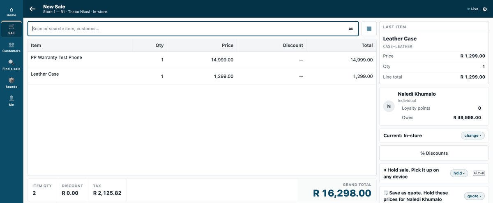
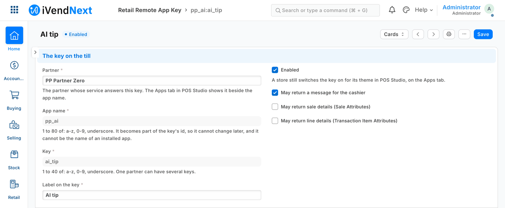
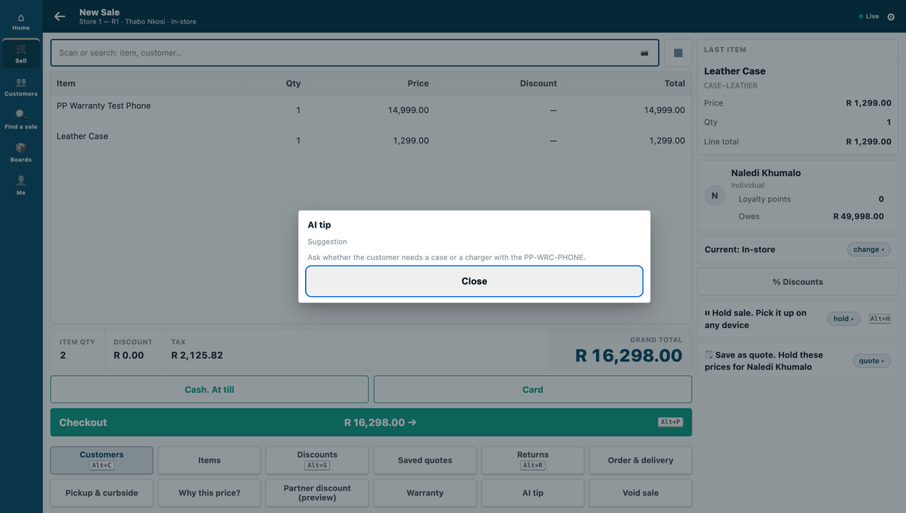

# A till key that asks an AI model — the recipe

*A cashier presses **AI tip** on a sale, and a short hint appears in the till's own sheet.*

This recipe adds a key to the till that gives the cashier a short, AI-written hint during a sale, such as an add-on to suggest or a care note. The hint comes **from an AI model the customer already has**. It is for an iVendNext Partner, or a licensed customer's IT team. **Reference implementation:** `samples/s6_ai_till_key/`.

**Who pays for the AI.** We never pay for an AI model on a customer's behalf, and never per customer question. The shop sets up its own provider: an open-weight model on its own machine (Ollama, llama.cpp, vLLM), or the assistant it already pays for. Your service calls **that**. The sample ships with a local stand-in, so it runs with no account at all.

**When to use it.** Rung 3 of the ladder, a remote till key (`recipes/point_handler.md` step 6), when the answer is words for the cashier. The key cannot change a price, a total, a payment or a stock figure. The answer is a **message**: a title of up to 60 characters and a body of up to 280. The till refuses anything else, whole.

## Steps

1. **Pick the provider and run the service.** `samples/s6_ai_till_key/service.py` is about 100 lines of standard-library Python. The logic is in `core.py` (no framework, no provider code) and the provider is in `providers.py`. Set these in the service's environment:
   - `PP_POINT_SECRET`: the signing secret you will give the shop.
   - `PP_AI_PROVIDER`: `stub` (no AI at all) or `chat`.
   - For `chat` only: `PP_AI_URL` (any service that speaks the chat-completions request), `PP_AI_KEY` (the customer's own key, if the service wants one) and `PP_AI_MODEL`.

   Put the service behind **HTTPS**. The till calls HTTPS only, and checks the certificate.

2. **Register the key in the shop.** A System Manager does this in Desk, on a **Retail Remote App Key** record. Fill in: your name as the partner, an app name, the key, its label, `message` as the only thing it may return, your HTTPS address (`…/point/ai_tip`), the signing secret, and the time to answer. The time to answer is 3 seconds unless raised, and at most 10 on this record; a manifest may declare at most 5 (`recipes/manifest.md`). Tick **the customer's consent**, and paste the consent text the sample prints (`core.consent_text()`). That text is built from the very list of fields the prompt is built from, so the words and the data cannot drift apart.

   

   *The key's record in Desk: enabled, message only, your HTTPS address.*

3. **Switch the key on in the store:** **POS Studio → the theme → Apps → tick the key → Save**, as for any till key. The key then shows among the store's keys on the till.

   

   *A sale on the till, with the **AI tip** key among the store's keys.*

4. **Choose a model that can answer in time.** The till waits at most the time you set (3 s by default, 10 s at most). If the model cannot answer that fast, the cashier reads *"AI tip did not answer in time. Nothing was added to the sale."* That sentence is the till's own, and the sale goes on. Use a small model, a short prompt (the sample's asks for at most 40 words), or raise the time to answer to what the counter can bear.

5. **Press it.** The till's server calls your service, and the hint comes back in the till's own sheet. The till draws the sheet; your service sends only words.

   

   *The hint, in the till's own sheet.*

## What is sent, and to whom

Two hops, and the consent text (`core.consent_text()`) names both:
1. **The till sends your service its context** on every press: the item codes, quantities and units, the store, **the customer on the sale and the cashier**, the sale's reference, the register's profile, the company and the currency. No prices, totals or payment details. The shop consents to this when it ticks the consent box on the key's record.
2. **Your service forwards only two things to the AI model:** the item codes with quantities, and the store's name. The customer, the cashier and everything else stop at your service. A basket longer than 30 lines is cut, and control characters are stripped.

## What is refused, and why

- **An answer that is not a message, or breaks the message rules** (a title over 60 characters, a body over 280): the till refuses it whole, so a key can never change a price, a total, a payment or stock.
- **A request with a wrong or old signature:** your service refuses it, so only the shop that holds the signing secret can ask.
- **A redirect from the AI provider:** the service follows **no redirects**. A redirect would carry the customer's AI key to whatever host it names.

## When your service is slow or down, and when the till is offline

The service never invents a tip. In each case the sale goes on:

| What happens | The cashier reads |
|---|---|
| The model is slow (past the time to answer) | *AI tip did not answer in time. Nothing was added to the sale.* |
| The model is down, errors, or answers nonsense | *AI tip could not finish. Nothing was added to the sale.* — the service never invents a tip |
| The answer breaks the message rules | *AI tip answered in a way this till cannot use. Nothing was added to the sale.* |

**Offline:** a remote key is online only; the sale goes on without it.

## Logs and secrets

The service writes one line per request: the request id, the status and the milliseconds. It **never** logs the prompt, the sale, the model's reply, the customer's AI key or the signing secret. A failure logs the error's class only, because an error's message can carry a key.

## What we would like to improve

- A partner who ships only data needs no hand step: a manifest declares the **Retail Remote App Key** record (`remote_keys`, [the manifest recipe](manifest.md)), and from the release that carries it the key is ready in POS Studio > Apps once the app is installed.

## Technical notes

Proven on our test bench.

### What the tests check, section by section

- **What is sent:** `tests/test_core.py` builds a sale full of marker values and proves none of them is in the prompt; the bench test proves the same with the till's real context, and fails if the till ever sends a key the consent text does not name.
- **Redirects:** the provider call follows **no redirects** (a redirect would carry the customer's AI key to whatever host it names; `tests/test_service.py` proves the target is never called).
- **Logs:** one line per request: the request id, the status and the milliseconds. **Never** the prompt, the sale, the model's reply, the customer's AI key or the signing secret — a failure logs the error's class only, because an error's message can carry a key. `tests/test_service.py` and the bench run grep the service's log for each of them.

### What was proven where

- **Laptop, no account** (`tests/test_core.py`, `tests/test_service.py`): 20 tests — the prompt carries only what the consent lists; the consent names it; a good answer through the stub and through the chat provider; a wrong or old signature refused (and refused *by the signature check*, not by any other failure); a failing provider gives no tip; a slow provider gives the *did not answer in time* sentence at the 3 s deadline; no secret or prompt text in the log; the log check itself is shown able to fail.
- **On our test bench** (its own run, not in the kit): the same, with the real context built by the till and **every answer judged by the till's real validator**, which is also shown able to refuse a 61-character title and a 281-character body.
- **A real till, in a real browser** (our test bench, first on 2026-10-07; the pictures re-taken on 2026-10-10, iVendNext POS app at `87812e141`; frame: the till, `/pos?frame=terminal`, 1440 wide): the key's **Retail Remote App Key** record and its theme row written by our bench run through the record's own save (what steps 2–3 do in Desk and POS Studio; those two screens were not walked), the cashier pressed **AI tip** on a sale of a phone and a leather case, and the till's server called this service **over HTTPS**, checking a certificate the bench's server was told to trust for the run; the hint came back in the till's own sheet. Screens: the key on the till, the hint, and the key's record in Desk (now at steps 3, 5 and 2 above; the GIF is built from the same screens, every frame cut above the record's address and signing secret). One press, answered by the stub provider: the walk proves the till's call and its sheet, not the stand-in caller's other cases.
- ⚠ **Not proven:** the **"answered in a way this till cannot use"** row through the caller (the validator's refusals are shown; no end-to-end test of that sentence); a certificate a shop's server trusts **by default** (the walk's was trusted for the run only); **offline** behaviour (the key is online-only per the till's documentation; not run); **logs other than the service's own** (the stub's log, the bench's console output and the real key's logging on a refusal were not searched for secrets).
- ⚠ **Not proven:** a real AI model. The stub stands in; the chat provider is exercised against the stub's chat-completions endpoint only.
