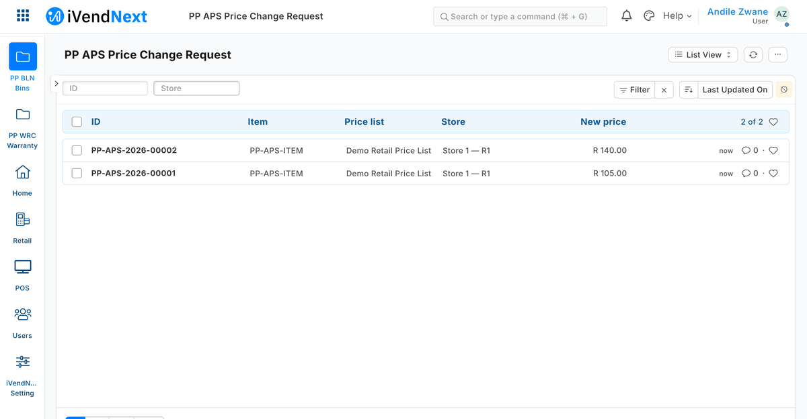
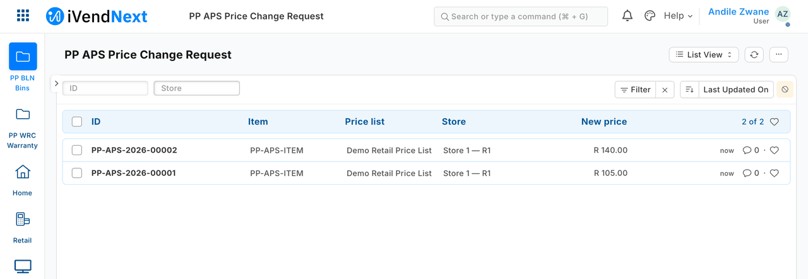
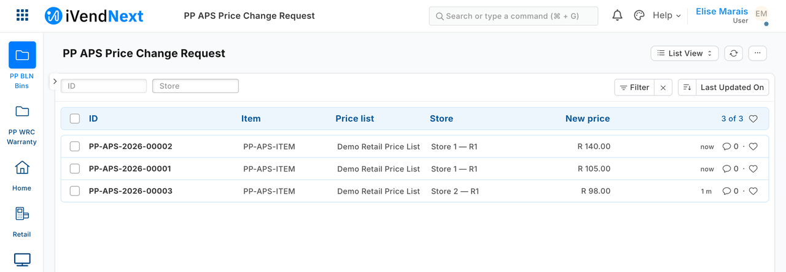
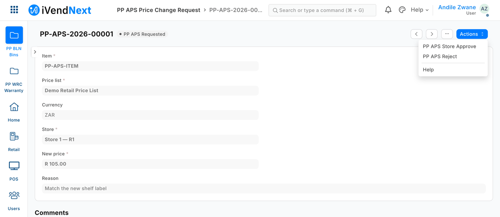
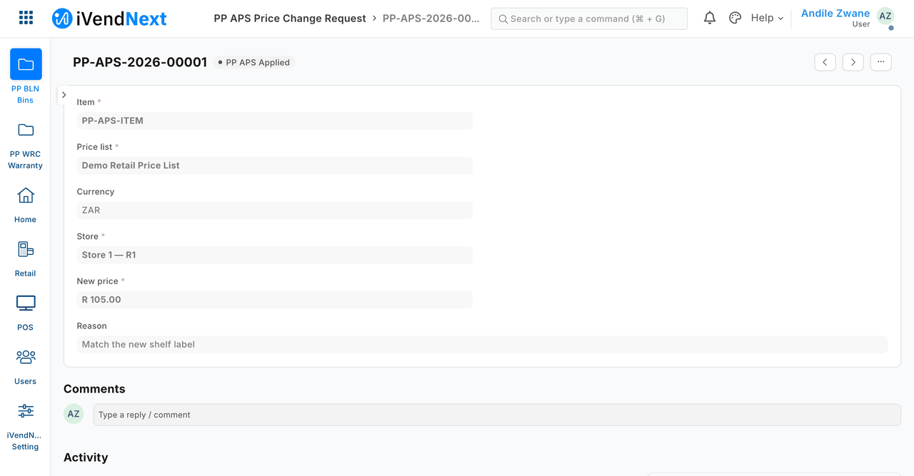
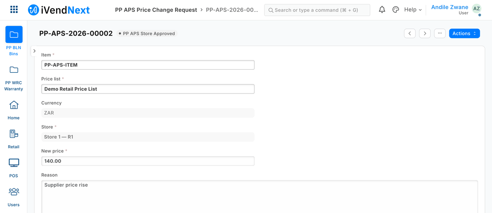
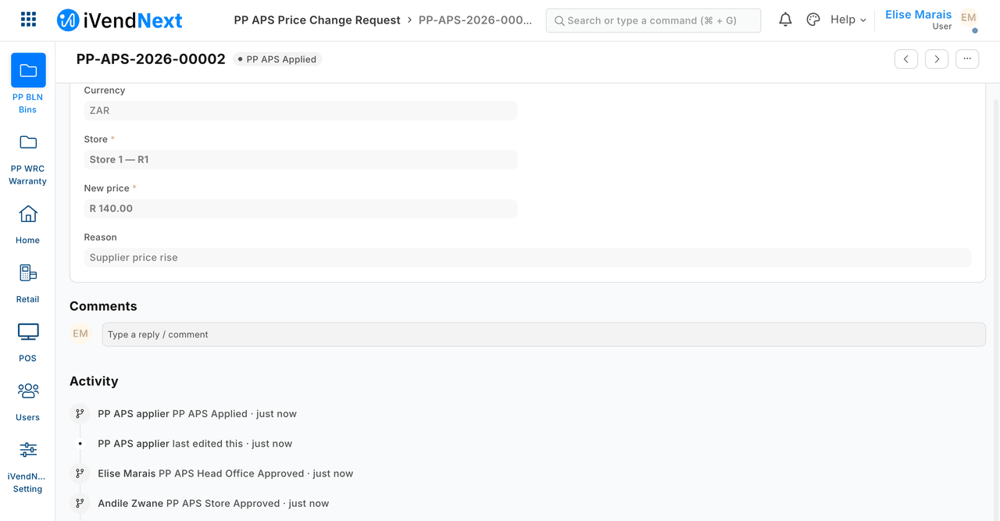
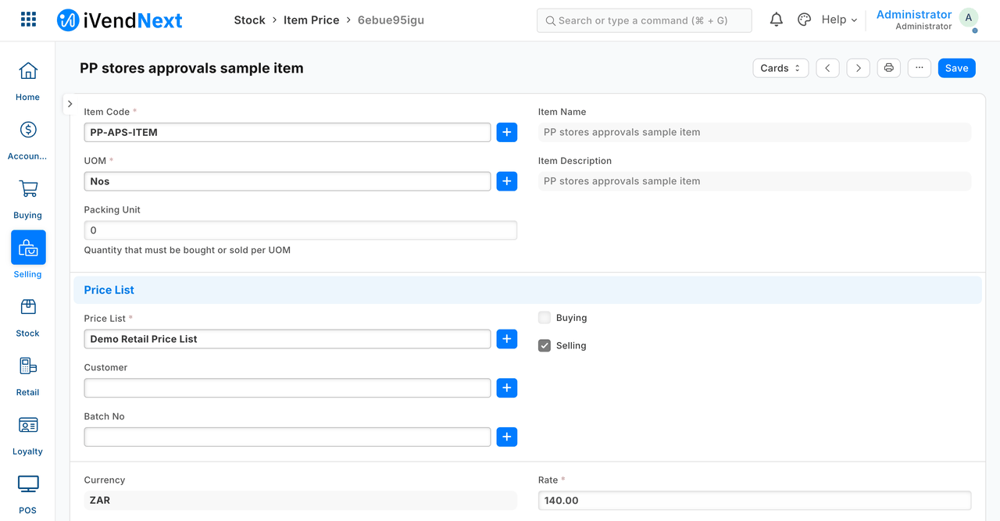

# Approvals across stores — a store manager's limit, head office above it — the recipe

This recipe is [Approvals by workflow](approvals.md) (S11) grown for a chain. A price change names its **store**; **the store manager of that store** approves it up to a limit, and **head office** approves anything above; each store sees only its own requests; a small outside service applies the change **once**. **Reference implementation:** `samples/s14_approvals_stores/` (a manifest, an outside service, tests).

It keeps every safeguard S11 has. Read S11's recipe first: this page says only what is new.

**When to use it.** When the person who may approve depends on the store and on the size of the change, and the retailer has more than one store.

## Steps

1. **Four roles.** The install makes each role the manifest names that iVendNext does not have, empty, for the customer to give to staff. The sample names *PP APS Requester*, *PP APS Store Manager*, *PP APS Head Office* and *PP APS Applier*; the customer gives each to the right people. In a real roll-out use the chain's own roles, which the install leaves as they are. ⚠ **No one holds a raising role and an approving role, and no one holds both approving roles.** The retailer's own self-approval check covers the *Approve* action only; the rest rests on this rule and on the service.

2. **Install the app** (`samples/s14_approvals_stores/manifest.json`). It holds one record type and one workflow:
   - the **price change request**: item, price list, **store** (fixed once raised), new price, reason, change tracking on;
   - a workflow of five states: *Requested → Store Approved → Head Office Approved → Applied*, and *Rejected*. The store manager approves or rejects; head office approves (from *Requested* or *Store Approved*) or rejects (from any); the service applies from either approved state.
   Every row writes all nine rights out. The store manager, head office and service can read and write requests.

3. **Fence each person to their store — in the retailer's iVendNext.** For every requester and store manager, one *User Permission* on *POS Profile* (their store). iVendNext then shows them, and lets them approve, their own store's requests only; a requester cannot raise a request for another store. Head office and the service have no store fence: they see all stores.

   What each person sees: the store manager  and head office .

4. **Set the limit.** A store manager's limit is one number for the chain: the service's `LIMIT_PCT` setting, a percentage of the price now (10 when unset). Who may approve is the workflow's roles plus the store's User Permission from step 3.

5. **The service's key** is S11's (step 4 there): read and write on *Item Price*, fenced by a *User Permission* on the price lists it serves (*Applicable For* *Item Price* only), plus read and write on the request type (its workflow action saves the request). It cannot raise a request.

6. **Run the outside service** (`approvals_stores.py apply`) as often as you like. For each request in *Store Approved* or *Head Office Approved*, oldest first, it checks, and only then writes the price and takes the *Apply* action — once, and a rerun after a kill finishes it without writing the price again. It refuses and says why:
   - S11's refusals: item, price list or price changed after it was raised (and now the **store**); ten or more recorded changes; no recorded approval; no or two price rows;
   - **an approval given by the person who raised the request — at any step, not only the last**;
   - **a store approval whose price row changed after the approval** (an earlier request applied, another role's edit): the limit was judged against a price that is gone, so the manager rejects it and it is raised again. This stops two requests approved side by side adding up past the limit — two +10% requests would otherwise make +21%; requests approved one after another each still move the price by up to the limit (below). A head-office approval names the price it wants and is applied whatever the row holds;
   - **a change above the store manager's limit** that head office has not approved: it waits, and the report says so.
   - **a request rejected while the service was applying it**: the action fails, and the service puts the price back and says so — within one run. If a run was killed after writing the price and the request is rejected before the next run, no run looks at it again: check that price row by hand.

   A refusal is written only in the service's report: keep the report. The request's own history shows who approved at each step and the service's *Apply*.

   What it looks like: the manager's action , a change within the limit applied , a change above the limit waiting , then head office's yes and the service's apply , and the price row .

7. **Schedule the export** (`approvals_stores.py export --day <date> --out <folder>`), as S11 step 6: the day's requests with the store and who approved at each step, who applied and who rejected, and a column *changed_after_raise* that says **yes** where the item, price list, price or store was edited after the request was raised (iVendNext lets a requester edit an *Applied* request; the history keeps the truth, and the file now says so). A cell that starts with `=`, `+`, `-` or `@` is written with a leading `'`, so a spreadsheet shows it as text.

## Know these limits

- **The limit is per request, not cumulative.** Requests approved and applied one after another each move the price by up to the limit. A chain that wants a cap per day adds it.
- **The limit is read against the price at the moment the service runs**, and a store approval is valid only while the price row is as it was when approved (step 6). One request per price row at a time: a second one approved beside it is rejected and raised again.
- **Where several stores share one price list, one store manager's approval changes every store's price.** The store fence decides who approves, not whose price moves.
- **The approval binds this service only,** as in S11: take write on *Item Price* from every other role.
- **The service does not tie a price list to a store.** A store manager's approval moves the price on whatever list the request names — including another store's own list, if the requester named it. A retailer with one price list per store should add that check.
- **Putting a price back is best effort.** If iVendNext refuses the put-back itself, the report says only "the shop said …" while the rejected price stays live; a Desk edit to the price row in the milliseconds between the service's write and its put-back is overwritten.
- **An edit in the milliseconds between the service's read and its action** leaves the request *Applied* showing the edit, while the price written is the approved one; the export marks it *changed_after_raise*.
- **The service's key lists the retailer's users, with email, phone and mobile number.** Measured: 36 rows, fields `email`, `mobile_no`, `name`, `phone` — the retailer's default for any desk user, not a right this sample grants. If that matters to the chain, give the service a user the retailer's directory does not list, or accept it.
- **A negative price is refused** by the field (non-negative), and a price row at or below 0 is never inside a percentage.

## What is refused, and why

- **A store manager opening or approving another store's request; a requester raising one for another store:** refused by iVendNext.
- **A store manager taking the head-office action:** refused by iVendNext (the workflow's roles).
- **A request raised and approved by one person:** iVendNext refuses the *Approve* action; a state written straight in is accepted by iVendNext and refused by the service — at the store step and at the head-office step.
