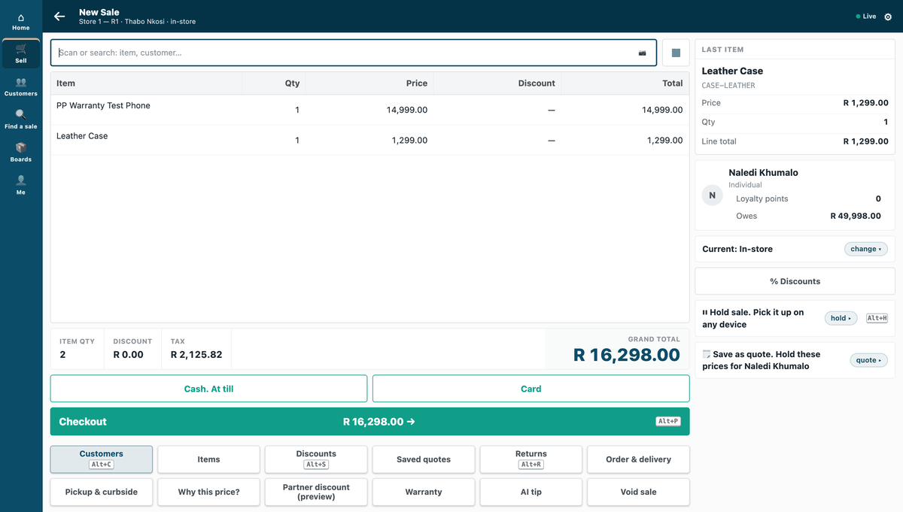
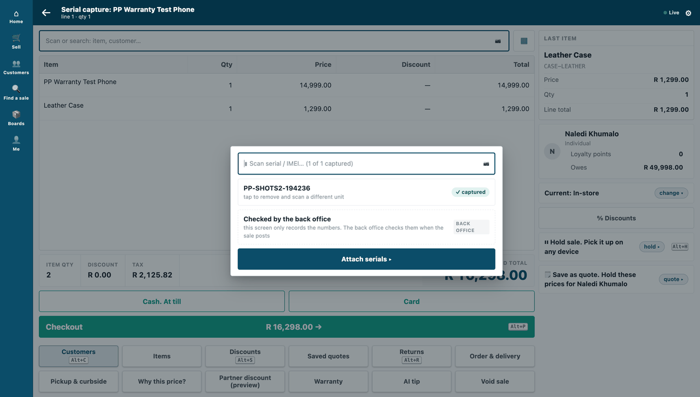
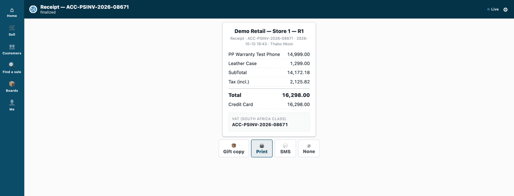
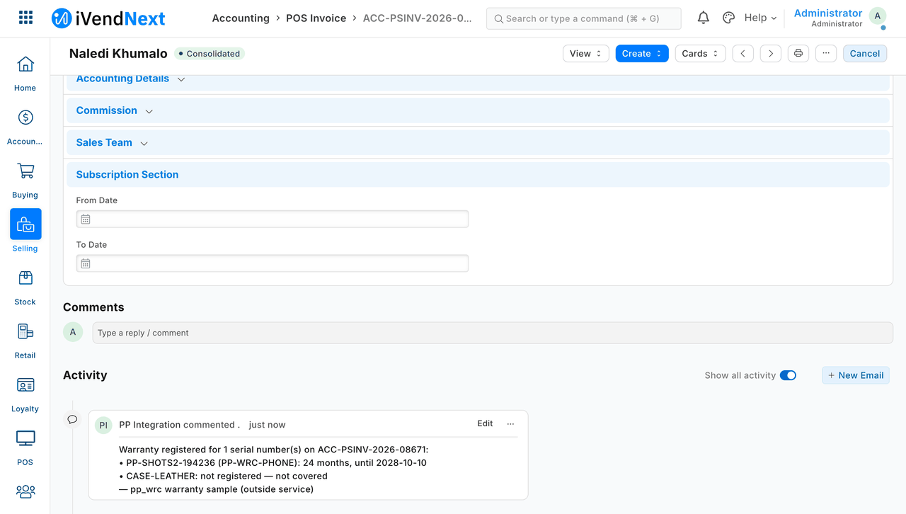

# Building a connected app — the recipe



*A cashier sells a covered phone; a moment later the warranty service's comment is on the sale in Desk.*

A connected app is your own service, on **its own server, in any language**, that reads and writes a shop's iVendNext over the record API. This recipe is for an iVendNext Partner, or the CitiXsys Consulting Team, building one.

**Reference implementation:** `samples/s2_bins/service/` (bins: reads stock, books stock movements, keeps its own records in the shop) and `samples/s1_warranty/service/` (warranties: reads sales and serial numbers, writes a comment). Every call they make is in `api/collection/` and described in `api/openapi.yaml`.

**When to use it.** It is step 2 of the build ladder, after configuration. Use it when the work belongs on your side: an outside system, your own store, a process that runs after a sale. If the cashier must see an answer **during** the sale, add a till key (`recipes/point_handler.md`). If you need your own record types in the shop, ship them in a manifest (`recipes/manifest.md`).

## Steps

1. **Get a key.** The shop makes one integration user for your app, with one narrow role (`recipes/integration_user.md`). Every request carries `Authorization: token <api key>:<api secret>`.

2. **Start from the request collection, not from a library.** `api/collection/NN_*.http` holds every call the samples make, as plain HTTP files. Any tool can send them, and `run.sh` sends them all with `curl` and `jq` alone:

   ```bash
   BASE=http://<shop>:<port> KEY=<api key> SECRET=<api secret> bash api/collection/run.sh
   ```

   Generate a client from `api/openapi.yaml` only if you want one; nothing needs it.

3. **Read records.** List with `fields` and `filters`; read one record with its child rows:

   ```
   GET /api/resource/POS Profile?fields=["name","warehouse"]&limit_page_length=5
   GET /api/resource/POS Profile/<name>                               → .data.warehouse: where a till sells from
   GET /api/resource/Bin?fields=["actual_qty"]&filters=[["item_code","=","<item>"],["warehouse","=","<warehouse>"]]
   ```

   A list returns only `name` unless you ask for `fields`. A stock balance is the shop's own figure (`Bin.actual_qty`): read it, never keep your own copy of it.

4. **Write records.** `POST /api/resource/<type>` creates; `PUT /api/resource/<type>/<name>` changes only the fields you send.

   ⚠ **A child table sent in a PUT replaces the record's rows.** To add one row, send the existing rows plus the new one. The bin service does this on every move: one save carries the new quantity and the row that explains it, so a quantity never changes without its reason (`samples/s2_bins/service/bins.py`).

5. **Book a stock movement: you ask, the shop books it.** Create a Stock Entry with `docstatus: 1`. One call creates **and** books it, and the shop keeps valuation and the ledger. Send `purpose` as well as `stock_entry_type`: over the API the purpose is not filled in for you.

   ```json
   POST /api/resource/Stock Entry
   {"stock_entry_type": "Material Transfer", "purpose": "Material Transfer", "company": "<company>", "docstatus": 1,
    "items": [{"item_code": "<item>", "qty": 4, "s_warehouse": "<back room>", "t_warehouse": "<till's warehouse>"}]}
   ```

   For **serialised** items, your role also needs create on Serial No and Serial and Batch Bundle, and the line carries `use_serial_batch_fields: 1` with `serial_no` (collection file `05`). The two-step form (a draft, then `POST /api/v2/document/Stock Entry/<name>/method/submit/`) also works (file `07`).

6. **Do the shop's work first, then your own.** Book the movement first, then update your own records with its name as the reason. If your second step fails, the movement's name in your log tells you what to finish. Never invent stock in your own records first.

   ⚠ **A booking call that times out may still have booked.** Before you send it again, look for it, for example by a reference you put in its remarks. The sample's `/pick` does not do this yet: a caller must not blindly retry a pick that timed out.

7. **React to events with webhooks, and make up for lost ones.** A booked sale reaches you as a signed webhook. Follow `recipes/webhook_receiver.md`: verify the raw body, reject replays, handle each sale idempotently, and run a reconciliation pull.

   Here is the warranty sample end to end. A cashier sells a covered phone:

   

   The till asks for the phone's serial number before it charges:

   

   The sale is booked:

   

   The warranty service hears about the sale and writes its comment on it, in Desk:

   

8. **Handle errors by their status:**

   | Status | Meaning | What to do |
   |---|---|---|
   | `401` | wrong or rotated key | alert; do not retry in a loop |
   | `403` | outside your role, or no key | fix the role or the call |
   | `404` | no such record | treat as absent |
   | `417` | the record was refused (a rule in the shop) | read `exception` / `_server_messages`; do not retry unchanged |
   | timeout / `5xx` | the shop is busy or down | retry later, idempotently — check whether a create already happened before you create again |

## What is refused, and why

- **Code inside the shop.** A connected app runs on your server. Server scripts are switched off for partners. In-shop logic means a till key (`recipes/point_handler.md`) or, later, an embedded app.
- **Changing money.** Prices, discounts, taxes and totals come from the shop's own data (pricing rules, promotions). A connected app never writes them onto a sale.
- **Your own copy of stock.** Read balances from the shop. Your records may say **where** stock sits, never **how much** the shop owns.

## When your service is down, and when the till is offline

- **Your service down:** the shop keeps selling. Webhooks are tried three times within a few seconds and then dropped. Your reconciliation pull, run on a schedule and after every restart, finds what you missed. **A pull reads a bounded page:** S2's reads at most 200 sales per kind of sale, oldest first, and moves its mark past each sale it handled. A shop that sold more than that between two passes needs the pass run again, so run it until a pass lists fewer than 200 sales.
- **The shop busy or down:** your calls time out. Retry later with the same idempotency rules.
- **Till offline:** till sales reach the shop when the till syncs. Your webhook should then fire, late, and your pull covers any gap. We have not yet tested webhooks for till sales, so rely on the pull.

## Tests

- `api/collection/run.sh` — every call, curl and jq only; it must pass against your sandbox.
- The bins service has its own end-to-end tests: putaway, pick, a sale, and webhook hardening.

## What we would like to improve

- Webhooks that are retried for longer, carry a signed timestamp, and can be subscribed to without the System Manager role.
- A server-to-server sign-in with scopes enforced against record types, and per-key rate limits.

## Technical notes

### What was proven where

- The recipe is proven on our test bench.
- The request collection, step 2: on the bench, **27 of 27 green**.
- A stock movement, step 5: measured on the bench, the pick booked a `Material Transfer`, and the two warehouses' balances moved by exactly the quantity (S2 tests). Valuation and the ledger stay the engine's; a stock balance is the engine's own figure (`Bin.actual_qty`).
- Webhooks, step 7: the bin service proves all four (S2 tests: a forged call refused, a replay ignored, a fresh event for a handled sale changing nothing, three failed deliveries recovered once by the pull).
- The pictures, step 7: **in a real browser** (our test bench, 2026-10-10, iVendNext POS app at `87812e141`; frames: the till at 1440 wide, then Desk): a cashier sold a covered phone, scanned its serial, and the warranty service's comment was on the sale in Desk.
- The bins service end to end (putaway, pick, a sale, webhook hardening): **15 of 15 green** on our test bench, with the till key pressed by the bench's own run; a canary on the bench proves those tests can fail (the bench's tests are not in the kit).

### What has not been proven

- Till-sale webhooks were not exercised on the bench: no till day was opened.
