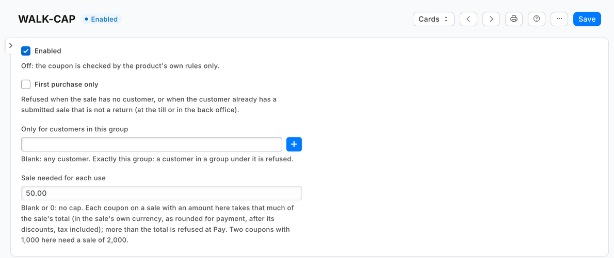
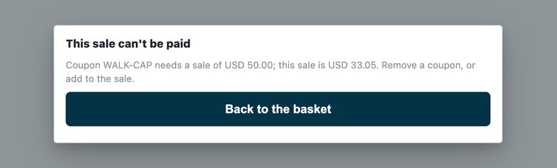

# Coupons for a first purchase, one customer group, or a sale of a given size — the recipe

A retailer's coupons already carry dates, stores, week days and a cap per store. Three rules retailers ask for are not there: **a coupon only a new customer may use** (a welcome coupon), **a coupon only one group of customers may use** (staff, members of a campaign) and **a coupon that needs a sale of a given size for each use** (one coupon of 100 for each 1,000 spent). This recipe adds them from outside, through the check before payment: the retailer writes one rule per coupon in Desk, and your service refuses a coupon the rule does not allow when the cashier presses Pay. It is for an iVendNext Partner, or the CitiXsys Consulting Team.

**Reference implementation:** `samples/s32_coupon_rules/` — *Coupon rules*.

**When to use it.** Your rule depends on who the customer is or what they bought before, which the coupon itself cannot say. A rule the coupon already holds (dates, stores, week days, an excluded customer group, a cap per store) is configuration: set it on the coupon ([the check recipe's coupon section](rule_guard.md#a-coupon-and-what-the-check-receives-for-it)).

## Steps

1. **Declare the rule record and the check in your manifest** (`samples/s32_coupon_rules/manifest.json`):
   - a record type `<PREFIX> Rule`, one record per coupon, named by it (`"autoname": "field:coupon"`, a **Link** to *Coupon*, unique): *Enabled*, *First purchase only* (a tick), *Only for customers in this group* (a Link to *Customer Group*) and *Sale needed for each use* (a **Currency**, never required: blank is no cap). Give **System Manager** the rights to edit it and your integration role **read only**; name the role `<PREFIX> Integration`, so the install makes it;
   - one `check` subscription at your service's address, and that address alone in `allowed_urls`;
   - a feed registration, one per app, with no user named: from POS version 2.1.0.667 the install makes your app's own user, `<app>@integration.invalid`, and names it, and the retailer's site hands that user's key to your hosted service after the install or an update (*Connect again* only if the site could not reach the app, or a key was lost or changed);
   - a help address on the rule record type (a `documentation` property setter).

2. **Choose what happens when your service is down.** Coupon rules declares `allow_and_flag`: an outage never stops a retailer selling, and a coupon sale is flagged on *Sales to review*. A retailer that would rather lose the sale than give a restricted coupon unchecked changes its subscription to `refuse`; every sale then waits on your service, coupon or not.

3. **Check every call with the check's secret** (`<app>:sub:<key>`; the sample's key is `coupons`), and refuse a timestamp more than five minutes from yours.

4. **Answer a sale with no coupon at once.** `coupon_codes` is empty: allow, and read nothing from iVendNext. Most sales are answered this way.

5. **Read what the coupon carries.** For each coupon on the sale, `coupon_codes` holds the Coupon record's **name** (its `id`), not the code the cashier typed. Look it up among the retailer's switched-on rules: `GET /api/resource/<PREFIX> Rule` with `fields` `["*"]`, `filters` `[["enabled","=",1]]` and `limit_page_length` 0, with your integration user's key, kept a minute. Ask for every field rather than naming them: one hosted service answers retailers on an earlier version of your app too, and a read naming a field their record type lacks fails for them. A coupon with no rule is never refused.

6. **Judge, cheapest first.** Group rules read nothing more, so they go first; then the sale needed, which reads nothing either (below); then a first-purchase rule counts the customer's earlier sales, live, through the retailer's own count, `GET /api/method/ivendnext_mpos.api.v1.get_count` (`doctype`, `filters`): POS Invoices with `docstatus` 1 and `is_return` 0, and Sales Invoices with the same and `is_consolidated` 0 (a sale made in the back office; a consolidated invoice is the till's sales a second time), both at once, since each read has its own timeout. Any one means the customer has bought before. The count checks your user's rights **and its User Permissions**, so iVendNext gives your role a plain **read on POS Invoice and Sales Invoice** (not *Only If Creator*) and gives the user no User Permissions; otherwise the count sees only part of a customer's sales and a returning customer can pass as new.

   | The coupon's rule | The sale | Answer |
   |---|---|---|
   | only for customers in *Staff* | the customer's group is not exactly *Staff* | `{"verdict": "refuse", "reason": "Coupon STAFF15 is only for customers in Staff. Remove it, or add a customer in that group."}` |
   | first purchase only | the customer has a submitted sale (before the cashier adds the new customer, the till names its walk-in customer, who usually has) | `{"verdict": "refuse", "reason": "Coupon WELCOME10 is for a first purchase only; this customer has bought before. Remove it, or add the new customer."}` |
   | first purchase only | no customer (the till always names one; a defensive answer) | `{"verdict": "refuse", "reason": "Coupon WELCOME10 is for a first purchase only. Add the customer to the sale first."}` |
   | a sale needed of 1,000 on each of C100A and C100B | a sale (`stage` `sale`) whose `totals.grand_minor` is less than the two together | `{"verdict": "refuse", "reason": "Coupons C100A, C100B need a sale of AED 2,000.00; this sale is AED 1,450.00. Remove a coupon, or add to the sale."}` |
   | any, and it holds; or no rule | — | `{"verdict": "allow"}` |

   **The sale needed, worked out.** Add the amounts of every coupon on the sale whose rule names one, each in the sale's currency's minor units (`currency_exponent`, rounded up: it is a minimum), and compare the sum with `totals.grand_minor`: the sale's total as rounded for payment, after its discounts (the coupons' own too, since a coupon books into the line totals) and tax included; an exchange's replacement is its own sale, judged at its own total. One amount serves every store, read in each sale's own currency. More than the total is refused; equal is allowed. One coupon of 100 for each 1,000 spent is a rule of 1,000 on each such coupon: two need a sale of 2,000, the same as allowing *floor(total ÷ 1,000)* coupons. The check sees each coupon once (`coupon_codes` is a set of names) and never a coupon's own amount, so the rule is per coupon, and a coupon repeated on one sale (the Coupon's hidden *Can Repeat In Transaction*) counts once. It is a minimum sale per coupon, never a cap on what a percentage coupon takes off; for one coupon for each so much spent, the retailer gives each coupon its own record and rule. No coupon reaches a return at the till today: a return's coupons are cleared, and a coupon cannot ride beside a returned item. As a backstop, refuse a capped coupon on `stage` `return` whatever the total (its total would be paid back). Keep the sentence under 140 characters with its amounts and instruction whole: name the coupons, or, when their names are long, say *These 3 coupons need*.

   The group and first-purchase rules are judged on whatever stage the check sends; a return carries no coupon at today's till (its coupons are cleared, and a coupon cannot ride beside a returned item), so in practice they judge sales and an exchange's replacement.

7. **When iVendNext cannot be read, say so the right way.** No answer, an error answer other than 401 or 403, or not a list of records: answer 503, so the till applies your down answer. iVendNext refuses your key (401 or 403: a key withdrawn, a user disabled, a right not given): refuse a sale with a coupon in words that say so (*"Coupon rules cannot read your shop: it refused the app's user. Remove the coupon, or ask your administrator to check the app's setup."*), so a refused key never gives a restricted coupon unchecked. Never follow a redirect with the key; treat an answer cut short as no answer.

8. **Test it.** The sample's tests: each rule, the check's secret, the rules read and kept, the count asked only when needed and never kept, one retailer and many, every answer against the contract; `canaries.py` breaks each guarded rule and expects its test to fail. Then press Pay on a sandbox with a coupon on the sale.

### Rules

The retailer's records of `<PREFIX> Rule`, one per coupon: *Enabled* (off: the coupon is checked by the product's own rules only), *First purchase only* (refused when the sale has no customer, or the customer already has a submitted sale that is not a return, at the till or in the back office), *Only for customers in this group* (blank: any customer; exactly this group, so a customer in a group under it is refused) and *Sale needed for each use* (blank or 0: no cap; the sale's total, after its discounts and tax included, that each use of the coupon takes). **A coupon used at most so many times in each store** is not a rule here: set the Coupon's own *Maximum Redemption Count Per Store*, which iVendNext enforces when the coupon is applied (and does not apply offline). A change reaches the service within a minute.

**What the cashier does.** The till shows *"This sale can't be paid"* and the app's sentence, then goes back to the basket. The cashier removes the coupon (or adds the new customer, or the right one) and presses Pay again. Once the check has allowed a coupon, the basket is held to what was checked: another line or another coupon is refused before any money until the cashier presses Pay again, which asks your service again (the till's own lock: *"The sale changed after the check. Press Pay again."*).

## What iVendNext needs from you

| You give | iVendNext checks |
|---|---|
| an **HTTPS** address its server trusts | the address is consented; a private address is refused on a customer's site |
| a rule record type, by manifest | the installer makes it and removes it at uninstall |
| a signature check on every call | — (yours to do) |
| an answer within 3 s | your declared down answer applies otherwise |

**A group rule trusts the customer's group.** The till's edit sheet lets a cashier change it (the retailer's cashier role saves customers): a customer moved into the coupon's group passes. The retailer closes it by putting *Customer Group* at permission level 1 in *Customize Form* and giving level-1 write only to its managers: the cashier's change then leaves the group as it was ([Customers by store](customers_by_store.md), rule 7). Put that in the setup, with what follows from it: a cashier can no longer give a new customer a group (one created at the till takes the default customer group in Selling Settings, or none), the till still says *Saved* after a group change it dropped, and no cashier's role may keep level-1 write (Sales Master Manager has it by default).

## Technical notes

- **Offline,** the till does not call you: the coupon applies, and the sale is flagged when it syncs.
- **The count is taken at the check:** a sale for the same customer booked after the check and before the money, at this till or another, is not seen, so the coupon can be given twice that way. A count, not a lock.
- **What counts as a purchase:** an order or layaway placement the till booked as a submitted POS Invoice counts (read in the till's code, not run); a customer whose only document is an exchange's return does not; a sale in another company on the same site counts; an offline sale not yet synced does not.
- **Where the check never runs:** the check before payment does not run on a park to a till, a layaway deposit or an account collection (the check page, *Not in this version*), nor on a sale rung in the Desk's own POS screen, so a restricted coupon rung there is not refused and not flagged.
- **iVendNext's build:** the count calls `ivendnext_mpos.api.v1.get_count`, which iVendNext POS has since 2026-10-15 (every kit sample uses the same names); on an older build the count answers 404, which the service treats as iVendNext down, so the coupon passes, flagged.
- **A cold start:** on CitiXsys hosting the first Pay after a quiet spell starts the function, which takes longer; past the check's 3 s the down answer applies, flagged.
- **What the product does already, and does not:** a Coupon's *Apply Once Per Customer* is enforced by the product but its field is hidden on the Coupon form (a retailer shows it with *Customize Form*); it counts every coupon row for the customer, drafts and cancelled sales included. A Coupon's *Minimum Bill Amount* is hidden and not enforced; a *Sale needed for each use* on a coupon's rule is that minimum, at Pay. The hidden *Apply Once Per Customer* is not this app's.
- **Hosting:** the service is the app template's shape, so it serves many retailers through the template's handshake (guide chapter 14b); each retailer's site hands over the check's secret, and the key of the app's own user, when it connects after the install or an update (*Connect again* only if the site could not reach the app, or a key was lost or changed). It only answers presses, so on CitiXsys hosting it runs as a function, paid per call (`app.json` `"runs": "function"`). Until a retailer's user key arrives the service answers 503, so your down answer applies.

### What was proven where

- **On the laptop:** the sample's tests and canaries (its README says how to run them).
- **On our test bench, version 1.1.0** (2026-10-28, the iVendNext POS app at `60147699`, the engine at `12f182446`; the service in its one-retailer form, its user holding the app's role alone): the new service against the listed 0.1.0 install answered the eight cases above as before; the update to 0.2.0 kept the check on and consented and the rules as they were, the new field blank; with *Sale needed for each use* 150.00 on a 10% coupon, one unit (90.00 after the coupon) refused in the app's words with nothing booked, two units (180.00) allowed and booked with the coupon, the total the service received equal to the booked one. The library copy's update from the listed 1.0.1 on a rehearsal site kept a rule, the field blank, and the check enabled, consented and called by the till. **Laptop tests only:** two capped coupons on one sale; the return-stage backstop.
- **On our test bench** (2026-10-18, the iVendNext POS app at `4c3f11b5`, the engine at `b26351df`; the service in its one-retailer form, reading iVendNext with a user holding only the app's role and a read on POS Invoice and Sales Invoice; two of the retailer's own coupons, 10% and 15% off), **8 of 8**, through the till's own calls inside one day that was closed after: a sale with no coupon allowed and booked · a first-purchase coupon for the walk-in customer refused in the app's words, the card push refused, no sale booked · the same coupon for a new customer allowed, booked at 90.00 of 100.00 with the coupon on the sale · that customer's next sale with it refused (the sale just booked counted live) · a group coupon for a customer outside the group refused, nothing booked · for a customer in it allowed, booked at 85.00 · after an allowed check, a second unit, another customer or another coupon each refused before any money, and Pay again asked the service again · the service received each coupon by its record's name, never the code typed. The install, the uninstall (the schema as found) and the rights put back were checked too, and no POS day was left open. **Not run on the bench:** a cash booking of a refused basket (the bench's day has no drawer, so the till refuses cash before the check's door; read in the till's code, the door refuses it), many retailers (the laptop tests), offline.
