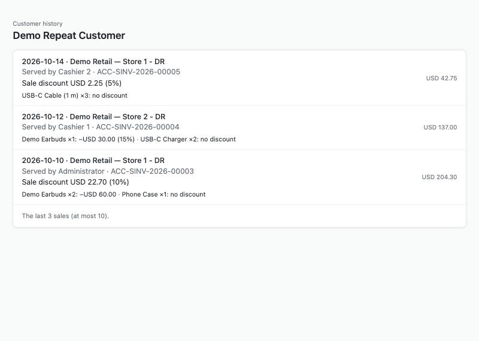

# A customer's history on the till: who served, and each discount — the recipe



*The page opened with a till-shaped context for a customer with three sales: the store, who served and each discount.*

A cashier wants to see, for the customer on the sale, the last visits: when, in which store, **who served** them, and **the discount** on the sale and on each line. This recipe builds it as a **partner page**: a key on the till (and a page in Desk for a customer) opens your page, your server reads the customer's sales over the record API and shows them. It is for an iVendNext Partner, or the CitiXsys Consulting Team, who has read [the partner page recipe](partner_page.md).

**Reference implementation:** `samples/s28_merge_and_history/` — *Customer history* (its other door is a Desk button, [the merge recipe](merge_documents.md)).

## What the till already shows

The till's own customer card already shows, **read from the POS app's code at commit `e149dce4` (2026-10-14), not run on a site**: the name, phone and e-mail, the year they became a customer, the credit limit and balance, the lifetime spend and the number of visits, what they usually buy (item groups), loyalty, and **the last 10 sales**, each with its number, date, first item, store, amount, whether it was a return, and its kind when it is not a purchase. It reads the same two ledgers as this page and skips the day's roll-up invoices the same way.

**What your page adds:** who served each sale, the sale's discount and each line's discount — and as many sales as the retailer sets (up to 50).

## Steps

1. **Declare the page** to open on a till key and in Desk, sending the sale (it carries the customer), never the user:

   ```json
   "extension_subscriptions": [{"key": "history", "point": "page", "label": "Customer history",
     "endpoint_url": "https://your.server/mhs/history/", "page_placement": "Till key and Desk page",
     "page_roles": ["PP MHS History"], "page_send_user": 0, "page_send_sale": 1,
     "page_returns_message": 1, "page_returns_sale_attributes": 0, "page_height": 70}]
   ```

   iVendNext needs at least one thing a page may answer, so `page_returns_message` is 1 — and the page never answers.
2. **Check the context on your server** ([the partner page recipe](partner_page.md), step 3): the signature over the payload's bytes, the expiry, the nonce once.
3. **Find the customer.** On the till, `sale.customer`; in Desk, the record's `name` when its type is *Customer*. No customer: say *No customer on this sale* and stop.
4. **Read the customer's sales, newest first, at most x.** From *POS Invoice* and from *Sales Invoice* with `is_consolidated` 0, each filtered on the customer and `docstatus` 1, with `order_by` `posting_date desc, posting_time desc` and `limit_page_length` x. ⚠ Send `order_by` as plain text: sent as JSON (in quotes) iVendNext ignores it and answers oldest first. A consolidated *Sales Invoice* is the day's roll-up of the till's sales ([the event feed's page](../contracts/pages/event_feed.md)): reading it would show each sale twice. Merge the two lists, newest first by date and time (compare times as numbers: iVendNext sends `9:15:00` with no leading zero), and keep x.
5. **Read each sale** (`/api/resource/⟨type⟩/⟨name⟩`, side by side: each is a round trip) and check its customer again. Then the full names of the users who made them (`/api/resource/User`, `full_name`).
6. **Show each visit**: the date, the store (the sale's warehouse), who served (the full name of the sale's owner), the sale's `discount_amount` and `additional_discount_percentage`, and each line's discount: `discount_amount` (per unit) times `qty`, with its `discount_percentage`. Use the design kit (`kit/design/`) and `ivnKit.applyTheme(theme)`; write every value with `textContent`.
7. **Answer nothing.** Do not post to the till.

## The settings

One record of your type `⟨PREFIX⟩ Settings`, named `Default`: how many sales the page shows (10 when empty, at most 50).

## Bounds

- Online only; on the till the key needs an item and the customer on the sale. A till profile that puts a default walk-in customer on every sale opens the page for the walk-in.
- Anyone with the page's role sees the sales the app's key can read, in every store and company.
- Who served is the user who made the sale. The built-in Administrator's full name is not readable with the app's key.
- A line that stored a percentage but took nothing off shows no discount: the page shows what was taken off.
- The app's key reads every sale and every user's full name: give its role to the app's user alone. On the sandbox, a read iVendNext gave to every user did not reach the app's key; give the read to the role.

## What was proven where

On a sandbox site, 2026-10-16 (POS 2.0.0.648), on the sample's first build (the review's changes after it ran on the laptop): the page opened in a real browser with the context the retailer signed for a customer in Desk showed three sales by three people from two stores, newest first, each discount as stored, the roll-up invoice skipped (one made by hand; the sandbox had no till sale, so till sales and a real closing's roll-up are laptop only); a customer with no sales, a context used twice, a user without the page's role, and the settings' number at 2 each did what they say. The till's own key was not pressed (no one was signed in to the till); the till-shaped page used a context signed with the page's secret by the test script. Details: `samples/s28_merge_and_history/README.md`.

## Tell the customer

The cashier presses **Customer history** with the customer on the sale and sees their last visits: when, where, who served them and what discount they had. It needs a connection.
