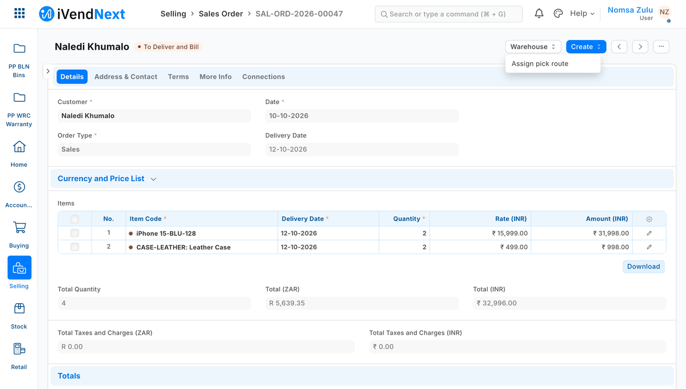
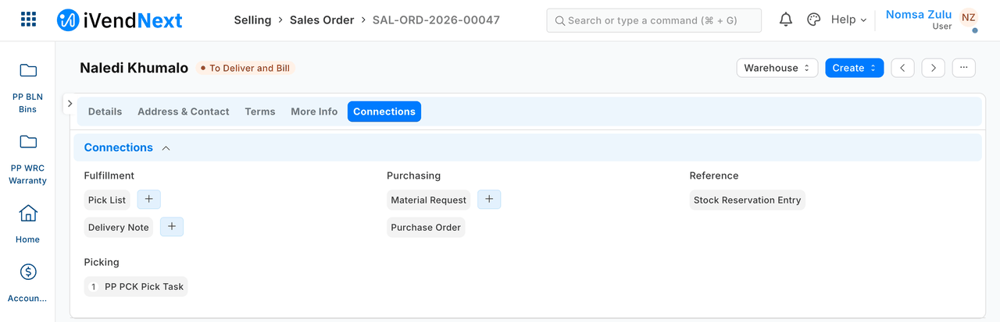
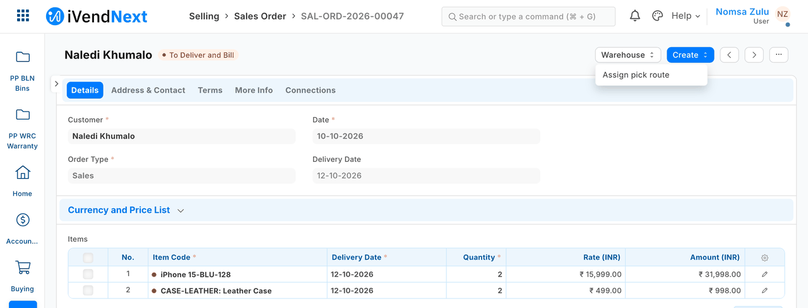
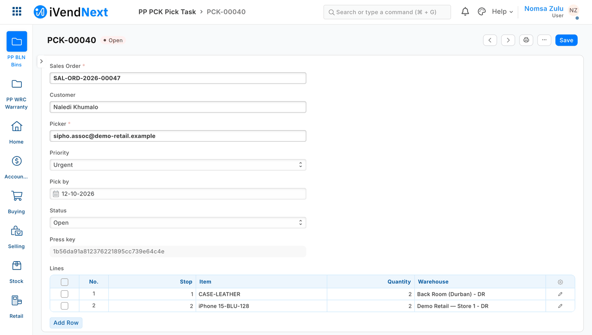
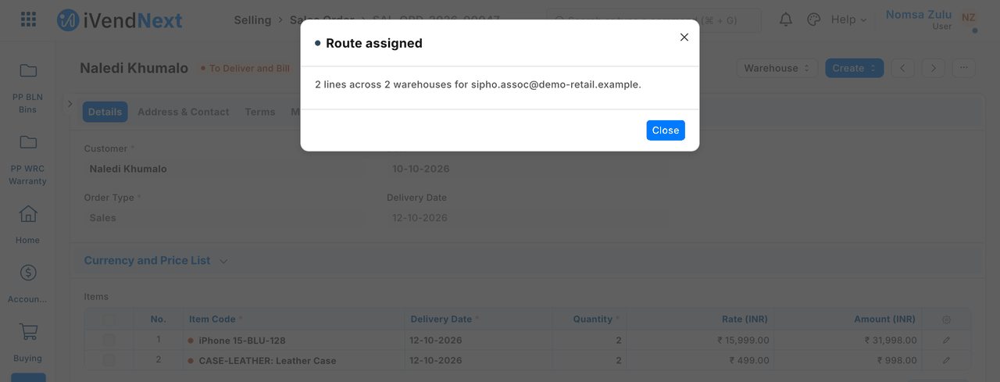
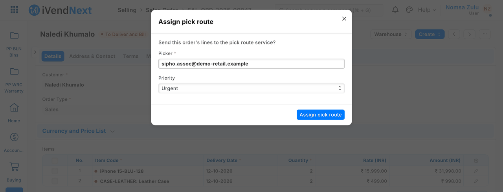

# A button on a Desk record (a Desk action) — the recipe



*A stock user presses* Assign pick route *on a Sales Order, picks a colleague, and the partner's pick task opens.*

A Desk action is a button on a shop record in iVendNext Desk. When a user presses it, your service does its work on that record and tells Desk what to show. Examples: *Assign pick route* on a Sales Order, *Recheck unit barcodes* on a Batch, *Allocate cash* from a Customer. This recipe is for an iVendNext Partner, or the CitiXsys Consulting Team, building one.

**Reference implementation:** `samples/s16_pick_route/` — *Assign pick route*.

**When to use it.** It is step 3 of the screen ladder, after configuration and a connected app: use it when a user should start your work **from the record they are looking at**. The button, its dialog and the answer are the shop's own screens: **you ship no JavaScript into Desk**, ever. Your service does the work through its own API calls; the answer only tells Desk what to show.

**The four rules, here.** Your answer **never writes**: your service writes before it answers, with its own key and its own rights. It never changes a submitted record except through a field the record allows after submit, or a record of your own linked to it. It is **safe to run twice** (the press carries a key for that). It never touches money.

## Steps

1. **Declare it in your manifest** (`recipes/manifest.md`, `guide/07_manifests.md` § *The extension points' kinds*). Three parts: your service, the button, and — usually — a record type of your own and a Connections link, so what you make shows under the shop's record:

   ```json
   "extension_subscriptions": [{"key": "route", "point": "desk_action", "label": "Pick route service",
                                "endpoint_url": "https://your.server/press/route", "timeout_seconds": 5}],
   "desk_actions": [{"record_type": "Sales Order", "label": "Assign pick route", "group": "Warehouse",
                     "placement": "both", "service": "route", "roles": ["Stock User", "Stock Manager"],
                     "on_draft": 0, "on_submitted": 1, "states": ["To Deliver and Bill", "To Deliver"],
                     "inputs": [{"fieldname": "picker", "label": "Picker", "fieldtype": "Link", "options": "User", "reqd": 1},
                                {"fieldname": "priority", "label": "Priority", "fieldtype": "Select", "options": "Normal\nUrgent"}],
                     "send_fields": "name, customer, set_warehouse, delivery_date, items(item_code, qty, warehouse)"}],
   "links": [{"doctype": "Sales Order", "link_doctype": "PP PCK Pick Task", "link_fieldname": "sales_order", "group": "Picking"}]
   ```

   - `placement`: `form`, `list` (the list's Actions menu, on several records at once) or `both`. A bulk press needs `list` or `both`.
   - `inputs`: up to 10, each of one of eight types: `Data`, `Int`, `Float`, `Date`, `Select`, `Link`, `Check`, `Small Text` ([the library page](../contracts/pages/desk_action.md) holds the list at the product's head). Any other type, `Currency` included, is refused at install (*"Input 1: choose one of the listed types."*). **An amount is typed as a `Float`.** It reaches your service as a JSON number, so read it with `Decimal(str(value))` and never add amounts up in float (S22's `money.py` does this).
   - `send_fields` **is the shop's consent.** The shop reads it before it switches your service on: name exactly what you need, and nothing more. Money leaves as whole minor units with its currency; **a quantity leaves in thousandths** (2 units arrive as `2000`).
   - The manifest installs **switched off**: your service unconsented and off, the button off. The service's signing secret is handed back **once**, at install.

   The Connections link is what puts your record under the shop's record. Here the pick task is listed under *Picking* on the order:

   

2. **What the shop does after install.** A System Manager opens your service (*Retail Extension Subscription*), reads what is sent, ticks the consent and switches it on, then switches the button on (*Retail Desk Action*). The server stamps the consent (who, when, for which address and which list). A change to the address or the list clears it.

   Once it is on, the button sits in the record's menu — here in the **Warehouse** menu of a submitted order:

   

3. **Your service checks every press is the shop's.** The press is one POST to your address, body `{"point": "desk_action/1", "context": {…}}`, with `X-iVendNext-Timestamp` and `X-iVendNext-Signature` = base64 HMAC-SHA256 of `<timestamp>.<raw body>` with the secret. Check it **over the raw bytes, before you parse anything**, and refuse a timestamp more than five minutes from yours:

   ```python
   want = base64.b64encode(hmac.new(secret.encode(), ts.encode() + b"." + raw, hashlib.sha256).digest())
   if not (ts.isascii() and ts.isdigit()) or abs(time.time() - int(ts)) > 300 or not hmac.compare_digest(want, sig.encode()):
       return 401
   ```

4. **Do the work with your own key, then answer.** The context carries the user, their language, the inputs, each record's type, name and declared fields, and an `idempotency_key`. S16 creates one pick task per order over the record API **as its integration user** (`recipes/integration_user.md`), stores the key on the task, and finds that task again on a retry:

   ```python
   name = tenant.find_task(order, key) or tenant.create_task(plan(record, inputs, key))
   return {"message": {"title": "Route assigned", "body": "2 lines across 2 warehouses for …", "level": "success"},
           "open_record": {"doctype": "PP PCK Pick Task", "name": name}}
   ```

   Give your integration role **only** what the work needs. S16's role **reads and creates** its own pick tasks (no write: it never edits one), and does **not** read Sales Orders: everything it needs arrives in the press. On a retry, answer about the task that exists (its picker), not about what the dialog sends this time.

   The pick task the service made holds the order, the picker, the priority and the lines in walking order:

   

5. **Answer in Desk's closed vocabulary.** A `message` (title ≤ 60, body ≤ 280, level `info` · `success` · `warning`) plus **at most one** next step: `open_record` (it must exist and the user must be allowed to read it), `open_page` (an address under a partner page placed on Desk) or `refresh: true`. One bad part refuses the whole answer. The contract is `desk_action.v1.schema.json` in [`contracts/`](../contracts/README.md); S16 checks every answer it gives against it (`tests/test_contract.py`).

   Desk shows your message as the shop's own:

   

6. **Press it the way Desk does.** Desk calls `ivendnext_mpos.api.desk_action.run(action, names, inputs, idempotency_key)`. The server re-checks everything the button showed, on the **saved** record. The user fills in the shop's own dialog with the inputs you declared:

   

   What to expect:
   - One order: your answer shows, and your record opens. The order itself is unchanged. Your record's owner is your **integration user**, not the user who pressed.
   - Your service receives exactly the fields you declared, and nothing else.
   - The same press twice (one key) gives the same answer and **one** record.
   - Several orders from the list: one press, one answer, a record for each.
   - An answer Desk cannot use (say, `open_record` naming a record that does not exist) is refused whole, logged, and the user is told to check the record.
   - A user without the role, a record in the wrong state, or an input value the button does not accept: the server refuses in its own words and logs the refusal. **Your service is not called.**

7. **When your service is down or slow.** Desk waits 3 seconds unless you raise it (at most 10; S16 declares 5) and then says *"⟨label⟩ did not answer in time. Check the record before you try again."* — it never claims nothing changed, because you may have written before you went quiet. A retry from the same dialog carries the **same** key, so your idempotency makes it safe. Set your timeout to cover your own API writes. We have not yet tested this case end to end.

8. **Test it.** Unit-test your core and service on your laptop with presses signed the way the shop signs them (`samples/s16_pick_route/tests/`), and check your answers against the contract. Then press it on a sandbox.

## A reason asked before a document is rejected

The approver must say why when rejecting (a purchase order, a price change), and the reason is kept on the document. **The doors it combines:** a Desk action with one required input, your service, the workflow call, and a save rule as the net. **The limit:** the approver presses your button, not the workflow's own *Reject*, and the reject is recorded as your integration user.

1. **Your manifest** adds two fields to the document (`<prefix>_rejection_reason`, Small Text; `<prefix>_rejected_by`, Data, read only) and a Desk action **Reject with reason** with one input, `reason` (Small Text, `"reqd": 1`), on the workflow states that may be rejected, with `roles` set to **the roles that held the workflow's reject before** (step 3 takes it from them, so the button's roles become the only gate on who may reject). The dialog asks for the reason before anything is sent.
2. **Your service** writes the reason and the pressing user (`context.user`) into those fields, **then** takes the workflow's reject (`/api/method/ivendnext_mpos.api.v1.apply_workflow`). In that order: the workflow call reads the saved document again, so a reason sent with it would be dropped. Sample S11 (`samples/s11_approvals/approvals.py`, `reject`):

   ```python
   if len(reason.strip()) < 5:
       return {"message": {"title": "A reason is needed", "body": "Write why it is rejected …", "level": "warning"}}
   api.call("PUT", f"/api/resource/{DT}/{name}", body={"rejection_reason": reason, "rejected_by": presser})
   api.call("POST", "/api/method/ivendnext_mpos.api.v1.apply_workflow", body={"doc": json.dumps(doc), "action": "PP APR Reject"})
   return {"message": {"title": "Rejected", "body": "… The reason is kept on it.", "level": "success"}, "refresh": True}
   ```

   A second press finds the document already rejected and says so. If the shop refuses the transition (the service's role may not take it), the service puts the two fields back and says so: a document is never left carrying a reason it was not rejected for. If the answer is lost (a timeout) the service reads the document again first, so a reject that went through keeps its reason. Sample S11's `reject`, six tests.
3. **Configuration, all at once:** take the reject transition away from the approvers' roles and give it to the service's integration user's role, switch the button on, and add **the net**: a save rule `required_when` on the reason field, condition `workflow_state = <your rejected state>`, mode `refuse`. A document rejected any other way (an import, the API) is then refused without a reason.
   ⚠ Not one without the others. The save rule alone leaves the approvers unable to reject at all: they may not write the reason in a state another role edits, and their own *Reject* is then refused. S11 ships neither the button nor the rule, because it has no press service.

Limits to tell the customer:
- the workflow records your integration user as the one who rejected; `rejected_by` holds the person who pressed;
- your service must be up: when it is down the button says so, and nothing is rejected;
- the service's role needs write on the document in the states where it rejects (or the two fields allowed after submit, on a submitted document).

## What the shop needs from you, and what it checks

| You give | The shop checks |
|---|---|
| an **HTTPS** address its server trusts (a real certificate) | the address is consented with the field list; a private address is refused on a customer's site |
| a signature check on every press | — (yours to do) |
| `send_fields`, as small as the work allows | the consent text is built from it, and a change clears the consent |
| roles that may press | re-checked on the server at every press, with the record's state and every condition |

**A service that writes the pressed record** (S35, [call-centre orders](call_centre_orders.md)) meets the shop's own save: a table is replaced whole, so send every row back as read; a sales order's save reads its customer with a rights check, so the app's user needs read on Customer; and the shop saves a draft whose lines name a group warehouse and refuses it only at submit, so check a warehouse before you write it; and a bundle's parts (`packed_items`) keep their warehouse unless you write them too.

## Technical notes

### What was proven where

Proven on our test bench on 2026-10-07.

- Install, step 1. **On the bench:** both manifests passed the checker (`VALID`) and installed **switched off**: the service unconsented and off, the button off, the service's signing secret handed back **once**, as `pp_pck:sub:route`.
- Switch-on, step 2. **On the bench:** done as data by the System Manager; the service was then callable, with the consent text naming `items(item_code, qty, warehouse)`.
- The signature check, step 3. **On the bench:** a fresh, well-formed press signed with the wrong secret was refused (401, nothing written), over HTTPS. With this check removed, S16's own tests go RED (we prove that with a mutation run on every change). The canary proves the sample's signature check.
- Pressing it, step 6. **On the bench**, as a Stock User:

  | Case | Result |
  |---|---|
  | S1 — one submitted order | *Route assigned*; the pick task opens. It holds the order's two lines, the picker and the priority, and its owner is the **integration user**, not the user who pressed. The order itself is unchanged |
  | Sent fields | exactly the five declared fields; the lines' quantities `2000` and `1000` for 2 and 1 units |
  | The same press twice (one key) | the same answer, **one** task |
  | S2 — a `refresh` answer | Desk gets `refresh` and the message |
  | S3 — `open_record` naming a task that does not exist | refused whole: *"Assign pick route answered in a way Desk cannot use. Check the record before you try again."*, and logged |
  | S4 — three orders from the list | *3 routes assigned*, a task for each |
  | A user without the role · a draft order · *Priority* = "Whenever" | refused by the server in its own words (*"You may not use Assign pick route."* · *"… does not run on … in this state."* · *"Priority: the value is not one this button accepts."*); each writes a `refused` row in the Extension Log naming the user and the reason; **your service is not called** |

- The pictures: **in a real browser** (our test bench, 2026-10-10, iVendNext POS app at `87812e141`; frame: Desk, 1440 wide), as a stock user picking a colleague.
- Down or slow, step 7: *(The extension point's own rules at the product's pin, read in its code, not driven on our bench.)*

### Figures beside the run that measured them

All on our test bench, 2026-10-07: install → the shop's switch-on → S1–S4, the three refusals, the forged press → uninstall with the schema as found (the Extension Log keeps its press rows, by design) — setup 9/9, S16 **14/14**, teardown 6/6. **A press, end to end** (the shop's call, over HTTPS, the service writing one or three pick tasks over the record API, the answer judged): **39–207 ms**, over two runs, on the four answered presses (the Extension Log's `latency_ms`; the test shop and the service on one machine, so a real network adds its own round trip). Your timeout must cover your own API writes: S16 declares 5 seconds.
