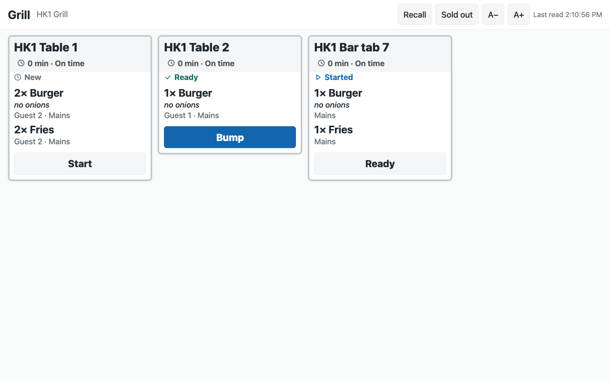
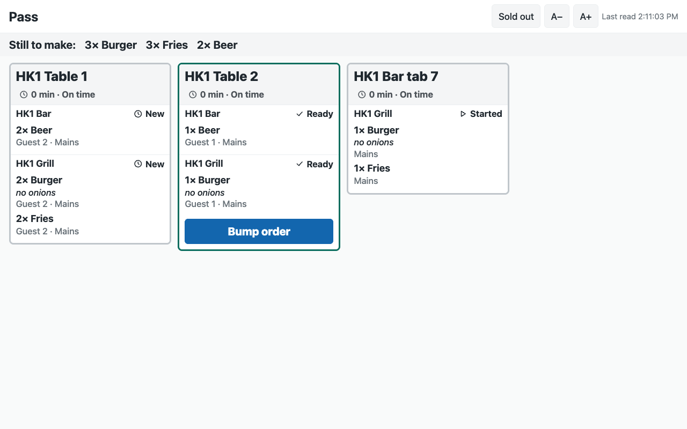
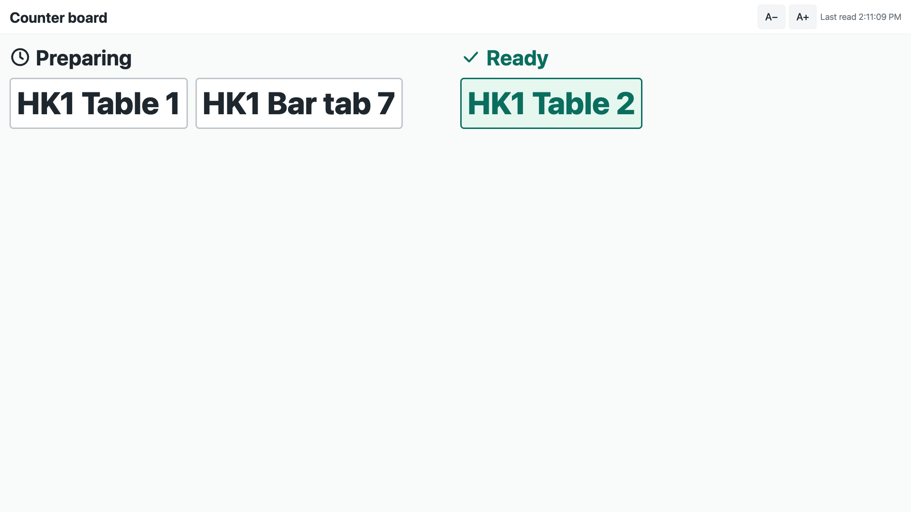

# Kitchen screen: a screen per station, an expo screen and a Now serving board — the recipe

Every restaurant past the first one runs its kitchen from screens. The till already sends each kitchen station its own ticket when a cashier or a server presses *Send* (a counter sale or a table's check), and prints it on the station's printer. What the kitchen does not have is a screen that shows those tickets, lets a cook mark them done, and tells the counter what is ready. This recipe gives each station a screen, the pass an expo screen, and the dining room a *Now serving* board, on the till's own tickets.

**Reference implementation:** `samples/s59_kitchen_screen/`.

**When to use it.** Quick service, full service, a bar, a café, a cloud kitchen, a hotel's restaurant: any store whose till sends to kitchen stations. The stations are the till's own *Kitchen Stations*; each dish reaches its station by the station on the item, its item group or the register; the register that sends has a printer row for each station.

**The four rules, here.** No code runs inside the retailer's iVendNext. One address is called, your service: by the *Make link* button, and by each screen's page. The service reads and moves tickets only through the till's station-ticket door (`station_tickets`, `station_ticket_move`), as the app's own user, with one right: *May Work a Kitchen Screen*. Sold out goes through the till's own item availability (`item_availability`, `set_item_availability`), at the screen's own store only. The service never voids, comps or changes a line, and never sends a price.

## What the kitchen and the counter see

| | |
|---|---|
| A station screen: the grill's tickets, oldest first, each with its timer and one button |  |
| The expo at the pass: each order's tickets together, and what is still to make |  |
| The *Now serving* board on a TV |  |

## Steps

### Settings

1. Install the manifest. It adds the settings (one per company, with a row per store), the screen record and its stations table, the roles **PP KSC Manager** and **PP KSC Integration**, the button *Make link* and its service (off), and the feed registration that makes the app's own user (`pp_ksc@integration.invalid`; leave the feed off).
2. Give the app's user its stores and its key, in this order, on its User record: keep *Is Desk User*, tick **Is POS User**, choose a **Shift Profile**, link a **Retail Permission** with **May Work a Kitchen Screen** and nothing else (a new Retail Permission may come with *layaway* ticked: untick it); add one row for each store to the store access table (each store once, with a register there); **Save**; then **Generate Keys**.
3. **Sold out, only if the kitchen should mark it:** in **Role Permissions Manager**, give **PP KSC Integration** **Read**, **Write** and **Create** on *Retail Item Availability*. ⚠ The till does not limit that right to the user's stores; the app marks only the screen's own store, and only a dish on that screen's board or already sold out there.
4. On **PP KSC Settings**, one row per store: *Sold out from the screens*, *Warn after* and *Late after* (8 and 15 minutes to start), the screens' look (*Dark*), an accent colour, the screens' language, *Ticket size* (*Standard*) and *Board shows tables* (off: the board shows counter sales' numbers only). Consent to the service and switch the button on.

### Screens

5. The manager makes a **PP KSC Screen** for each screen (a manager of one store gets a **User Permission** on *Warehouse* for that store, so their screens reach that store alone; it scopes every store-linked record they open, as for any store-scoped user): its name, its kind (*Station*, *Expo* or *Board*), its store and, for a station screen, its stations (one, or a few on a small kitchen's screen). **Make link** (on one record, or on many ticked in the list) writes the screen's number and its link. The manager opens the link on the screen's browser, full screen.
6. A link that leaked is replaced by pressing **Make link** again on that record: its number goes up by one and a screen open with the old link stops within 15 seconds. Changing a screen's kind, store or stations stops its link until *Make link* is pressed again.

### A service

7. The till sends. Each station's screen reads its store's board every 3 seconds and shows its stations' tickets not yet bumped, oldest first: the call number (the table, or the sale's number), the till, the time waited, each dish with its choices under it, the guest and course, the note, the allergen line. The timer turns amber, then red, with *Late soon* and *Late* beside the colour. The tickets size with the screen (about 4 across a 10-inch tablet, 5 on a TV); **A−** and **A+** change them on that screen, kept on that device over the store's *Ticket size*. The screen shows whole tickets only: the rest wait behind *+N more tickets* and the page buttons, and a ticket taller than the screen shows *+N more dishes*, which opens it whole.
8. One tap moves a ticket one step, through the door: *Start*, *Ready*, *Bump*. The service reads the board first and refuses a ticket of another station or another store, a skip and a step back; the door answers a double tap as *already*. A void ticket shows *Void: stop making* with its dishes struck through; the cook bumps it. *Recall* shows the tickets bumped in the last 30 minutes, read only.
9. The expo shows one card per order, each station's ticket inside it, and *Still to make* across the top (each dish's quantity over the tickets not yet ready, less what a void of the same order cancels). **Bump order** appears when every station's part is ready, and bumps them all.
10. The *Now serving* board shows *Preparing* and *Ready*: an order is ready when every station's ticket of it is ready or bumped, and it leaves when all are bumped. Call numbers only, no dish.
11. **Sold out:** a cook taps *Sold out* and marks a dish on the board's tickets; the service calls `set_item_availability` for the screen's own store, and the tills stop selling it (a till's sale is refused; a line an app adds to an open check is refused when the check is paid; a till that is offline sells it until it syncs). The same list clears it.

## What the retailer does

Day to day the tills send as before; the kitchen taps tickets on its screens; the counter reads the board. The app never voids, comps, changes or prices a line: those are a manager's decisions, at a till.

## Limits

- A ticket is on the board only when its station's printer took it from the till: a station with no printer on the sending register, or a printer that refused, has no ticket.
- A screen needs the internet. Tickets a till printed while the store was offline are on paper only and never reach the board.
- A ticket the till's print agent later reports unprinted leaves the board without a bump; its dishes come back on the next *Send*.
- A screen reads every 3 seconds: a new ticket shows within about 4 seconds. Its corner shows *Last read* in amber when its last good read is older than 15 seconds.
- A recalled ticket is shown again, never moved back to ready (the door has no step back).
- Sold out needs the item-availability right (read, write and create), which the till does not limit to a user's stores. A dish marked and then cleared at one store keeps that store's own availability row, which wins over a later sold out for every store: mark it again at that store, or clear the store's row in Desk.
- A dish already sold out that no ticket on the board names is listed by its item code.
- A line of a sold-out dish that reaches an open check by another way (an app adding to a check) is refused when the check is paid, not when it is added.
- Allergens show only where the store's receipt theme shows them on the item.

## Technical notes

- **The link is an authorisation.** A screen's link carries the site, the screen record, its number and an HMAC-SHA256 signature of the three with the *Make link* subscription's secret (`#s=…&t=<record>.<number>.<signature>`, after `#`). The service checks the signature before it reads anything, then reads the record and refuses a link whose number moved on, or whose kind, store or stations changed since it was made (a hash of the three, written beside the number).
- **What makes a link work is the app's.** The number, the link and what it was made for carry `write_roles` of the app's role and System Manager: a manager cannot lower a number to bring a leaked link back.
- **One read for a store's screens.** A copy of the function keeps a store's board for 1.5 seconds, its sold-out list for 30 seconds, and a verified screen with its store's row for 15 seconds, so the screens of one kitchen that land on the same copy read the retailer's board at most once every 1.5 seconds between them. A move reads the board fresh first.
- **Calls:** 20 calls a minute per screen to the service. On one copy they cost the retailer up to 40 board reads a minute for a store (shared by that copy's screens of the store, kept 1.5 seconds), 4 screen-record and 4 store-row re-reads, and 2 sold-out reads when sold out is on. A move is a fresh board read and the move; a sold-out tap one call; at most one of either a screen every quarter of a second on each copy.
- **Live, without a socket.** The door's notice (`mpos_station_ticket` on the site's own socket) reaches only a server holding that socket. A function holds none between calls, so the page reads every few seconds, which the door's own page says to do when the socket is down. A partner hosting a container can hold the site's socket (namespace `/<site>`, `Authorization: token key:secret`, `Origin` the site's address, a `Cookie` with no `sid`) and tell its screens to read at once.
- **The page.** Served by the service (`page.html`, `page.js`, `page.css`, and the kit's `ivn-kit.css` and `ivn-kit.js`), with a policy that allows nothing from another site and no inline script. Every word the retailer wrote is put on the page as text, never as markup.
