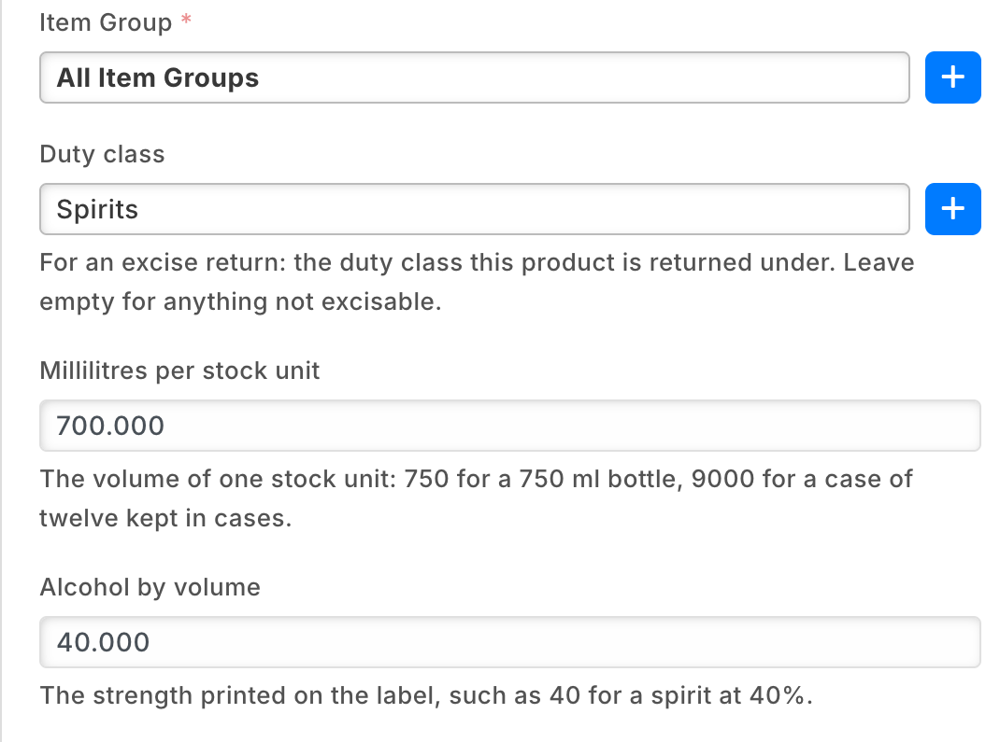
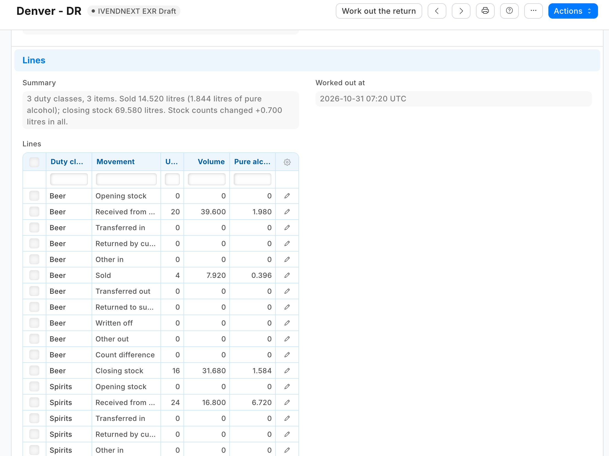
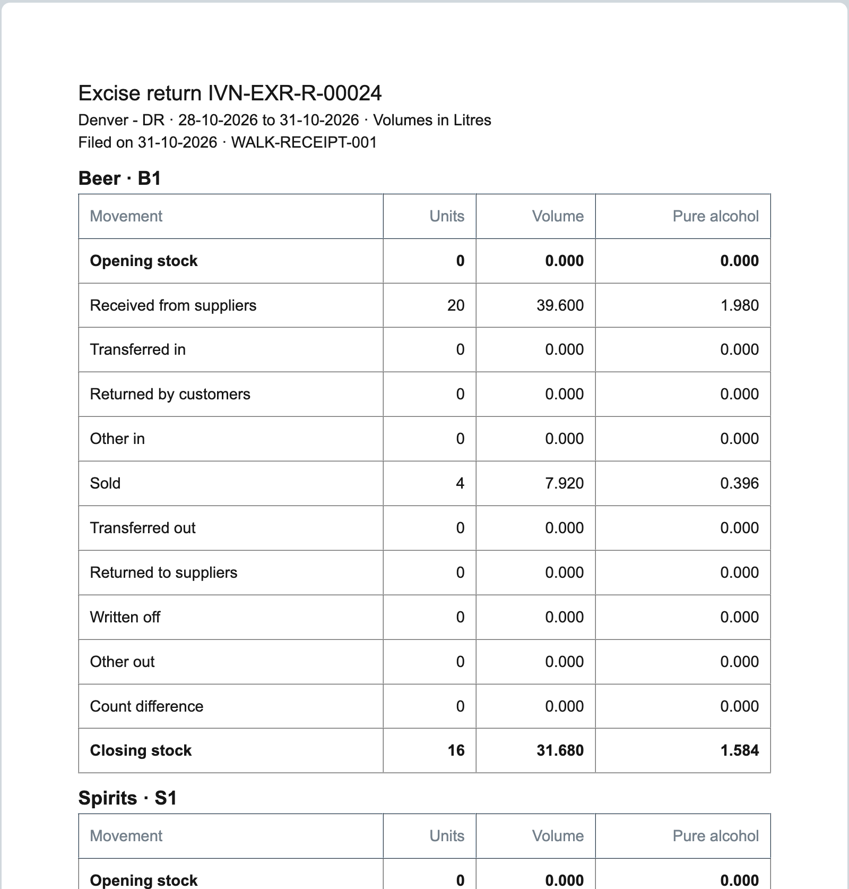

# Liquor excise returns — the recipe

A liquor store files an excise return every month or quarter: what it held and what moved, in volume, by duty class, and often the volume of pure alcohol. This recipe gives the retailer the **duty class** and the **return** as its own records in iVendNext Desk, three fields on each liquor item, and a return worked out from the store's own stock ledger and **kept as filed**. It is for an iVendNext Partner, or the CitiXsys Consulting Team, who wants a store's excise figures off the spreadsheet without code inside the retailer's iVendNext.

**Reference implementation:** `samples/s62_liquor_excise_returns/`.

**When to use it.** The store sells wine, spirits or beer and reports volumes to an excise or licensing authority. The sale, the receipt, the transfer and the count are ordinary: the app reads what iVendNext booked. The authority's own form, codes and duty rates are yours to add for the market you serve.

**The four rules, here.** No code runs inside the retailer's iVendNext. One service, a function paid per call, answers one Desk button and reads and writes through the record API as the app's own user. It reads the store's stock ledger and items and never counts stock itself. It reads no customer, no price and no money, and it moves none.

## What the store sees

1. **Set-up.** Store staff open **PP EXR Duty Class**, **+ Add**: the class as the authority names it (*Spirits*, *Wine*, *Beer* …) and the authority's code if the form has one. Then, on each liquor item, under the item group: **Duty class**, **Millilitres per stock unit** (750 for a 750 ml bottle; 9000 for a case of twelve kept in cases) and **Alcohol by volume** (40 for a spirit at 40%).
2. **Every day.** Nothing new: the till sells, Desk receives, transfers, writes off and counts as before.
3. **A return.** The back office opens **PP EXR Return**, **+ Add**: the company, the store, **From**, **To** and **Volumes in** (Litres or US gallons), all set once. Saved, it is a draft numbered `EXR-R-00001`. **Work out the return**: twelve lines per duty class appear, each in units, volume and pure alcohol, and a summary.
4. **Filing.** **Print**, format *PP EXR Excise return worksheet*: the figures for the authority's form. The Stock Manager files them and moves the return to **Filed** (*Actions*, *PP EXR File*), then fills **Filed on** and the authority's **Filing reference**. The figures are locked.
5. **A correction.** A new return for the period. A filed return never changes. A draft not wanted: *Actions*, *PP EXR Drop* (Stock User).

## Duty classes

The record type `PP EXR Duty Class`, named by its class (`field:class_name`), tracked:

| Field | What |
|---|---|
| `class_name` | **Duty class**, as the authority names it; required and unique |
| `return_code` | **Authority's code**: the code or line the return form gives the class; printed beside it |
| `notes` | which products belong, or the rule that sets the band |

Three fields on **Item**: `pp_exr_class` (a Link to the duty class, a standard filter of the Item list), `pp_exr_ml` (**Millilitres per stock unit**) and `pp_exr_abv` (**Alcohol by volume**, a percent). Millilitres keep a miniature exact (37.5 ml) at a site's usual three places. **Stock User** reads duty classes; **Stock Manager** and **Item Manager** keep them.

## Returns

The record type `PP EXR Return`, numbered `format:EXR-R-{#####}`, tracked: `company` and `store` (a Warehouse), `unit` (**Volumes in**: *Litres* or *US gallons*), `from_date` and `to_date` (both inclusive), all five `set_only_once` so the lines the service writes are always of the return's own period, the read-only `summary`, `lines`, `worked_out_by` and `worked_out_at` the service writes, and `filed_on` and `filing_reference`. Its table `PP EXR Return Line`, all read only: `duty_class`, `return_code`, `movement`, `units`, `volume`, `pure_alcohol` (three places each).

**The lines**, twelve per duty class with stock or a movement, in this order: *Opening stock*, *Received from suppliers*, *Transferred in*, *Returned by customers*, *Other in*, *Sold*, *Transferred out*, *Returned to suppliers*, *Written off*, *Other out*, *Count difference*, *Closing stock*. Out lines are positive figures; *Count difference* carries its sign. Opening plus the in lines, less the out lines, plus the count difference, is the closing.

**Read from the store's stock ledger** (`Stock Ledger Entry`, the store's `warehouse`, `is_cancelled` 0): the opening and closing are each item's balance (`qty_after_transaction` of its last row before the period and up to its end, the last by `posting_datetime` then `creation`, as iVendNext orders them). The movements are the period's totals per item and voucher type (Sales Invoice, POS Invoice, Delivery Note out *Sold*, in *Returned by customers*; Purchase Receipt and Purchase Invoice in *Received from suppliers*, out *Returned to suppliers*), and the Stock Entries' net movement per entry by purpose (*Material Transfer* in or out *Transferred*, *Material Receipt* in *Received*, *Material Issue* out *Written off*; anything else *Other*). A stock count writes its row with a quantity of 0 and sets the balance, so *Count difference* is what is left. **Volume** is units times millilitres over 1,000 (US gallons divided by 3.785411784); **pure alcohol** is volume times strength; each line rounded once to 3 places, half away from zero.

**The workflow** `PP EXR Return`: *PP EXR Draft* to *PP EXR Filed* by **PP EXR File**, allowed to the Stock Manager; *Draft* to *PP EXR Dropped* by **PP EXR Drop**, allowed to the Stock User. A draft is the Stock User's to edit (a manager who also makes returns holds Stock User too); a filed return is the Stock Manager's, for *Filed on* and the reference.

**The lock** `PP EXR return locked once filed` (`locked_in_state`, refuse, *Filed* and *Dropped*) keeps the company, store, unit, period, lines, summary and who worked it out. It judges the step the record was saved in, so *File* (from a draft) passes it, and the manager's filing date and reference afterwards are not locked.

## Steps

1. **Add the record types above** to your manifest (`doctypes`, the lines table with `"istable": 1`, every line field `read_only`), and the three Item fields (`custom_fields`; never `reqd` or `precision` on the retailer's own record type).
2. **Add the workflow** (`workflows`) and **the lock** (`save_rules`) over the figures and their source. It installs switched off: the retailer switches it on.
3. **Add the button** (`desk_actions`, `send_fields` `name`, `conditions` on `workflow_state` your Draft) and its service (`extension_subscriptions`, point `desk_action`). The service reads the return, the duty classes, the items with a class, and the store's ledger with the list API's own sums (`fields` `["item_code","voucher_type","sum(actual_qty) as qty"]` and `group_by`), never a row per sale; then writes the lines, carrying the return's `modified` as read.
4. **Add the worksheet** (`print_formats`, Jinja, placing the letter head itself, grouping the lines with `groupby("duty_class")`) and a `documentation` property setter per record type.
5. **Check it before it reaches a retailer:** `python3 tools/check/check.py samples/s62_liquor_excise_returns`.

## What the retailer does

1. **Install the app.** It adds the duty class, the return, the three Item fields, the workflow, the lock, the worksheet and the button, and makes the role `PP EXR Integration` and the app's own user with that role alone.
2. **Switch the lock on:** Desk › *Retail Save Rule* › *PP EXR return locked once filed* › **Enabled**. The press refuses while it is off (it reads the rule's `enabled` and `mode`).
3. **Give the app's role Read** on Stock Ledger Entry, Stock Entry, Item and Retail Save Rule (Role Permissions Manager).
4. **Switch the service and the button on** (Retail Extension Subscription: read, consent, enable; Retail Desk Action: enable).
5. **Make the duty classes and fill the three fields** on each liquor item. Write on Item decides what a return counts: give it to whom you trust with the return.

## Limits

- **The books as they stand when it is worked out:** a back-dated entry changes the earlier books, not a filed return; the next return's opening then differs from this one's closing by it.
- **Not stopped:** two returns for one store and period (a correction is a new return); an item moved to another class (its stock moves with no line); a period not yet over. One return a warehouse.
- **A till's sales are dated by the company's till posting setting:** posted when the day is closed, they take the closing's date, so close each till's last day of the period before midnight or that day's sales count in the next period; posted as each sale is made, a sale keeps its own date.
- **By document type:** an internal (inter-company) delivery or receipt counts as *Sold* or *Received*; a *Material Receipt* as *Received from suppliers*. An item variant needs its own three fields. Units add each item's own stock unit; a US proof gallon is twice a pure-alcohol gallon. The count difference also carries the rounding (a few thousandths).
- **An item missing its millilitres or strength** is counted in units only for what it lacks, and the summary names it.
- **A count and a movement at the same second** are not told apart; the sum stands.
- **One store and one period a press**, at most 366 days. A store with very many liquor items can run out of the press's time (about 50 balance times a read, four reads at a time); a shorter period does not shorten it.
- **The app's user holds no User Permission:** one silently narrows what it reads.
- **Duty, rates and the authority's form** are a version of your own: add them on top of these figures.
- **A return with no lines can be filed:** a workflow step cannot ask for lines; the manager checks them before *File*.
- **A System Manager can switch the lock off or delete a return;** no other role may. The return's history shows it.
- **Desk shows the step and button with the app's prefix** (*PP EXR File*).
- **Uninstalling removes the duty classes and returns**; the install's export keeps a copy.
