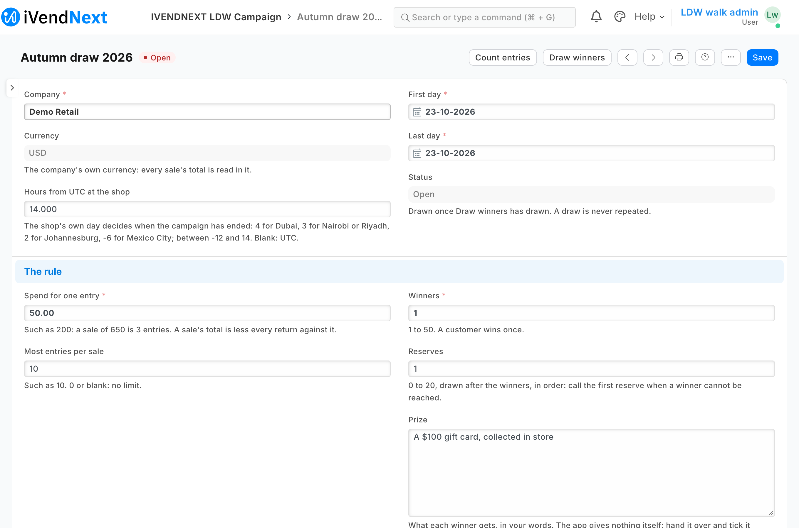
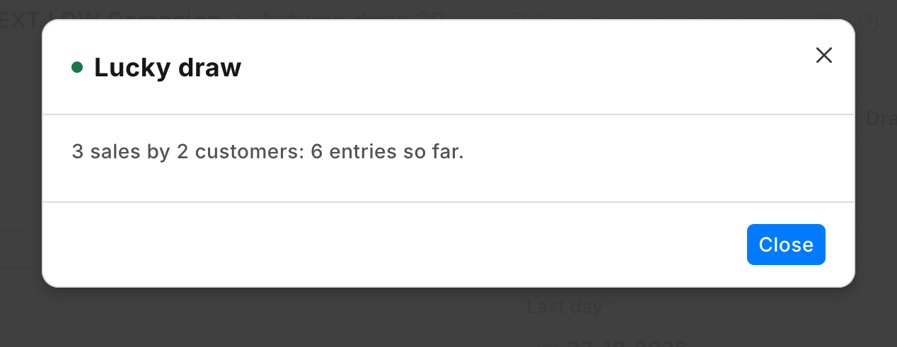
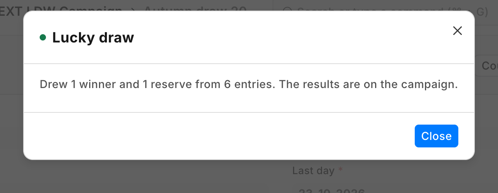
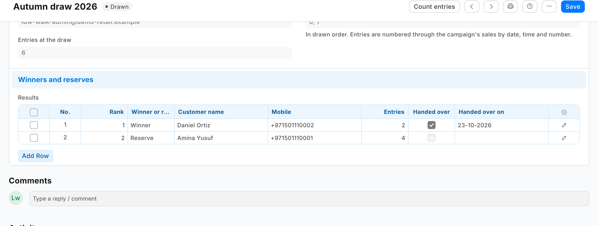

# Lucky draw: entries by spend, and a fair draw of the winners — the recipe

A retailer runs a *shop and win* campaign: every so much a customer spends at its tills during the campaign is one entry, and after the last day the winners are drawn. The retailer wants the entries counted by its own rule, returns taken off, the till's walk-in sales left out, and a draw that is fair and that nobody can repeat or change after it. This recipe does it with a **campaign** record of the app's own and two buttons on it. A manager presses **Count entries** during the campaign and **Draw winners** once after it. Your service reads the campaign's till sales, counts each sale's entries, draws the winners and reserves, and writes the results on the campaign. It is for an iVendNext Partner, or the CitiXsys Consulting Team, who wants a campaign without code inside the retailer's iVendNext.

**Reference implementation:** `samples/s44_lucky_draw/`.

**When to use it.** The retailer's customers are named on their sales (the cashier adds the customer, or a loyalty card does). The campaign's rule is about spend: so much spent, one entry. For a reward that every customer above a threshold gets, not a draw, see S25 (*Gift card on spend*); for a check at the till before payment, S23.

**The four rules, here.** No code runs inside the retailer's iVendNext. One address is called, your service, and only when someone presses a button. The service reads the retailer's sales and writes only its own campaign record: it changes no sale, price or customer, and never an edit someone saved after it read the campaign. It moves no money: the prize is the retailer's to hand over.

## What the manager sees

1. The manager makes a campaign: its company, its first and last days, the spend for one entry, the most entries a sale may give, the tills and the customer groups that take part (none listed: all), the winners, the reserves, and the prize in the retailer's words.

   <a id="the-campaign"></a>
2. **Count entries**, any time: *"412 sales by 297 customers: 1,036 entries so far."* The counts are written on the campaign.
3. **Draw winners**, after the last day (by the campaign's own *hours from UTC*): *"Drew 3 winners and 2 reserves from 1,036 entries. The results are on the campaign."* The campaign now reads *Drawn*; its results list each winner and reserve with their name, mobile and e-mail from the retailer's own customer record, their entries, the entry number drawn and the sale holding it. Its rule can no longer change, and the button is gone.
4. The manager calls the winners, hands over the prizes and ticks *Handed over* on each row.









## Steps

1. **Add the campaign record type** with three tables of its own: the tills (POS Profile), the customer groups (Customer Group), and the results (rank, winner or reserve, customer, the customer's name, mobile and e-mail fetched from the customer on save, entries, the entry number drawn, the sale, *Handed over*). Give the campaign's rule fields `read_only_depends_on: "eval:doc.status=='Drawn'"`, so the rule is locked once drawn, and make the status, the counts and the draw's record read-only: only the service writes them. See the sample's `manifest.json`.

2. **Add the two buttons on the campaign's form**, for the app's own manager role, each sending the campaign's name only, each answered by its own service ([Desk action recipe](desk_action.md)). *Draw winners* shows only while the campaign is not drawn:

   ```json
   "extension_subscriptions": [
     {"key": "count", "point": "desk_action", "label": "Lucky draw count",
      "endpoint_url": "https://your-service.example/press/count", "timeout_seconds": 10},
     {"key": "draw", "point": "desk_action", "label": "Lucky draw",
      "endpoint_url": "https://your-service.example/press/draw", "timeout_seconds": 10}],
   "desk_actions": [
     {"record_type": "PP LDW Campaign", "label": "Count entries", "placement": "form", "service": "count",
      "roles": ["PP LDW Manager"], "on_draft": 1, "on_submitted": 0, "send_fields": "name"},
     {"record_type": "PP LDW Campaign", "label": "Draw winners", "placement": "form", "service": "draw",
      "roles": ["PP LDW Manager"], "on_draft": 1, "on_submitted": 0, "send_fields": "name",
      "conditions": [{"field": "status", "operator": "!=", "value": "Drawn"}],
      "confirm_text": "Draw the winners and reserves now? A draw is never repeated, and the campaign's rule can no longer change."}]
   ```

3. **Add a feed registration** for the app's user (leave it switched off; its description at most 140 characters, the retailer's own limit): name no user: from POS version 2.1.0.667 the install makes the app's own user and names it, and a hosted service that serves many retailers is handed that user's key by the retailer's site after the install or an update (*Connect again* only if the site could not reach the app, or a key was lost or changed; guide chapter 14b).

4. **Write the service** (`samples/s44_lucky_draw/draw.py` and `service/app.py`, standard library). For each press:
   - check the signature (that button's subscription's secret);
   - read the campaign (`GET /api/resource/PP LDW Campaign/<name>`); on *Draw winners*, answer *Already drawn* when it reads *Drawn*, and refuse before the campaign's last day has ended at the retailer's iVendNext;
   - read, with the app's user, one list read each (`GET /api/resource/<type>?fields=…&filters=…&limit_page_length=0`): the submitted till sales of the campaign's company and days (and tills), the submitted returns since its first day, every POS Profile's walk-in `customer`, and, when the campaign lists groups, the Customer Group tree (`lft`, `rgt`);
   - count each sale's entries: what the customer paid (`base_rounded_total`, or `base_grand_total` when iVendNext does not round) less its returns, divided by the spend, rounded down, capped; leave out the walk-in customer and the groups not taking part; number the entries through the sales in order of date, time and number;
   - on *Count entries*, write the counts and the list's fingerprint; on *Draw winners*, draw with a cryptographic random source, one place per customer, winners then reserves, and write the results, the draw's record and *Drawn* (`PUT` with the campaign's `modified` as read);
   - answer with a message and `refresh` (the extension point's vocabulary).

5. **Rights.** The manager role needs *Select* on **POS Profile** and **Customer Group** for the campaign form's lookups (the role alone gets no answer), and *Read* on **Company**: the form fills the campaign's currency from the company (`fetch_from`), and a fetch needs read (*"You need Read permission to fetch values from Company"*). The app's user holds the app's integration role alone, with read on **POS Invoice**, **POS Profile** and **Customer Group** (measured on our test bench: iVendNext refused each until it was given; a right of *select* alone answers the names only). The manifest gives the role read and write on the campaign. **A campaign's groups are only as safe as the customer's group.** The till's edit sheet lets a cashier change it (the retailer's cashier role saves customers): a customer moved into the campaign's group before a sale takes entries. The retailer closes it by putting *Customer Group* at permission level 1 in *Customize Form* and giving level-1 write only to its managers: the cashier's change then leaves the group as it was ([Customers by store](customers_by_store.md), rule 7). Put that in the setup, with what follows from it: a cashier can no longer give a new customer a group (one created at the till takes the default customer group in Selling Settings, or none), the till still says *Saved* after a group change it dropped, and no cashier's role may keep level-1 write (Sales Master Manager has it by default).

## Tell the winners

The app writes the winners; calling them is the retailer's. A retailer's own Notification reads only the campaign's own fields, so it cannot send to each result's mobile: a message to each winner is a partner's version, from your own service after the draw.

## Bounds

- **Till sales only**: a Desk sale (Sales Invoice) or a web order does not count.
- **Draw once every till has sent its sales**: a sale that reaches the retailer's iVendNext after the draw is not in it.
- **One press reads the whole campaign.** On our test bench iVendNext answered 12,157 sales (2.7 MB) in under a fifth of a second to a service beside it. A press stops reading after 7 seconds and then writes nothing: split a campaign that large by till.
- **Returns** are the till's own; a credit note made in Desk against the day's closing invoice takes no entries off.
- **The app never draws twice**; the manager role cannot delete a campaign. A person with write on campaigns can still add or remove a result row in the form, or change a drawn campaign through the API, and a System Manager can delete one and draw again; the campaign's history (its version log) shows every such change. Give the manager role only to people you trust.
- **The customer's own entries** are not shown at the till or on the receipt.
- **Removing the app removes its campaigns.**
- **Blank hours from UTC** reads as UTC: a retailer west of UTC sets it.
- **The law.** A draw for customers may need a permit where you sell (a promotion permit in the UAE, for example), and some countries require a free way to enter; both are the retailer's. The app counts sales only.

## See also

[Desk action](desk_action.md) · [Gift card on spend](gift_card_on_spend.md) · [Make it your own](make_it_your_own.md) · guide chapter 9 (the extension points)
