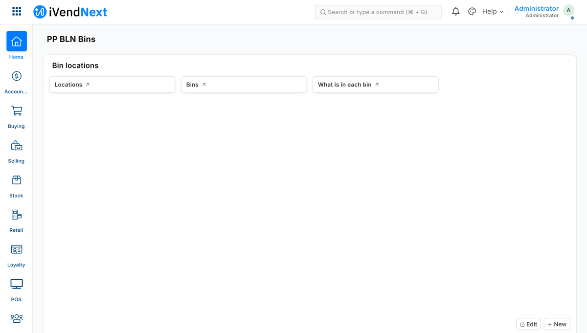
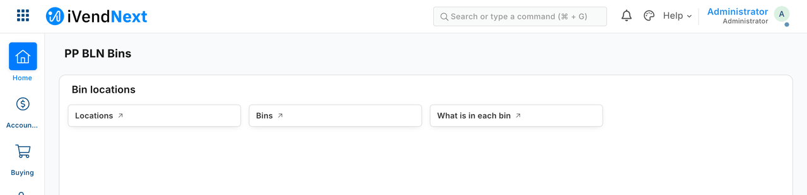
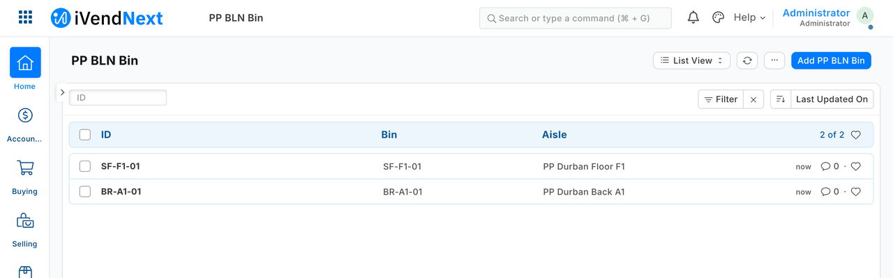
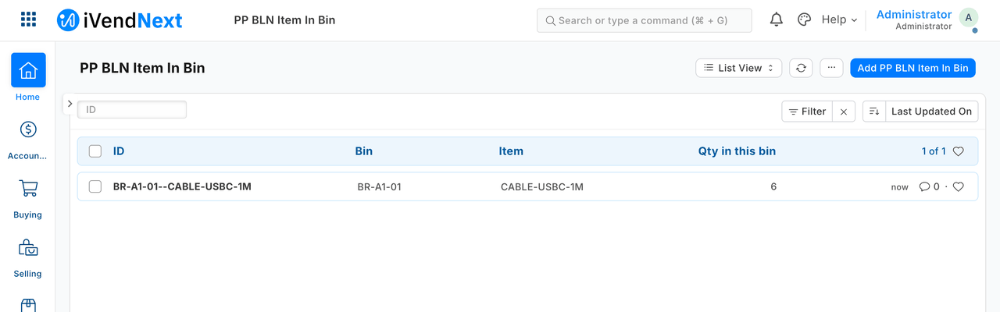

# Shipping your own data in a manifest — the recipe



*What the bin-location manifest installs, as staff see it in Desk: the workspace, the bins, and what is in each bin. The workspace is never in the Desk's menu as this picture shows it: the retailer's administrator opens it from the App library, and your app's users find it with the search bar.*

A manifest is one file that adds **your own record types and fields, and whatever else the retailer's administrator could add in Desk,** to a retailer's iVendNext, without you writing code inside the retailer's iVendNext. It is for iVendNext Partners, and for the CitiXsys Consulting Team. **Reference implementation:** `samples/s11_approvals/manifest.json` (one workflow on the customer's Purchase Order), `samples/s2_bins/manifest.json` (five record types, a field on Item, a print format, a workspace, two webhooks) and `samples/s1_warranty/manifest.json` (one record type the till key reads). The checker is `tools/manifest/validate.py` (a copy of iVendNext's own), and `tools/manifest/site_rules.py` adds three stops iVendNext's install makes after it (a feed description over 140 characters, a bad Dynamic Link, a record type's name over 61 characters); `ivn check` runs both, and `ivn try` puts a manifest on your own sandbox.

**When to use it.** Rung 4 of the build ladder. Use it when configuration cannot hold your data and your app needs it **inside** the retailer's iVendNext: staff see it in Desk, a till key reads it, or a webhook reports on it. A manifest runs nothing, except a certified module it carries, which runs in our sandbox. Your logic lives on your server (a connected app) or in a till key.

> **Package or module?** A **package** is your whole app: its records, fields, print formats, buttons, services and label layouts, sent as one manifest. The retailer's administrator presses **Install** in the App library, reads what it will change, ticks **I agree** and presses **Install**; later the retailer can update it or remove it, and *Connected apps* lists every one. A **module** is one small program that does one job at an extension point, such as adjusting a price or checking a sale before payment. **Two extension points take a module today: the check before payment and pricing.** Your package can carry it ([chapter 7](../guide/07_manifests.md), `extension_modules`), or the retailer's administrator adds your file in Desk, with a certificate our review team signs, and can withdraw it. **In short:** a package is the app, and a module is one program that does one job.
>
> *Technical note:* a package installs from the **App library**, or by hand from the **Retail Extension Package** screen in Desk; a module is a **Retail Extension Module** record that the retailer's administrator adds in Desk, or your package installs, at an extension point that takes one ([the Wasm kit](../tools/wasm_kit/README.md)).

## Steps

1. **Choose your prefix.** One to three upper-case words (`ACME BINS`) and the matching app name (`acme_bins`); `ivn new acme_bins --from s2` sets both. Its first word is your company's own first word, so the App library accepts it as yours ([Publish your app](../site/pages/publish.md)). A name needs no prefix: only a field you add to one of the retailer's own record types starts with the lower-case prefix (`acme_bins_default_bin`).

2. **Write `manifest.json`.** Set `"manifest_version": 2`. An app may do anything the retailer's administrator can do in Desk, on the retailer's own record types too. The kinds a manifest may carry:

   | Kind | What it is | Example (S2) |
   |---|---|---|
   | `doctypes` | your record types; child tables allowed | `PP BLN Bin`, `PP BLN Item In Bin`, the child `PP BLN Bin Movement` |
   | `custom_fields` | fields on your own types, or on the retailer's, where the field's name starts with your prefix; a field may carry `write_roles` and `read_roles`, so only named roles change or read it ([below](#a-field-only-named-roles-read-or-change)) | `Item.pp_bln_default_bin` |
   | `property_setters` | display changes on a record type or a field, the retailer's own included: relabel, hide or require a field | `PP BLN Bin.bin_code` bold |
   | `print_formats` | templates for your records or the retailer's; a format may declare `default_print_language`, the language it prints in (a language the site has; `ar` prints right to left) | `PP BLN Bin Label` |
   | `notifications` | e-mail or in-app alerts on any event of a record that is not one of the till's own; on the till's own records, a reminder before or after a date | — |
   | `workspaces` | a Desk page with headers and shortcuts | `PP BLN Bins` |
   | `sale_attributes` | an optional sale detail a till key can fill | — |
   | `webhooks` | signed calls to **addresses you list** in `allowed_urls` | a booked sale → your service |

   **The rest of the kinds: the screens, approvals, the feed, the till key and the extension points.**

   | Kind | What it is | The rules |
   |---|---|---|
   | `reports` | a **Report Builder** report: columns, filters, order, totals row, roles | Report Builder only: a *query* report (SQL) and a *script* report (Python) are refused. A report may name a field the same manifest adds, and a workspace may link the manifest's own report: the install makes your fields first and your pages after your reports |
   | `number_cards` | a count, sum, average, minimum or maximum over a record type | may name a field the same manifest adds |
   | `dashboard_charts` | count / sum / average over time, or group-by; line, bar, percentage, pie, donut | may name a field the same manifest adds |
   | `dashboards` | your charts and cards on one page | — |
   | `list_settings` | the list view's columns and counters | any record type, the retailer's as well as your own; an entry with no `fields` leaves the list's columns as Desk makes them |
   | `workflows` | states, transitions, the role per transition, a field set on entering a state (approvals by workflow) | any record type but the till's own records. A state may submit or cancel (`doc_status`), a transition may carry a `condition`, and the mail goes as `send_email_alert` says; `update_field` writes only your own field. Missing states and actions are made, and removed again at uninstall unless another workflow uses them. Sample S11 is one |
   | `naming_rules` | a numbering rule (prefix + digits, optional conditions) | anything but the sale's own records (POS Invoice, Sales Invoice, the day's opening and closing, the merge log), which the retailer's series and its tax authority read |
   | `links` | the **Connections** panel: your records listed under an iVendNext record (e.g. claims under a Customer) | `link_fieldname` is a Link on your record type pointing at that record type |
   | `registered_applications` | your service's **event-feed** registration (`recipes/event_feed.md`) | **one per app**: every record type your service follows goes in its `events`; its description holds at most 140 characters. The install makes your app's own user, `<app>@integration.invalid` (API only, one role `<PREFIX> Integration`), and names it on the feed as the user your service reads as ([the event feed recipe](event_feed.md), step 1, says how its key reaches you and the licence bound). At uninstall its queue rows go with it |
   | `remote_keys` | your **remote till key** (the till calls your service) | on every store's till from the install, just before the till's last key; a store moves or hides it in the Designer (**POS Studio > Apps**). `https` only, an address you list; time to answer 3 seconds unless raised, at most 10 ([the till key page](../contracts/pages/remote_till_key.md)) |
   | `extension_subscriptions` | your service for one extension point: `desk_action`, `page`, `check`, `capture`, `doccheck`, `fulfil`, `price` (a module's service only) or `payer` (label 1–40, `https` address you list, `timeout_seconds` at most 10: a scan or quantity-change capture at most 3, a payer at most 5; a page's `page_…` settings and roles); a module's service has `transport: "wasm"` and no address ([below](#a-certified-module-in-your-package)) | on from the install, under its one consent, for every store; a payer stays off until the retailer names its clearing mode. The install makes the secret (`<app>:sub:<key>`). Each extension point's settings are in [chapter 7](../guide/07_manifests.md) (a payer's `clearing_mode` is the retailer's, refused in a manifest) |
   | `desk_actions` | a button on a Desk record (roles, when it shows, its inputs, `send_fields`) answered by one of your `desk_action` subscriptions (`service` = its `key`) | a service the manifest does not install is refused, and so is the role `Guest` or `All` |
   | `save_rules` | a rule checked on every save of a record type, the retailer's own or yours (the ten kinds and their keys: [the save rules page](../contracts/pages/save_rules.md)) | on from the install; a role rule stays off until the retailer names the role, and `"enabled": 0` keeps any rule off. No markup in the message; on a sale the product lets a rule only flag; rules run in `sequence` order; **a rule may name only a field that exists at install** (a workflow in the same manifest is made first, so a rule may read its `workflow_state`) |
   | `fiscal_readers` | one outside fiscal service's result on the sale: your result fields at their own permission level, the status map, the writer role and its users | stays **switched off** until the retailer sets it up; no API key is made (the retailer makes it). The steps the retailer takes are in guide chapter 7 |
   | `extension_modules` (sandboxed modules) | a module we certified, for the check before payment or pricing, run by an `extension_subscriptions` service with `transport: "wasm"` | `manifest_version` 2; one module per partner and extension point; a module version is used once on a site; the fields and the rest of the rules: [chapter 7](../guide/07_manifests.md). The retailer's administrator can still add a module in Desk instead; a package is refused where the retailer already added a module of yours at that extension point |
   | `label_layouts` | the label the till prints for an item or a basket line: HTML, or Zebra printer commands (`zpl`) for a counter's label printer, with placeholders from a closed list ([the label layout page](../contracts/pages/label_layout.md)) | `manifest_version` 2; kind `html` or `zpl`; placeholders from the list only, no code and no scripts; also up to three of the item's own fields, `{item.<fieldname>}` (each a Data, Select, Int or Check field every role reads), and one line detail, `{detail.<attribute>}`; a `zpl` template starts with `^XA`, ends with `^XZ` and draws its barcode over `{barcode}`, not `{barcode_svg}`; label stock 10 to 150 mm, 1 to 10 labels per row |
   | `list_marks` | a coloured label on a row of a Desk list, when the row's values say so ([the list mark page](../contracts/pages/list_mark.md)) | `manifest_version` 2; display only |
   | `scan_sources` | a table of the retailer's own unit codes that the till's scan reads ([the scan source page](../contracts/pages/scan_source.md)) | `manifest_version` 2; nothing leaves the retailer's iVendNext |
   | `register_books` | the books of a regulated-stock register (a controlled-drug register, a liquor or duty-free book), declared as data: one **Retail Register Book** per book | `manifest_version` 2; installed on or off as each book declares; every name a book reads must exist on the site, or the install is refused; an update cannot change a book (ship a corrected one under a new id); a book with lines is kept, switched off, at uninstall; the register stores are the retailer's own setup, never the manifest's ([the regulated register recipe](regulated_register.md), [the register books page](../contracts/pages/register_books.md)) |
   | `field_rules` | rows on a till theme the retailer already has: a till screen, a field, and hide, relabel, require or show | no switch: a rule that requires a field holds at once, the others reach each till at its next start; `show` on `customer_create` asks for up to three of the retailer's own Customer fields (an ID number, a date of birth) on the new-customer sheet and the till's customer edit ([*Field rules*](../contracts/pages/fields.md), §7e); to make one required, add a save rule |
   | `translations` | your own words in a language, one entry per language ([the install page](../contracts/pages/package_install.md), *Words in a language*) | no markup that carries script |

   A retailer's own receipt lines are not a kind: they are the register's *Receipt Header* and *Receipt Footer*, two text fields the retailer fills in on its register; a tax authority's QR and seal reach the receipt through fiscal readers ([the receipt page](../contracts/pages/receipt.md)).

   **Everything is on from the moment of install, under the one consent, for every store,** apart from the switches the table names. What the retailer does after the install is only what is theirs to decide: give staff the roles, fill a setting only they know.

   Each record type lists its permissions by role, including your app's integration role, so your service can read and write its own records. A right a row leaves out is off. **The install makes each role your manifest names that the site lacks,** with no one in it. A role named with your prefix (`ACME BINS Stock Clerk`) is your app's own and goes when no installed app uses it; any other name (*PO Approver*) is the retailer's from then on and stays at uninstall. A role the retailer already has is used as it is. The retailer's administrator gives each role to the right people, so never tell a retailer to *create* a role the install makes. Every record type your app makes also gives System Manager every right, unless your manifest gives System Manager its own row at level 0. `Guest` and `All` are refused.

   **What leaves the retailer's iVendNext — nothing the retailer did not grant.** A partner sees a retailer's data only through what the retailer grants: the integration key's permissions, the event feed, the remote till key's fixed context. A manifest cannot open another channel:
   - a **webhook** sends only its fixed, thin body (record type, name, event, time); the service reads the record with its own key;
   - a **print format** loads nothing from outside the retailer's iVendNext (an image address can carry data out, so embed images as files or `data:` URIs);
   - a **notification** goes to the retailer's own people (by role, or by a field of the record), never to an address the manifest names.

   Templates that read other retailer data (a receipt reading the company's tax number) are allowed where the output stays with the retailer's staff.

3. **Check it yourself, before anyone installs it:**

   ```bash
   ivn check
   ```

   Every refusal names the element and the reason, for example *"REFUSED webhooks[0] (PP BLN Hook): a webhook calls an address the manifest lists in allowed_urls: the consent shows the shop each one"*.

4. **Install.** On your own sandbox, `ivn try`: it asks no key, no plan, no card and no questions. For a customer, `ivn publish --to <site>` puts it on their shelf and prints the message to send their administrator ([Publish your app](../site/pages/publish.md)). The **retailer's own administrator** installs your app from **App library** in Desk: from a private shelf they first press **Open your shelf** and paste the key you sent; then **Install**, read the summary, tick **I agree**, **Install**. The **Retail Extension Package** screen (paste, **Check**, **Consent and install**) does the same by hand. The summary is written by our code from the manifest itself, never from your description of it, and it lists everything your manifest makes or switches on, every outside address, and each print format as a template that runs on the server when printed, able to read, change and send the retailer's data. The install runs as a background job: *Queued → Installing → Installed*. An app CitiXsys hosts receives its secrets when the site connects to it; for an app you host, each secret (a webhook's, a service's) is shown once to whoever installed, and can be read again on its own record. **Before each part works** lists only what the retailer still decides.

   **A sample's address is not yours.** A kit sample's manifest names a placeholder address for its service, in `allowed_urls`, its webhooks, its services and its till keys. An app CitiXsys hosts gets its own address when you publish. On your own server, replace it with your service's address, everywhere it appears in the manifest.

   The site checks the manifest again, at the check and again when the job runs. It refuses names another app holds and a record type the site lacks. Then it creates everything, and records each element in an **install record** as it goes. If anything fails half-way, it removes what it made and shows **Failed** with the reason.

5. **Use your records** over the record API, like any other type (`recipes/connected_app.md`). The bins service writes `PP BLN Item In Bin` with its movement rows, and the "Where is it?" till key reads it. In Desk:

   

   *The workspace the manifest installs.*

   

   *The bins, each on its aisle.*

   

   *What is in each bin, kept up to date by the service.*

6. **Update: bring a higher version.** Each `ivn try` is a new version, and `ivn publish` sends it. Before the consent, the screen shows what changes from the installed version. An update adds what is new and changes in place what may change; it removes nothing (a dropped webhook, notification, workflow, sale detail or service is switched off and goes at uninstall). **An update keeps each rule's switch,** and a service the customer stopped stays stopped. A lower or equal version, a dropped or renamed record type or field, a field changing type, or a change to a kind that cannot change in place (a number card, a chart, a dashboard, list settings, a naming rule, a Connections link, an event feed, a fiscal reader, a sale detail) is refused: ship it under a new name. The earlier version's record shows **Superseded**. To go back, `ivn rollback <version>` publishes an earlier version's content as a new, higher version.

   **Export, then uninstall.** *Export and uninstall* on the installed version's record first writes every record of your types, with their child rows, and the values of the fields you added to the retailer's records, to a private file on the package, then uninstalls.

7. **Uninstall — nothing is left behind.** The installer removes everything the install record lists (and that a consented version of your manifest made), newest first: webhooks, workspace, print format, property setters, fields, record types and the module. It also:
   - **drops your tables and the columns your fields added.** iVendNext's own delete of a custom record type keeps its table and rows, and its delete of a custom field keeps the column and its values. With the drops, the site's schema after the uninstall equals the schema before the install, kind by kind;
   - removes what **the retailer** did to your types after install (a field added in Customize Form, a role-permission edit, a default print format), so a later install does not inherit a field whose column is gone.

   Two cases it handles in the open. **A sale detail that booked sales already use is kept, switched off,** since a booked sale must keep its detail; a reinstall switches it back on. **If any element cannot be removed,** the uninstall says so (it does not report success); **Finish** on the package completes it. Finish also takes back a job that was killed half-way.
   **Comments and version history** on your records are removed with them; the export holds them with the records, so the export is where they are kept. **Attachments** stay, as files no longer linked to a record.

8. **Reinstall — clean.** A reinstall gives exactly the first install's schema. None of the old data comes back.

## Adding details to a sale

Your app needs to keep something on a sale: a delivery slot, a prescription number, a tax authority's answer. The sale is the record every app and every retailer change wants a field on, and its row has a fixed amount of room, shared by all of them. On a busy site there is room for only a few more short fields. So choose where the detail lives in this order:

1. **Your own record type,** linked to the sale (a `Link` field to POS Invoice on your record). It has room of its own, your app owns it, and it can hold as many details as you need. Best for anything with more than two or three values, or anything your service writes after the sale.
2. **A sale detail** (`sale_attributes`): a short value, up to 140 characters, that the cashier or a till key fills on the sale. It takes no room on the sale's row. Best for one or two short values captured at the till.
3. **A field on the sale** (`custom_fields` on POS Invoice), only when the detail must sit on the sale itself, for example a fiscal reader's result. Declare it **`Small Text`** unless something lists, filters or searches by it: a `Small Text` field takes 10 bytes of the row, a `Data`, `Link` or `Select` field 562.

**What happens when the fields do not fit.** The install measures each record your manifest adds fields to, and each record type it brings, before it makes anything, on a first install and on an update. Fields that would not fit are refused, in one line, for example:

> custom_fields[0] (POS Invoice): POS Invoice has 5,117 bytes of room left on this site (about 9 more Data, Link or Select fields), and this app's fields need 6,744 (the widest: pp_xyz_slot, pp_xyz_ref, pp_xyz_note). A record's row holds at most 65,535 bytes, shared by every app and the shop's own fields: put them in your app's own record type; a sale detail (sale_attributes) for a short value, up to 140 characters, captured on the sale; or use Small Text for text nothing searches, which uses almost no room

Nothing is made, so the retailer's administrator can install a corrected version straight away. A rarer database error (*Row size too large*) stops part-way through the install and takes back most of what it made: the field whose column failed can be left behind, and it blocks a second try until the retailer's administrator deletes it (Desk, *Custom Field* list; *Finish* on the package does not remove it).

**Technical notes.** The room differs per site: it depends on the other apps installed and the retailer's own fields, so a manifest that installs on your sandbox may not fit a busy retailer's site. Your own record types have the same ceiling per row, so a record type with very many long fields is refused the same way; split it, or use a child table. An update counts only what it adds or widens: a field already installed is already counted.

## A field only named roles read or change

A field your manifest adds may carry `write_roles` (the roles that change it, and so read it too) and `read_roles` (the roles that read it; left out, every role that reads the record type):

```json
{"dt": "Customer", "fieldname": "acme_rxc_id_number", "label": "National or residence ID", "fieldtype": "Data",
 "insert_after": "customer_name", "write_roles": ["ACME RXC Pharmacist"], "read_roles": ["ACME RXC Pharmacist", "ACME RXC Records Officer"]}
```

- **Group your limited fields into few role sets:** the installer gives each set of roles a permission level of its own, and a record type has nine.
- **An update may add a limited field,** but may not change the roles of one already installed.
- **Who else reads such a field** (System Manager, the till, a print): [chapter 7](../guide/07_manifests.md), *A field only named roles read or change*.

## A certified module in your package

A package may carry a module our certify service signed, for the check before payment or for pricing ([the Wasm kit](../tools/wasm_kit/README.md)):

1. **Have the module certified.** Build it with the kit's meters; our review team signs its SHA-256 for one extension point and one version.
2. **Declare it** in `extension_modules` (manifest version 2): `key` (lower-case letters, digits and underscores), `point`, `version` (a whole number from 1), `metered: true`, `sha256` and `certificate` (from the certificate file) and `wasm` (the module's bytes in base64, at most 256 KB).
3. **Declare its service** in `extension_subscriptions`: the same `point`, `transport: "wasm"` and `module` naming the module's `key`, with no address and no secret. Pricing takes a module only.

   ```json
   "extension_modules": [{"key": "member_price", "point": "price", "version": 1, "metered": true,
                          "sha256": "…", "certificate": "…", "wasm": "…"}],
   "extension_subscriptions": [{"key": "price", "point": "price", "label": "Member price",
                                "transport": "wasm", "module": "member_price"}]
   ```

4. **Install it** like any package: only the service has a switch, and a pricing service's limit starts at 0 until the retailer raises it. A module **version is used once** on a site: installing the app again, or shipping a fix, needs a higher module version, certified again.

- **What the install refuses:** a module our certify service did not sign, or one iVendNext has recalled.
- **The recall.** iVendNext can recall one certified module by its SHA-256, in a POS release: from each retailer's next deploy of that release the module is refused where it is added or installed, the server stops running it, and the extension point takes its declared down answer on every till. A till that stays offline runs the module it holds until it next reads a snapshot.
- **Size:** the App library serves a manifest of at most 256 KB, so a library app's module stays near 190 KB.

## What a retailer reads: the card and the guide

A manifest has two readers: the installer, which checks it, and the **people in the retailer's iVendNext**, who decide whether to install the app and what to do next. So write the card and the guide for the retailer's owner or manager, in a retailer's words, not for a developer.

### 1. The card: what the app does

The card is `app.json`'s `card`. `ivn publish --public` asks you once for what it does not hold yet:

```json
"card": {
  "title": "Bin locations",
  "summary": "Mark where each item sits in a store, by aisle and bin.",
  "what": ["Staff record each aisle and bin and what is in it.", "Each item can have a default bin."],
  "pictures": ["screenshots/01_workspace.png"],
  "industries": ["distribution-and-warehousing", "hardware-and-diy"],
  "price": "free",
  "guide": "https://github.com/acme/acme-bins#readme"
}
```

- **`price`** is `free`, or `key`: retailers ask you for a key.
- **`industries`** names where the app is especially used; the App library lists the app on each one's page.
- **Do not say a retailer must create your own roles.** The install makes them: say which roles the install adds, and that a person gives them to staff.
- **Say what leaves the retailer's iVendNext, from the manifest.** If your manifest has an outside address (`allowed_urls`), webhooks, till keys, event feeds, services, print formats or label layouts, or an outside service that signs in to read and write, say what it sends or runs outside; do not say *nothing leaves your iVendNext*.

### 2. The guide

The guide link may be any https page; your repository's README is enough. A retailer finds its way fastest with five headings, in a retailer's words:

1. **What it does** — two or three sentences; who uses it.
2. **What you set up first** — numbered; each step names the Desk screen by the name a retailer searches for.
3. **Where it shows** — Desk, the till, POS Studio, print layouts.
4. **What leaves your iVendNext** — taken from your manifest: outside addresses, till keys, webhooks, services, event feeds, print and label layouts. *Nothing* only when the manifest names nothing.
5. **How to remove it** — from the app's **Details**, **Export and uninstall**, and what is kept.

## What is refused, and why

An app may do anything the retailer's administrator can do in Desk. The install refuses only what would:

- book a wrong money, tax, stock or fiscal figure;
- stop the till saving a sale, the day's close or a new customer at the counter;
- send the retailer's data somewhere the consent does not show;
- let someone act as someone else, code running in the retailer's saves or in a viewer's browser included.

Every refusal, with the reason for it, is on [What an app may not do](../contracts/pages/what_an_app_may_not_do.md). Everything else iVendNext checks when the install saves it, in its own words.

## When your service is down, and when the till is offline

A manifest runs no code of its own, and the rules above keep anything it declares out of the till's own saves, so it cannot stop a sale. Its webhooks behave as every webhook does (`recipes/webhook_receiver.md`): three tries, then your reconciliation pull. A till key that reads your records is online-only: on an offline till it is dimmed.

## What we would like to improve

- A till key declared from data, so a manifest can ship one with no code (the remote key covers keys answered by your server).

## Technical notes

### What was proven where

- The recipe's install, export, uninstall and reinstall were proven on our test bench with a manifest carrying every kind but the remote till key (`tools/manifest/tests/fixtures/full_v2_ok.json`).
- `extension_modules`: not walked with this recipe.
- Screenshots in step 5: our test bench; frame: Desk, 1440 wide.
- Export, **on the bench:** the export held the bin, its item record with its movement, and the Item field's value.
- Uninstall, **measured on the bench:** with those drops switched off, both tables and the column were still there; with them on, the site's schema after the uninstall equals the schema before the install, kind by kind. The retailer's own changes to your types: measured, all three swept, schema diff empty.
- The kept sale detail and the failed removal: both were measured by forcing the failure on the bench.
- Reinstall: on the bench a reinstall gave exactly the first install's schema, and none of the old data came back: no bin records, no old Item value.
- A custom block on a workspace (measured: such a block ran as the administrator).
- Offline: a till key that reads your records is online-only (on an offline till it is dimmed, per the till's own documentation; not run here).

### Tests

- `python3 -m unittest discover -s tools/manifest/tests -p 'test_manifest_check.py'`: your manifest and the refusals, without a running iVendNext; `test_allowbydefault.py` and `test_site_rules.py` in the same folder hold what is allowed and the install's three stops.
