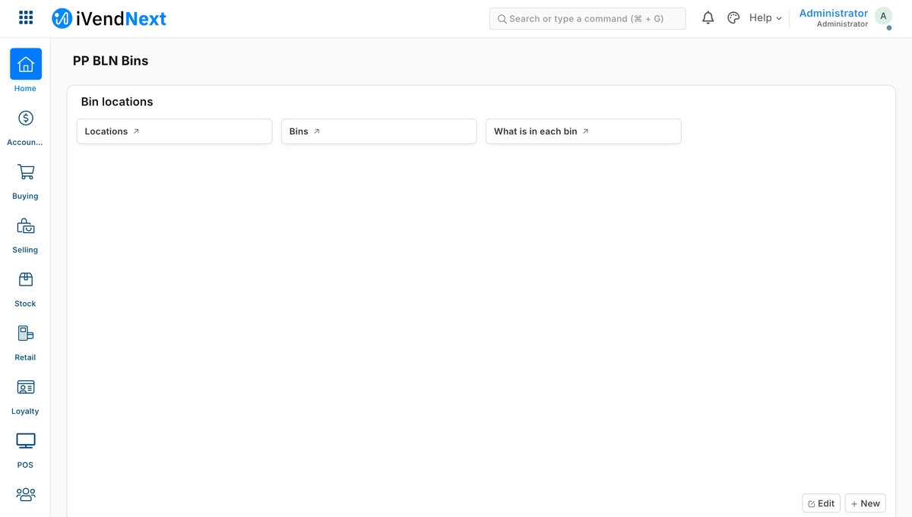
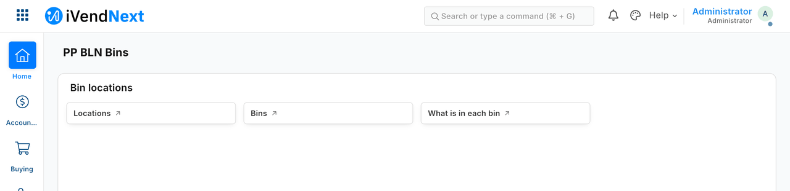
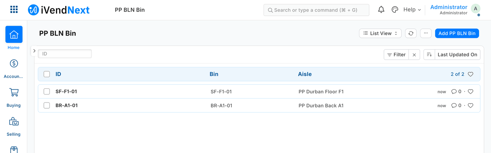
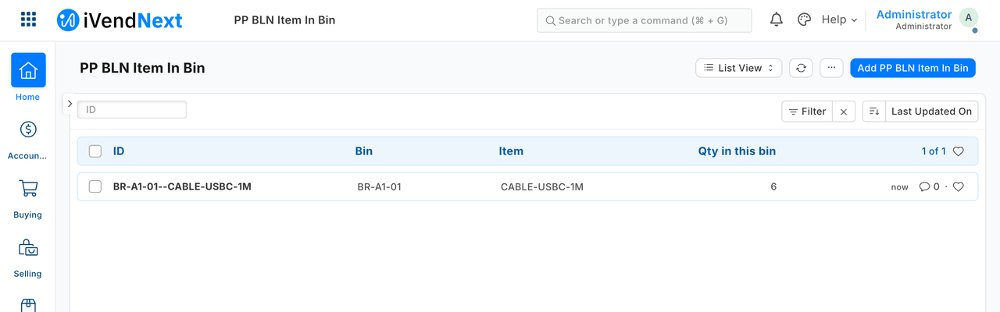

# Shipping your own data in a manifest — the recipe



*What the bin-location manifest installs, as staff see it in Desk: the workspace, the bins, and what is in each bin.*

A manifest is one file that adds **your own record types and fields** to a shop — bins and what is in them, warranty terms, a reference list — without you writing code inside the shop. It is for iVendNext Partners, and for the CitiXsys Consulting Team. **Reference implementation:** `samples/s2_bins/manifest.json` (five record types, a field on Item, a print format, a workspace, two webhooks) and `samples/s1_warranty/manifest.json` (one record type the till key reads). The checker is `tools/manifest/validate.py` (a copy of the shop's own), and `tools/manifest/site_rules.py` adds the two refusals the shop's install makes after it (a report, card or chart may not name a field the same manifest adds to a shop's record type, and a workspace may not link the manifest's own report); `tools/check/check.py` and `tools/deploy/deploy.py` run both; the installer is in the shop, behind its **Retail Extension Package** screen; `tools/deploy/deploy.py` puts a manifest on your own sandbox.

**When to use it.** Rung 4 of the build ladder. Use it when configuration cannot hold your data and your app needs it **inside** the shop: staff see it in Desk, a till key reads it, or a webhook reports on it. A manifest runs nothing. Your logic lives on your server (a connected app) or in a till key.

> **Package or module?** A **package** is your whole app: its records, fields, print formats, buttons, services and label layouts, sent as one manifest. The shop's administrator pastes your file, reads *What it will do*, consents and installs it; later the shop can update it or remove it, and *Connected apps* lists every one. A **module** is one small program that does one job at an extension point, such as adjusting a price or checking a sale before payment. **Two extension points take a module today: the check before payment and pricing.** The shop's administrator adds your file in Desk, with a certificate our review team signs, and can withdraw it; a package cannot carry one yet. **In short:** a package is the app, and a module is one program that does one job.
>
> *Technical note:* a package installs from the **Retail Extension Package** screen in Desk; a module is a **Retail Extension Module** record that the shop's administrator adds in Desk, at an extension point that takes one ([chapter 8](../guide/08_sandboxed_functions.md)).

## Steps

1. **Choose your prefix.** One to three upper-case words (`PP BLN`) and the matching app name (`pp_bln`). Every name you create starts with the prefix. A field you add to one of the shop's own record types starts with the lower-case prefix (`pp_bln_default_bin`). Names on a site are shared and carry no owner, so the prefix is how an uninstall finds what is yours. Its first word is your company's own first word, so the App library accepts it as yours ([Publish your app](../site/pages/publish.md)).

2. **Write `manifest.json`.** The kinds a manifest may carry:

   | Kind | What it is | Example (S2) |
   |---|---|---|
   | `doctypes` | your record types (not submittable); child tables allowed | `PP BLN Bin`, `PP BLN Item In Bin`, the child `PP BLN Bin Movement` |
   | `custom_fields` | fields on your own types, or prefixed fields on the shop's | `Item.pp_bln_default_bin` |
   | `property_setters` | display tweaks on your own types and fields | `PP BLN Bin.bin_code` bold |
   | `print_formats` | templates for your records or the shop's | `PP BLN Bin Label` |
   | `notifications` | e-mail or in-app alerts | — |
   | `workspaces` | a Desk page with headers and shortcuts | `PP BLN Bins` |
   | `sale_attributes` | an optional sale detail a till key can fill | — |
   | `webhooks` | signed calls to **addresses you list** in `allowed_urls` | a booked sale → your service |

   **Manifest v2 (`"manifest_version": 2`) adds the screen kinds, approvals, the feed and the remote till key.** A v1 manifest still installs once every one of its permission rows writes all nine rights.

   | Kind | What it is | The rules |
   |---|---|---|
   | `reports` | a **Report Builder** report: columns, filters, order, totals row, roles | Report Builder only — a *query* report (SQL) and a *script* report (Python) are refused. Columns and filters are checked against the record type **as it is before the install**, so a field the same manifest adds to a shop's record type cannot be used (`site_rules.py`), and a workspace cannot link the manifest's own report |
   | `number_cards` | a count, sum, average, minimum or maximum over a record type | "Document Type" cards only; a *custom* card (a server method) is refused |
   | `dashboard_charts` | count / sum / average over time, or group-by; line, bar, percentage, pie, donut | a *custom* chart (a server method) and a *report* chart are refused |
   | `dashboards` | your charts and cards on one page | only the manifest's own charts and cards |
   | `list_settings` | the list view's columns and counters | **your own record types only** — a shop record type has one list setting, the shop's |
   | `workflows` | states, transitions, the role per transition, a field set on entering a state (approvals by workflow) | **your own record types only**; every state keeps the record a draft (never submits or cancels); **no transition condition** (it is code evaluated on the server). Missing states and actions are made, and removed again at uninstall unless another workflow uses them |
   | `naming_rules` | a numbering rule (prefix + digits, optional conditions) | **your own record types only** — numbering the shop's records, a sale's number included, is fiscal ground |
   | `links` | the **Connections** panel: your records listed under a shop record (e.g. claims under a Customer) | the link field must be a Link on your record type pointing at that shop record type |
   | `registered_applications` | your service's **event-feed** registration (`recipes/event_feed.md`) | installed **switched off, with no user**: the shop chooses the user your service reads as and ticks each record type on. At uninstall its queue rows go with it |
   | `remote_keys` | your **remote till key** (the till calls your service) | **from the release that carries it,** the key is ready in **POS Studio > Apps** as soon as the app is installed: the consent the administrator reads on the install screen is the key's consent, and the store switches the key on there and places it on its till; **until then** it installs switched off, consent not given, and the shop's administrator ticks both in Desk. The installer makes the secret and hands it to you once; `https` only, an address you list; **a manifest may declare a `timeout_seconds` above 0 and at most 5** (our checker refuses more: `tools/manifest/validate.py`). The record the installer makes accepts up to 10 in Desk (`recipes/ai_till_key.md`). Refused, with its reason, on a site whose POS app predates the remote key |
   | `extension_subscriptions` | your service for the `desk_action` or `page` extension point (label 1–40, `https` address you list, `timeout_seconds` at most 10; a page's `page_…` settings and roles) | installed **switched off, consent not given**; the installer makes the secret and hands it to you once (`<app>:sub:<key>`); no consent text, no stores (`scope`), no sandboxed module |
   | `desk_actions` | a button on a Desk record (roles, when it shows, its inputs, `send_fields`) answered by one of your `desk_action` subscriptions (`service` = its `key`) | installed **switched off**; a service the manifest does not install is refused; no role open to everyone |
   | `save_rules` | a rule checked on every save of a record type, the shop's own or yours (the seven kinds and their keys: [the save rules page](../contracts/pages/save_rules.md)) | installed **switched off**; the name carries your prefix; no markup in the message; on a sale the product lets a rule only flag; rules run in `sequence` order; **a rule may name only a field that exists at install**, so a rule on a workflow's `workflow_state` needs that workflow saved first (workflows, then the manifest, then the rest of the configuration) |
   | `fiscal_readers` | one outside fiscal service's result on the sale: your result fields at their own permission level, the status map, the writer role and its users | installed **switched off**, in the order the product accepts; no API key is made (the shop makes it). The steps the shop takes are in guide chapter 7 |
   | `extension_modules` (sandboxed modules) | — | **refused**: a package cannot install a module yet; the shop's administrator adds one in Desk, at the check before payment or pricing |
   | `label_layouts` | the label the till prints for an item or a basket line: HTML, or Zebra printer commands (`zpl`) for a counter's label printer, with placeholders from a closed list ([the label layout page](../contracts/pages/label_layout.md)) | installed **switched off**; `manifest_version` 2; the name starts with your prefix; kind `html` or `zpl`; placeholders from the list only, no code and no scripts; a `zpl` template starts with `^XA`, ends with `^XZ` and draws its barcode over `{barcode}`, not `{barcode_svg}`; label stock 10 to 150 mm, 1 to 10 labels per row |
   | `receipt_blocks` | — | **refused, and the refusal says why:** a shop's own receipt lines are the register's *Receipt Header* and *Receipt Footer*, two text fields the shop fills in on its register, not a table a manifest fills; a tax authority's QR and seal reach the receipt through fiscal readers ([the receipt page](../contracts/pages/receipt.md)) |

   Each record type lists its permissions by role, including your app's integration role, so your service can read and write its own records. **The install makes the roles your manifest names that start with your prefix** (`ACME BINS Stock Clerk`) when the shop lacks them, empty and removed again at uninstall, on a site whose POS app is at `e149dce4` or later (an older install refuses a row for a role the site lacks). A role the shop already has is used as it is; a role without your prefix that the shop lacks (`PP Integration` in the samples) is **refused**, so name your integration role with your prefix as well. The shop's administrator gives each role to the right people, so never tell a shop to *create* a role the install makes. ⚠ **Write every right out — all nine** (`read, write, create, delete, report, export, share, print, email`). A permission row that leaves one out gets it **ON**: a row of `read` only is stored with all nine on. The manifest checker refuses a row that leaves a right out, or writes one as anything but 0 or 1. All four samples write all nine; `samples/s11_approvals/manifest.json` shows the form.

   **What leaves the shop — nothing the shop did not grant.** A partner sees a shop's data only through what the shop grants: the integration key's permissions, the event feed, the remote till key's fixed context. A manifest cannot open another channel:
   - a **webhook** sends only its fixed, thin body (record type, name, event, time); the service reads the record with its own key;
   - a **print format** loads nothing from outside the shop (an image address can carry data out, so embed images as files or `data:` URIs);
   - a **notification** goes to the shop's own people (by role, or by a field of the record), never to an address the manifest names, and shows its own record's fields only.

   Templates that read other shop data (a receipt reading the company's tax number) are allowed where the output stays with the shop's staff.

   **On the shop's own record types a manifest may only ADD.** A field you add there may not carry anything the server enforces on save (mandatory, a default, unique, a minimum, a length, set-once, precision). A property setter there may only change how **your own** field is shown. Webhooks may listen to the shop's record types, but without a condition, and notifications go on your own types only. Each of those is evaluated **inside the shop's own save**: one mistake would stop every till sale.

3. **Check it yourself, before anyone installs it:**

   ```bash
   python3 tools/manifest/validate.py samples/s2_bins/manifest.json      # VALID, exit 0
   ```

   Every refusal names the element and the reason, for example *"REFUSED webhooks[0] (PP BLN Hook): a webhook may only call an address the manifest lists in allowed_urls"*.

4. **Install.** The **shop's own administrator** installs your manifest, from the **Retail Extension Package** screen in Desk: paste it, press *Check*, read the summary, tick the consent, install. The summary is written by our code from the manifest itself, never from your description of it, and it lists everything your manifest makes or switches on, every outside address, and each print format as a template that runs on the server when printed, able to read, change and send the shop's data. The install runs as a background job: *Queued → Installing → Installed*. Each secret (a webhook's, a service's) is shown once to whoever installed, and can be read again on its own record. **Before each part works** lists what the shop still switches on.

   On **your own sandbox** you do the same with one command, with your sandbox administrator's API key:

   ```bash
   BASE=https://<your-sandbox> KEY=<api key> SECRET=<api secret> python3 tools/deploy/deploy.py manifest.json
   ```

   It checks the manifest on your machine first, sends it, prints the site's summary and stops. Add `--consent` to install with exactly that summary. It waits for the job and prints the status, any secrets and the to-do list.

   The site checks the manifest again, at the check and again when the job runs. It refuses names already taken by someone else, and a field on one of the shop's single-record settings types. Then it creates everything, and records each element in an **install record** as it goes. If anything fails half-way, it removes what it made and shows **Failed** with the reason.

5. **Use your records** over the record API, like any other type (`recipes/connected_app.md`). The bins service writes `PP BLN Item In Bin` with its movement rows, and the "Where is it?" till key reads it. In Desk:

   

   *The workspace the manifest installs.*

   

   *The bins, each on its aisle.*

   

   *What is in each bin, kept up to date by the service.*

6. **Update: bring a higher version.** Raise `version` (`0.1.0` → `0.1.1`) and install it the same way. Before the consent, the screen (and `deploy`) shows what changes from the installed version. An update adds what is new and changes in place what may change; it removes nothing (a dropped webhook, notification, workflow, sale detail or service is switched off and goes at uninstall), and it switches off every changed service until the shop consents again. **An update keeps the shop's own switch** on a changed notification, webhook or workflow: one the shop switched off stays off, one left on stays on. A lower or equal version, a dropped or renamed record type or field, or a field changing type is refused: ship it under a new name. The earlier version's record shows **Superseded**.

   **Export, then uninstall.** *Export and uninstall* on the installed version's record (or `deploy.py uninstall "<app> <version>"`) first writes every record of your types, with their child rows, and the values of the fields you added to the shop's records, to a private file on the package, then uninstalls.

7. **Uninstall — nothing is left behind.** The installer removes everything the install record lists (and that a consented version of your manifest made), newest first: webhooks, workspace, print format, property setters, fields, record types and the module. It also:
   - **drops your tables and the columns your fields added.** iVendNext's own delete of a custom record type keeps its table and rows, and its delete of a custom field keeps the column and its values. With the drops, the site's schema after the uninstall equals the schema before the install, kind by kind;
   - removes what **the shop** did to your types after install (a field added in Customize Form, a role-permission edit, a default print format), so a later install does not inherit a field whose column is gone.

   Two cases it handles in the open. **A sale detail that booked sales already use is kept, switched off,** since a booked sale must keep its detail; a reinstall switches it back on. **If any element cannot be removed,** the uninstall says so (it does not report success); **Finish** on the package (`deploy.py finish`) completes it. Finish also takes back a job that was killed half-way.
   **Comments and version history** on your records are removed with them; the export holds them with the records, so the export is where they are kept. **Attachments** stay, as files no longer linked to a record.

8. **Reinstall — clean.** A reinstall gives exactly the first install's schema. None of the old data comes back.

## What a shop reads: the card and the guide

A manifest has two readers: the installer, which checks it, and the **people in the shop**, who decide whether to install the app and what to do next. The App library will not list an app whose card cannot help them, and it says why in words the moment you publish. So write both before you publish, for the shop's owner or manager, in shop words, not for a developer.

### 1. The card: what the app does and how a shop sets it up

The card is `library/app.json`. Besides its title, one-line summary, category, who uses it and changelog, it carries three things every listed app must have (its industries, its details and its guide):

```json
{
  "app": "acme_bins",
  "title": {"en": "Bin locations"},
  "summary": {"en": "Mark where each item sits in a store, by aisle and bin."},
  "category": "Stock",
  "industries": ["distribution-and-warehousing", "hardware-and-diy"],
  "used_by": ["Stock clerk", "Store manager"],
  "details": {
    "en": {
      "lead": "Know where an item sits without walking the floor.",
      "what": [
        "Staff record each aisle and bin and what is in it.",
        "Each item can have a default bin."
      ],
      "setup": [
        "In Desk, search for ACME BINS Location and add a location for each store.",
        "Open each person's User record and give them the role the install added: ACME BINS Stock Clerk."
      ],
      "notes": ["It marks where things sit. It does not move stock."]
    }
  },
  "docs": [
    {"title": {"en": "Guide to Bin locations"}, "url": "https://docs.ivendnext.com/docs/<section>/<your-page>"}
  ],
  "changelog": [{"version": "1.0.0", "date": "2026-10-15", "en": "First release."}]
}
```

- **`details`** is a lead sentence, a list of points under **what** the app does, a list of **setup** steps the shop takes after the install, in the order it meets them, and a list of **notes** (good to know). Up to ten points in each list, each 1 to 300 characters. `en` is required; `es` and `ar` are optional and checked the same way.
- **`industries`** is required on a public card: `["all"]` for an app every retailer can use, standing alone, or one to six of `fashion`, `grocery`, `pharmacy`, `beauty-and-cosmetics`, `electronics-and-phones`, `hardware-and-diy`, `liquor-and-wine`, `hospitality`, `travel-retail`, `distribution-and-warehousing`, `optical`, `thrift-and-resale`. Name an industry only where the app is especially used; the App library lists the app on each one's page.
- **`docs`** is one to six `{title, url}` addresses (a title up to 80 characters), the first of them your guide page.
- **A setup step names the Desk screen** by the name a shop searches for and says who does it: *In Desk, search for ACME BINS Location and add one for each store*, not *configure the locations*.
- **Do not say a shop must create your own roles.** The install makes the ones that start with your prefix (above): say which roles the install adds, and make the step the one that gives them to people.
- **Say what leaves the shop, from the manifest.** If your manifest has an outside address (`allowed_urls`), webhooks, till keys, event feeds, services, print formats or label layouts, or an outside service that signs in to read and write, the card may not say *nothing leaves your shop*. Say what it sends or runs outside.

### 2. The guide page: one page, or a section for a larger app

Your `docs` link opens your app's guide page, and each of your record types opens its own heading on it. The page has five headings, in this order, in shop words:

1. **What it does** — two or three sentences; who uses it.
2. **What you set up first** — numbered; each step names the Desk screen by the name a shop searches for.
3. **Where it shows** — Desk, the till, POS Studio, print layouts.
4. **What leaves your shop** — taken from your manifest: outside addresses, till keys, webhooks, services, event feeds, print and label layouts. *Nothing* only when the manifest names nothing.
5. **How to remove it** — from the app's **Details**, **Export and uninstall**, and what is kept.

**Count the screens a shop opens:** each record type that is not a table inside another one, each report and each Desk page you add. Workspaces, print formats, field rules, workflows and webhooks do not count: describe them on the page of the screen they belong to.

- **Fewer than three screens: one page**, with a `###` heading for each screen under the five headings.
- **Three or more: a section**, its first page carrying the five headings and then pages such as *Set it up*, *Using it every day*, *Troubleshooting* and *Removing it*. A section's address opens its first page, so the card's link is the same either way.
- **App or Rule.** The docs site groups every library app under one of two words, in the shop's own language: an **App** adds records a shop works in every day (a bin, a member, a deviation, an approval) or a screen of its own; a **Rule** adds one check, field or layout to a screen the shop already uses, with only the settings it needs (a rule record, a unit code, a warranty term). Size and kind are separate: an App may be one page and a Rule may be a section. Name the kind in your listing request, and the first line of your page says it. Use neither *package* nor *module* for either: the product already uses both words for something else.
- **Every screen has its own heading,** named for what the screen is for. That heading is the address the screen's help opens: renaming it means changing the address in the manifest in the same release.

**Where the page lives.** The library accepts a guide address on `docs.ivendnext.com`, `developer.ivendnext.com`, `help.ivendnext.com` or `www.ivendnext.com`, and on no other: an address elsewhere (your own site included) is refused today. Write the page in the template and send its text with the listing request ([the form](../feedback/app_listing.md)); we put it on the docs site and send you its address, which goes into `docs` and into each `documentation` setter below. A preview shelf and an app made for one customer are not checked this way, so you can test the whole install first, **with `"public": false` in `library.json`**: a card marked `public: true` is checked before anything is written, preview shelf included. The kit's samples predate this ask and carry no `documentation` setter, so a copy of one needs them before it lists.

### 3. The address of each screen, in the manifest

For **each of your record types that is not a table inside another one**, add one property setter on the record type itself (no `field_name`). It is the address that screen's help opens: the empty list's *Need Help?* link today, and the help panel beside the screen from the release that carries it:

```json
{"doc_type": "ACME BINS Location", "property": "documentation", "property_type": "Data",
 "value": "https://docs.ivendnext.com/docs/<section>/<your-page>#locations"}
```

The address is `https://<host>/docs/<section>/<page>#<heading>`: the heading is the text of the heading on the page, in lower case with hyphens (*Adding an extension* is `#adding-an-extension`); leave `#<heading>` out when the screen is the whole page. Write it as plain `https`, in letters A to Z or a to z (no accents), digits and `. _ ~ / -` only, with an optional `#heading` and no query, quote, space, `<` or `>`: the shop's own check refuses any other value, and the library refuses a value that is not `https` on one of the four hosts below. A field you add to one of the shop's own screens may carry its own help address (`documentation_url`, a field-level property setter) from the release that carries it. ⛔ Do not give your workspace a *URL* shortcut to your guide: a shortcut address counts as an outside address the app may call, and the install screen lists it as one.

### 4. What the library refuses, word for word

The library checks the card and the manifest together on its own side when you publish, and `publish.py` prints the refusal in the library's words. A listing is refused, with one of these, when it cannot help a shop. `{…}` is filled in with your own values:

| Code | The words you read |
|---|---|
| `help_details` | `<app>: the card must say what the app does and how to set it up: details needs a lead, at least one point under what and at least one step under setup` (`(in es)` or `(in ar)` is added when that language is the short one) |
| `help_guide` | `<app>: the card must link its guide: docs is one to six {title, url} addresses on docs.ivendnext.com, developer.ivendnext.com, help.ivendnext.com, www.ivendnext.com` |
| `help_nothing_leaves` | `<app>: the card says nothing leaves the shop, but the app has <an outside address (host) · webhooks · till keys · event feeds · extensions · print formats · label layouts · an outside service that signs in to read and write>: say what it sends or runs outside, or take that line out` |
| `help_roles` | `<app>: a setup step tells the shop to create the app's own roles ('<the step>'): the install makes them, so say which roles the install adds and make the step giving them to people` |
| `help_record_guide` | `<app>: the record type <name> has no guide address: add a property setter {doc_type: '<name>', property: 'documentation', value: <https address of its page in your guide>} on docs.ivendnext.com, developer.ivendnext.com, help.ivendnext.com, www.ivendnext.com` (and ` (its address '<value>' is not https on one of them)` when a setter exists but its address is off those hosts) |

A public card without `industries` is refused as `bad_entry`, *<app>: a public card names its industries: industries is ["all"] for every retailer, or one to six of fashion, grocery, pharmacy, beauty-and-cosmetics, electronics-and-phones, hardware-and-diy, liquor-and-wine, hospitality, travel-retail, distribution-and-warehousing, optical, thrift-and-resale*; an unknown industry, or `all` beside another, is refused as `bad_entry` too.

A guide address off those hosts keeps its older code: `bad_entry`, *a document's address is on docs.ivendnext.com, developer.ivendnext.com, help.ivendnext.com, www.ivendnext.com*. All of these come back as HTTP 400 and, on the upload door, as `{refused, words}`; a refused upload writes nothing.

**What the check does not do.** The two wording checks (*nothing leaves*, *create the roles*) read English only and a few phrasings, so a pass is not a promise the page is true: a shop reads your card, and you answer for it. The library cannot read your guide page's text; whoever places it on the docs site reads it. Only a **public** card is checked.

## What is refused, and why

| Element | Why |
|---|---|
| a server script | it runs partner code inside the shop's own saves; partners use a till key or a connected app instead |
| a client script | it runs partner code in the browser of every Desk user who opens the form |
| a web page | it is published on the shop's own web address and can carry script or pass itself off as the shop |
| a web template | it puts partner markup on every web page that uses it |
| a submittable record type | it joins the shop's accounting and stock lifecycle; a manifest's types hold the partner's own data only |
| making a field mandatory on the shop's own record types — your own added field included — or making a field there mandatory, read-only or hidden through a property setter (a field you add may itself be read-only or hidden, and may use fetch-from and show-when, on a child table such as Purchase Order Item too) | it can stop the shop's saves (a till sale included), stop a person or the till setting a field, or hide a value the engine needs |
| any other change to the shop's own fields | a manifest may only change the fields it adds itself |
| a mandatory field added to a shop's record type | it would stop every save that does not fill it |
| any name without the prefix | names on a site are shared and carry no owner |
| a webhook to an address not in `allowed_urls`, or a secret in the manifest | a webhook may only call addresses you declared; secrets are made at install |
| a custom block on a workspace, or script in markup | it runs in the browser of everyone who opens it, administrators included. ⚠ The markup check reads your manifest's text: it is a tripwire, not a guarantee (a print template's output is not escaped). The shop's administrator decides, from a summary our installer writes, where a print format is listed as a template that runs on the server when printed, able to read, change and send the shop's data |
| a script print format | it runs in the viewer's browser |
| an HTML or button field | an HTML field shows its own markup in Desk; a button needs a script |
| a required sale detail | it would stop every sale on every till that does not fill it |
| a notification on a shop's own record type (from POS build 2.0.0.654 a reminder before or after a date is allowed: the rows below), to an outside service, or with keys beyond the plain ones | it runs inside every save of that record, so an error in it stops the save (a till sale included); e-mail and the in-app bell only, on your own types |
| a webhook **condition** on a shop's own record type | it is evaluated inside every save of that record, and an error in it stops the save; filter in your own service instead |
| a default, unique, minimum, length, set-once or precision on a field you add to a shop's record type, or any property setter there that is not about display | the server enforces these on every save of the shop's record, a till sale included |
| a tree record type, a field on a shop's single-record type, or (before POS build 2.0.0.654) a single-record type | this installer installs and removes ordinary record types, and from build 2.0.0.654 settings records too. **For your service's own settings**, a settings record of your own (`"issingle": 1`) from that build; on an older site, an ordinary record type with one record named `Default` (S22) |
| records open to visitors who are not signed in, or to a role the system hands out by itself (All, Desk User, Administrator) — and a notification sent to Guest or to one of those roles | a manifest's records are for the shop's own users; a row for All reaches every signed-in user (website customers included), and one for Desk User every staff user, whatever roles the shop's administrator chose; a notification to one reaches whoever holds a stored row for it, refused so every place a role is named follows one rule |
| a permission row that leaves a right out, or writes one as anything but 0 or 1 | a right left out is switched on, so every row says all nine |
| a help address (a record type's `documentation`, a field's `documentation_url`) that is not an `https` address in letters A to Z or a to z, digits and `. _ ~ / -`, with an optional `#heading` and no query, quote, space, `<` or `>` | Desk shows it as a link, so an address that can break out of the link, or that is not `https`, is refused |
| a property setter on your own record type that changes more than the record type itself may carry (`title_field`, `sort_field`, `sort_order`, `search_fields`, `track_changes`, `description`, `quick_entry`, `show_title_field_in_link`, `documentation`), or on its fields more than how they are shown and used (never a field's type, options or name), or a value outside what that property takes (`title_field`, `sort_field` and `search_fields` must name the record type's own fields, `sort_order` is `ASC` or `DESC`, a flag is `0` or `1`) | the checks the manifest runs on the record type's structure (its name, fields, permissions and naming) do not run on a setter; change those in the record type |
| script in a property setter's value, a record type's description, a field's label or a shortcut's label (a script element, an inline handler, a `javascript:` address), or a shortcut that carries more than its type, target, label and view, has no label, has a label with `<`, `>`, `"` or `&`, or names a view other than List, Report Builder, Dashboard, Tree, New, Calendar or Kanban | Desk writes these into pages as they are, so they would run in the browser of everyone who opens them |
| a workspace icon that is not an icon's name (lower-case letters, digits and `-`, at most 40 characters) | it is written into the page's markup and an address |
| **From POS build 2.0.0.654 (train T12)** | an older install screen refuses every kind below outright |
| a report naming two tables, two dots, a field that is not a table, a row field the rows lack, a record's number column beside row columns with a totals row, two tables sharing one row record type, a row record type with a `-` in its name, a table behind a permission level above 0, or a table field the same manifest adds to a shop's record type | one table per report and one dot keeps a report honest (one line per row); a field added in the same manifest is not yet there at install: ship it in an earlier version. These refusals fence nothing: Desk's own column picker offers the same columns |
| a reminder on a shop's record type that is not **Days Before** or **Days After** a Date or Datetime field, `days_in_advance` outside 1 to 365, sent to anyone but a role, by anything but e-mail or the bell, or with anything but plain text and `{{ doc.⟨field⟩ }}` in its subject and message | the daily scheduler sends it to every holder of the role in every store, with no cap and no data filter: only the record's own fields may show. A template error skips one message; an error outside it stops that day's run of every date reminder on the site |
| `attach_print` on a shop's record type, a shop's print format, a format of another record type, a format that reads other records or includes another template, or attaching files by a field or an address | the attached print is rendered with no viewer's rights, so it may read nothing but its own record's fields; keep **Allow Print for Draft** on |
| a multi-select field whose child record type is not your own, or has no Link field shown in the list | Desk drops the rows at the save without one |
| a settings record that also carries a table, gives `report` or `export` on a permission row, or is named by anything but a property setter (`description`, `track_changes`), a workspace shortcut of type `DocType` with no view, or a save rule's `value_from_type` and `value_from_name`; an update that makes a record type a settings record or stops it being one | one record, no list: anything else naming it would treat it as a list; ship a changed one under a new name |
| a list mark switched on; on a submitted record type, one with an active workflow, a table or a settings record; on a field the record type lacks, a virtual one, a password or a long text; a label over 24 characters, holding `<`, `>`, `&`, `"`, `'` or a backtick, or with a space before or after it; a colour off the list; a sixth mark on one record type; one label twice on one record type | a mark is display only and installs switched off; the shop switches each on |
| a prefix whose first word is one the system reads (`IS`, `IGNORE`, `FOR`, `HAS`, `SET`, `BASE`, `FREE`, `PRICE`, `POST`, `NOT` and twelve more, listed on the [save rules page](../contracts/pages/save_rules.md)) | the system acts on fields whose names start that way; an update of an installed app with such a prefix is refused too |

## When your service is down, and when the till is offline

A manifest runs no code of its own, and the rules above keep anything it declares out of the shop's own saves, so it cannot stop a sale. Its webhooks behave as every webhook does (`recipes/webhook_receiver.md`): three tries, then your reconciliation pull. A till key that reads your records is online-only: on an offline till it is dimmed.

## What we would like to improve

- A till key declared from data, so a manifest can ship one with no code (the remote key covers keys answered by your server).

## Technical notes

### What was proven where

- The whole recipe was proven on our test bench.
- Manifest v2: proven on the bench on 2026-10-04 with a manifest carrying every kind but the remote till key (this bench's POS app then predated it, so it was proven only refused; it installs on the bench since 2026-10-07, see its row) (`tools/manifest/tests/fixtures/full_v2_ok.json`; 35 of 35 checks on the bench's install–uninstall–reinstall cycle).
- `remote_keys`: refused, with its reason, on a site whose POS app predates the remote key; installs on our test bench since 2026-10-07.
- `extension_modules`: a package cannot install a module yet (the shop's administrator adds one in Desk, at the check before payment or pricing).
- Permission rows (measured: a row of `read` only was stored with all nine on).
- Where the install screen is: in the POS app from commit `87812e14` (2026-10-10). ⚠ A sandbox without it is updated on request (on a site without it, `deploy` stops at the check with *Failed to get method*). There is no other way to install a manifest. A manifest that carries label layouts or field rules on the receipt needs the POS app from commit `7be4333b` (2026-10-10) or later: an older install screen refuses them, although the kit's checker (copied at `06c9d483`) passes them.
- `deploy`, **on our test bench, 2026-10-10:** the warranty sample checked without `--consent` (nothing installed, the package stayed *Checked*), installed with it (*Installed* in about 2 s), updated to `0.1.1` with one new field (the earlier version *Superseded*, an export written first), exported and uninstalled (the record type gone), and *Finish* refused with nothing to finish. The bins sample installed with its two webhooks and its till key, and `deploy` printed each secret from its own record.
- Install, earlier (until 2026-10-10 our team ran the installer in the site's console). **On the bench:** S2 installed five record types with their tables, the Item field and its column, two property setters, the print format, the workspace and two signed webhooks.
- Screenshots in step 5: our test bench, 2026-10-10; frame: Desk, 1440 wide.
- Export, **on the bench:** the export held the bin, its item record with its movement, and the Item field's value.
- Uninstall, **measured on the bench:** with those drops switched off, both tables and the column were still there; with them on, the site's schema after the uninstall equals the schema before the install, kind by kind. The shop's own changes to your types: measured, all three swept, schema diff empty.
- The kept sale detail and the failed removal: both were measured by forcing the failure on the bench.
- Reinstall: on the bench a reinstall gave exactly the first install's schema, and none of the old data came back: no bin records, no old Item value.
- A custom block on a workspace (measured: such a block ran as the administrator).
- Offline: a till key that reads your records is online-only (on an offline till it is dimmed, per the till's own documentation; not run here).

### Tests

- `python3 -m unittest discover -s tools/manifest/tests -p 'test_validate.py'` — your manifest and the original refusals, without a shop (45 refusal cases, each with exactly its own reason); `test_validate_v2.py`, `test_validate_rights.py` and `test_validate_automatic_roles.py` in the same folder hold the later ones.
- Our test bench's install cycle (its own run, not in the kit): refuse at install, install, the shop's own customisations, export, uninstall, schema diff, reinstall, every allowed kind once, a removal that fails, a kept sale detail. **32 of 32 green** with all its steps (the install cycle alone is 20), including a canary that proves the diff catches leftover tables and columns.
