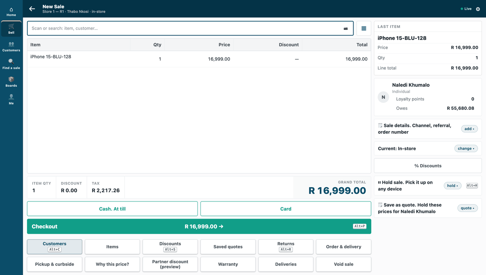
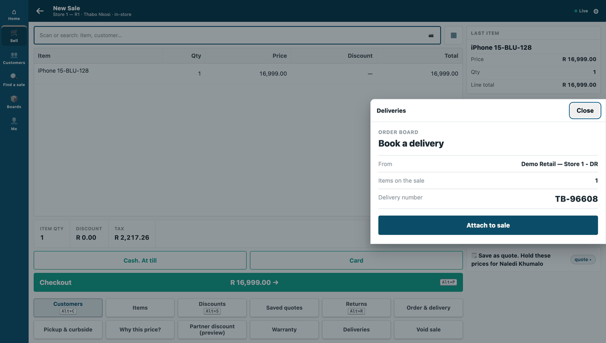
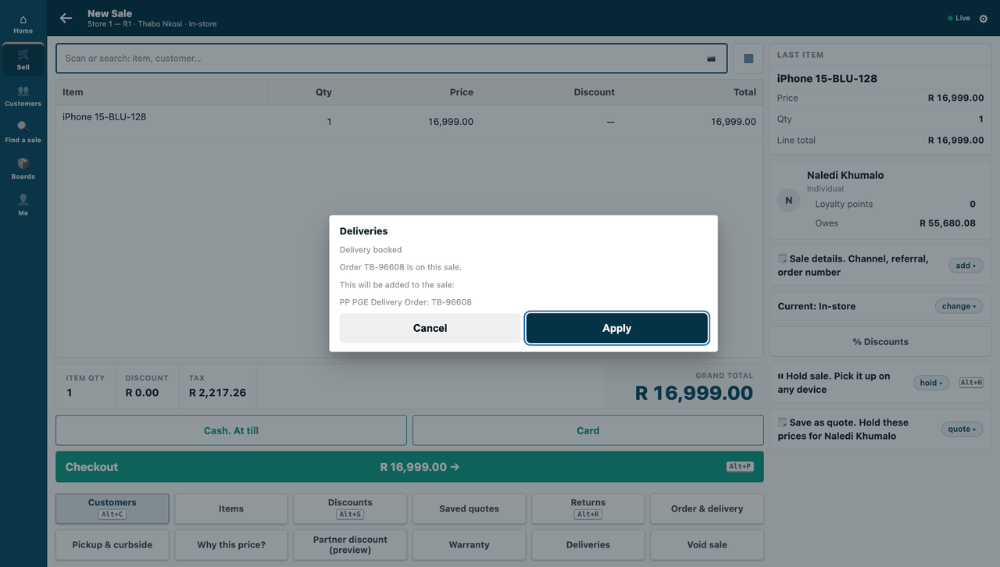
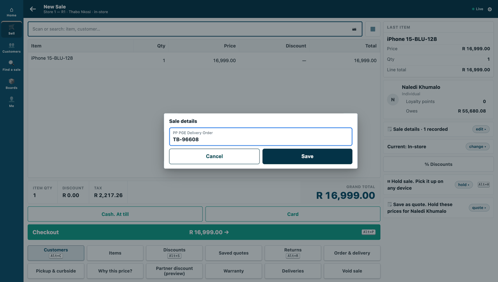
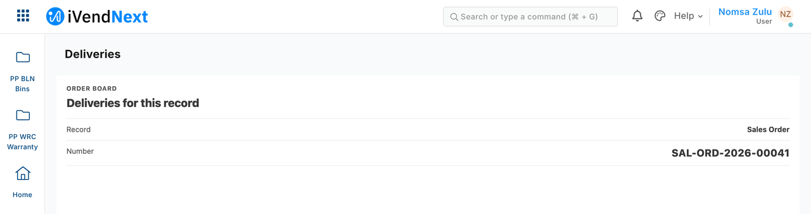

# Your own screen inside the retailer's frame (a partner page) — the recipe


*A cashier presses **Deliveries** on a sale; the partner's order board opens over the sale; when the cashier applies the till's confirm sheet, the delivery number is on it.*

A partner page is your own screen, served from your own server, that iVendNext shows inside its frame: a delivery partner's order board on the till, a console in Desk. Use it when your work needs **its own screen** beside the retailer's. **Reference implementation:** `samples/s17_partner_page/` — an order board.

**How it differs from an app inside the retailer's iVendNext.** Nothing of yours runs inside the retailer's iVendNext. Your page stays on **your** server and iVendNext frames it: on the till (counter and tablet) as a sheet over the sale, in Desk as a page for a record. The frame keeps your page on its own origin, so it cannot read iVendNext's screen, session or storage. The phone shows no app keys, so no page either.

## Steps

1. **Declare the page in your manifest**, with what it may answer on the till and who may open it in Desk:

   ```json
   "allowed_urls": ["https://your.server/board/"],
   "sale_attributes": [{"name": "PP PGE Delivery Order"}],
   "extension_subscriptions": [{"key": "board", "point": "page", "label": "Deliveries",
     "endpoint_url": "https://your.server/board/", "page_placement": "Till key and Desk page",
     "page_roles": ["Desk User"], "page_send_user": 0, "page_send_sale": 1,
     "page_returns_message": 1, "page_returns_sale_attributes": 1, "page_height": 45}]
   ```

   Ask only for what your page uses: the consent text is built from these settings.
   - `page_send_user` sends the viewer's login (personal data). S17 does not need it, so it leaves it at 0.
   - `page_send_sale` sends the sale as the till holds it, **which includes the cashier's login (`operator`) and the customer's id** (personal data too). Send it only if your page uses the sale.

   **Look like the till.** The context carries the till's own design tokens (`theme.vars`: background, card, ink, muted text, lines, accent, corner radius, text scale). Draw with them the way the till's own sheets do: the till's type, a bold title, muted detail rows, one full-width button in the accent, and a `page_height` that fits what you show (S17 asks for 45, a share of the screen's height on the counter; a tablet shows a page full height). S17's `board.html` is the pattern. Or load the design kit (`kit/design/`) and call `ivnKit.applyTheme(theme)`: it maps these names onto the kit's own tokens (card → surface, ink → text, muted → text-muted, line → border, accent → primary).

   Your page must be on **your own host**: iVendNext refuses a page on its own site's address at install.

2. **What the retailer does after install.** It reads what the page will receive (the consent text is built from the declaration) when it ticks the install's one consent. The page is on from the install, and the Desk page opens straight away. The **Deliveries** key reaches a till when the retailer switches it on in **POS Studio → Apps**; until then no cashier sees it.

   

   *A sale on the till, with the **Deliveries** key beside the till's other keys.*

3. **Read the context on your server, never trust it in the browser.** iVendNext opens your page with `#ctx=<payload>.<signature>` in the address. The **fragment** never reaches a server log or a `Referer`. Your page's script reads it once, takes it out of the address bar, and sends it to your own server. Your server checks two things:
   - the **signature**: base64url HMAC-SHA256 of the payload's bytes, with the secret the installer handed back (`pp_pge:sub:board`) — checked before you parse it;
   - the **expiry**: `exp`, five minutes after it was made.

   The payload says where it was opened: on the till, the store, the POS Profile and the sale as the till holds it (no money); in Desk, the record type and name. Show what it says with `textContent`, never as markup. It also carries a `nonce`; step 4 sends it back as `ctx_nonce`. Your server refuses a forged context and an expired one, and the same context may open again until it runs out.

4. **Answer the till, server to server.** Your **server** (never the browser, which never holds the secret) posts `{"ctx_nonce", "result"}` to `/api/method/ivendnext_mpos.api.page.submit`. It is signed like every extension point's call: `X-iVendNext-Timestamp` and `X-iVendNext-Signature` = base64 HMAC-SHA256 of `<timestamp>.<body>`. The result is the till's own vocabulary: a `message` and `sale_attributes` (no money). Then your page may `postMessage({type: "ivendnext:done"})` to the till. The till checks the message's origin and reads nothing else from it.

   iVendNext takes one answer. A second is refused, with *"This page has already answered."* until the till has picked up the first, and with *"This page is closed, or its time ran out. Nothing was added to the sale."* after that. The till picks up the first.

   

   *The board, framed as a sheet over the sale, drawn with the till's own tokens.*

   

   *After **Attach to sale**: the till's own confirm sheet, with the sale detail and the number. The cashier presses **Apply**.*

   

   *The delivery number is on the sale.*

5. **In Desk, the server checks who may open it.** `/app/partner-page/<page>?doctype=Sales Order&name=…` asks iVendNext for a context. `page_roles` says who may open it: S17's *Desk User* is every staff user, and the retailer can narrow it in *Who may open the Desk page* on the record. iVendNext gives a context only to a user who holds one of those roles **and** may read that record. Anyone else is told *"You can't open this page for that record."*

   

   *The same board in Desk, as a page for a Sales Order.*

6. **Test it.** Unit-test the context check and the answer with contexts minted the way iVendNext mints them (`samples/s17_partner_page/tests/`). Check your answers against `partner_page.v1.schema.json` in [`contracts/`](../contracts/README.md) (S17's contract test runs it).

## When your page is down, and offline

- If your page does not load within 10 seconds, the till says *"⟨label⟩ isn't answering."* and adds nothing.
- If **iVendNext** cannot be reached when your server answers, say so on your page and let the cashier press again. If the answer never arrived, the retry lands. If only the reply was lost, the retry is told *"This page has already answered."*: the first answer stands, and the till shows it when your page sends `ivendnext:done` or the cashier presses **Close**.
- An answer after the context ran out is refused to you, in words.
- The page key is dimmed when the till is offline: a page is online only.

## Technical notes

### What was proven where

- Proven on our test bench on 2026-10-07.
- Own host, **on the bench:** the same manifest with the retailer's own address was refused at install, in the product's words — *"A partner page cannot be on this site's own address."* — and left nothing.
- The context, **on the bench:** the board saw the till, its store and this sale; a forged context and an expired one (signed with the real secret, its time gone) were refused.
- The answer, **on the bench:** the till picked up the delivery order number and the message, **once** (a second pick-up found nothing). A second answer for one context was refused by **iVendNext**: *"This page has already answered."* The till still got the first answer only.
- Desk, **on the bench:** with the sample's earlier roles, a Stock User got the context for an order of its own customer, and the board read the record from it; a Stock User without read on another customer's order was told *"You can't open this page for that record."*
- The 10-second timeout is the extension point's own rule; not driven on our bench.
- Tests: the mutation canary removes the signature check and the tests go RED.

### Screenshots

- Step 2, in a real browser (our test bench, 2026-10-10, iVendNext POS app at `87812e141`; frame: the till, `/pos?frame=terminal`, 1440 wide).
- Step 4, in a real browser (our test bench, 2026-10-10, iVendNext POS app at `87812e141`; frame: the till, 1440 wide).
- Step 5, in a real browser (our test bench, 2026-10-10, iVendNext POS app at `87812e141`; frame: Desk, 1440 wide).

### Figures beside the run that measured them

Our test bench, 2026-10-07: the till's press, the framed page over HTTPS, one answer, one pick-up, the double answer refused, the Desk context and its refusals, the address change — **19 of 19**; the POS day the till opened was closed in the same test. Re-run after the restyle at `page_height` 45: 19 of 19.
