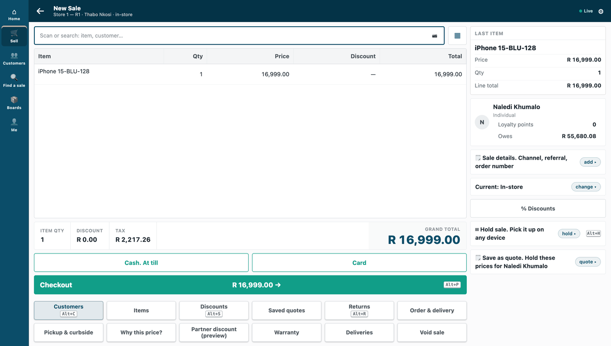
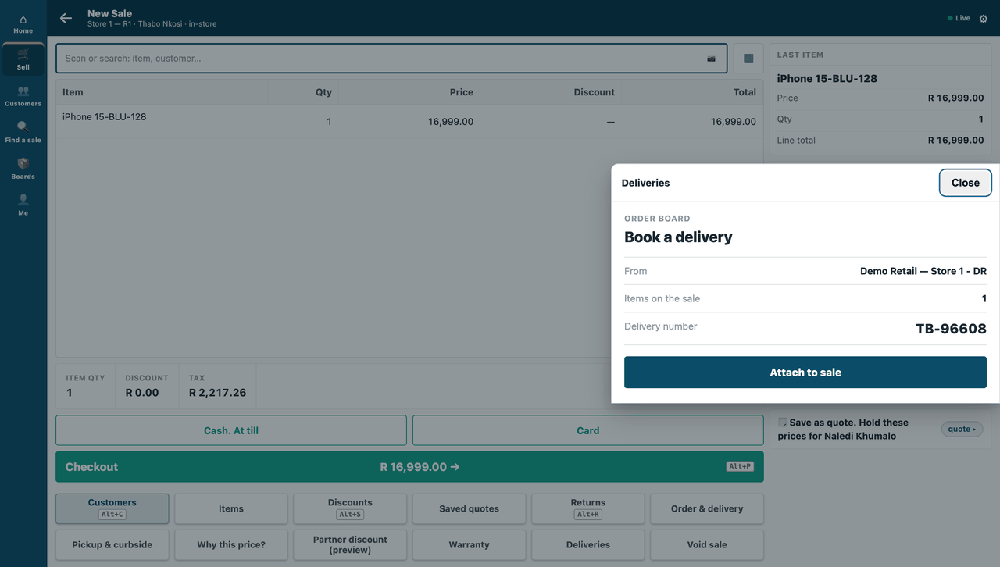
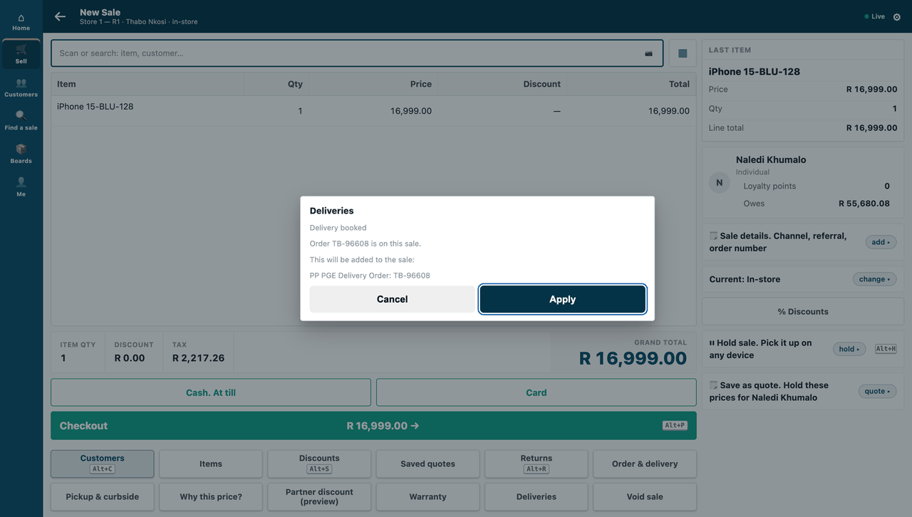
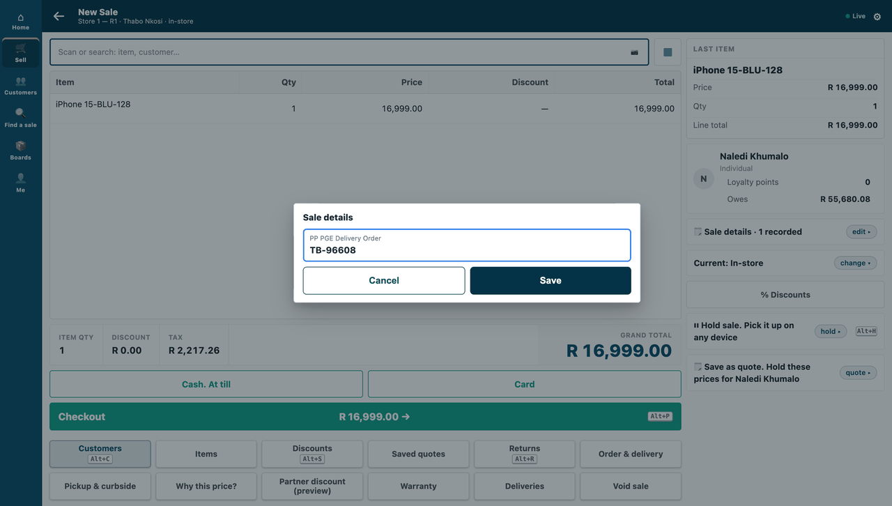
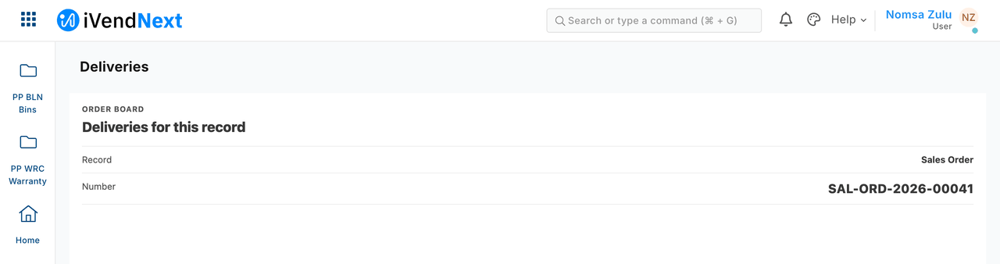

# Your own screen inside the shop's frame (a partner page) — the recipe


*A cashier presses **Deliveries** on a sale; the partner's order board opens over the sale and puts the delivery number on it.*

A partner page is your own screen, served from your own server, that the shop shows inside its frame: a delivery partner's order board on the till, a console in Desk. Use it when your work needs **its own screen** beside the shop's. **Reference implementation:** `samples/s17_partner_page/` — an order board.

**How it differs from an app inside the shop.** Nothing of yours runs inside the shop. Your page stays on **your** server and the shop frames it: on the till (counter and tablet) as a sheet over the sale, in Desk as a page for a record. The frame keeps your page on its own origin, so it cannot read the shop's screen, session or storage. The phone shows no app keys, so no page either.

## Steps

1. **Declare the page in your manifest**, with what it may answer on the till and who may open it in Desk:

   ```json
   "allowed_urls": ["https://your.server/board/"],
   "sale_attributes": [{"name": "PP PGE Delivery Order"}],
   "extension_subscriptions": [{"key": "board", "point": "page", "label": "Deliveries",
     "endpoint_url": "https://your.server/board/", "page_placement": "Till key and Desk page",
     "page_roles": ["Stock User", "Stock Manager"], "page_send_user": 0, "page_send_sale": 1,
     "page_returns_message": 1, "page_returns_sale_attributes": 1, "page_height": 45}]
   ```

   Ask only for what your page uses: the consent text is built from these settings.
   - `page_send_user` sends the viewer's login (personal data). S17 does not need it, so it leaves it at 0.
   - `page_send_sale` sends the sale as the till holds it, **which includes the cashier's login (`operator`) and the customer's id** (personal data too). Send it only if your page uses the sale.

   **Look like the till.** The context carries the till's own design tokens (`theme.vars`: background, card, ink, muted text, lines, accent, corner radius, text scale). Draw with them the way the till's own sheets do: the till's type, a bold title, muted detail rows, one full-width button in the accent, and a `page_height` that fits what you show (S17 asks for 45, a share of the screen's height on the counter; a tablet shows a page full height). S17's `board.html` is the pattern. Or load the design kit (`kit/design/`) and call `ivnKit.applyTheme(theme)`: it maps these names onto the kit's own tokens (card → surface, ink → text, muted → text-muted, line → border, accent → primary).

   Your page must be on **your own host**. A page on the shop's own address is refused at install, in the product's words — *"A partner page cannot be on this site's own address."* — and leaves nothing behind.

2. **What the shop does after install.** It reads what the page will receive (the consent text is built from the declaration), ticks the consent and switches the page on. Then it places the **Deliveries** key in **POS Studio → Apps** for a theme (`recipes/point_handler.md` step 4). If your address changes, the consent is cleared and the page cannot open until the shop ticks it again: the till's key says why it cannot open. Switching the page off and on again does not bring the consent back; only ticking it does.

   

   *A sale on the till, with the **Deliveries** key beside the till's other keys.*

3. **Read the context on your server, never trust it in the browser.** The shop opens your page with `#ctx=<payload>.<signature>` in the address. The **fragment** never reaches a server log or a `Referer`. Your page's script reads it once, takes it out of the address bar, and sends it to your own server. Your server checks three things:
   - the **signature**: base64url HMAC-SHA256 of the payload's bytes, with the secret the installer handed back (`pp_pge:sub:board`) — checked before you parse it;
   - the **expiry**: `exp`, five minutes after it was made;
   - the **nonce, once**: a context already opened is refused, so a copied address cannot be opened again.

   The payload says where it was opened: on the till, the store, the POS Profile and the sale as the till holds it (no money); in Desk, the record type and name. Show what it says with `textContent`, never as markup. A forged context, an expired one, and one opened twice are all refused.

4. **Answer the till once, server to server.** Your **server** (never the browser, which never holds the secret) posts `{"ctx_nonce", "result"}` to `/api/method/ivendnext_mpos.api.page.submit`. It is signed like every extension point's call: `X-iVendNext-Timestamp` and `X-iVendNext-Signature` = base64 HMAC-SHA256 of `<timestamp>.<body>`. The result is the till's own vocabulary: a `message` and `sale_attributes` (no money). Then your page may `postMessage({type: "ivendnext:done"})` to the till. The till checks the message's origin and reads nothing else from it.

   **Refuse a second answer yourself** — the shop refuses it too, with *"This page has already answered."* The till picks up your answer once, and only the first one.

   

   *The board, framed as a sheet over the sale, drawn with the till's own tokens.*

   

   *After **Attach to sale**: the till's own confirm sheet, with the sale detail and the number.*

   

   *The delivery number is on the sale.*

5. **In Desk, the server checks who may open it.** `/app/partner-page/<page>?doctype=Sales Order&name=…` asks the shop for a context. The shop gives one only to a user who holds one of your `page_roles` **and** may read that record. Anyone else is told *"You can't open this page for that record."*

   

   *The same board in Desk, as a page for a Sales Order.*

6. **Test it.** Unit-test the context check and the answer with contexts minted the way the shop mints them (`samples/s17_partner_page/tests/`, 11 tests). Check your answers against `partner_page.v1.schema.json` in [`contracts/`](../contracts/README.md) (S17's contract test runs it).

## When your page is down, and offline

- If your page does not load within 10 seconds, the till says *"⟨label⟩ isn't answering."* and adds nothing.
- If **the shop** cannot be reached when your server answers, say so on your page and let the cashier press again. S17 then gives the context's one answer back, so the retry works.
- An answer after the context ran out is refused to you, in words.
- The page key is dimmed when the till is offline: a page is online only.

## Technical notes

### What was proven where

- Proven on our test bench on 2026-10-07.
- Own host, **on the bench:** the same manifest with the shop's own address was refused at install, in the product's words — *"A partner page cannot be on this site's own address."* — and left nothing.
- Consent, **on the bench:** changing the address cleared the consent and the till's key said why it could not open; switching it off and on again did not bring it back; ticking the consent did.
- The context, **on the bench:** the board saw the till, its store and this sale; the same context opened twice was refused; a forged context and an expired one (signed with the real secret, its time gone) were refused.
- The answer, **on the bench:** the board answered once; the till picked up the delivery order number and the message, **once** (a second pick-up found nothing). A second answer for one context was refused by the board; with the board's own check switched off, **the shop refused it**: *"This page has already answered."* The till still got the first answer only.
- Desk, **on the bench:** a Stock User got the context for an order of its own customer, and the board read the record from it; a user without the roles, and a Stock User without read on another customer's order, were both told *"You can't open this page for that record."*
- The 10-second timeout is the extension point's own rule, P-PAGE §5; not driven on our bench.
- Tests: the mutation canary removes the signature check and the tests go RED.

### Screenshots

- Step 2, in a real browser (our test bench, 2026-10-10, iVendNext POS app at `87812e141`; frame: the till, `/pos?frame=terminal`, 1440 wide).
- Step 4, in a real browser (our test bench, 2026-10-10, iVendNext POS app at `87812e141`; frame: the till, 1440 wide).
- Step 5, in a real browser (our test bench, 2026-10-10, iVendNext POS app at `87812e141`; frame: Desk, 1440 wide).

### Figures beside the run that measured them

Our test bench, 2026-10-07: the till's press, the framed page over HTTPS, one answer, one pick-up, the double answer refused on both sides, the Desk context and its two refusals, the address change — **19 of 19**; the POS day the till opened was closed in the same test. Re-run after the restyle at `page_height` 45: 19 of 19.
