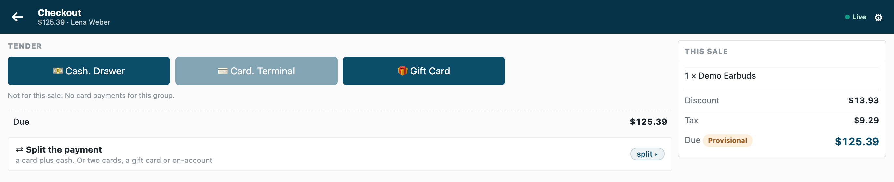
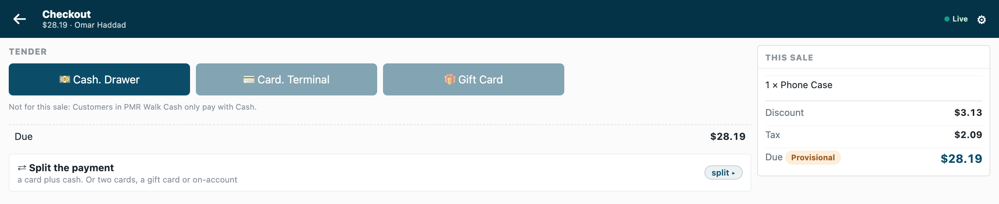

# Payment method rules: which payment methods each customer group may use — the recipe

A till offers every payment method its POS Profile lists to every customer. Retailers ask for less: **customers who order through a delivery platform pay only by that platform's method**, **only account customers buy on account**, **a group that settles in dollars pays only in dollars**. This recipe adds that from outside, through the check before payment: the retailer writes one rule per customer group in Desk, and your service answers each Pay with the methods that sale may not use. The till draws them dimmed with your reason. It is for an iVendNext Partner, or the CitiXsys Consulting Team.

**Reference implementation:** `samples/s46_payment_method_rules/` — *Payment method rules*.

**When to use it.** Who the customer is decides how they may pay. A rule about the till alone (this till takes no cheques) is configuration: list the till's methods on its POS Profile.

## What the cashier sees

- A sale whose customer's rule leaves methods out: the payment screen, those methods dimmed with *"Not for this sale: ⟨your reason⟩"*.
- A sale the rule leaves nothing to pay with: *"This sale can't be paid"* and your sentence, then back to the basket.
- Any other sale: the payment screen as always. Every refund: the refund choices as always.

## Rules

1. **Declare the rule record and the check in your manifest** (`samples/s46_payment_method_rules/manifest.json`):
   - a record type `<PREFIX> Rule`, one record per customer group, named by it (`"autoname": "field:customer_group"`, a **Link** to *Customer Group*, unique): *Switched on*, the kind (a **Select**: *Only these payment methods* or *Every payment method but these*), the methods (a **Table** of `<PREFIX> Rule Method`, each a **Link** to *Mode of Payment*, at least one) and the cashier's words (a **Data** field of at most 120 characters). Give **System Manager** the rights to edit it and your integration role **read only**; name the role `<PREFIX> Integration`, so the install makes it;
   - one `check` subscription at your service's address, and that address alone in `allowed_urls`;
   - a feed registration, one per app, with no user named (its description at most 140 characters, which iVendNext's install holds): from POS version 2.1.0.667 the install makes your app's own user, `<app>@integration.invalid`, and names it, and the retailer's site hands that user's key to your hosted service after the install or an update (*Connect again* only if the site could not reach the app, or a key was lost or changed);
   - a help address on the rule record type (a `documentation` property setter).

2. **Choose what happens when your service is down.** Payment method rules declares `allow_and_flag`: an outage never stops a retailer selling, and the sale is flagged on *Sales to review*. A retailer that must never give on-account credit unchecked changes its subscription to `refuse`, once the site has handed your service its user's key (before, every sale waits on a service that cannot read iVendNext); every sale then waits on your service. A key withdrawn or a user disabled (401 or 403) is iVendNext unreadable too: every sale takes the down answer until the user is switched back on or given a new key, and a hosted service gets the new key at *Connect again*. Log it apart from an outage.

3. **Check every call with the check's secret** (`<app>:sub:<key>`; the sample's key is `methods`), and refuse a timestamp more than five minutes from yours.

4. **Answer a refund at once.** `stage` is `"return"` for every refund, the returned items of an exchange and a return without its sale: allow, and read nothing. An exchange's replacement basket comes as `stage: "sale"` and pays by store credit, so an *Only these* rule must list the store-credit method, or that group cannot exchange: say so in your guide. Excluding store credit on a return refuses every exchange, so leave refunds to the till.

5. **Read the retailer's rules and its group tree at the same time,** with your integration user's key, and keep them a minute (a rule changed, or a group made, reaches you within that minute; until then a new group's customers keep every method): `GET /api/resource/<PREFIX> Rule` with `fields` `["name","customer_group","kind","words","methods.mode_of_payment"]` (iVendNext answers one row per method), `filters` `[["enabled","=",1]]` and `limit_page_length` 0; and `GET /api/resource/Customer Group` with `["name","lft","rgt"]`. Each read has its own timeout, so two in a row could outrun the check's 3 seconds. iVendNext gives your role a plain **read on Customer Group**; the rule records are the role's own. If either read fails, answer 503 (the down answer applies), never a decision on half the rules.

6. **Find the rule that decides.** The customer's own group's rule; else the nearest group above it with a rule: the groups whose span holds the group's (`lft` below and `rgt` above), the innermost first. No rule up the tree: allow. One rule decides, whole: a group's own rule replaces the rules above it, so say so to iVendNext.

7. **Leave methods out, never put them in.** `offered_tenders` are the methods this till offers. Under *Only these*, leave out every offered method not listed; under *Every method but these*, the listed ones offered. Answer `{"verdict":"allow","exclude_tenders":[…],"reason":"…"}` with 1 to 20 of the offered methods and a plain reason of 1 to 140 characters. When every offered method is left out, or more than 20, answer `refuse` with a sentence that says what to do: a partial list would let a method through.

8. **Mind the first card method.** A card terminal cannot tell a credit card from a debit card before it charges: leaving out the store's first card method stops card payments at the till. Say so in your guide.

9. **Tell iVendNext to lock the customer's group.** Your rule trusts the group the customer record holds, and the till's edit sheet lets a cashier change it (the retailer's cashier role saves customers): a customer moved into a group with other methods takes them. The retailer closes it by putting *Customer Group* at permission level 1 in *Customize Form* and giving level-1 write only to its managers: the cashier's change then leaves the group as it was ([Customers by store](customers_by_store.md), rule 7). Put that in the setup, with what follows from it: a cashier can no longer give a new customer a group (one created at the till takes the default customer group in Selling Settings, or none), the till still says *Saved* after a group change it dropped, and no cashier's role may keep level-1 write (Sales Master Manager has it by default).

## Bounds

- A sale only: refunds and an exchange's returned items are not judged; its new items are, as a sale.
- Methods within one sale together are not judged: the check answers before a method is picked.
- One rule per customer group; a customer's own rule is a group of their own.
- Offline, the till does not call your service: the down answer applies and the sale is flagged when it syncs. The check does not run on a park, a layaway deposit, an account collection or the Desk's own POS screen.
- At most three checks answer one POS Profile, ten seconds together.

## See also

- [A rule checked before payment](rule_guard.md): the check's answers and its basket lock.
- [Coupon rules](coupon_rules.md): the same service shape, refusing a coupon.
- The check before payment's page, `contracts/pages/partner_check.md`: `exclude_tenders`, the reasons and the down answers.
