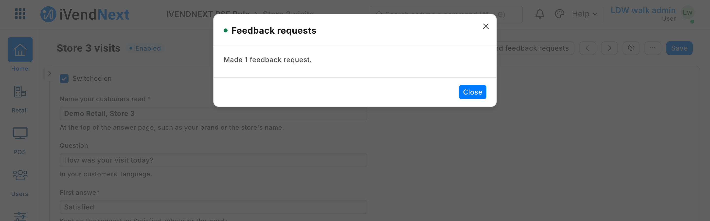
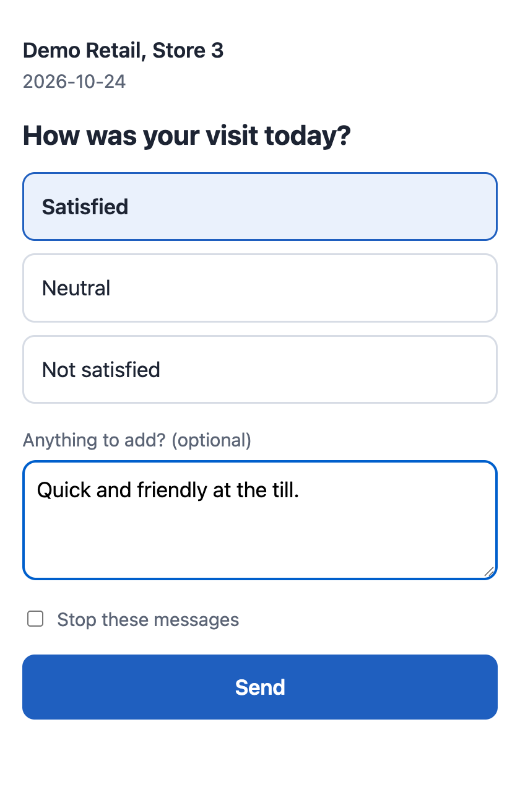
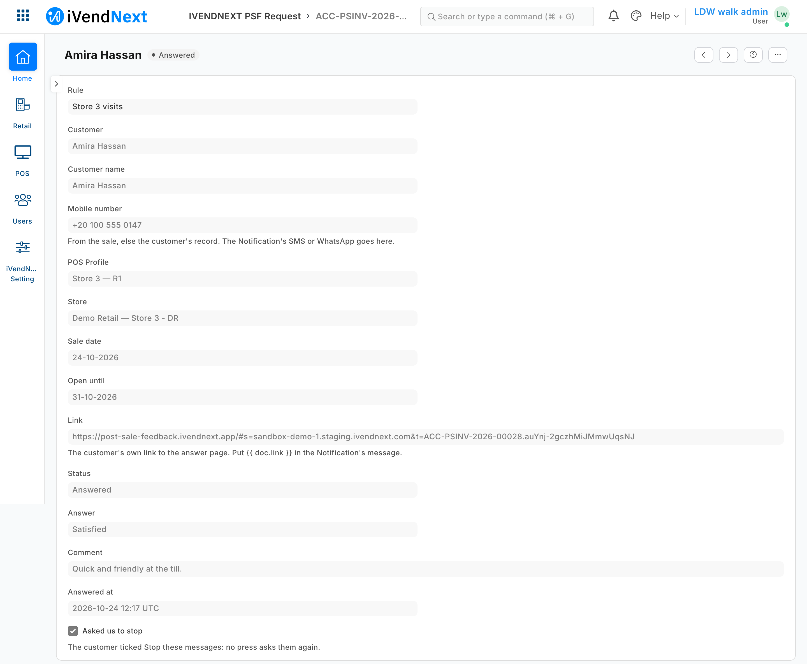

# Post-sale feedback: ask each customer how the visit was — the recipe

Retailers ask to hear from the customer after a sale: **a message after the visit with a few answers to tap**, **one answer per sale, kept by store**, **a way for the customer to say stop**. This recipe adds that from outside, through a Desk button and a page your service serves: the retailer writes a rule in Desk; a manager presses *Send feedback requests* and your service makes one request per recent till sale to ask, holding the customer's own signed link; the retailer's own Notification sends each request by SMS, e-mail or WhatsApp; and your page writes the customer's answer on the request, once. It is for an iVendNext Partner, or the CitiXsys Consulting Team.

**Reference implementation:** `samples/s49_post_sale_feedback/` — *Post-sale feedback*.

**When to use it.** The retailer wants its customers' own word on each store, inside iVendNext, sent through its own messaging. A survey tool's link in the receipt message keeps the answers outside iVendNext, by no sale or store.

## What the retailer and the customer see

- The manager, on a rule: *Send feedback requests*; the answer says how many were made and why the others were not (*already asked*, *asked us to stop*, *with no mobile number or e-mail*).
- The customer, a message from the retailer with a link: the retailer's name, the sale's date, the question and three answers in the retailer's words, a comment, and *Stop these messages*.
- The manager again: each answer on its request, and the report of answers by store.

## Rules

1. **Declare three record types, the button and its service in your manifest** (`samples/s49_post_sale_feedback/manifest.json`):
   - `<PREFIX> Rule`, named by its title: *Switched on*, the name customers read, the question and three answers (the retailer's words, in its customers' language), the days back a press reaches (1 to 7), the days a link stays open (1 to 30), a table of POS Profiles (`<PREFIX> Rule Profile`, never required: no row means every POS Profile), and *Asked up to*, which your service writes and a manager may clear to read the rule's days again. Give your manager role the rights to keep it; your integration role reads it and writes *Asked up to*. Whoever keeps the rules needs *Select* on *POS Profile* for the table's lookup;
   - `<PREFIX> Request`, one per sale, named by it (`"autoname": "field:sale"`, so a second write of the same sale is refused as a duplicate): the sale (a **Link** to *POS Invoice*), the rule, the customer, their name, `mobile` (a **Data** field with the option *Phone*, which an SMS or WhatsApp Notification sends to), `email` (the option *Email*), the POS Profile, the store, the sale's date, the last day it is open, the `link`, the status (*Sent* or *Answered*), the answer (a **Select** of the three, stored in English whatever the words shown), the comment, the time answered and *asked to stop* (a **Check**, never a standard filter). Every field read-only. Your integration role reads, writes and creates it; the manager reads it;
   - name the roles `<PREFIX> Manager` and `<PREFIX> Integration`, so the install makes them;
   - one `desk_action` subscription at your service's address, and that address alone in `allowed_urls`; one Desk action on the rule, form and list, for the manager role, sending only `name`;
   - a feed registration naming your one integration user (its description at most 140 characters), so the retailer's *Connect again* hands that user's key to your service;
   - a report of the answered requests, and a help address on each record type you make (a `documentation` property setter).

2. **Check every press with the subscription's secret** (`<app>:sub:<key>`; the sample's key is `send`), and refuse a timestamp more than five minutes from yours. A press names one to 100 rules.

3. **On a press, read with your integration user's key** (the rules first, then the rest at the same time): the pressed rules with their POS Profiles in one list read (`fields` `[…, "profiles.pos_profile"]` gives one row per POS Profile); every POS Profile's walk-in customer and store (`["name","customer","warehouse"]`); each rule's submitted till sales of its days (`docstatus` 1, `is_return` 0, `posting_date` from the first day, its POS Profiles), **received since its last press** (`creation` at or after *Asked up to*, `order_by` `creation asc`, at most 500); the requests already made for those days (`["name","customer"]`) and the customers who asked to stop (`asked_to_stop` 1); and, for the sales that carry no contact, the customers' own (`["name","mobile_no","email_id","custom_phone_no","custom_email"]`, fifty names a read: a customer the till creates holds its phone and e-mail in `custom_phone_no` and `custom_email`, never `mobile_no`). iVendNext gives your role a plain **read on POS Invoice, POS Profile and Customer**, no User Permissions.

4. **Choose whom to ask.** Never the walk-in customer, a sale with no customer or a return. Never a customer who asked to stop, a sale already asked, or a customer already asked in the rule's days. One request per customer a press, their latest sale, across every rule of the press. The sale's own contact first (`contact_mobile`, `contact_email`), else the customer's: the till's fields first. Neither: count it and move on.

5. **Read side by side, then write the requests, several at once, within the press's time.** The button waits 10 seconds at most and a function's cold start comes first: the sample makes the reads that need only the rules at the same time, reads for at most 7 seconds, starts no new request after 4.5 and gives each 2. A request iVendNext refuses as a duplicate was made by another press: count it as made. One it refuses for its own values (`InvalidPhoneNumberError`, `InvalidEmailAddressError`, `LinkValidationError`): count it and never try it again. Any other refusal refuses every request (a Notification's condition that fails, say), and one with no answer may be made: the next press tries both again. Then move each rule's *Asked up to* to the first sale it did not make, else to the last sale it read; the next press finds the requests already made as asked.

6. **Sign the link; check the signature before any read.** The link is your page's address with `#s=<the retailer's site>&t=<the sale>.<signature>`, the signature HMAC-SHA256 of the site and the sale with the press's secret, cut to 22 base64url characters. The part after `#` never reaches a server in the address. Your page sends `s` and `t` in the body of its calls; check the signature first, against the current secret and the one before, and answer a bad one, or a retailer you do not know, in the same words, so a guessed link never reaches the retailer's iVendNext.

7. **Answer once.** On the page's answer, read the request and its rule; while it is open and unanswered, write the answer, the comment (at most 280 characters), the time in UTC and *Answered*, with the request's `modified` as read, so a second tap never writes over the first. *Stop these messages* is written whatever the state. Past its last day, a link takes no answer.

8. **Show nothing personal on the page:** the name the rule gives, the sale's date, the question and the three answers. Serve it with a strict content policy (no inline script, no outside source) and no referrer.

## The message

The request reaches the customer through iVendNext, never through your service:

- iVendNext makes one **Notification**: *Document Type* `<PREFIX> Request`, *Send Alert On* **New**, and a message holding `{{ doc.link }}`. *Channel* **SMS** with a recipient *Receiver By Document Field* **mobile** (and SMS Settings for its own gateway), **Email** to the field **email**, or WhatsApp where the WhatsApp app is installed (the programme's bench measured the SMS; e-mail and WhatsApp are not measured). A manifest's own notification goes only to the retailer's users, so this one is the retailer's: put it in your setup steps.
- iVendNext sends a Notification inside the record's save and never fails the save for it: a gateway that refuses is written to the retailer's *Error Log*. The request is made; the customer gets no message. Your setup's last step is a test press; tell iVendNext to watch its Error Log.

## Bounds

- A press, not a schedule: the manager presses once a day (for example at closing), and the messages go then. Until functions on CitiXsys hosting have a schedule, a message at the moment of the sale is not this recipe.
- One press makes what fits its time; more sales wait for the next press, which says so.
- A customer is asked at most once in a rule's days, whichever rule asked.
- Links are signed with the button's signing key. When it changes (a System Manager ticking the consent again can change it), links signed with the key before keep working until it changes once more; older ones stop. A retailer's manager role reads every request's link.
- Reading every request and answer is the manager role's and the retailer's System Manager's; each request holds a customer's mobile number and e-mail.
- Offline sales are asked once they reach iVendNext, while their date is within the rule's days back: the press reads by when a sale arrived, not when it was rung.
