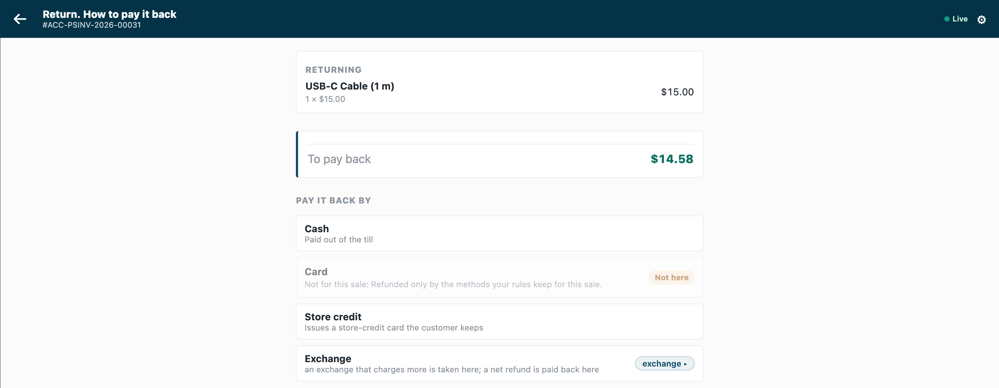

# Refund rules: how the till may pay a refund back — the recipe

A payment method's *Allowed in Returns* holds for every refund alike. Retailers ask for more: **a sale paid by card refunded to the card, never in cash**, and **a return without its receipt only to store credit**. This recipe adds that from outside, through the check before payment, which runs before the refund choices open on every refund the till pays: the retailer fills one settings record in Desk, and your service takes the other methods off the refund screen, with the reason, or refuses the refund. It is for an iVendNext Partner, or the CitiXsys Consulting Team.

**Reference implementation:** `samples/s51_refund_rules/` — *Refund rules*. A retailer installs it, as it is, from the App library: [Refund rules](https://library.ivendnext.app/apps/ivendnext_rfr).

**When to use it.** A refund must follow the sale it refunds. A method no refund may ever use is configuration: untick its *Allowed in Returns*. Each store refunding only its own sales is configuration too, for a return against a sale: leave *Use inter-store transactions* off in Retail Setting (the default).

## What the cashier sees

- A return against a card sale: the card method and the store credit method offered, the others dimmed with *"Not for this sale: Refunded only by the methods your rules keep for this sale."*
- None of the sale's methods offered at this till: *"This refund can't go ahead"* and the service's sentence.
- Every sale: the payment screen as always.

## Rules

1. **Declare the settings record and the check in your manifest** (`samples/s51_refund_rules/manifest.json`):
   - a record type `<PREFIX> Settings` named by its title, the service reads `Default`: *Refund by the sale's own methods* (a **Check**), *Store credit method* (a **Link** to *Mode of Payment*, required with the tick: `"mandatory_depends_on": "same_methods"`), *Always allowed* and *Without its sale, only these methods* (each a **Table** of one child type, `<PREFIX> Method`, a **Link** to *Mode of Payment*; neither required). Give **System Manager** the rights to edit it and your integration role **read only**; name the role `<PREFIX> Integration`, so the install makes it;
   - one `check` subscription at your service's address, and that address alone in `allowed_urls`;
   - a feed registration, one per app, with no user named (its description at most 140 characters): from POS version 2.1.0.667 the install makes your app's own user, `<app>@integration.invalid`, and names it, and the retailer's site hands that user's key to your hosted service after the install or an update (*Connect again* only if the site could not reach the app, or a key was lost or changed);
   - a help address on the settings record type (a `documentation` property setter).

2. **Choose what happens when your service is down.** The sample declares `allow_and_flag`: an outage never stops a refund, and it is flagged on *Sales to review*. A retailer that must never refund outside its rules changes its subscription to `refuse` once the site has handed your service its user's key. A key withdrawn or a user disabled (401 or 403) is iVendNext unreadable too: log it apart from an outage.

3. **Check every call with the check's secret** (`<app>:sub:<key>`; the sample's key is `refunds`), and refuse a timestamp more than five minutes from yours.

4. **Answer a sale at once.** Judge only `stage: "return"` with `totals.grand_minor` below 0: a sale is allowed without a read. An exchange's returned items are always a return with a negative total (their credit note is checked alone, whatever the replacement costs).

5. **Read the settings with your integration user's key, and keep them a minute:** `GET /api/resource/<PREFIX> Settings/Default` returns the record with both tables. A 404 is no record: every rule off (log it: a wrong prefix looks the same). A 200 that holds no record, and any other failure, answers 503, the down answer.

6. **Keep the refund to the sale's methods.** `return_of.paid_by` names the Modes of Payment that paid the sale (for an order or a layaway plan, every one that paid into it), in the same names as `offered_tenders`. Keep those, the *Always allowed* ones and the store credit method; for `return_of.channel` `none` (a return without its sale), keep the methods named and the store credit method, or, with none named and the methods rule on, the *Always allowed* ones and the store credit method, so a no-receipt return is no way round the rule. `offered_tenders` is the POS Profile's whole payment table, a method switched off for returns included: refuse only when none of those would stay. Answer `{"verdict":"allow","exclude_tenders":[…],"reason":"…"}` with every other offered method, each once. None would stay: `{"verdict":"refuse","reason":"…"}`. More than 20 to take off: refuse (the contract allows 20).

7. **Never take off the store credit method.** An exchange's returned items book store credit whatever the replacement costs: leaving it out refuses every exchange (the check page, section 3). The till books it with a Mode of Payment of type Store Credit (the most recently changed, when several are enabled): have the retailer keep one enabled and name it. Your setup also tells the retailer to tick *Allowed in Returns* for it, and for each card method a refund may go back to, on each POS Profile the rules hold at: the rules only take methods away.

## Bounds

- Methods, never amounts: the cashier chooses how much goes to each method kept.
- A manager's approval for a refund outside the rules is your version: an `approve` carries no methods taken off.
- Whole sales only (every line returned) is your version: read the sale's lines with the integration user.
- Offline, the till does not call your service. The check does not run on a park, a layaway deposit, an account collection, a gift card's balance paid out in cash or the Desk's own POS screen.
- At a till with a cash drawer, an exchange whose replacement costs less pays its difference in cash: refused at its credit note when your rule leaves cash out. Say so in your guide: return the items, then ring the new ones.
- Before POS version 2.1.0.669, `return_of.paid_by` lists a sale's tender rows, so a zero-amount row counts as a method that paid; from 2.1.0.669 it names only the methods that paid.
- A layaway plan's refund is payable at any store of the company, whatever *Use inter-store transactions* says.
- The till asks every check at each Pay too: answer a sale at once, but it is still a call, and it carries the sale's details.
- Not checked: a return sent to a register (refunded in Desk) and a refund made in Desk.
- At most three checks answer one POS Profile, ten seconds together.

## See also

- [Payment method rules](payment_method_rules.md): the same service shape, leaving payment methods out of a sale by customer group.
- [A rule checked before payment](rule_guard.md): the check's answers and its basket lock.
- The check before payment's page, `contracts/pages/partner_check.md`: `return_of`, `offered_tenders` and the online-refund example.
