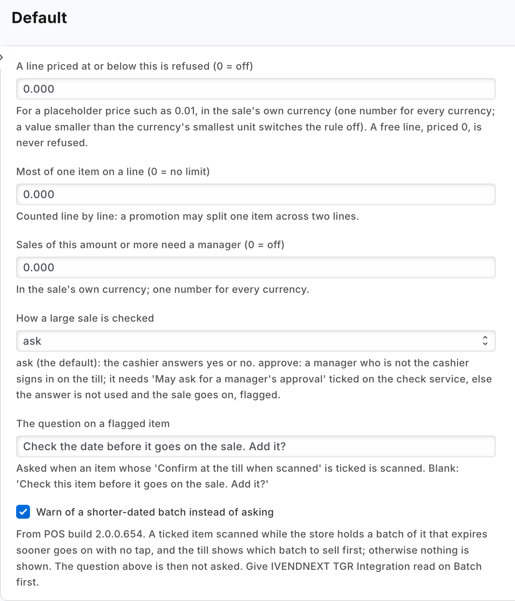
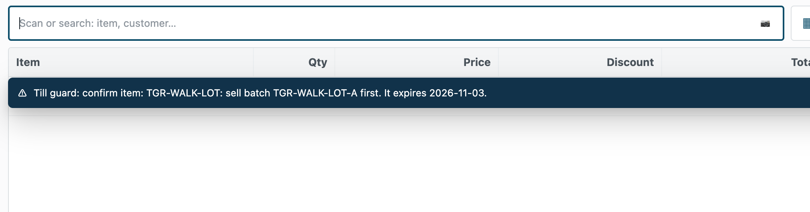
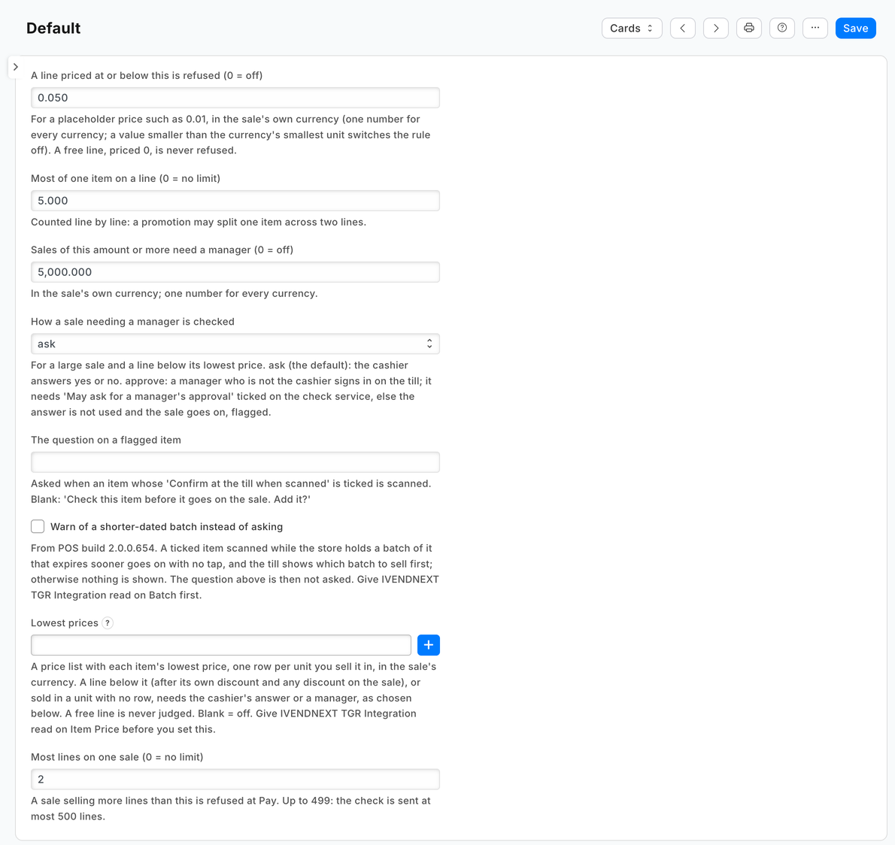
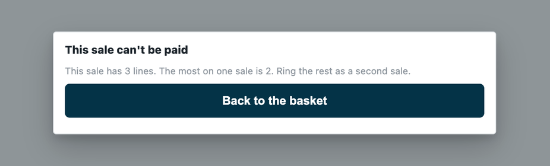

# Several till rules in one app, with the retailer's own settings (till guard rules) — the recipe

A retailer rarely wants one rule at the till. It wants a handful: a manager for a large sale or a price below an item's lowest, no line at a placeholder price, a most-per-line quantity, a most lines per sale, a beep on a flagged item. This recipe puts them in **one app**: a check before payment for the rules at Pay, a capture on scan for the rule at the scan, and **one settings record the retailer edits in Desk**, which your service reads. It is for an iVendNext Partner, or the CitiXsys Consulting Team.

**Reference implementation:** `samples/s23_till_guard/` — *Till guard rules*.

**When to use it.** Your rules need numbers or choices that differ from retailer to retailer, and one service answers many retailers. For one rule with fixed settings, the check alone is enough ([recipe](rule_guard.md)); for a value captured at the scan, the capture ([recipe](capture.md)).

## Steps

1. **Declare the two services and the settings in your manifest** (`samples/s23_till_guard/manifest.json`):
   - a record type `<PREFIX> Settings` (an ordinary record type; the service reads the record named `Default`, guide chapter 7). Give **System Manager** the rights to edit it, and your integration role **read only**. The install makes that role when iVendNext lacks it **only if its name starts with your prefix** (on a site whose POS app is at `e149dce4` or later): the sample's is `PP TGR Integration`. Name yours `<PREFIX> Integration`, and say in your card's setup steps who gives it to the app's integration user;
   - a **Check** field on Item (*Confirm at the till when scanned*), and the capture's filter on it: `"settings": {"event": "scan", "item_field": "<prefix>_confirm_at_scan"}`. Online, the server reads the tick at each scan and calls you only for a ticked item; offline you are not called, and the till applies your down answer to the items ticked at its start of day (at most 2,000);
   - a `check` subscription and a `capture` subscription, each at its own address;
   - a feed registration (`registered_applications`), one per app, with no user named: from POS version 2.1.0.667 the install makes your app's own user, `<app>@integration.invalid`, and names it, and the retailer's site hands that user's key to your hosted service after the install or an update (*Connect again* only if the site could not reach the app, or a key was lost or changed);
   - a help address on the settings record type (a `documentation` property setter), so Desk's help on the record opens your page at its settings.

2. **Choose what happens when your service is down.** Till guard rules declares `allow_and_flag` for both: an outage never stops a retailer selling, and each sale is flagged on *Sales to review*. A retailer that wants a rule to hold in an outage changes its subscription to `refuse` (the check's three down answers are in the [check recipe](rule_guard.md)).

3. **Check every call with its own route's secret.** The install makes one secret per service, `<app>:sub:<key>`. The check's address accepts only the check's secret, the scan's only the scan's (`service/app.py`, `ROUTES`).

4. **Read the retailer's settings with your integration user's key, and keep them a minute.** `GET /api/resource/<PREFIX> Settings/Default`. No record yet: every rule off. iVendNext cannot be read: use the last rules you read for a short while (S23: ten minutes, kept by each running copy of the service, so a copy that has just started has none), then answer 503 so the till applies your down answer. Never follow a redirect with the key.

5. **Answer.** At Pay, the first refusal wins (`refuse` + `reason`); then a line below its lowest price, or a large sale, gets `ask` (a yes/no; S23's default, it needs nothing more) or `approve` (a manager who is not the cashier signs in). At the scan, `confirm` + `question`: the till beeps and asks. What a sale or a return takes back is never judged; what a return sells (an exchange rung without its sale: lines with a positive quantity) is judged by the line rules, and the large-sale rule reads the total the customer pays (on an exchange, net of what it takes back), so an exchange cannot dodge it. On a return the till's headline is *This refund can't go ahead*. Every sentence is plain text of 1 to 140 characters.

   | Rule | Answer |
   |---|---|
   | a line priced above 0 and at or below the retailer's placeholder price | `{"verdict": "refuse", "reason": "Line 2: PEN-01 is priced 0.01 AED. Correct its price before the sale is paid."}` |
   | a line holding more than the retailer's most (line by line: a promotion may split one item across lines) | `{"verdict": "refuse", "reason": "Line 1: 60 of WATER-24. The most on one line is 50."}` |
   | more lines sold than the retailer's most lines on one sale | `{"verdict": "refuse", "reason": "This sale has 41 lines. The most on one sale is 40. Ring the rest as a second sale."}` |
   | a line priced above 0 and below its lowest price, in the retailer's price list of lowest prices (the line's own unit; `approve` chosen) | `{"verdict": "approve", "reason": "Line 2: CEMENT-50 is 18.00 SAR, below its lowest price of 20.00 SAR. It needs a manager's approval."}` |
   | a sale at or above the approval amount (the retailer's default, `ask`) | `{"verdict": "ask", "question": "This sale is 5,000.00 AED or more. Has a manager agreed to it?"}` |
   | the same, when the retailer chose `approve` | `{"verdict": "approve", "reason": "Sales of 5,000.00 AED or more need a manager's approval."}` |
   | a flagged item scanned | `{"verdict": "confirm", "question": "PEN-01: Check this item before it goes on the sale. Add it?"}` |

6. **Tell iVendNext what to do** (the sample's README, and your card's setup steps): after the install, make the `Default` record, tick the items, tick the feed's record types on, give the app's role (the install added it, and the app's own user holds it) its reads, then consent to and switch on each service. For `approve`: first give each manager *May Approve a Partner's Check* on their Retail Permission and write access to *Retail Override Request* (the check refuses the next tick until someone other than the cashier can approve), then tick *May ask for a manager's approval* on the check. Without the tick, an `approve` answer cannot be used and the till applies your down answer.

7. **Test it.** The sample's tests: each rule, each route's secret, the record read and kept, one retailer and many, every answer against the contracts; `canaries.py` breaks each guarded rule and expects its test to fail. Then press Pay and scan on a sandbox.

### Settings

The retailer's record `Default` of `<PREFIX> Settings`, each rule off until set (0 or blank = off): *a line priced at or below this is refused* (a placeholder price such as 0.01; a free line is never refused), *lowest prices* (a price list of the retailer's, one Item Price row per item and unit, in the sale's currency; the service reads those rows for the basket's items after the refusals, so a list that cannot be read never stops a refusal; the integration role needs read on Item Price, given before the list is named), *most of one item on a line*, *most lines on one sale*, *sales of this amount or more need a manager* and *how a sale needing a manager is checked* (`ask` or `approve`, for a large sale and a line below its lowest price), and *the question on a flagged item*. Amounts are one number for every currency, read in the sale's own currency. A change reaches the service within a minute.

## What iVendNext needs from you

| You give | iVendNext checks |
|---|---|
| an **HTTPS** address its server trusts, per service | the address is consented; a private address is refused on a customer's site |
| a settings record type and a field, by manifest | the installer makes them and removes them at uninstall |
| a signature check per route | — (yours to do) |
| an answer within the timeout (3 s at Pay, 1.5 s at the scan) | your declared down answer applies otherwise |

## Technical notes

- **Configure before you code a price rule.** iVendNext already refuses a price below cost (Selling Settings, *Validate Selling Price*), holds a cashier's price change inside a share of the list price unless a manager approves (Retail Permission, *price override lower and upper limit*), and caps a line's discount (the item's *Max Discount (%)*). A lowest price per item and unit is what those leave open.
- **Offline,** the till does not call you: each service's declared down answer applies, and the sale is flagged when it syncs.
- **Hosting:** the service is the app template's shape, so it serves many retailers through the template's handshake (guide chapter 14b, *One app, many retailers*); each retailer's site hands over the two secrets when it connects after the install, and its integration user's key, which the site hands over after the install or an update. It only answers presses, so on CitiXsys hosting it runs as a function, paid per call (`app.json` `"runs": "function"`). Until a retailer's user key arrives the service answers 503, so your down answer applies.
