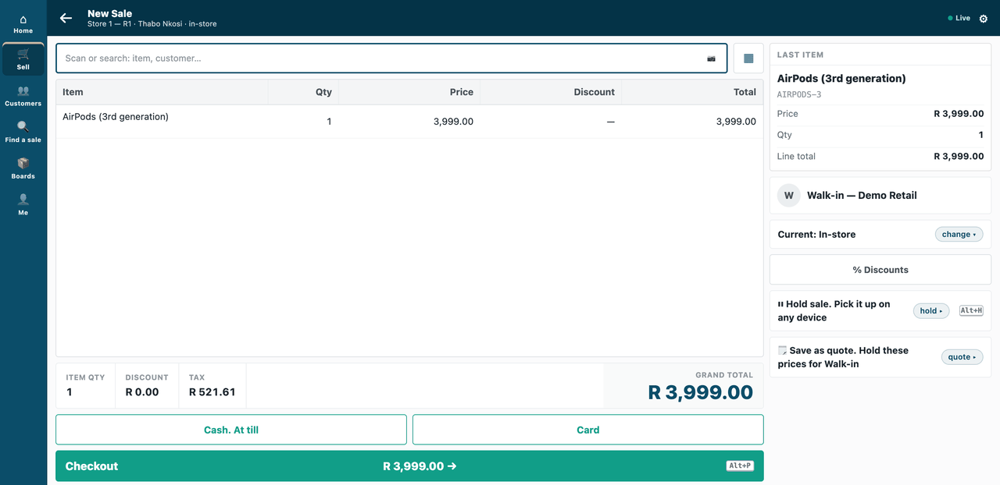
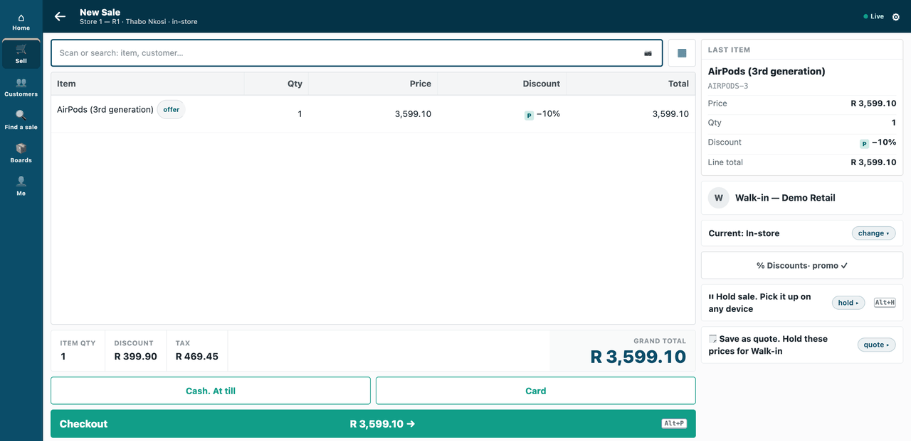
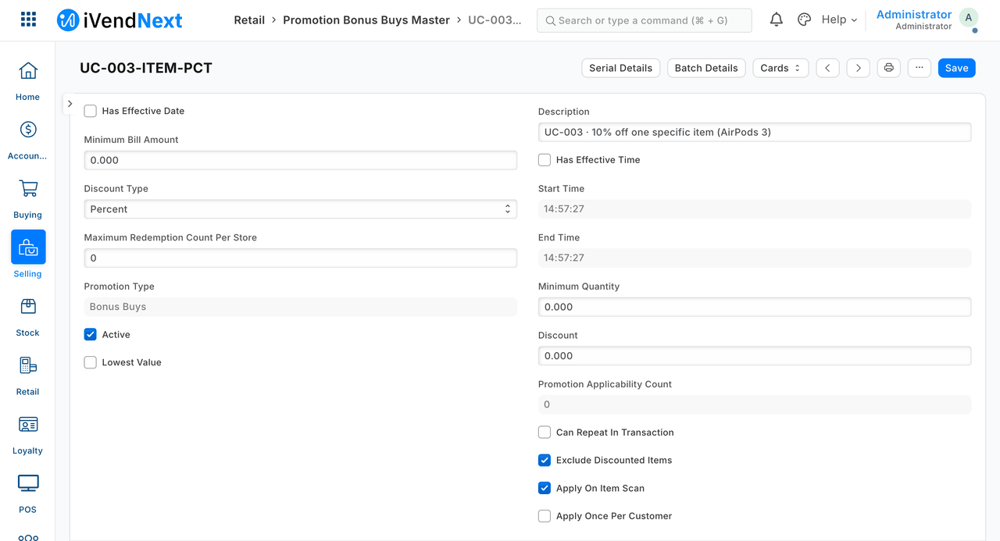

# S10 — the manager's AI assistant

*Start from this sample: copy this folder into `apps/<your app>/` of a repository made from the kit and change the names as this page says; the one-command start does not cover it, because it builds its own manifests ([how](../../recipes/make_it_your_own.md)).*


*The manager asks the assistant to switch a promotion on and says yes; the till's price drops from R 3,999.00 to R 3,599.10, and the promotion reads Active in Desk.*

An AI assistant for a store or area manager, which reads and changes iVendNext through **our MCP server** (`tools/mcp_server/`). This sample is for a developer who wants to put an assistant in front of iVendNext safely: it uses the manager's own key, reads only unless you allow writes, and its assistant is told to ask before every change (the server cannot see a person: see *Before you copy it*).

**Industries:** every industry

**When to use it:** a manager wants to ask *"what sold in the Store 1 store yesterday?"* or say *"put the 10% off AirPods promotion on"* in plain words.

**Door:** Outside app

## What happens

1. The manager types a sentence.
2. The assistant turns it into tool calls on our MCP server, on **the manager's own key**.
3. For a question, it reads and answers.
4. For a change, it says what it will do and **waits for a yes**. Only then does it make the change.

The server is read-only unless the operator starts it with `--writes`. Recipe: `recipes/ai_manager.md`.

## What it looks like

The conversation, as the scripted assistant ran it, on the manager's own key through our MCP server started with `--writes`:

```text
MANAGER:   Put the 10% off AirPods promotion on
ASSISTANT: I will switch 'UC-003 · 10% off one specific item (AirPods 3)' on (it is off now). Shall I go ahead?
MANAGER:   yes
ASSISTANT: Done. The shop has saved the change.
```

| Step | Frame | Screenshot |
|---|---|---|
| 1. Before: AirPods at R 3,999.00 on the till | the till, 1440 wide |  |
| 2. After the yes: the same AirPods at R 3,599.10, the promotion marked on the line | the till |  |
| 3. The promotion, *Active*, in Desk | Desk |  |

The promotion and the item are demo data.

## What the retailer does

This is for a store or area manager, with the retailer's administrator and whoever runs the assistant. The assistant is the customer's own: no AI is paid for or shipped here.

1. **Give the manager a key with only the rights they need.** The administrator gives the manager's **User** a role that can *read* sales, closings, stock, till profiles, items, prices and promotions and, only if the manager may change them, *write* promotions and price rows. Then, in the user's **API Access**, **Generate Keys**. The assistant can never do more than that role allows.
2. **Choose what the assistant may do.** The person who runs it starts the server, outside the retailer's iVendNext, with one of two profiles: `profile_read.json` to look only, or `profile_writes.json` with `--writes` to also switch a promotion on or off and change a price-list row. If the retailer runs price approvals, leave **Item Price** out of the writes: a price changed here skips them.
3. **Connect the assistant** to the server. Any assistant that speaks the Model Context Protocol will do. Put HTTPS in front of the server before anyone else reaches it.
4. **The manager speaks in plain words.** For a question, the assistant reads and answers. For a change, a well-behaved assistant says what it will do and waits for the manager's yes; the server cannot check that it did.

**Where it shows.** In the manager's conversation with the assistant. A change made after a yes shows where iVendNext's own screens show it: the promotion reads *Active* in Desk, and the till's price drops (R 3,999.00 to R 3,599.10 in the walk above). Every confirmed change is one line on the server's audit log, with a fingerprint of the manager's key and no value. Nothing is added to the till's screens, to POS Studio or to a print layout.

**What leaves the retailer's iVendNext.** Whatever the manager's key may read, and the assistant requests, goes to the assistant and so to the customer's AI provider: a customer's name or phone on a sale reaches it if the assistant requests it, because the server does not fence the fields it reads. The server holds no key of its own; each call carries the manager's key, and the retailer's permissions for that person decide. Narrow what is readable in the manager's role in the retailer's iVendNext.

## The files

| File | What it is |
|---|---|
| `profile_read.json` | the read-only profile: 6 tools (with the words the assistant reads for each) and 3 record types |
| `profile_writes.json` | the same plus one write — switch a promotion on or off, change a price-list row — start with `--writes` |
| `assistant.py` | a scripted stand-in for the AI (standard library): the manager's sentence → tool calls → an answer; it asks before it confirms |
| `tests/test_s10.py` | 19 laptop tests against a stand-in iVendNext, no AI |

## Before you copy it

- It needs the server change `--profile` in `tools/mcp_server/server.py`.
- `assistant.py` is a scripted stand-in, not an AI. No AI provider is paid for or shipped: bring your own.
- **"It asks before every change" is the stand-in's behaviour, not the server's.** `confirm: true` is the assistant's promise that the manager said yes: the server cannot see a person. Pick an assistant that asks before it calls a tool marked as changing things, and read the audit log.
- **A price changed through it skips any approval** the retailer runs ([approvals](../../recipes/approvals.md)). Where prices need a manager's yes from someone else, leave `Item Price` out of the writes profile.

## Run it

From the kit's root (the folder that holds `samples/`):

```bash
python3 -m unittest discover -s samples/s10_ai_manager/tests -p 'test_*.py'
```

To start the server for a staging site (it needs a site and the manager's key, so it needs a sandbox), run this from the kit's root:

```bash
IVN_BASE=https://shop.example python3 tools/mcp_server/server.py --http localhost:8130 --profile samples/s10_ai_manager/profile_read.json
```

## Technical notes

### What was walked, and where

The GIF: frames: the till (`/pos?frame=terminal`, 1440 wide), then Desk. Walked on our test bench on 2026-10-10, iVendNext POS app at `87812e141`. Built from the same screens as the stills; every frame is cut above the till's key row. The conversation is text, above.

The conversation was run by the scripted assistant on our test bench (2026-10-07), on the manager's own key through our MCP server started with `--writes`.

The promotion and the item are the demo site's own data (*UC-003*, AirPods; the walk-in is *Walk-in — Demo Retail*); both baskets were voided, so nothing was sold. The promotion was switched off again by the sample's tear-down.

### What was tested

| Where | What |
|---|---|
| `tests/test_s10.py` | 19 laptop tests against a stand-in iVendNext, no AI |
| (our test bench) | the same flow against a real site: 25 checks, passed |

## Versions

### 1.0.0

- First version in the kit: the manager's AI assistant.
