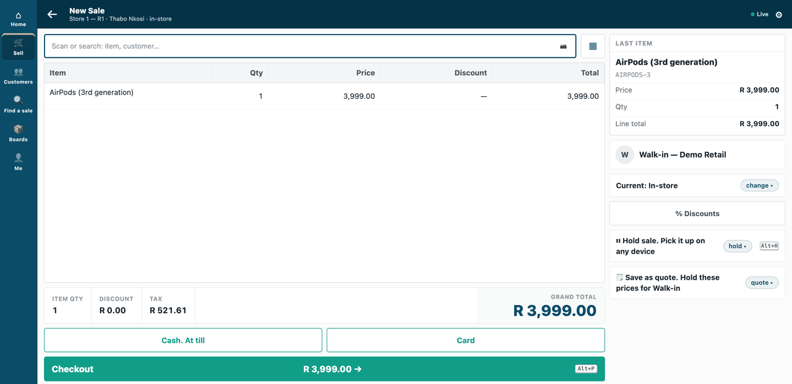

# S10 — the manager's AI assistant

A store or area manager asks in plain words, "what sold in the Store 1 store yesterday?" or "put the 10% off AirPods promotion on", and an AI assistant reads and changes iVendNext through our MCP server, on the manager's own key. It reads only unless the operator allows writes, and a change waits for the manager's yes before it is made.



**What is in it:** `profile_read.json` (6 tools, 3 record types), `profile_writes.json` (adds switching a promotion on or off and changing a price-list row) and `assistant.py`, a scripted stand-in for the AI.

**Industries:** every industry

**When to use it:** a manager wants to ask *"what sold in the Store 1 store yesterday?"* or say *"put the 10% off AirPods promotion on"* in plain words.

**Door:** Outside app

## Start from it

**Copy by hand: not an app made here.** Copy this folder's two profiles into your own repository, and start the server in `tools/mcp_server/` with the profile you choose; bring your own AI assistant.

## What to change

What a partner usually changes:

- **What it may read:** the tools and record types in `profile_read.json`.
- **What it may change:** `profile_writes.json`, started with `--writes`. If the retailer runs price approvals, leave *Item Price* out of the writes: a price changed here skips them.
- **The assistant:** `assistant.py` is a scripted stand-in, not an AI. Pick an assistant that asks before it calls a tool marked as changing things: `confirm: true` is the assistant's promise that the manager said yes, and the server cannot see a person.

More: the [recipe](../../recipes/ai_manager.md).

**The customer sets:** the manager's role and key. The administrator gives the manager's user a role that can read sales, closings, stock, till profiles, items, prices and promotions (and write promotions and price rows only if the manager may change them), then generates the key in **API Access**. The assistant can never do more than that role allows. Whatever the key may read goes to the customer's AI provider.

## Run it

```bash
python3 -m unittest discover -s samples/s10_ai_manager/tests -p 'test_*.py'
IVN_BASE=https://shop.example python3 tools/mcp_server/server.py --http localhost:8130 --profile samples/s10_ai_manager/profile_read.json
```

## Versions

### 1.0.0

- First version in the kit: the manager's AI assistant.
