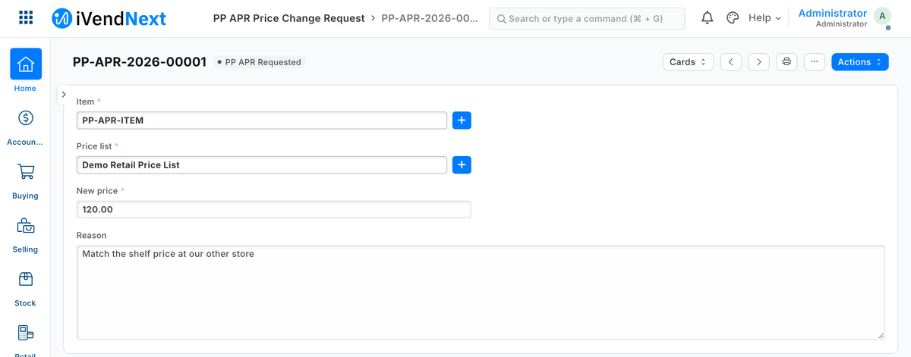
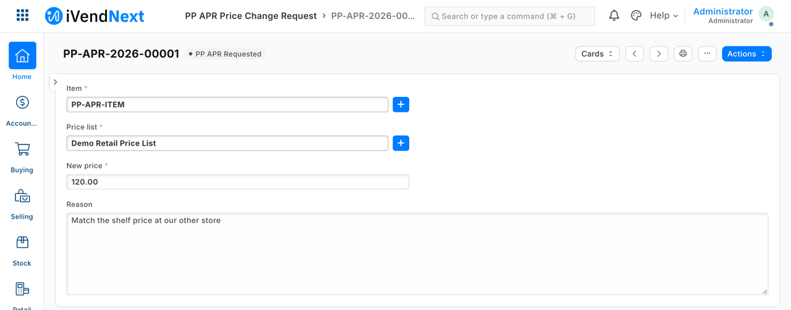
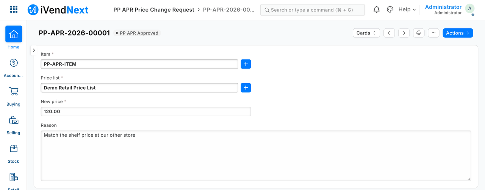
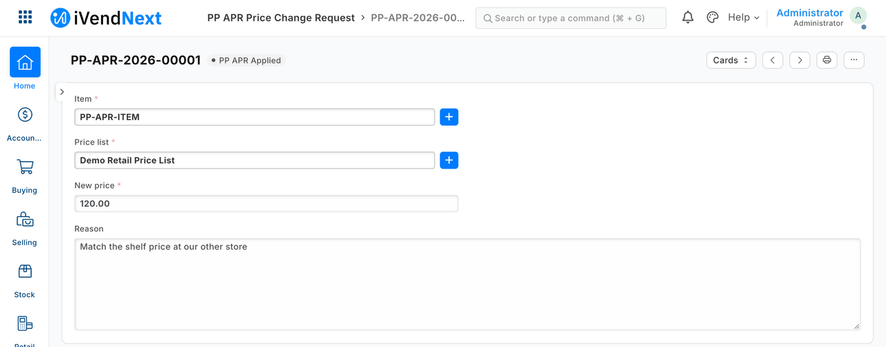
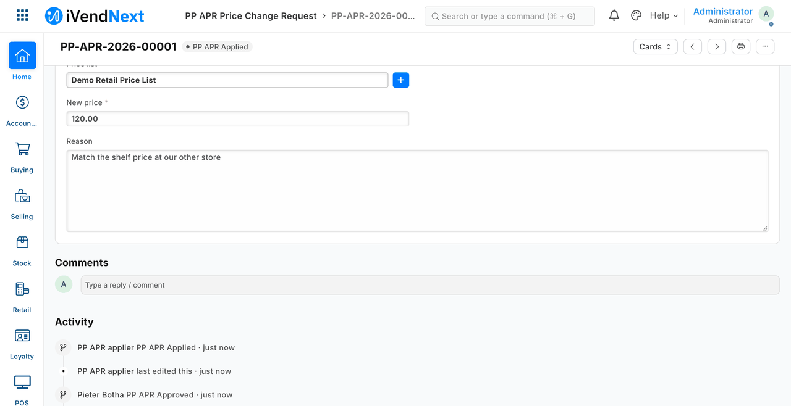
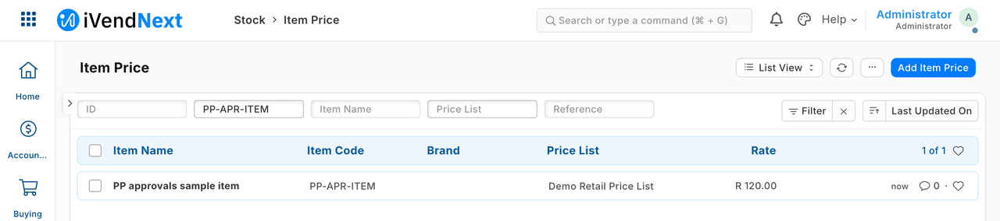

# S11 — price-change approvals with a nightly export

*Start from this sample: `python3 tools/manifest/start.py s11_approvals --prefix "ACME APR"` copies it into `apps/` of your repository under your own prefix (your company's first word, then a short name for the app) and checks it ([how](../../recipes/make_it_your_own.md)).*



*A price-change request is made, approved by a manager and applied once by an outside service; the retailer's price row then shows the approved price.*

A price change that needs a manager's yes before it reaches the retailer's prices. This sample is for a developer who wants an approval step in iVendNext without building a screen: iVendNext's own workflow does the approving, and a small outside service applies the result.

**Industries:** Thrift and resale

**When to use it:** a change must be requested, approved by someone else, and only then applied, with a record of who did what.

## What happens

1. A requester asks for a price change: the item, the price list, the new price and the reason.
2. A manager approves it. A requester cannot approve, and no one should hold both roles.
3. An **outside service** (`approvals.py apply`) applies the *Approved* request through the record API, **once**, with its own key.
4. The trail shows who approved and that the service applied it.
5. The retailer's price row now holds the new price.

The request moves *Requested → Approved → Applied* by a **native workflow** on the partner's own record type (`manifest.json`). `approvals.py export` writes the day's requests to a file, with a *changed_after_raise* column and text cells guarded against spreadsheet formulas; schedule it to run each night.

## What it looks like

The approver is shown as *Pieter Botha*; the item and the state names are the sample's own placeholders (`PP-APR-ITEM`, *PP APR Approved*).

| Step | Frame | Screenshot |
|---|---|---|
| 1. A requester asks: the item, the price list, the new price, the reason | Desk, 1440 wide |  |
| 2. The approver approves | Desk |  |
| 3. The service applies it, once | Desk |  |
| 4. The trail: who approved, and that the service applied it | Desk |  |
| 5. The retailer's price row: 120.00 | Desk |  |

## What the retailer does

This is for a retailer where a price change needs a second person's yes. iVendNext's own workflow does the approving; a small service the retailer (or its partner) runs applies the result.

1. **Install the app.** The retailer's administrator opens **Retail Extension Package** in Desk, pastes the manifest, presses **Check**, reads the summary, ticks the consent and installs. The install adds the record type **PP APR Price Change Request**, its numbering and its workflow, and the three roles *PP APR Requester*, *PP APR Approver* and *PP APR Applier* (empty at first, and removed again at uninstall; the install makes roles that start with the app's prefix, on a site whose POS app is at `e149dce4` or later). The names are the sample's placeholders; a real roll-out uses the retailer's own manager roles.
2. **Give the roles to the right people.** On each **User** record, give *PP APR Requester* to the people who raise price changes and *PP APR Approver* to the managers who say yes. **Never give one person both.** The two-person rule rests on that.
3. **Make the service's own user.** This app has no event feed, so the install makes no user for it: the administrator makes a user for the service, gives it the role *PP APR Applier* and generates its API key ([the integration user recipe](../../recipes/integration_user.md)). Outside the requests, that role gets exactly one right: read and write on **Item Price**, with all nine rights written out. Then fence the user to the price lists it serves, with one **User Permission** per **Price List** (*Apply To All Document Types* off, *Applicable For* **Item Price**). Take write on **Item Price** away from every other role, or the approval is a suggestion.
4. **Run the service.** The partner or the retailer's IT runs `approvals.py apply` with that key, as often as it likes (every minute, or on a trigger), and schedules `approvals.py export` to run just after the retailer's midnight.
5. **Day to day.** A requester makes a new **PP APR Price Change Request** and fills in **Item**, **Price list**, **New price** and **Reason**. A manager with the approver's role takes **PP APR Approve** (or **PP APR Reject**). The service then applies the approved price once, and the request reads **PP APR Applied**. A requester cannot approve, and the service refuses a request whose price was changed after it was raised.

**Where it shows.** In Desk only: the request list (item, price list, new price), each request's trail of who approved and that the service applied it, and the retailer's price row. The nightly export is a CSV file the service writes outside the retailer's iVendNext. Nothing is added to the till's screens, to POS Studio or to a print layout. The administrator's role (*System Manager*) can read, report on, export and print the requests, but cannot change the trail through this record type.

**What leaves the retailer's iVendNext.** Nothing is named in the manifest: no outside address, webhook, till key or event-feed registration. The service you run reads the requests and their change history over the record API, writes one price row per approved request and takes the workflow's *Apply* action, with its own narrow key. The export file it writes names who made, approved and applied each request. iVendNext lets any desk user list the retailer's users with their email and phone number, and so it does this key; this was measured on S14's key, which holds the same rights.

To remove it, use **Export and uninstall** on the installed version's record: it writes every request to a private file first ([manifest recipe](../../recipes/manifest.md)).

## The files

| File | What it is |
|---|---|
| `manifest.json` | the record type, numbering, change tracking, the workflow, every right written out |
| `approvals.py` | `apply` and `export` (standard library), with the guard against a request whose price changed after it was raised; `reject`, the core of a *Reject with reason* Desk action (0.2.0) |
| `tests/test_s11.py` | 23 laptop tests against an in-memory stand-in |

Recipe: `recipes/approvals.md`.

**Since 0.2.0: a reason asked before a request is rejected.** The record has two more fields, *Why it was rejected* and *Rejected by*. `reject` is the core a Desk action's press calls: it writes the reason and the pressing user, then takes *PP APR Reject*; if iVendNext refuses the transition, it puts the two fields back. S11 ships no press service, so its manifest declares neither the button nor the save rule that would refuse a reject without a reason: a retailer adds both together, with the reject transition moved to the service's role, or the approvers could no longer reject at all. The button, its dialog and the press handler are the Desk action recipe's: [`recipes/desk_action.md`](../../recipes/desk_action.md#a-reason-asked-before-a-document-is-rejected). Not walked on a retailer's iVendNext: the four tests use the in-memory stand-in.

## What is refused, and why

- **A request whose price changed after it was raised** — by the approver before approving, or by anyone after. iVendNext accepts such an edit from anyone with write, but the service refuses to apply it. Only the price as raised and approved is applied.
- **A request approved by the person recorded as raising it, or with ten or more recorded changes.** The service refuses it: the retailer's own self-approval check covers only the *Approve* action, and iVendNext shows only the last ten changes.
- **A price changed by anyone but this service.** The approval binds only the service: take write on price rows from every other role, and fence the service's user to its own price lists (the recipe's *Know these limits*).
- **A permission row that leaves a right out.** iVendNext treats a right that is left out as ON, so the manifest checker refuses such a row. Write every right out.

## Run it

From the kit's root (the folder that holds `samples/`):

```bash
python3 -m unittest discover -s samples/s11_approvals/tests -p 'test_*.py'
```

To export a day's requests from a retailer's iVendNext (this needs a sandbox, an app key and a secret), run this from the sample's own folder, `samples/s11_approvals/`:

```bash
BASE=https://shop.example AP_KEY=… AP_SECRET=… python3 approvals.py export --day 2026-10-04 --out state/export
```

## Technical notes

### What was walked, and where

The GIF: frame: Desk, 1440 wide. Walked on our test bench on 2026-10-10, iVendNext POS app at `87812e141`. Built from the same screens as the stills; every frame is cut above the activity lines.

Each step was taken by that person's own key (S11's bench driver), and photographed in Desk between steps. That a requester cannot approve is S11's tests', not step 2's shot.

### What was tested

| Where | What |
|---|---|
| `tests/test_s11.py` | 23 laptop tests against an in-memory stand-in (6 of them for `reject`, 0.2.0) |
| (our test bench, 0.1.0) | the same flow against a real site: 29 checks, passed; and the nightly export run by its cron line |

Measured: iVendNext accepts an edit of the price after approval; the service refuses to apply it. A permission row that omits a right gets it ON, so the manifest checker refuses such a row.

## Versions

### 0.2.0

- First version in the kit: price-change approvals by workflow, with a nightly export.
- The set-up steps say the install makes the app's own user (POS 2.1.0.667 or later).
