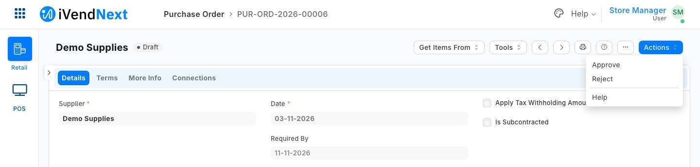

# S11 — Purchase Order approval

A Purchase Order over 50,000 waits for a Purchase Manager, and approving it submits it. A smaller order the buyer submits. Mail goes to whoever acts next. It is one workflow on the customer's own record type, with no service, no key and no record type of its own: the first app to build from [Build your first app](../../site/pages/first_app.md).



**What is in it:** an approval workflow on Purchase Order.

**Industries:** every industry

**When to use it:** a customer wants a person's yes before an order goes out, or wants to move it through its own steps. If the amount and the approver are all they want, they need no app: *Authorization Rule* in iVendNext Desk does that with no workflow, and [the card](../../needs/documents/approval-by-amount.md) says how.

## Start from it

```bash
ivn new acme_po_approval --from s11
```

## What to change

What a partner usually changes:

- **The amount:** `doc.base_grand_total > 50000` on *Approve* and *Reject*, and `doc.base_grand_total <= 50000` on *Submit*, in `manifest.json`.
- **Who may approve:** `allowed` on each transition. A step that says `"allow_self_approval": 0` cannot be taken by the person who raised the document, as on *Approve*: an order over 50,000 waits for someone else's yes. A step that says `1` can, as *Submit* does. A step that says nothing is `0` on today's POS and takes Desk's own setting, `1`, from its next update, so name `0` on every step that must stay two-person. The sample uses the roles every site has, *Purchase User* and *Purchase Manager*. A role that is not on the site is made at install, empty, for the customer to give to staff.
- **The record type:** `document_type`. Material Request or Stock Entry work the same way, with a total or a field of their own in the condition. The till's own records, such as POS Invoice, are on [the list of what an app may not do](../../contracts/pages/what_an_app_may_not_do.md).
- **The mail:** `send_email_alert`: 1 mails whoever may act next, 0 sends none.

More steps, more states, a required budget code or a mail with the order's print attached: the [recipe](../../recipes/approvals.md).

## Run it

```bash
ivn check
ivn try
```

As the buyer, raise a Purchase Order over the amount. As the approver, open it and press *Approve*: it reads *Approved* and it is submitted.

## Versions

### 1.0.1

- *Approve* says `"allow_self_approval": 0`, so the person who raised an order still cannot approve it once a silent step takes Desk's own setting.

### 1.0.0

- An approval on the customer's Purchase Order: approving submits it, the amount decides who may act, and mail is on. No service, no key, no record type of its own.
