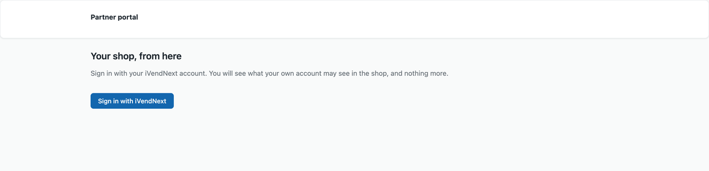

# S13 — a standalone portal with "Sign in with iVendNext"

A small web app on your own server. A person from the retailer opens it, signs in with their own iVendNext account, allows the app, and sees the latest sales that account may see: a store user sees their store's sales and no other store's, and someone with no right gets a plain sentence. Each sale links to the same record in the retailer's Desk. The portal keeps the sign-in token on its server, and Sign out ends it.



**Industries:** every industry

**When to use it:** a screen of your own, outside the retailer's iVendNext, for people who already have iVendNext accounts. If the screen can live inside the retailer's iVendNext, use the native screens first (guide chapter 13a).

**Door:** Outside app

## Start from it

**Copy by hand: not an app made here.** Copy `samples/s13_portal/` into your own repository; it is one file, `portal.py`, and the pages use the kit's own stylesheet.

## What to change

What a partner usually changes:

- **The list:** which records the page shows and which columns (`portal.py`; `LIST_LIMIT` is 20 POS Invoice records).
- **The words:** the sign-in page and the sentence for a person with no right.
- **The settings:** `PORTAL_SHOP`, `PORTAL_CLIENT_ID`, `PORTAL_CLIENT_SECRET` and `PORTAL_REDIRECT`; optionally `PORTAL_PORT` (8141), `PORTAL_HOST`, `PORTAL_SECURE=1` and `PORTAL_KIT`.
- **The look:** the pages use `ivn-kit.css`; change it there, not in the portal.

More: the [recipe](../../recipes/portal.md).

**The customer sets:** an **OAuth Client** in Desk for the portal (its exact redirect address, grant type *Authorization Code*, response type *Code*, scopes `openid all`; its client id and secret go to you), who may use it (**Allowed Roles**), and what each person may see (a **User Permission** on the store fences a store user to their store).

## Run it

```bash
python3 -m unittest discover -s samples/s13_portal/tests -p 'test_*.py'
PORTAL_SHOP=https://shop.example PORTAL_CLIENT_ID=… PORTAL_CLIENT_SECRET=… PORTAL_REDIRECT=https://your.server/callback python3 samples/s13_portal/portal.py
```

## Versions

### 1.0.0

- First version in the kit: a standalone portal with Sign in with iVendNext.
- A cut-short answer from a retailer's site is handled as an unknown outcome, like a site that cannot be reached, never a crash.
