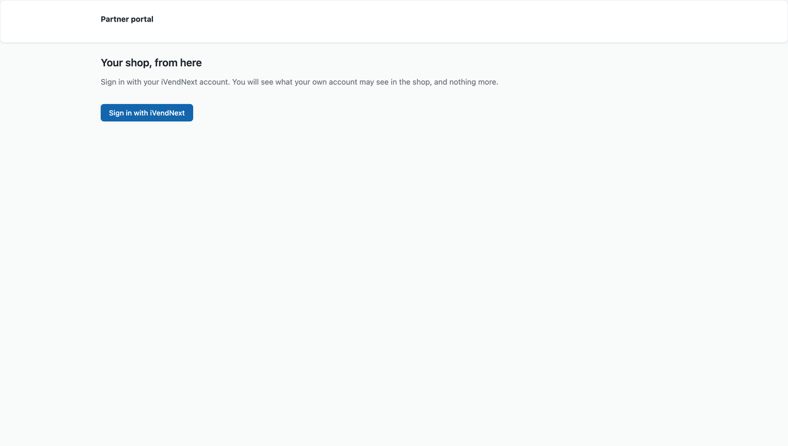
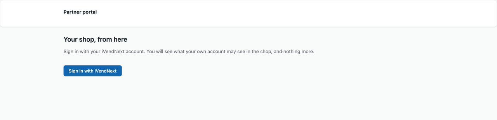
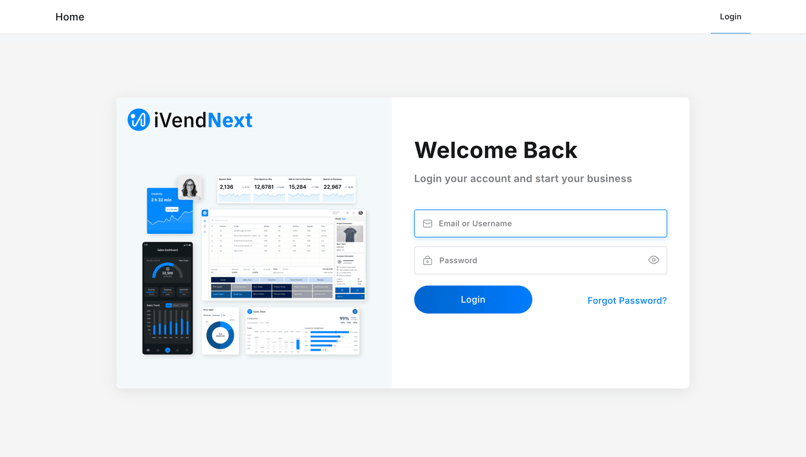
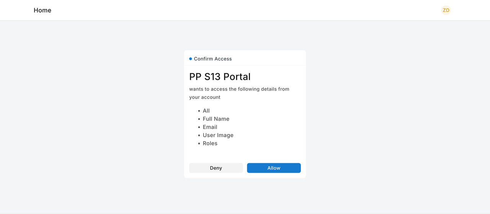
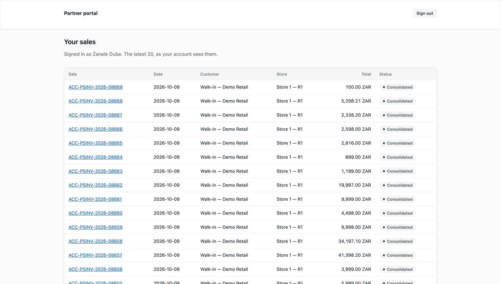
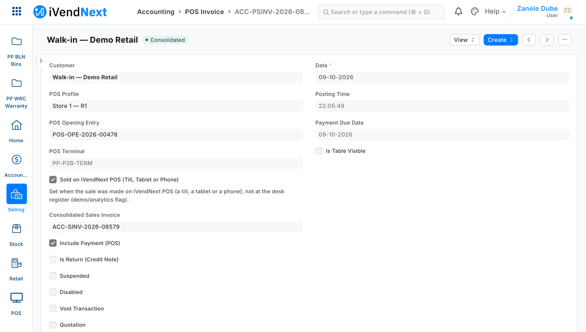
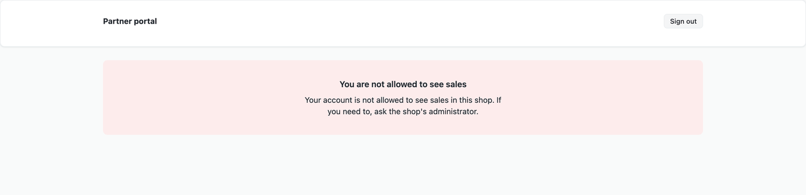
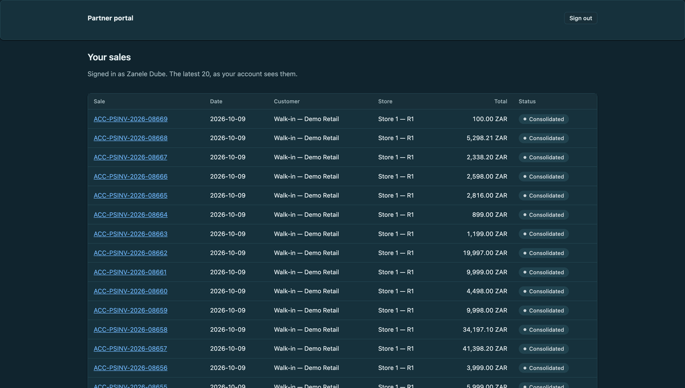

# S13 — a standalone portal with "Sign in with iVendNext"



*A portal on the partner's own server: a person signs in with their iVendNext account, allows the app, and sees only what that account may see in the retailer's iVendNext. The last frame is a different person, whose account has no right to sales.*

A small web app on **your own server**. A person from the retailer opens it, signs in with their own iVendNext account, and sees the retailer's records that *their own account* may see — a store user sees their store's sales and no other store's; someone with no right sees nothing. It is for a developer, or the CitiXsys Consulting Team, who needs a screen that is not inside the retailer's frame (a head-office or franchise portal, say).

**When to use it:** a screen of your own, outside the retailer's iVendNext, for people who already have iVendNext accounts. If the screen can live inside the retailer's iVendNext, use the native screens first (guide chapter 13a).

**Door:** Outside app

## What happens

1. The person opens the portal. It shows a **Sign in with iVendNext** button.
2. The portal sends their browser to iVendNext. The person signs in **to iVendNext** with their own account and presses **Allow** on the retailer's page that names your app.
3. iVendNext sends the browser back with a one-time code. The portal swaps the code for a token — proving it is the app that started the sign-in — and keeps the token **on its server**.
4. The portal asks iVendNext for the latest sales **with that token**. iVendNext answers as that person: only their store's sales. The page lists them; each sale links into the same record in the retailer's Desk.
5. **Sign out** revokes the token at the retailer's iVendNext.

A person whose account has no right to sales gets a plain sentence, not a list. A person iVendNext does not let into your app never reaches the portal at all.

## What it looks like

Taken on our test bench on 2026-10-10 (product pin: the iVendNext POS app `87812e141`), in a 1440 px wide browser window. The portal runs on its own address on the same machine (port 8141); iVendNext is another site on that machine, the kit's demo site *Demo Retail*. The people are shown as *Zanele Dube* (a cashier of the store *Store 1 — R1*) and *Ruan Pretorius* (a desk user whose only role grants nothing on sales). The totals show two decimals and a thousands separator. The GIF is built from the same screens as the stills below, uncropped. The portal's own sign-in page, the retailer's *Allow* page and the *not allowed* page (stills 1, 3 and 6) show no retailer name and are kept from the walk of 2026-10-08.

| Step | Frame | Screenshot |
|---|---|---|
| 1. A guest opens the portal: one button, no sale | the portal, 1440 wide |  |
| 2. The button sends the browser to the retailer's own sign-in (the portal never sees the password) | iVendNext |  |
| 3. iVendNext asks the person to allow the app, and names it | iVendNext |  |
| 4. Back at the portal: the latest sales *that account* may see, all of one store | the portal |  |
| 5. A sale opens in the retailer's Desk, under the same person's own rights | Desk |  |
| 6. A person with no right to sales: a sentence, not a list | the portal |  |
| The sales list in a browser set to dark | the portal |  |

On the bench the retailer's front door drops the port from the address it sends the browser back to after a first sign-in, so the walk signed in at the retailer's iVendNext first and then pressed the portal's button (step 2's page is the retailer's sign-in as the button leads to it). A site on a standard port does not have this.

## What the retailer does

This is for a head office or franchise that wants a screen outside the retailer's iVendNext for people who already have iVendNext accounts. The partner runs the portal; the retailer decides who gets in and what each person sees.

1. **Register the portal in Desk.** The retailer's administrator makes an **OAuth Client** for it: the app's name, the portal's exact redirect address (for example `https://your.server/callback`), grant type *Authorization Code*, response type *Code*, scopes `openid all`. the retailer gives the partner the client id and the client secret, which stay on the partner's server. To let only some roles in, list them under **Allowed Roles**: iVendNext then stops anyone else at its own Allow step.
2. **Give each person the rights you want them to have, in the retailer's iVendNext.** The portal does no filtering of its own. A store user is fenced to their store by a **User Permission** on the store; the portal then lists only that store's sales. Change who sees what in the retailer's iVendNext and the portal follows.
3. **The partner runs the portal** on its own server, behind HTTPS, with the retailer's address, the client id and secret and the redirect address.
4. **People use it.** A person opens the portal and presses **Sign in with iVendNext**, signs in to iVendNext with their own account and presses **Allow**. They see the latest sales their own account may see, each linking to the same record in Desk. **Sign out** ends the sign-in at the retailer's iVendNext. A person with no right to sales is told so in a sentence.

**Where it shows.** On the portal's own page, on the partner's server, outside the retailer's iVendNext. The retailer's own sign-in and Allow pages appear during sign-in, and a sale opens in Desk under the same person's own rights. Nothing is added to the till, to POS Studio or to a print layout.

**What leaves the retailer's iVendNext.** Nothing is named in a manifest, because this is an outside app and installs nothing in the retailer's iVendNext. Once a person allows it, the portal holds that person's sign-in token on its server and reads the latest 20 sales (**POS Invoice**) with it, so it sees what that account may see. The token is the person's whole account, writes included; the portal only reads. The client secret goes only to iVendNext.

## The files

| File | What it is |
|---|---|
| `portal.py` | the whole portal (standard library only): the sign-in, the page, the sign-out |
| `tests/test_s13.py` | 33 laptop tests against a fake iVendNext |

The pages use the kit's own stylesheet (`ivn-kit.css`) and no colour or font of their own. The portal serves the kit's file from the kit's folder, or from next to `portal.py` if you copy it there. Recipe: `recipes/portal.md`; the sign-in itself: `recipes/sign_in.md`.

## What is refused, and why

- **A callback that was not started from this browser, has the wrong state, or is used twice.** The portal keeps the state against the session id of the browser that started the sign-in and spends it on the first callback that carries it. A wrong state spends nothing, so a forged link cannot burn someone's sign-in.
- **A code with no verifier, or the wrong one.** iVendNext refuses it; the portal always sends the verifier it made. It also sends the client secret, from its own settings and only to iVendNext: iVendNext does not check the secret on this build, but a portal that leaves it out would stop signing anyone in the day iVendNext starts checking it.
- **A page that shows the token, or an address that carries one.** The token stays in the portal's memory; the browser holds only a random session id, **replaced by a new one at sign-in** (an id planted beforehand is worth nothing). On an HTTPS portal the cookie is `Secure` and `__Host-`-bound without being told.
- **A flood of sign-in starts.** The portal keeps at most 1,000 sessions; at the cap it drops the expired ones, then the oldest *unfinished* sign-in, never a signed-in person. While a flood lasts it can still stop new sign-ins: put a rate limit in front of `/login`.
- **A link to the sign-in in a browser that is already signed in.** It goes to the sales page; it does not start a new sign-in, so a forged link signs nobody out.
- **Two callbacks at once, or a sign-in dropped while iVendNext answers.** The state is checked and spent in one step; a token that no session holds any more is revoked at once, never left live.
- **A record name that carries markup.** Every value is escaped.

## Run it

From the kit's root (the folder that holds `samples/`):

```bash
python3 -m unittest discover -s samples/s13_portal/tests -p 'test_*.py'
```

To start the portal (this needs a sandbox and the app registered in the retailer's iVendNext), run this from the sample's own folder, `samples/s13_portal/`:

```bash
PORTAL_SHOP=https://shop.example PORTAL_CLIENT_ID=… PORTAL_CLIENT_SECRET=… PORTAL_REDIRECT=https://your.server/callback python3 portal.py
```

## Technical notes

Tested on our test bench on 2026-10-10 (25 checks; the run id is in the recipe): two store users with one store each, a desk user holding an unrelated role, a website user, and an OAuth client with and without *Allowed Roles*. Measured: a website user (no desk role) is stopped by iVendNext at its Allow step with "Invalid client_id parameter value" (400), and so is a desk user without the role when the client lists *Allowed Roles*; the portal never receives a code for either.
Bounds, recorded: a sign-in lasts as long as the retailer's token — an hour on this build (read from the retailer's code, not measured); the portal's own 8-hour ceiling never binds. The token is the person's **whole account** in the retailer's iVendNext, writes included: the portal only reads, but whoever holds the portal's memory holds every signed-in person's account until their token ends. Disabling a person in iVendNext does not end a token already issued: revoke their tokens too. A sign-in that ends without *Sign out* (the token ends, a restart) leaves the retailer's refresh token active at the retailer's iVendNext; the portal never kept it. Each total shows its currency's own decimals (ISO 4217: none for JPY, three for KWD) with a comma between thousands and a point before the decimals, whatever number format the retailer uses; a retailer on another format (lakh grouping, a decimal comma) shows the same amount written differently in Desk. A retailer's refusal at sign-in always reads "Your account may not use this portal"; a restart signs everyone out. Not tried: the refresh token, HTTPS (the bench is plain HTTP on its own network), two portals on one client, many users at once.
