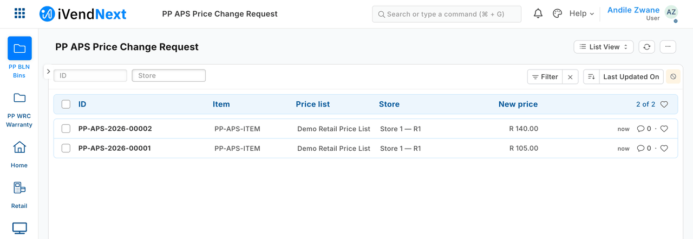

# S14 — price-change approvals across stores

A chain wants a price change to need a yes: a store manager's yes up to a limit, and head office's yes above it, with each store seeing only its own requests. A request names its store; the store's manager approves or rejects it; within the limit a small service applies the price, above it the request waits for head office. One workflow on the sample's own record type, with a service that writes the price once.



**Industries:** Thrift and resale

**When to use it:** an approval whose approver depends on the store, and on how big the change is. For one retailer with one approver, S11 is enough.

## Start from it

```bash
ivn new acme_store_approvals --from s14
```

## What to change

What a partner usually changes:

- **The roles:** `allowed` on each transition in `manifest.json` (*PP APS Requester*, *PP APS Store Manager*, *PP APS Head Office*, *PP APS Applier*). Use the chain's own roles if it has them.
- **The limit:** one number for the chain, the service's `LIMIT_PCT` setting, a percentage of the price now (10 when unset).
- **The fields of a request:** `item`, `price_list`, `store`, `new_rate` in `manifest.json`.
- **Who may approve:** the workflow's roles, and one User Permission on *POS Profile* (their store) for each requester and store manager, set in Desk. Head office has none, so it sees every store.

More: the [recipe](../../recipes/approvals_stores.md).

**The customer sets:** who holds each role, each store manager's and requester's store (a User Permission), and the limit.

## Run it

```bash
ivn check
ivn try
```

To apply approved requests, run this from `service/aps/` in the app you made:

```bash
BASE=https://shop.example AP_KEY=… AP_SECRET=… LIMIT_PCT=10 python3 approvals_stores.py apply
```

## Versions

### 0.3.3

- The requester can pick the price list: the install gives *PP APS Requester* read and select on Price List (`role_rights`), where a requester with no sales or buying role met *No permission for Price List*. Read lets the form fill the currency from the price list picked.

### 0.3.2

- The three approve steps say `"allow_self_approval": 0`, so the person who raised a price change still cannot approve it once a silent step takes Desk's own setting.

### 0.3.1

- The export writes each value as it is.

### 0.3.0

- The approval rule table went: a User Permission per store and one limit, LIMIT_PCT, do its job.

### 0.1.0

- First version in the kit: price-change approvals across stores, each store manager up to a limit.
