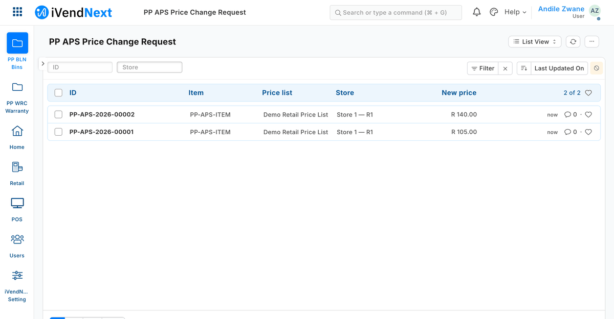
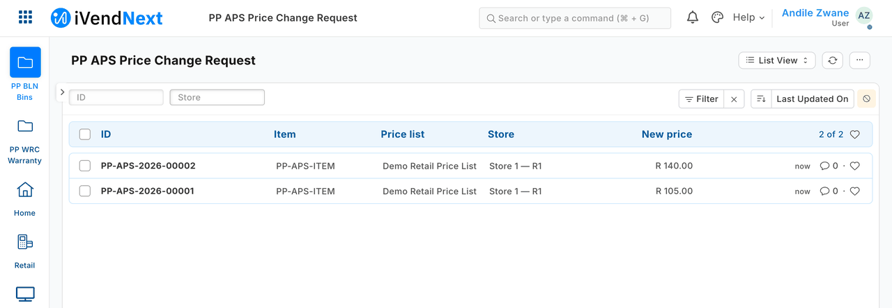
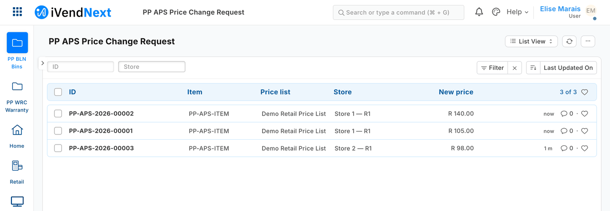
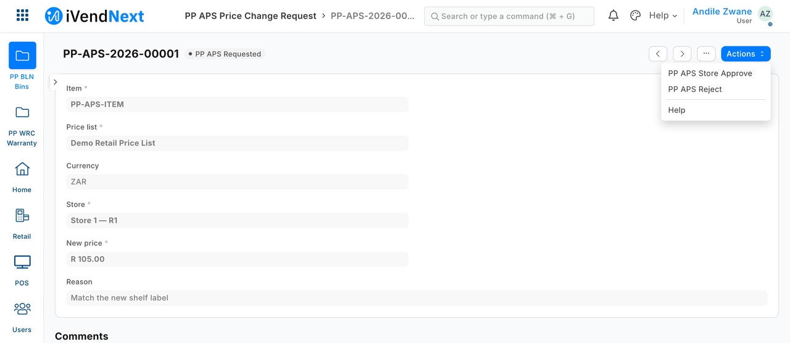
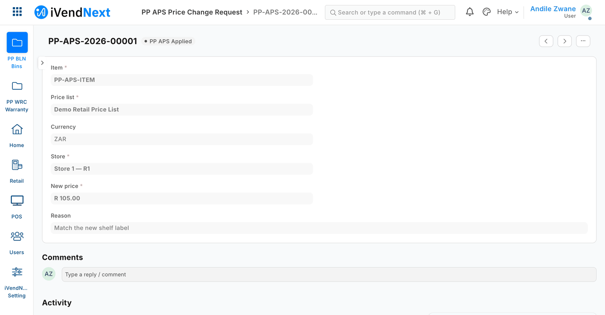
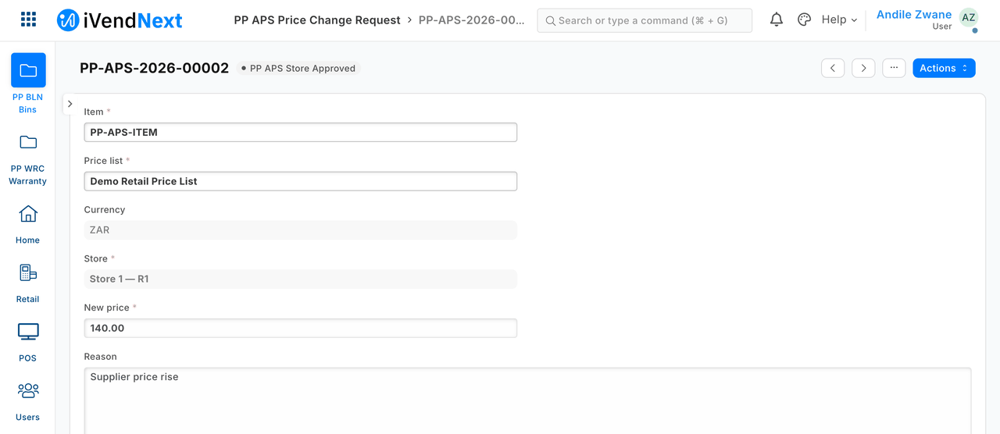
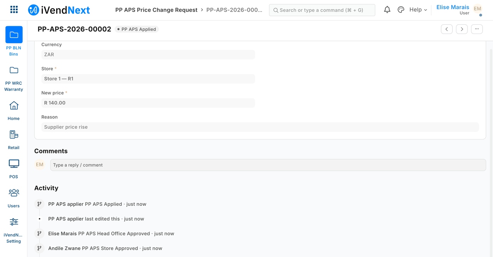
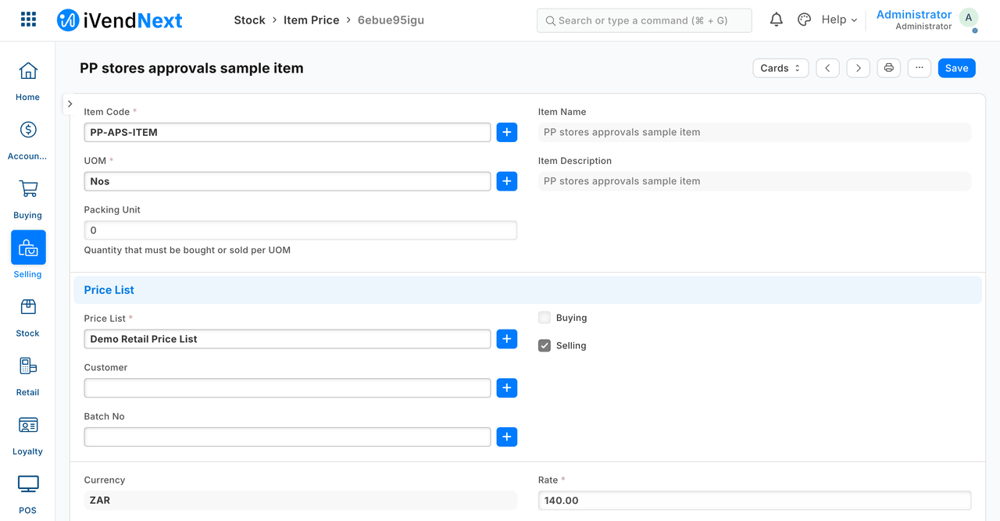

# S14 — price-change approvals across stores



*A store manager sees only their own store's requests and approves; within their limit the outside service applies the change, above it the request waits for head office, which approves and the price row follows.*

A chain wants a price change to need a yes — but **a store manager's yes up to a limit, and head office's yes above it**, with each store seeing only its own requests. This sample is S11 (one approval step, one shop) grown for a chain: it is for a developer, or the CitiXsys Consulting Team, who will copy it for anything that needs a manager's approval across stores.

**When to use it:** an approval whose approver depends on the store, and on how big the change is. For one shop with one approver, S11 is enough.

## What happens

1. A requester in a store asks for a price change: the item, the price list, the **store**, the new price, the reason. The store cannot be changed afterwards.
2. The store manager of **that store** approves it. A manager of another store cannot even open it.
3. Within the manager's limit (a percentage of the price now, set per manager in the shop), an **outside service** (`approvals_stores.py apply`) applies it through the record API, **once**, with its own key.
4. Above the limit, the request waits. **Head office** approves it, and the service applies it. Head office may also approve straight from *Requested*.
5. The shop's price row now holds the new price; the request's history shows who approved at each step and the service's *Apply*. A refusal is written only in the service's report (it leaves no note in the shop).

## What it looks like

Taken on our test bench on 2026-10-10 (product pin: the iVendNext POS app `87812e141`), in Desk, 1440 px wide. The shop is the kit's demo shop, *Demo Retail*. The people are shown as *Andile Zwane* (store manager of *Store 1 — R1*), *Elise Marais* (head office); the item (`PP-APS-ITEM`), the state names (*PP APS …*) and the service (*PP APS applier*) are the sample's own placeholders. The request's *New price* reads in the price list's currency (R, as the price row does): the request carries the price list's currency, fetched from the price list. The GIF is built from screens of the same walk, every frame cut above the line that names the requester by address; its third frame is the request just after the manager's action, which has no still of its own. Every still is cut above the activity lines that name the test users by address.

| Step | Frame | Screenshot |
|---|---|---|
| 1. The store manager's list: only their store's requests (2 of the 3 in the shop) | Desk |  |
| 2. Head office's list: both stores (3 of 3) | Desk |  |
| 3. A request within the manager's limit: the manager's *Store Approve* action | Desk |  |
| 4. The service ran: the request is *Applied* | Desk |  |
| 5. A request above the limit (+33%, the limit is 10%): the manager approved it and it waits for head office | Desk |  |
| 6. Head office approved; the service applied it; the trail names who | Desk |  |
| 7. The price row now holds the approved price (seen as the administrator: no S14 role reads prices) | Desk |  |

What the service said at step 5 (its report, text): *"above the store manager's limit (10.0%): the change is 33.3%; it waits for head office"*. The approval-rule table was not photographed: its rows are named by the people's login addresses.

## What the shop does

This is for a chain: a store manager's yes up to a limit, head office's yes above it, and each store seeing only its own requests. A small service the chain (or its partner) runs applies the result.

1. **Install the app.** The shop's administrator opens **Retail Extension Package** in Desk, pastes the manifest, presses **Check**, reads the summary, ticks the consent and installs. The install adds the record types **PP APS Price Change Request** and **PP APS Approval Rule**, the workflow, and the four roles *PP APS Requester*, *PP APS Store Manager*, *PP APS Head Office* and *PP APS Applier* (empty at first, and removed again at uninstall; the install makes roles that start with the app's prefix, on a site whose POS app is at `e149dce4` or later). The names are the sample's placeholders; a real roll-out uses the chain's own roles.
2. **Give the roles to the right people.** On each **User** record: *PP APS Requester* to the people who raise requests in a store, *PP APS Store Manager* to the managers who approve for a store, *PP APS Head Office* to head office. No one holds a raising role and an approving role, and no one holds both approving roles.
3. **Fence each person to their store.** For every requester and store manager, add one **User Permission** on **POS Profile** (their store). The shop then shows them, and lets them approve, only their own store's requests. Head office and the service have no store fence.
4. **Write the approval rules.** As the administrator, add one **PP APS Approval Rule** per approver: the **Person**, the **Level** (*Store* or *Head Office*) and, for a Store level, the **Store** and the **Limit**, a percentage of the price now (for example 10). A person with no rule has no authority, whatever role they hold. Only the administrator can write this table, so no manager can raise their own limit.
5. **Make the service's own user.** The administrator makes a user for the service, gives it the role *PP APS Applier* and generates its API key. Beyond the requests (read and write) and the rule table (read), it gets read and write on **Item Price**, fenced by a **User Permission** on each **Price List** it serves (*Applicable For* **Item Price** only). Take write on **Item Price** away from every other role.
6. **Run the service.** `approvals_stores.py apply` as often as you like, and schedule `approvals_stores.py export` just after the shop's midnight.
7. **Day to day.** A requester raises a **PP APS Price Change Request**: **Item**, **Price list**, **Store**, **New price**, **Reason**. The store's manager takes **PP APS Store Approve** (or **PP APS Reject**). Within the manager's limit the service applies the change. Above it, the request waits and head office takes **PP APS Head Office Approve** (or **PP APS Head Office Reject**), which can also be done straight from *Requested*. The service then applies it.

**Where it shows.** In Desk only: each person's request list (item, price list, store, new price), each request's history of who approved at each step and the service's *Apply*, and the shop's price row. A store manager sees only their store's requests; head office sees all. A refusal is written only in the service's own report. The nightly export is a CSV file the service writes outside the shop. Nothing is added to the till's screens, to POS Studio or to a print layout.

**What leaves the shop.** Nothing is named in the manifest: no outside address, webhook, till key or event-feed registration. The service you run reads the requests, their change history and the rule table over the record API, writes one price row per approved request and takes the *Apply* action, with its own narrow key. The export names the store and who approved at each step. The shop lets any desk user list the shop's users with their email, phone and mobile number, and so it does this key.

To remove it, use **Export and uninstall** on the installed version's record: it writes every request to a private file first ([manifest recipe](../../recipes/manifest.md)).

## Who may approve is a table in the shop

The shop's workflow cannot hold a limit, and a person holding the right roles can write a request's state straight in. So the service does not take the state's word: it reads the shop's **approval-rule table** (`PP APS Approval Rule`, one row per person: *Store* with a store and a limit, or *Head Office*), and believes an approval only if the person who gave it has the matching row. A person with no row, a row that is not whole, or a store row for another store is not believed: the check **fails closed**. Only the shop's administrator can write the table; a store manager cannot raise their own limit.

## The files

| File | What it is |
|---|---|
| `manifest.json` | the request type (with its store), the approval-rule table, numbering, change tracking, the workflow of five states, every right written out |
| `approvals_stores.py` | `apply` and `export` (standard library): S11's service with the store limit and the authority check |
| `tests/test_s14.py` | 35 laptop tests against an in-memory shop |

Recipe: `recipes/approvals_stores.md`. It is built on S11 (`samples/s11_approvals/`) and keeps every one of its safeguards.

## What is refused, and why

- **Everything S11 refuses:** a request whose item, price list or price changed after it was raised; one with ten or more recorded changes; one approved by the person who raised it — here at **each** approval, not only the last.
- **A request whose store changed after it was raised.** The shop does not allow it; the service checks too.
- **A change above the store manager's limit, approved only at the store.** It waits for head office, and the report says so.
- **A store approval whose price row changed afterwards.** The limit was judged against a price that is gone; the manager rejects it and it is raised again (this stops two requests approved side by side adding up past the limit). The limit is per request: requests approved one after another each move the price by up to it.
- **A request rejected while the service was applying it.** The service puts the price back and says so (within one run; after a killed run, check the price row by hand).
- **A head-office approval by someone with no head-office row.** Even where the shop let them take the action because their roles allowed it.
- **An approval by a person whose rule was removed since.** The rules are read when the service runs.

## Run it

From the kit's root (the folder that holds `samples/`):

```bash
python3 -m unittest discover -s samples/s14_approvals_stores/tests -p 'test_*.py'
```

To export a day's requests from a shop (this needs a sandbox, an app key and a secret), run this from the sample's own folder, `samples/s14_approvals_stores/`:

```bash
BASE=https://shop.example AP_KEY=… AP_SECRET=… python3 approvals_stores.py export --day 2026-10-04 --out state/export
```

## Technical notes

Tested on our test bench on 2026-10-08, with two stores, a requester and a store manager in each, head office, the service, and three people holding two roles each. The run's id and checks are in the recipe. Not tried: two services at once, many requests at once, approvals across companies, an approver who is also the applier. A request names a price list, and the service does not tie the list to the store: a manager's approval moves the price on whatever list the request names — every store's where they share one, another store's own list where the requester named it; a shop with one list per store adds that check. A limit raised after an approval applies to it. The service's key can list the shop's users with their email and phone (the shop's default for any desk user).
