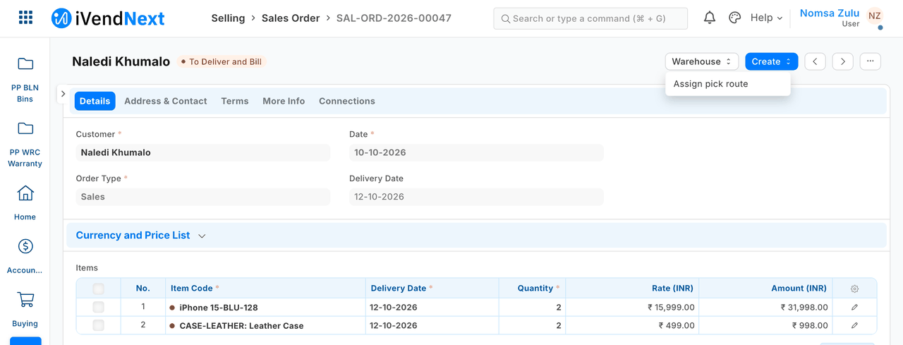

# S16 — *Assign pick route* (`pp_pck`): a Desk action

A stock user presses **Warehouse → Assign pick route** on a submitted Sales Order, picks a colleague and a priority, and your service creates a pick task that opens and is listed under the order. It is a button in iVendNext Desk that hands a record to your own service, which does real work and answers. From the order list the same button runs on up to 20 orders at once, one task each. The Sales Order itself does not change.



**Industries:** Distribution and warehousing

**When to use it:** you want a button on a Desk record that sends the record to your service and shows the answer.

## Start from it

```bash
ivn new acme_pick --from s16
```

## What to change

What a partner usually changes:

- the service's address: `allowed_urls` and the `endpoint_url` of the *route* subscription in `manifest.json` both name the sample's test address (`host.docker.internal`); write your own, with a certificate the customer's server trusts;
- who sees the button: `roles` on the Desk action (*Stock User*, *Stock Manager*);
- the dialog's fields, `Picker` and `Priority`, and the task's own record type, `PP PCK Pick Task`;
- what is sent: `send_fields` includes `customer`; drop it if the service does not need it;
- how the lines are ordered: `route.py` sorts by warehouse, then item; sort by bin instead if you have bin data (see [S2](../s2_bins/README.md));
- `timeout_seconds` on the subscription (5 here, at most 10).

More: the [recipe](../../recipes/desk_action.md).

## Run it

```bash
ivn check
ivn try
```

## Versions

### 1.0.3

- Desk shows plain names (Pick task, Pick task line) through the manifest's `translations` block, so a search for *pick task* finds the record. The stored names are unchanged: an installed site keeps its records. Manifest 0.2.3.

### 1.0.2

- Each line of the pick task shows the item's name and the order line's unit (*2 Case*), as well as the item code; the button sends the service both (`item_name`, `uom` in `send_fields`). The answer no longer names the picker by e-mail: it says how many lines across how many warehouses.

### 1.0.1

- A second press with the same key finds the first's task instead of being refused, and the press asks no confirmation.

### 1.0.0

- First version in the kit: a Desk action that assigns a pick route, serving many retailers as a function.
- Each setting in app.json says its purpose (the line the Settings screen shows), whether it is required, and which settings go with it.
- The set-up steps say the install makes the app's own user (POS 2.1.0.667 or later).
