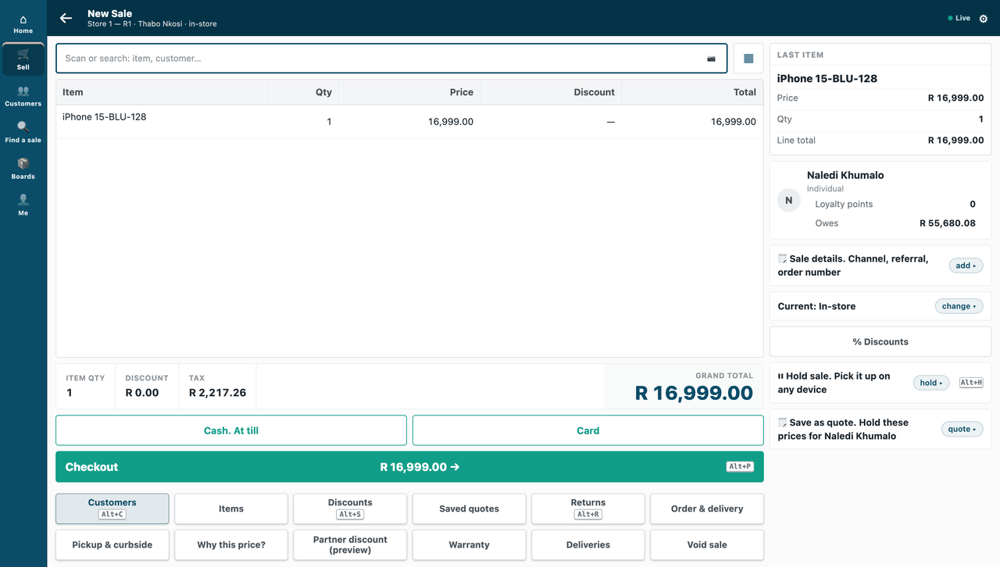

# S17 — an order board (`pp_pge`): a partner page

Your own screen, shown inside iVendNext: on the till as a sheet over the sale, and in Desk as a page for a record. A cashier presses the **Deliveries** key on a sale, the partner's board opens in the till's own look, and after *Attach to sale* the delivery number is on the sale. iVendNext opens the page with a signed, one-time context, which the board checks on its own server.



**Industries:** every industry

**When to use it:** your service needs its own screen in the till or in Desk, and may hand one answer back to the sale.

## Start from it

```bash
ivn new acme_board --from s17
```

## What to change

What a partner usually changes:

- **The page's address:** `allowed_urls` in `manifest.json`. Write your own, on your own host; iVendNext refuses an address on its own site.
- **The board:** `service/board.html`, and `service/app.py` for what it offers and answers with.
- **What the till sends:** `page_send_sale` (the sale, with the cashier's login and the customer's id) and `page_send_user` in `manifest.json`. Set `page_send_sale` to 0 if the board does not need the sale.
- **Who may open it in Desk:** `page_roles` in `manifest.json` (*Stock User* and *Stock Manager* here).
- **The answer:** the sale detail *PP PGE Delivery Order*, which the board answers with; a partner's copy shows its own name.
- **The test routes:** delete `/test/once` and `/test/opened` from `service/app.py`.
- **The opened contexts:** `page.py` keeps them in memory, so a restart forgets them. Keep them in your own database.
- **The app's id:** `IVN_LIBRARY_APP` in `app.json`.

More: the [recipe](../../recipes/partner_page.md).

## Run it

```bash
ivn check
ivn try
```

## Try it at the till

- Press Deliveries on a sale; the delivery board opens over the sale.
- Press Attach to sale; the delivery number is on the sale.
- Close the till day when you are done.

## Versions

### 0.2.0

- New app makes it into an app we host, for many sites (`Hosted` in `service/app.py`, `app.json`).

### 0.1.0

- First version in the kit: an order board as a partner page.
- A cut-short answer from a retailer's site is handled as an unknown outcome, like a site that cannot be reached, never a crash.
- The README says to put your own service's address in the manifest before you install.
