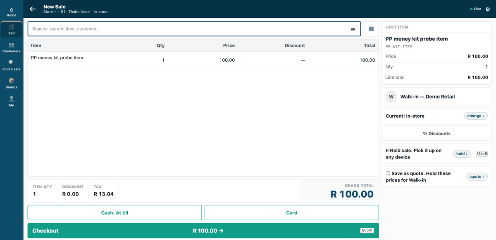
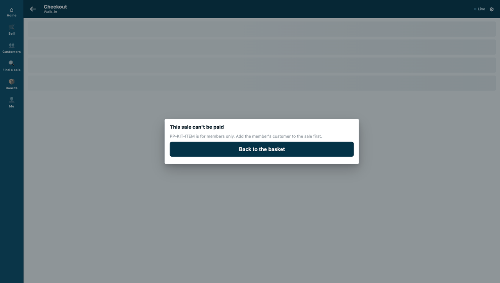
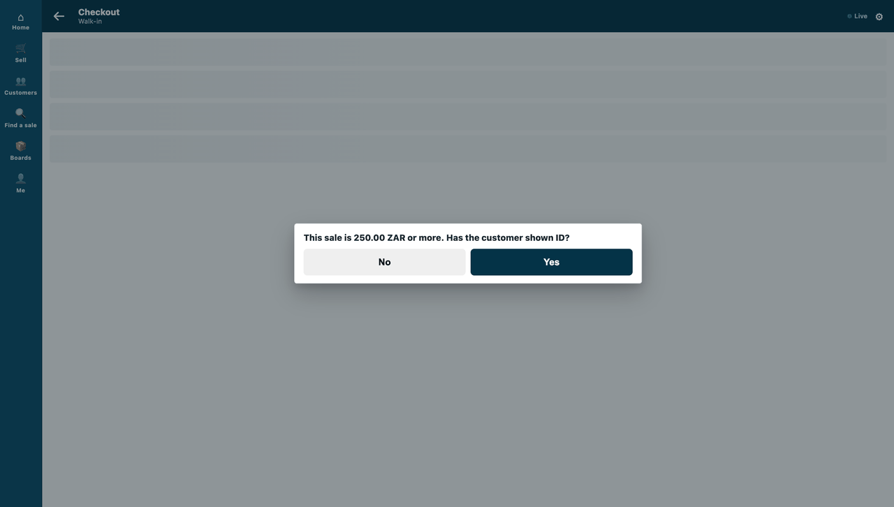
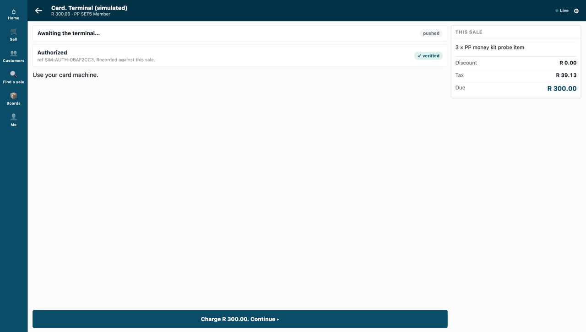
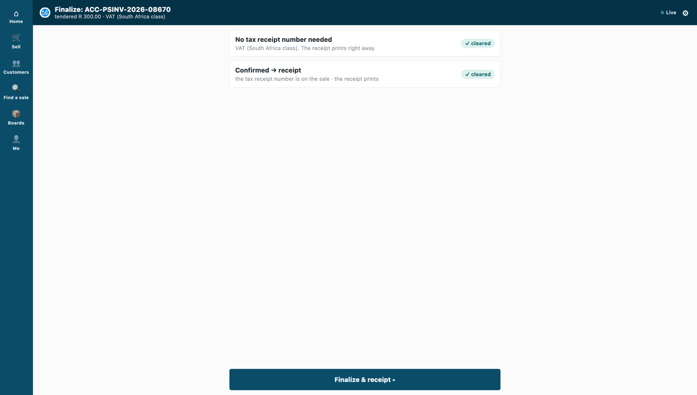
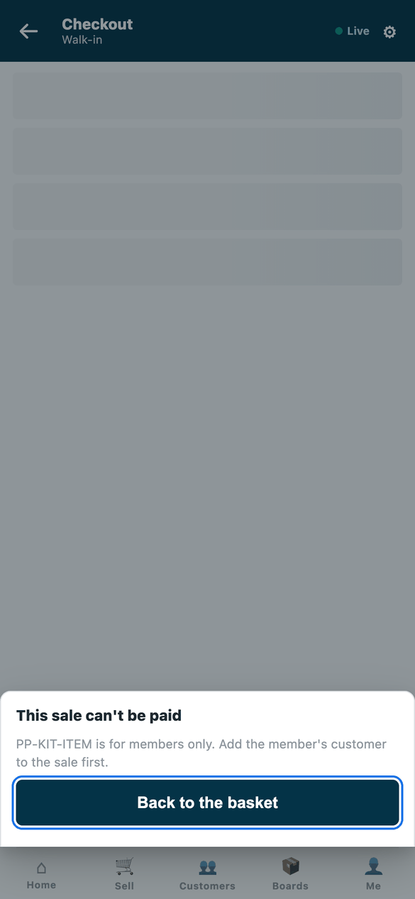
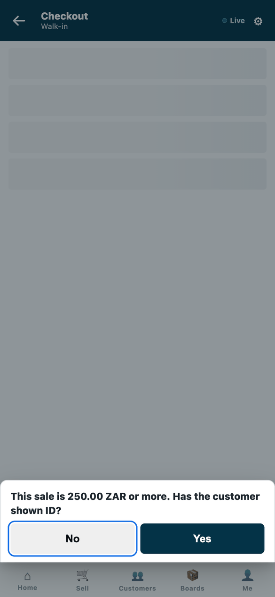

# S18 — Members-only rule guard (a check before payment)

*Start from this sample: `python3 tools/manifest/start.py s18_rule_guard --prefix "ACME RGD"` copies it into `apps/` of your repository under your own prefix (your company's first word, then a short name for the app) and checks it ([how](../../recipes/make_it_your_own.md)).*



*The till's Pay on a members-only item: refused in the service's own words for a walk-in, a question for a member's larger sale, then the sale paid and booked.*

When the cashier presses **Pay**, the retailer's server prices the basket and asks this service. It **refuses** a sale that holds a members-only item for a customer who is not a member, in its own words, and **asks** the cashier for ID when the sale is at or above the retailer's limit. Everything else is allowed. A refused sale books nothing.

The recipe: [`recipes/rule_guard.md`](../../recipes/rule_guard.md).

## What the retailer does

**Before you install:** every `host.docker.internal` address in `manifest.json` (in `allowed_urls`, and where the manifest calls it) is our test bench's own address for the sample's service, and it resolves only where Docker provides it. Replace it with your own service's address first, or iVendNext's calls never reach your service; if this manifest is already installed, raise its `version` and install it again ([the manifest recipe](../../recipes/manifest.md), step 6).

1. **Install the app** (the retailer's administrator). It comes in switched off, and it is set to refuse the sale when the service is down, so an outage never sells a members-only item. The install adds the record type **PP RGD Rule**, the role **PP RGD Integration** and the feed registration **PP RGD Rule feed**.
2. **Write your rule, in Desk.** One **PP RGD Rule** record per rule: a *Members-only item*, a *Members-only item group*, a *Member customer group*, or *Ask for ID at or above* an amount in the sale's currency (several limits: the lowest applies; none: never ask). Switch a record off to stop using it. The service reads the switched-on records and keeps them a minute, so a change applies within a minute. A line's own item group and the customer's own customer group count; a group above them does not.

   **If a rule names a member customer group, stop cashiers moving a customer into it.** The till's edit sheet lets a cashier change a customer's group, and the retailer's cashier role can save customers: a cashier could move any customer into a member group, and a members-only item would sell. In *Customize Form* for *Customer*, set **Customer Group**'s *Perm Level* to 1, and in *Role Permissions* give level 1 *Write* on Customer only to the roles that may move customers (your managers). A cashier's change then leaves the group as it was (measured with [S47](../s47_customers_by_store/) on the programme's bench, run `pp-20261023T115256Z-45139`). Two things follow: a cashier can no longer give a new customer a group either: a customer created at the till takes the default customer group (Selling Settings), or none when none is set, and a manager sets the right one (measured on the programme's bench, run `pp-20261023T162435Z-43204`, with a default group and without), and the till still says *Saved* after a group change it dropped. Check the level 1 rows already there: Sales Master Manager has one by default, and no cashier's role may hold level 1 *Write*.

3. **Hand the service its key.** From POS 2.1.0.667 the install made the app's own user, `pp_rgd@integration.invalid`, and named it on **PP RGD Rule feed**. It holds the role **PP RGD Integration** alone (read on **PP RGD Rule**), works through the API only and can never sign in to Desk, so there is no user to make. A service for many retailers is handed the key by the retailer's site itself, after the install or an update (press **Connect again** on the app only if the site could not reach the app, or a key was lost or changed). A service for one retailer: press *Generate Keys* on that user (User, API Access) and give the service the key. Until the service has it, once the check is on, every sale is refused with *"Member rule guard is not set up yet…"* (and with *"…your shop refused its key…"* if iVendNext later refuses that key). With no *Member customer group* record nobody is a member. Give that user no User Permissions: a rule naming a record outside them is not read.
4. **Switch the check on** (the System Manager). Open **Retail Extension Subscription**, the record *Member rule guard*, read what it is sent, tick the consent, choose the POS Profiles it answers (none chosen = all) and switch it on.
5. **Nothing more for the cashier to set.** On Pay the till shows the service's own sentences.

**Where it shows.** On the till, at **Pay**, on the counter frame and on the phone: *"This sale can't be paid"* with the service's sentence for a members-only item sold to a customer who is not a member (nothing is booked), or a Yes / No question asking whether the customer has shown ID. If the service does not answer, the cashier reads *"Member rule guard did not answer. This sale can't be paid until it does. Try again, or get a manager."* Offline the till cannot ask the service, so it applies the check's down answer, *refuse*: the sale cannot be paid until the till is back online. A return is judged only for the items it sells (an exchange rung without its sale), by the members-only rule; the ID question is asked on a sale only, and what a return takes back is never guarded. Desk gains the **PP RGD Rule** list; nothing is added to a print layout or a report.

**What leaves the retailer's iVendNext.** One address: the partner's service (the manifest ships a test address; the partner writes its own, and the retailer's server must trust its certificate). At each **Pay** the retailer's server sends it, signed, the priced basket: each line's item code, item group, quantity and amounts, the sale's totals, the customer and their customer group, the coupon codes, the sale details the cashier captured and the payment methods offered. Never a card. The consent in step 4 lists these fields. The service also reads the retailer's **PP RGD Rule** records, with the app's integration user (its role reads that record type and nothing else), and writes nothing: it has no webhook and no till key.

## What is in the folder

| File | What it is |
|---|---|
| `manifest.json` | one `check` service, installed switched off, `refuse` when the service is down; the **PP RGD Rule** record type and its feed |
| `rule.py` | the pure core: the signature check (`verify`), the shape check (`context_of`), the retailer's rule from its records (`rules_of`), the answer (`decide`) |
| `service/app.py` | the service, standard library only: `POST /rgd/check`, `GET /health`; for one retailer, or for many through the app template's handshake (`POST /ivendnext/connect`, `/disconnect`) |
| `app.json` | how CitiXsys hosts it: as a **function**, paid per call, since it only answers a press (guide chapter 14b, *A function or a container*), at `https://rule-guard.ivendnext.app` |
| `tests/` | the rule, the service over the wire with signed calls, every answer against the published contract, two retailers each judged by its own records (`test_shop_rules.py`) |

**Many retailers** (the App library's `ivendnext_rgd`): set `IVN_LIBRARY_APP=ivendnext_rgd`, `RGD_PREFIX=IVENDNEXT RGD` and a store (`IVN_SHOPS_FILE`, or the hosting's table) instead of `PP_POINT_SECRET`. Each retailer connects itself after its install; each check is verified with that retailer's own secret, `ivendnext_rgd:sub:guard`, and judged by that retailer's own Rule records, read with the key of the app's own user that the retailer's site handed over.

**Settings** (`service/.env.local`, never committed): `PP_POINT_SECRET` (handed back at install as `pp_rgd:sub:guard`), `PP_PORT`, `RGD_PREFIX` (default `PP RGD`), and the site to read the rule from: `IVN_SHOP_URL` and `IVN_SHOP_KEY` (the integration user's `<api key>:<api secret>`). A laptop run with no retailer: `PP_MEMBERS_ONLY_ITEMS` and `PP_MEMBERS_ONLY_GROUPS` (comma lists), `PP_MEMBER_GROUPS`, `PP_ASK_ABOVE` (whole currency units; blank = never ask) instead.

The service reads the retailer's rule records and nothing else, and writes nothing. A return that sells nothing reads nothing and is allowed.

**A cap on manager approvals, with no service (POS build 2.0.0.654 on).** A rule this guard cannot make: no more than ten discount approvals a store a day. It is one save rule, data only, of kind `count_per_day` on the approval request (`contracts/pages/save_rules.md` §8, the worked example; the product's accepted sample `contracts/extension_contracts/samples/save_rules/accepted/09_count_per_day.json`):

```json
{"record_type": "Retail Override Request", "kind": "count_per_day", "scope_field": "store", "day_field": "resolved_on", "cap": 10,
 "message": "This store has given its 10 discount approvals today. Deny this one; the cashier can sell at the normal price.",
 "conditions": [{"field": "request_type", "operator": "in", "value": "Markdown, Discount Stack, Open Price, Sale Discount"},
                {"field": "status", "operator": "in", "value": "Approved, Consumed"}]}
```

The eleventh approval a store's managers give that day is refused when the manager presses **Approve**, in the approvals inbox or in person on the cashier's device; the request stays *Pending*, and the cashier sells at the normal price. An approval given and never used still counts; a sale using one never counts it again; approvals given offline are not counted; an *Action* request (an action approved in person, written after it ran) is only flagged. A check before payment like this guard still answers at **Pay**, for a rule of the partner's own. The card: `needs/till/manager-approval-cap-per-day.md`. Walked by the product (POS train T12, three frames); not run by this sample.

## Run it

From the kit's root (the folder that holds `samples/`):

```bash
python3 -m unittest discover -s samples/s18_rule_guard/tests -p 'test_*.py'
python3 samples/s18_rule_guard/tests/canaries.py
```

To start the service, run this from the sample's own folder, `samples/s18_rule_guard/`, with the settings above in `service/.env.local`:

```bash
python3 service/app.py service/.env.local
```

## What it looks like

Taken on our test bench on 2026-10-10 (product pin: the iVendNext POS app `87812e141`), on iVendNext POS's counter frame (the till, `/pos?frame=terminal`) in a 1440 px wide browser window, light mode, and on its phone frame (`/pos` in a 390 × 844 phone viewport) for the rows marked *the phone*. The cashier is shown as *Thabo Nkosi*, at the kit's demo site *Demo Retail*, store *Store 1 — R1*. The counter frame's basket screens stop above the till's key row (other samples' keys); the GIF's frames are all cut by that one box, and the phone stills are the whole screen. The member is the bench's placeholder customer *PP SET5 Member*; the item is the bench's probe item (`PP-KIT-ITEM`). The card is the bench's simulated terminal (the demo button *demo: verified* was pressed; the screen then reads *✓ verified*), and the sale was booked on the bench (`ACC-PSINV-2026-08670`). On the phone the member's sale was answered *No* and voided.

| Step | Frame | Screenshot |
|---|---|---|
| 1. A walk-in's basket holds the members-only item | the till |  |
| 2. Pay: *This sale can't be paid*, with the service's own sentence; nothing is booked | the till |  |
| 3. The same item for a member, three of it (R 300.00) | the till |  |
| 4. Pay: the till asks the cashier the service's question, *Yes* or *No* (the Checkout header still reads *Walk-in* on this screen, on both frames; the next screens name the member) | the till |  |
| 5. After *Yes* the card terminal is asked, and answers *Authorized* | the till |  |
| 6. The sale is booked: tendered R 300.00 | the till |  |
| 7. The phone: the walk-in's sale refused at Checkout | the phone |  |
| 8. The phone: the member's sale asks the same question | the phone |  |
