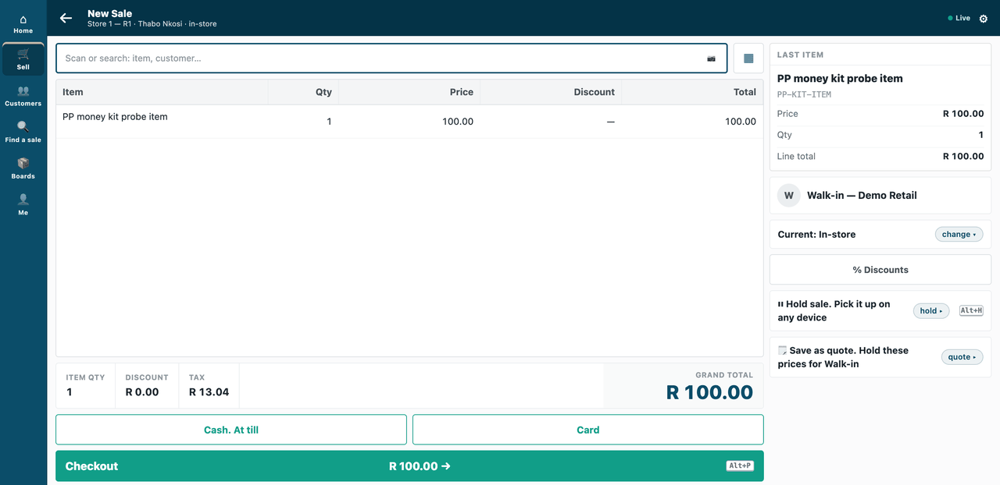

# S18 — Members-only rule guard (a check before payment)

When the cashier presses **Pay**, the retailer's server prices the basket and asks this service. It **refuses** a sale that holds a members-only item for a customer who is not a member, in its own words, and **asks** the cashier for ID when the sale is at or above the retailer's limit. Everything else is allowed. A refused sale books nothing.



**Industries:** every industry

## Start from it

```bash
ivn new acme_rule_guard --from s18
```

## What to change

What a partner usually changes:

- **The rules:** one `PP RGD Rule` record per rule, written by the customer in Desk: a members-only item, a members-only item group, a member customer group, or *Ask for ID at or above* an amount. The service reads the switched-on records and keeps them a minute.
- **The service's address:** every `host.docker.internal` in `allowed_urls` and the check's `endpoint_url` (`manifest.json`) is a test address; put your own service's address there.
- **The answers:** `decide` in `rule.py`, and the sentences it returns.
- **If the service is down:** the check in `manifest.json` refuses the sale, so an outage never sells a members-only item.

More: the [recipe](../../recipes/rule_guard.md).

**The customer sets:** the rules, and who may move a customer into a member group. A cashier can change a customer's group in the till, so the retailer puts *Customer Group* at *Perm Level* 1 in *Customize Form* and gives level 1 *Write* on Customer only to its managers.

## Run it

```bash
ivn check
ivn try
```

## Try it at the till

- Sell a members-only item to a walk-in customer; the till stops it at Pay.
- Choose a member and press Pay again; the sale goes through.
- Close the till day when you are done.

## Versions

### 1.1.1

- First version in the kit: a members-only rule checked before payment, each retailer judged by its own rule records.
- A line quantity that is not a whole number is refused, and an item handed back inside a sale is no longer refused.
- Each setting in app.json says its purpose (the line the Settings screen shows), whether it is required, and which settings go with it.
