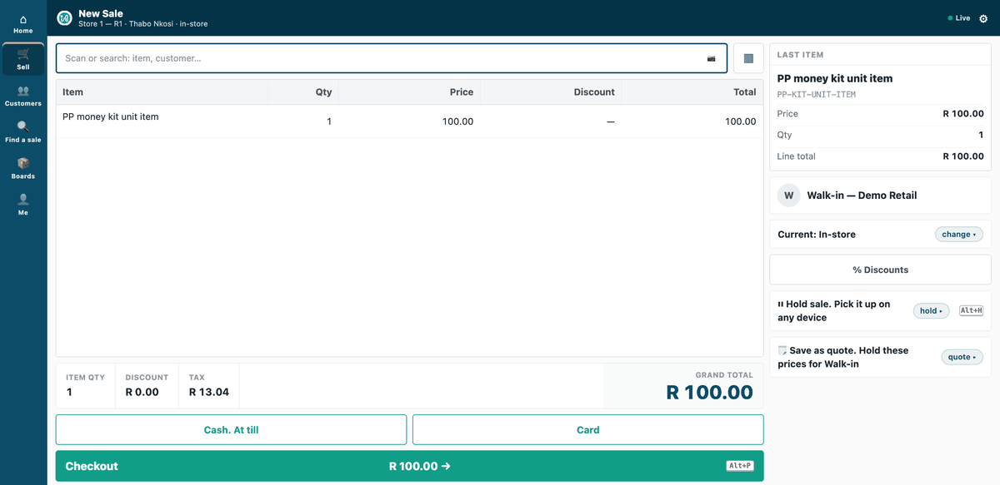

# S19 — Unit codes at the scan (a scan source)

The retailer's own unit codes, read by the till's scan: one record per unit (its unique code, its item, its batch, *Available* or *Sold*) and a scan source over that table. A scanned unit lands as its item with its batch; a sold unit is refused. Data only: no service, nothing leaves the retailer's iVendNext.



**Industries:** Beauty and cosmetics, Electronics and phones, Pharmacy

## Start from it

```bash
ivn new acme_units --from s19
```

## What to change

What a partner usually changes:

- **The unit's fields:** `unit_code`, `item`, `batch` and `status` on the record `PP UNC Unit` in `manifest.json`.
- **The scan source:** `PP UNC Units` in `manifest.json`, which reads that table.
- **Marking a unit *Sold* and *Available*:** the app does not. Your own service sets *Sold* after a sale and *Available* after a return, from the event feed (the [event feed recipe](../../recipes/event_feed.md)).

More: the [recipe](../../recipes/unit_codes.md).

**The customer sets:** the units (one record per unit in Desk, or written by your service), and, if the sale's line should keep the unit's code, **Record the code as** on the scan source, set to one of its own active line attributes.

## Run it

```bash
ivn check
ivn try
```

## Try it at the till

- In Desk, open Retail Scan Source and open the app's units.
- Scan a unit's code; it lands on the sale as its item, with its batch. Scan a sold unit; the till refuses it.
- Close the till day when you are done.

## Versions

### 0.1.0

- First version in the kit: unit codes read at the scan, as a scan source.
