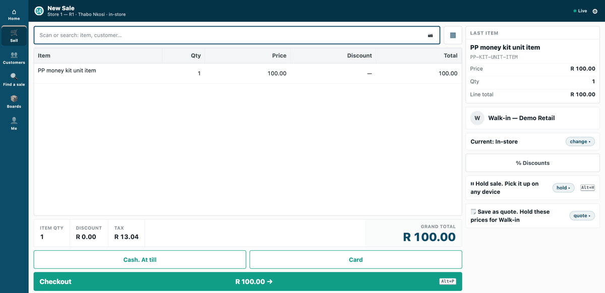
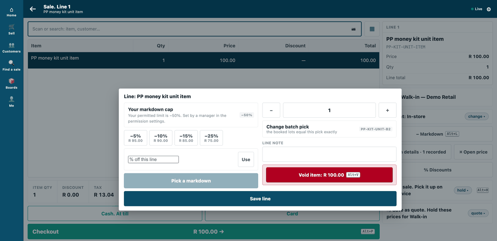
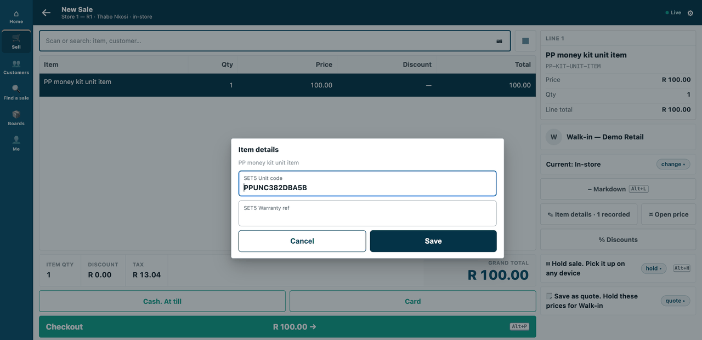
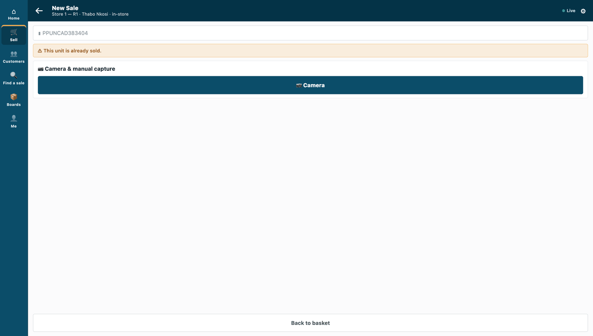
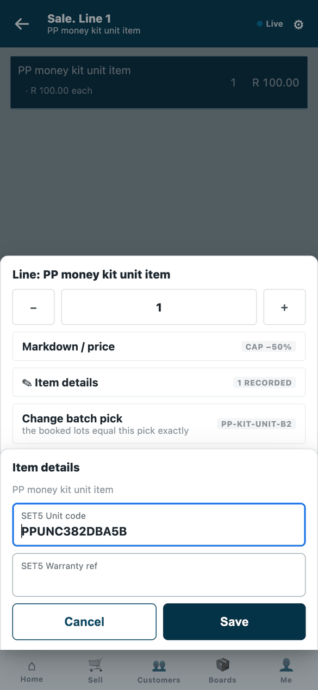
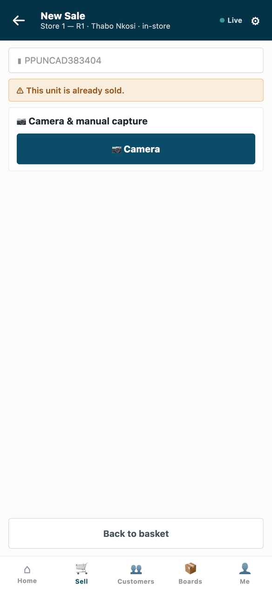

# S19 — Unit codes at the scan (a scan source)



*A scanned unit lands as its item with its batch and its code on the line; a unit already sold is refused.*

The shop's own unit codes, read by the till's scan: one record per unit (its unique code, its item, its batch, *Available* or *Sold*) and a scan source over that table. A scanned unit lands as its item with its batch; a sold unit is refused. **Data only**: no service, nothing leaves the shop.

The recipe: [`recipes/unit_codes.md`](../../recipes/unit_codes.md).

## What the shop does

1. **Install the app** (the shop's administrator). It adds the unit record `PP UNC Unit` (unit code, item, batch, status *Available* or *Sold*) and the scan source `PP UNC Units`, which comes in switched off. The app names no role of its own: it uses the shop's System Manager, Stock Manager and Stock User.
2. **Fill the unit table.** One `PP UNC Unit` record per unit: its unique code, its item, its batch and its status. The unit code is also its name, so one code names one unit. A Stock Manager or a System Manager can make and edit units in Desk; a Stock User can only read them. The partner's own service can write them over the record API.
3. **Switch the scan source on.** Open **Retail Scan Source**, the record *PP UNC Units*, and switch it on. Until then a unit's code is not found.
4. **Optionally, keep the unit's code on the sale's line.** Set **Record the code as** to one of the shop's own active line attributes. The booked sale then says which unit was sold, and the same unit twice in one basket is refused. (This needs a status field, so a returned unit can be sold again.)
5. **Decide who marks a unit *Sold* and *Available*.** The app does not do it. After a sale the unit must be set to *Sold*, and after a return back to *Available*: the partner's own service does this from the shop's event feed, which is set up separately (the [event feed recipe](../../recipes/event_feed.md) and the [integration user recipe](../../recipes/integration_user.md)).

**Where it shows.** On the till's scan, on the counter frame and on the phone: an *Available* unit lands as its item with its own batch (and its code on the line when step 4 is done); a *Sold* unit is refused with *"This unit is already sold."* In Desk the units are an ordinary list under `PP UNC Unit`. The phone's line sheet shows the batch, and *Item details* the unit's code. Nothing is added to a print layout or a report.

**What leaves the shop.** Nothing. The app is data only: it names no address, no service, no webhook, no event feed and no till key. The partner's service in step 5, if the shop uses one, is outside this app and is set up with its own feed and its own integration user.

Uninstalling removes the unit table with its units, and the scan source.

## What is in the folder

| File | What it is |
|---|---|
| `manifest.json` | the unit table `PP UNC Unit` and the scan source `PP UNC Units`, installed switched off |
| `tests/` | the manifest against the kit's checker, and the installed source against the published contract |

After install the shop switches the source on and, if it wants the unit's code on the sale's line, sets **Record the code as** to one of its own active line attributes. Your own service writes *Sold* after a sale (from the event feed) and *Available* after a return.

## Run it

From the kit's root (the folder that holds `samples/`):

```bash
python3 -m unittest discover -s samples/s19_unit_codes/tests -p 'test_*.py'
```

## What it looks like

Taken on our test bench on 2026-10-10 (product pin: the iVendNext POS app `87812e141`), on iVendNext POS's counter frame (the till, `/pos?frame=terminal`) in a 1440 px wide browser window, light mode, and on its phone frame (`/pos` in a 390 × 844 phone viewport) for the rows marked *the phone*. The cashier is shown as *Thabo Nkosi*, at the kit's demo shop *Demo Retail*, store *Store 1 — R1*. The counter frame's basket screens stop above the till's key row (other samples' keys); the GIF's frames are all cut by that one box, and the phone stills are the whole screen. The unit codes are the walk's own placeholders (`PPUNC…`); the item is the bench's unit item (`PP-KIT-UNIT-ITEM`) and the line attribute *SET5 Unit code* is the bench shop's own, chosen under *Record the code as* (*SET5* is the bench's label for the records its tests made).

| Step | Frame | Screenshot |
|---|---|---|
| 1. The code of an available unit is scanned: its item lands on the sale | the till |  |
| 2. The line's lot is the unit's own batch (`PP-KIT-UNIT-B2`) | the till |  |
| 3. The unit's code rides the line, as the shop's attribute | the till |  |
| 4. The code of a unit already *Sold*: *This unit is already sold.* Nothing is added | the till |  |
| 5. The phone: the line's sheet shows the batch, and *Item details* the unit's code | the phone |  |
| 6. The phone: a sold unit refused | the phone |  |
