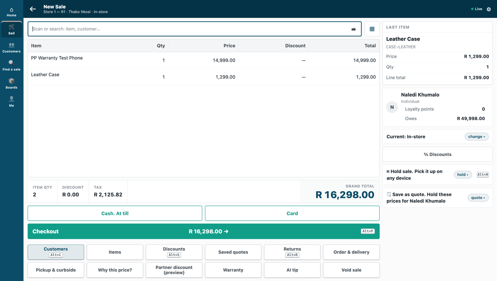

# S1 — warranty check (`pp_wrc`)

When the till books a sale, this app registers a warranty for each covered item sold, by its serial number, and leaves one comment on the sale in Desk: one line per warranty, and a line for each item not covered. A return, or a day's roll-up of till sales, registers nothing. A cashier can also press *Warranty* at the till to see an item's months. The retailer keeps the terms (covered item or item group, and months) in Desk.



**What is in it:** a till key, a warranty registered on each booked sale and one list (warranty term).

**Industries:** Electronics and phones, Hardware and DIY

**When to use it:** you want to do something with every booked sale (register it, notify someone, audit it) and show the result to staff on the sale itself.

## Start from it

```bash
ivn new acme_warranty --from s1
```

## What to change

What a partner usually changes:

- **The terms:** the retailer's own *PP WRC Warranty Term* records, one per item or item group (**Applies to**, the item or group, **Months**). An item's own term wins over its group's. On your own server, `service/terms.json` holds the same terms.
- **The answer the till gives:** `warranty_answer` in `core.py`.
- **The comment on the sale:** `comment_text` in `core.py`.
- **What is registered:** `registrations` in `core.py`, which decides which sale lines count.
- **The app's id:** `IVN_LIBRARY_APP` in `app.json`.

More: the [recipe](../../recipes/point_handler.md).

**The customer sets:** the warranty terms. The install makes the role **PP WRC Integration** and the app's own user, and gives the role read on Sales Invoice, POS Invoice, Serial and Batch Bundle and Item, and read and create on Comment (`role_rights`), so the retailer's administrator grants none. **Needs POS build `2.1.0.691` or later**, and `2.1.0.696` or later for an update to add these rights to an app installed before 0.3.3.

## Run it

```bash
ivn check
ivn try
```

## Try it at the till

- In Desk, add a warranty term for an item. Start a sale with that item and press Warranty; the till names the item and its months.
- Sell it and scan its serial number. Within a few minutes the warranty's comment is on the sale in Desk.
- Close the till day when you are done.

## Versions

### 0.3.3

- The role's rights move into the manifest (`role_rights`): read on Sales Invoice, POS Invoice, Serial and Batch Bundle and Item, and read and create on Comment, so a sale gets its warranty comment right after the install, with nothing for the retailer's administrator to grant. Needs POS build `2.1.0.691` or later; an update adds them from `2.1.0.696`.

### 0.3.2

- The description says *your store's iVendNext* where it said *the shop*. No logic changed.

### 0.3.1

- Status goes to the log, and the two admin routes and their token are gone; every warranty term is read, past the first thousand.

### 0.3.0

- As an app we host, it registers warranties too: a scheduled pass over each site's booked sales (`service/hosted.py`, `service/register.py`).

### 0.2.0

- New app makes it into an app we host: the *Warranty* till key, reading the retailer's own terms (`service/hosted.py`, `app.json`).

### 0.1.0

- First version in the kit: a warranty check against your own service, connected to the retailer's iVendNext.
- A cut-short answer from a retailer's site is handled as an unknown outcome, like a site that cannot be reached, never a crash.
- The set-up steps say the install makes the app's own user (POS 2.1.0.667 or later).
