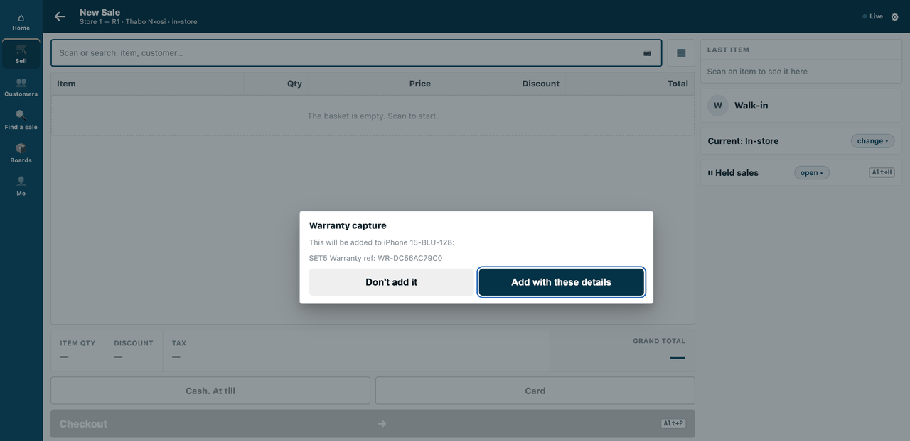

# S20 — Warranty capture and a member code (capture)

Three capture services, each at its own address. **On scan** of an item in the named item groups, the service answers with a warranty reference for the line, and the cashier confirms it. **On customer add**, it refuses a customer without a mobile number or with a barred one, and otherwise sends a one-time code: the customer is created only after the right code, and a wrong code is counted. **On a quantity change** of a line in the iPad group, up to three are allowed, four or five are asked about, and more are refused. No answer writes a customer field or moves money.



**Industries:** Electronics and phones

## Start from it

```bash
ivn new acme_capture --from s20
```

## What to change

What a partner usually changes:

- the service addresses: `allowed_urls` and each service's `endpoint_url` in `manifest.json` name the sample's test address; write your own;
- the item groups each service asks about: `item_groups` in each service's `settings` (the sample names *iPhone* and *iPad*);
- the handset count: `PP_QTY_ASK_ABOVE` (3) and `PP_QTY_MOST` (5);
- the barred numbers: `PP_BARRED_PHONES`;
- the line attribute that holds the warranty reference: `PP_LINE_ATTRIBUTE`;
- your message gateway: `CAP_MESSAGE_URL` is posted the phone and the code; with none, a customer is added with no code.

A serial- or lot-tracked line is never asked about a quantity change, so name only groups the retailer sells without serial numbers.

More: the [recipe](../../recipes/capture.md).

**The customer sets:** an active line attribute (**Transaction Item Attribute**) for the warranty reference, and the phone numbers the service bars.

## Run it

```bash
ivn check
ivn try
```

## Try it at the till

- Scan an iPhone; the till shows a warranty reference. Press Add with these details.
- With your message gateway set, add a new customer; the till asks for the code just sent to their mobile.
- The Handset count service, on a quantity change, has not yet been pressed on a till by us; it ran in the laptop tests, and the till's side of a quantity change was walked by the product.
- Close the till day when you are done.

## Versions

### 0.4.0

- New app makes it into an app we host, for many sites (`Hosted` in `service/app.py`, `app.json`); codes are kept so any copy can check them.

### 0.3.0

- A third capture, Handset count, asks on a quantity change (POS build 2.0.0.654 or later).
- The README says to put your own service's address in the manifest before you install.

### 0.1.0

- First version in the kit: a warranty reference on scan, and a member code when a customer is added.
