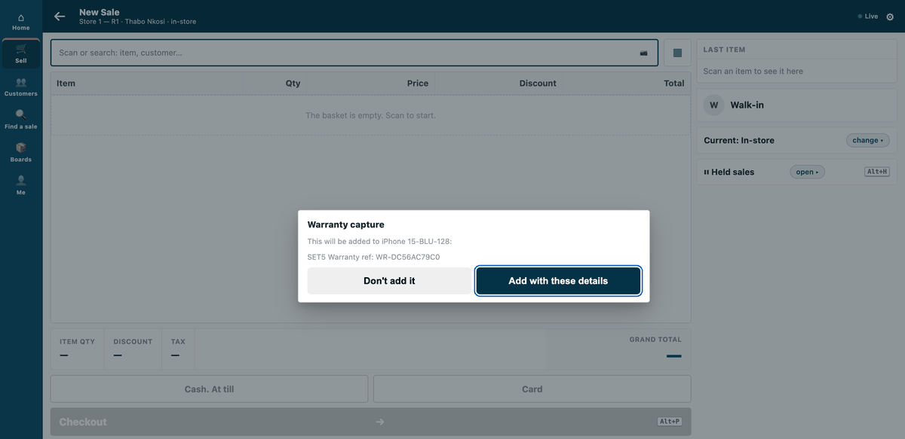
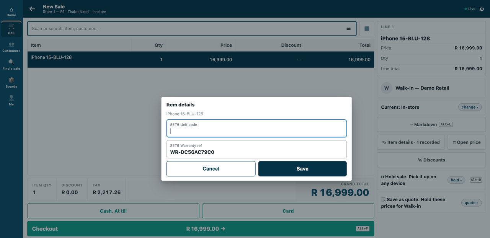
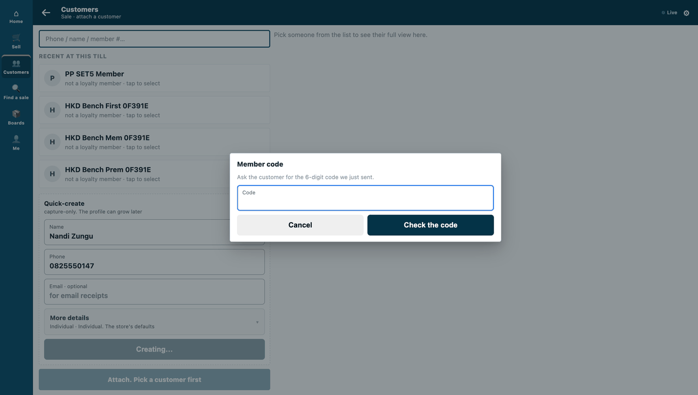
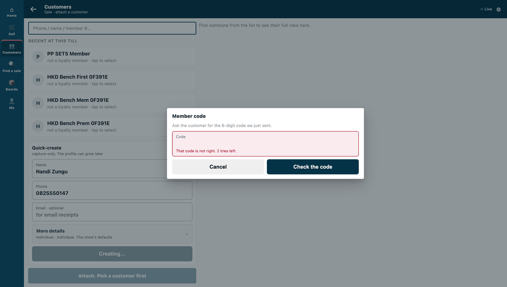
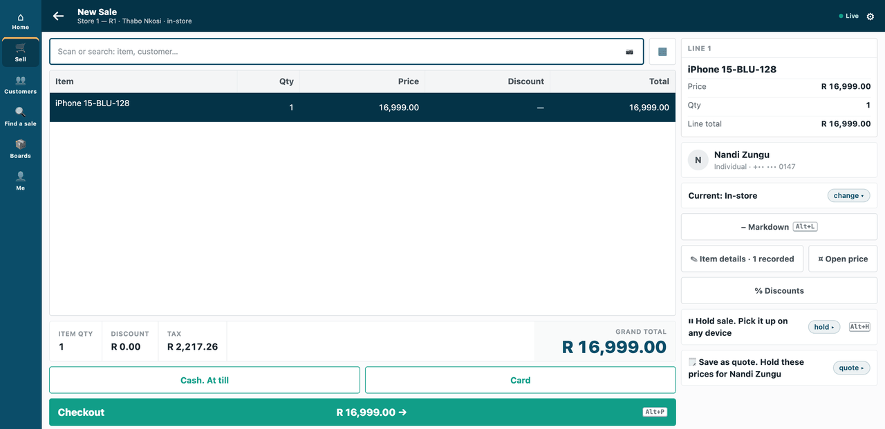
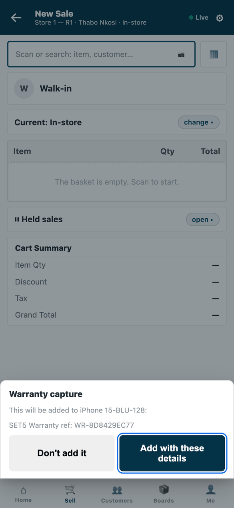
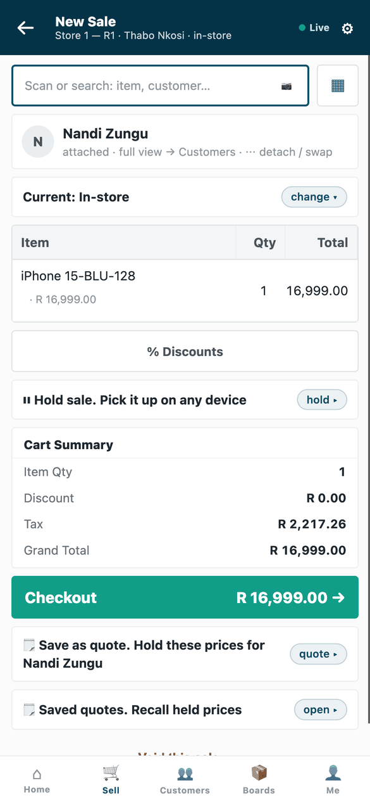

# S20 — Warranty capture and a member code (capture)



*A handset scanned asks the service for a warranty reference and the cashier confirms it; a new customer needs the code just sent, and a wrong code is counted.*

Three capture services, each at its own address. **On scan** of an item in the named item groups, before its line goes on the sale, the service answers with a warranty reference for the line (a value of a line attribute iVendNext keeps). **On customer add**, before the customer is created, it refuses a customer without a mobile number or with a barred one, and otherwise sends a one-time code: the customer is created only after the right code. **On a quantity change** of a line in the iPad group (POS build 2.0.0.654 on), up to three on a line are allowed, four or five are asked about (*"4 of iPad Air 64GB on one line. Has a manager agreed to more than 3?"*), and more are refused: a refusal or a *No* puts back the last allowed quantity. No answer writes a customer field or moves money.

The recipe: [`recipes/capture.md`](../../recipes/capture.md).

## What the retailer does

**Before you install:** every `host.docker.internal` address in `manifest.json` (in `allowed_urls`, and where the manifest calls it) is our test bench's own address for the sample's service, and it resolves only where Docker provides it. Replace it with your own service's address first, or iVendNext's calls never reach your service; if this manifest is already installed, raise its `version` and install it again ([the manifest recipe](../../recipes/manifest.md), step 6).

1. **Install the app** (the retailer's administrator). It adds three services, *Warranty capture* (on scan), *Member code* (on customer add) and *Handset count* (on a quantity change, version 0.3.0), all switched off. *Handset count* needs POS build 2.0.0.654 or later; leave it off on an older site. ⚠ A serial- or lot-tracked line is never asked about a quantity change (each unit is its own line), so name only groups the retailer sells without serial numbers: a phone sold by its IMEI never reaches this service. The sample names *iPad*, sold without serial numbers on our test bench. The app names no role and no record type of its own.
2. **Keep an active line attribute** for the warranty reference (**Transaction Item Attribute**) and tell whoever runs the service its name: the reference lands on the line as a value of that attribute. The item groups the scan asks about come with the app (*iPhone* and *iPad* in this sample); a partner's copy names the retailer's own.
3. **Agree two things with whoever runs the service:** the phone numbers it bars, and how it sends the one-time code. The sample sends nothing real: its message gateway is a stand-in that writes to a private file, so a real service must use the partner's own SMS or WhatsApp provider before production.
4. **Switch each service on** (the System Manager). Open **Retail Extension Subscription**, one record per service, read what it is sent, tick the consent, choose the POS Profiles and switch it on.

**Where it shows.** On the till, on the counter frame and on the phone. Scanning a handset of the named groups shows a confirm sheet; after *Add with these details* the line carries the warranty reference. Adding a new customer asks for the 6-digit code just sent to the customer, a wrong code reads *"That code is not right. 2 tries left."*, three wrong codes end the check, and the customer is created only after the right code. A customer without a mobile number, or with a barred one, is refused in the service's words. If the service is down, a scan goes on and the line is flagged, and a new customer waits (*"... did not answer. The customer can't be added until it does."*). A customer added offline, or from the receipt after payment, is created and flagged on the *Sales to review* report, never refused. A customer made in Desk is not checked.

**What leaves the retailer's iVendNext.** Three addresses, one per service (the manifest ships test addresses; the partner writes its own). On a scan iVendNext sends the sale's reference, the store, the POS Profile, the till's language, the cashier's login, the customer when one is on the sale, and the line: item code, item group, quantity, unit, batch, serial and the code scanned. On a customer add it sends the store, the POS Profile, the language, the cashier's login and the new customer's name, phone, email and customer group, then the code the customer reads out. On a quantity change it sends the sale's reference, the store, the POS Profile, the language, the cashier's login, the customer when one is on the sale, and the line: the till's own line id, item code, item group, unit, and the last allowed and new quantities. No price, total or payment is sent. The service sends the one-time code to the customer's phone through its own gateway, so the customer's number goes there. The service reads nothing else from iVendNext and writes nothing: no answer writes a customer field or moves money. It has no integration user, no event feed, no webhook and no till key.

## What is in the folder

| File | What it is |
|---|---|
| `manifest.json` | three `capture` services (scan, customer add, quantity change), installed switched off |
| `capture.py` | the pure core: signature check, a new warranty reference per scan (the till sends no line id), the codes (`Codes`, ten minutes, in this process), the handset count (`on_qty`: the new quantity judged, never the last allowed one) |
| `service/app.py` | the service: `POST /cap/scan`, `POST /cap/customer`, `POST /cap/qty` (each checks its own secret before reading the body), `GET /health`; its message gateway is a **stand-in** (`Outbox`, a private file) |
| `tests/` | the core, the service over the wire, every answer against the published contract |

**Settings** (`service/.env.local`, never committed): `PP_POINT_SECRET_SCAN`, `PP_POINT_SECRET_CUSTOMER` and `PP_POINT_SECRET_QTY` (handed back at install as `pp_cap:sub:on_scan`, `pp_cap:sub:on_customer` and `pp_cap:sub:on_qty`; without the third, `/cap/qty` answers 401 and the other two run), `PP_QTY_ASK_ABOVE` (3) and `PP_QTY_MOST` (5), `PP_LINE_ATTRIBUTE` (the retailer's active line attribute), `PP_BARRED_PHONES`, `PP_OUTBOX` (the stand-in's file), `PP_PORT`.

**Replace before production:** `Outbox.send` with your SMS or WhatsApp provider, and `Codes` with your own store if you run more than one process.

## Run it

From the kit's root (the folder that holds `samples/`):

```bash
python3 -m unittest discover -s samples/s20_capture/tests -p 'test_*.py'
```

To start the service, run this from the sample's own folder, `samples/s20_capture/`, with the settings above in `service/.env.local`:

```bash
python3 service/app.py service/.env.local
```

## What it looks like

Taken on our test bench on 2026-10-10 (product pin: the iVendNext POS app `87812e141`), on iVendNext POS's counter frame (the till, `/pos?frame=terminal`) in a 1440 px wide browser window, light mode, and on its phone frame (`/pos` in a 390 × 844 phone viewport) for the rows marked *the phone*. The cashier is shown as *Thabo Nkosi*, at the kit's demo site *Demo Retail*, store *Store 1 — R1*. The counter frame's basket screens stop above the till's key row (other samples' keys); the GIF's frames are all cut by that one box, and the phone stills are the whole screen. The handset is the bench's `iPhone 15-BLU-128`, and the line attribute *SET5 Warranty ref* is the bench iVendNext's own (*SET5* is the bench's label for the records its tests made). The customer *Nandi Zungu* was made on the bench for this walk and deleted after it; the phone number typed in the walk is made up. The one-time code went to the sample's stand-in gateway and was typed from there: the right code is not in any picture, and the sheet in step 3 is shown empty. The customers listed behind the sheet in steps 3 and 4 are the bench's own test customers.

| Step | Frame | Screenshot |
|---|---|---|
| 1. A handset is scanned: the till shows what the service will add, and asks | the till |  |
| 2. After *Add with these details* the line carries the reference | the till |  |
| 3. A new customer: the till asks for the 6-digit code just sent | the till |  |
| 4. A wrong code: *That code is not right. 2 tries left.* | the till |  |
| 5. With the right code the customer is created and attached to the sale (phone shown masked) | the till |  |
| 6. The phone: the same capture sheet, as a sheet from the bottom | the phone |  |
| 7. The phone: the sale with the new customer attached | the phone |  |

*Handset count* is not in these pictures. On a sandbox site (2026-10-21, POS 2.0.0.658) a copy of the manifest before its last change (both services on iPhone and iPad, renamed to the site's own groups) installed all three services switched off, *Handset count* with `{"event": "qty_change", …}` and `allow_and_flag`, and was uninstalled; no till asked it. Version 0.3.0 as shipped (the quantity service on *iPad* only) was not installed on a sandbox; its quantity service ran in the laptop tests, and the till's side of a quantity change was walked by the product (POS train T12, counter, phone and tablet frames).
