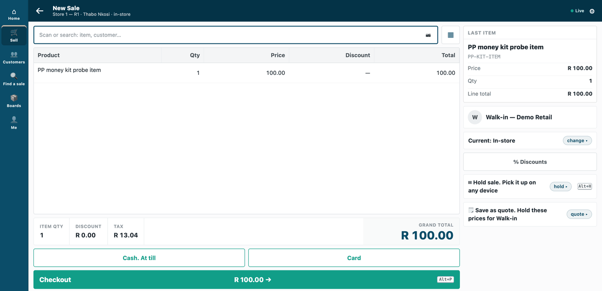

# S21 — Field rules for one till theme

The retailer's own words and fields on one till theme, with no code: the sale's line reads *Product*, the customer's card says *Stars*, the new-customer sheet has no email field, and a new customer needs a phone. Data only.



**Industries:** every industry

## Start from it

```bash
ivn new acme_field_rules --from s21
```

## What to change

What a partner usually changes:

- **The theme:** `theme` on each rule in `manifest.json`. Put the name of a till theme the customer's site has. The sample names `PP Partner Till`, and a copy made from it names that theme under your prefix, a theme no customer has. **Check** does not look at the site, so it passes any name; **Try** refuses a theme the site lacks (*no till theme named …*).
- **The words:** `label` on the `relabel` rules (`cart_line` · `item_name`, `customer_card` · `points`). Choose them before the first install: a later version of the app cannot change or drop a field rule.
- **What the new-customer sheet shows and asks for:** the `hide` rule on `email` and the `require` rule on `phone`, `surface` `customer_create`.

A rule changes what the till shows and asks for, never what it charges.

More: the [recipe](../../recipes/field_rules.md).

**The customer sets:** the till theme the rules belong to. If it does not exist yet, make it in POS Studio: open a theme, press **Save as a new theme**, name it and save.

## Run it

```bash
ivn check
ivn try
```

## Try it at the till

- Start a till that wears the app's till theme: the sale's line reads Product and the customer's card says Stars.
- Add a new customer with no phone; the till asks for one.
- Close the till day when you are done.

## Versions

### 0.1.1

- No change to what the app does. Before you copy it: name a till theme the customer's site has (Try refuses one it lacks; Check does not look at the site), and settle each rule's words before the first install, because a later version cannot change or drop a field rule.

### 0.1.0

- First version in the kit: field rules for one till theme.
- The README says its till theme PP Partner Till must exist before you install, and how to make it.
