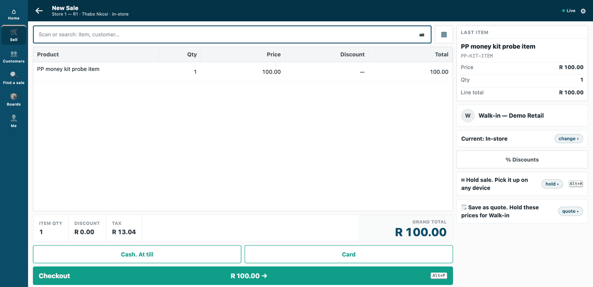
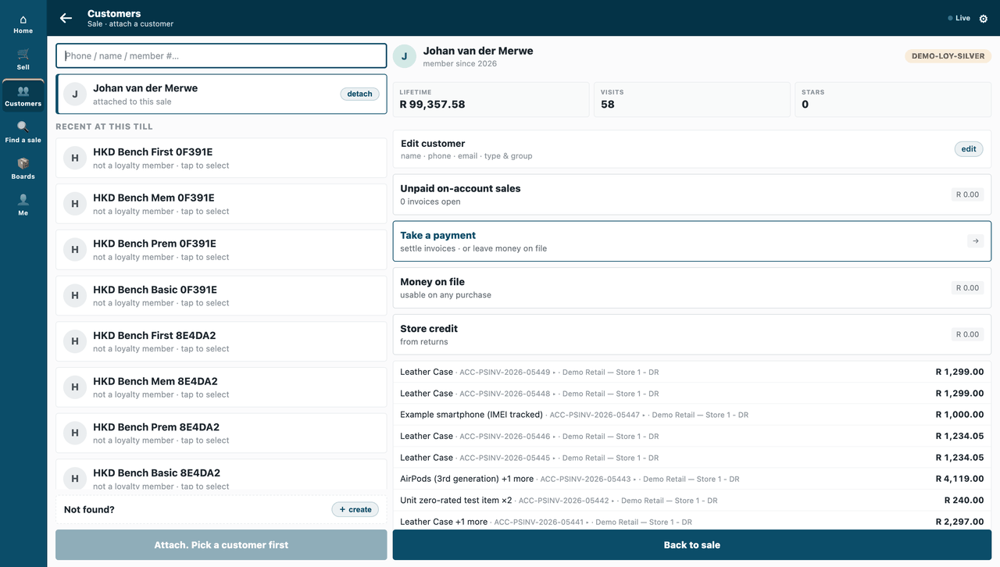
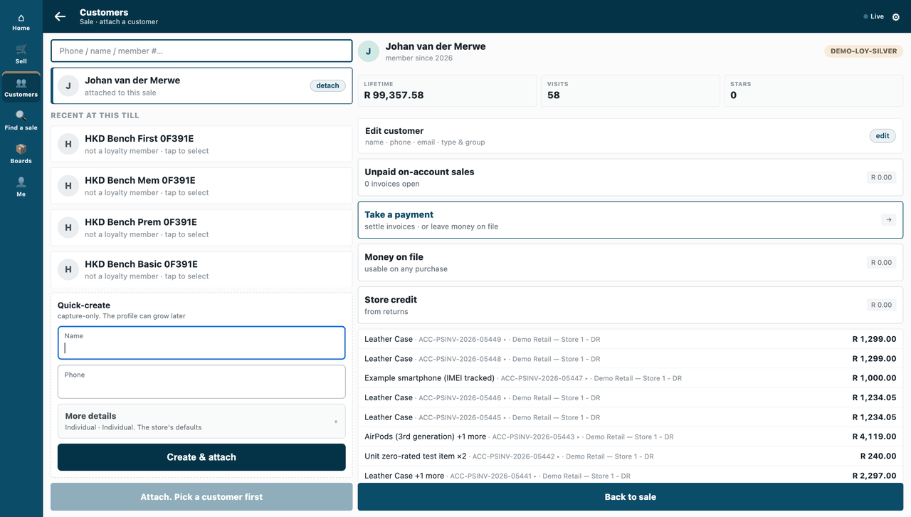
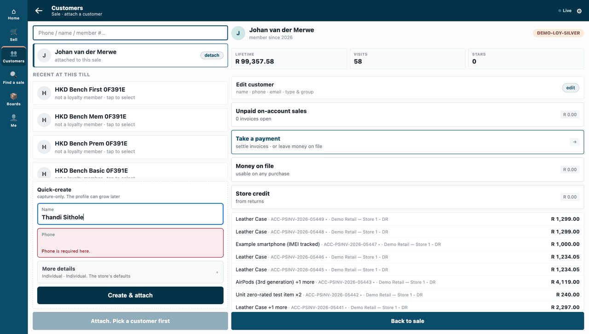
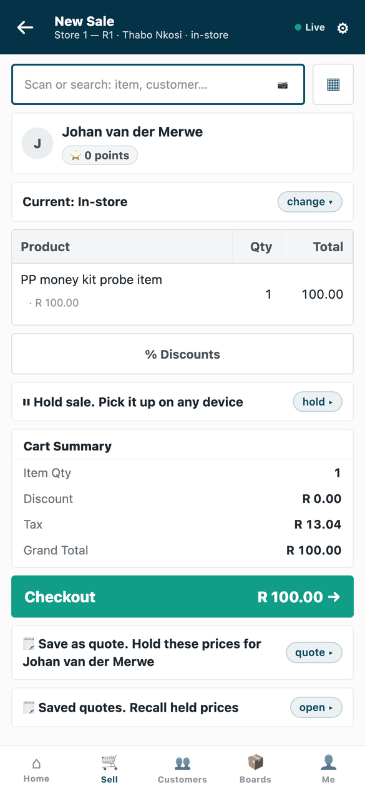
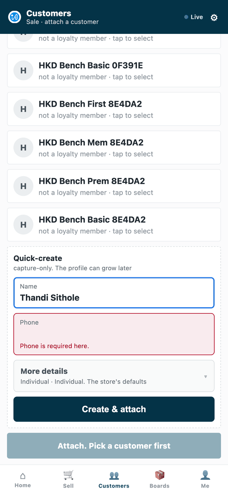

# S21 — Field rules for one till theme



*Field rules on one till theme: the sale's line reads "Product", the customer's card says "Stars", the new-customer sheet has no email, and a new customer needs a phone.*

The shop's own words and fields on one till theme, with no code: the sale's line reads *Product*, the customer's card says *Stars*, the new-customer sheet has no email field, and a new customer needs a phone. **Data only.**

The recipe: [`recipes/field_rules.md`](../../recipes/field_rules.md).

## What the shop does

1. **Choose the till theme.** The four rules belong to one till theme. The sample names `PP Partner Till`; a shop's copy names its own theme.
2. **Tell the shop's people before you install.** Field rules have no switch: the rules are live as soon as the app is installed. The phone rule is enforced by the server at once; the other three reach each till that wears the theme at its next start.
3. **Install the app** (the shop's administrator). It adds four rules to the theme: the sale's line heading reads *Product*, the customer's card says *Stars* where it said *points*, the new-customer sheet has no email field, and a new customer needs a phone.
4. **Start a till afresh** to see the words and fields change. Nothing else is set: there is no switch, no consent and no role to give.

A shop's manager can make the same rules by hand in POS Studio's **Fields** tab; shipping them in an app is for a partner who sets the same rules for many shops.

**Where it shows.** On the till, on the counter frame and on the phone: the line heading, the customer's card, the new-customer sheet and the *"Phone is required here."* refusal (the phone's customer chip still says *points*: the rule relabels the customer's card). The phone rule is also enforced by the server. A customer added offline without a phone is created when the sale syncs and flagged on the *Sales to review* report, never refused. A customer made in Desk or by an import is not checked. No price, amount, tax or payment field is on any rule: a rule changes what the till shows and asks for, never what it charges.

**What leaves the shop.** Nothing. The app is data only: four rules on a till theme, with no address, no service, no webhook, no event feed and no till key.

Uninstalling removes exactly these rows and leaves the theme as the shop had it.

## What is in the folder

| File | What it is |
|---|---|
| `manifest.json` | four rows of the named till theme (`PP Partner Till` is our test bench's; name the shop's own) |
| `tests/` | the manifest against the kit's checker and its refusals, every rule against the published contract |

Field rules have **no switch**: the phone rule is enforced by the server as soon as the manifest installs, the others reach each till at its next start. Uninstalling removes exactly these rows.

## Run it

From the kit's root (the folder that holds `samples/`):

```bash
python3 -m unittest discover -s samples/s21_field_rules/tests -p 'test_*.py'
```

## What it looks like

Taken on our test bench on 2026-10-10 (product pin: the iVendNext POS app `87812e141`), on iVendNext POS's counter frame (the till, `/pos?frame=terminal`) in a 1440 px wide browser window, light mode, and on its phone frame (`/pos` in a 390 × 844 phone viewport) for the rows marked *the phone*. The cashier is shown as *Thabo Nkosi*, at the kit's demo shop *Demo Retail*, store *Store 1 — R1*. The counter frame's basket screen stops above the till's key row (other samples' keys); the GIF's frames are all cut by that one box, and the phone stills are the whole screen. Walked in its own session, after the others were out: the rules reach a till at its next start. *Johan van der Merwe* is the demo shop's customer (his card's tier chip reads the demo loyalty code); the customers listed beside the sheets are the bench's own test customers; *Thandi Sithole* was typed into the new-customer sheet and never created (the till refused). The theme is the bench's `PP Partner Till`.

| Step | Frame | Screenshot |
|---|---|---|
| 1. The sale's line heading reads *Product* | the till |  |
| 2. The customer's card says *Stars* | the till |  |
| 3. The new-customer sheet has a name and a phone, and no email field | the till |  |
| 4. Create with no phone: *Phone is required here.* | the till |  |
| 5. The phone: the line heading reads *Product* (the customer chip above it still says *points*: the rule relabels the customer's card, step 2, not this chip) | the phone |  |
| 6. The phone: the new-customer sheet, no email field, and the phone rule | the phone |  |
