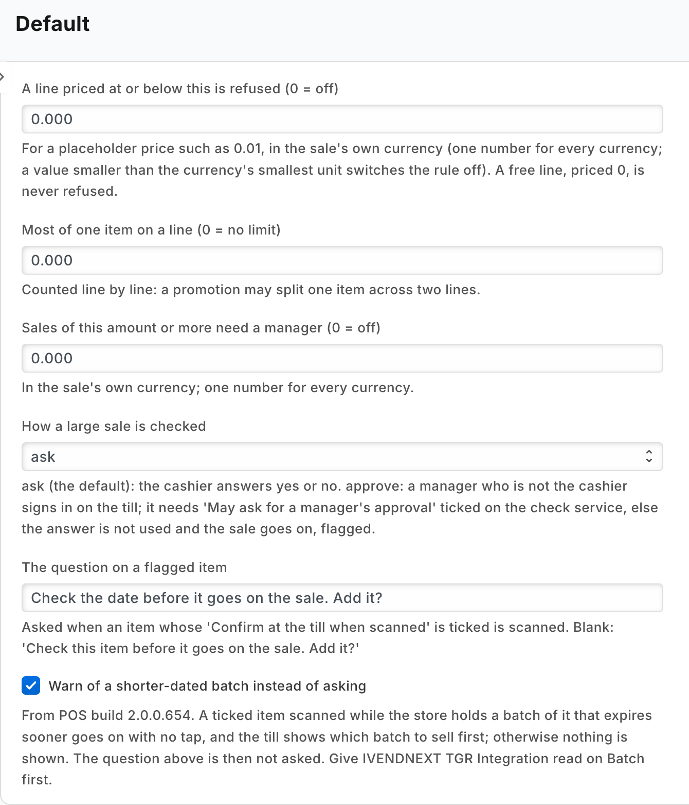

# S23 — Till guard rules (a check before payment and a capture on scan, one app)

The common checks a retailer wants before money is taken, in one app: no line at a placeholder price, the most of one item on a line, the most lines on one sale, a line below its lowest price, a large sale needing a yes or a manager's approval, and a question or a shelf-life warning when a flagged item is scanned. Each rule is off until the retailer sets it, in the app's settings record in Desk. At the till the cashier meets a refusal in the app's own words, a question, or a manager's sign-in.



**What is in it:** a check at Pay, a capture on scan.

**Industries:** Electronics and phones

## Start from it

```bash
ivn new acme_guard --from s23
```

## What to change

What a partner usually changes:

- **The rules:** `on_check` and `on_scan` in `guard.py`, and the retailer's settings read by `settings_of`.
- **The settings:** the fields of `PP TGR Settings` in `manifest.json` (`max_qty_per_line`, `max_lines_per_sale`, `lowest_unit_price`, `lowest_price_list`, `approval_from`, `approval_answer`, `confirm_question`, `warn_shorter_shelf_life`).
- **Which items are asked about at the scan:** the field `pp_tgr_confirm_at_scan` on Item in `manifest.json`.
- **The words the cashier reads:** the messages in `guard.py`.
- **The app's id:** `IVN_LIBRARY_APP` in `app.json`.

More: the [recipe](../../recipes/till_guard.md).

**The customer sets:** the rules it wants in the `Default` record of *Till guard settings* (`PP TGR Settings`) (0 or blank is off), the items to confirm at the scan, a price list of lowest prices, and, for a manager's approval, who may approve.

## Run it

```bash
ivn check
ivn try
```

## Try it at the till

- In Desk, set Most of one item on a line to 50 in the app's settings.
- Sell 51 of one item; the till stops it at Pay.
- Close the till day when you are done.

## Versions

### 1.4.1

- Desk shows plain names (Till guard settings) through the manifest's `translations` block, so a search for *till guard* finds the record. The stored names are unchanged: an installed site keeps its records. Manifest 0.5.1.

### 1.4.0

- The role's rights beyond the feed's reads move into the manifest (`role_rights`): the install gives the feed's user its reads and the manifest the rest, so the retailer's administrator grants none. Needs POS build `2.1.0.691` or later.

### 1.3.0

- Two new rules: the most lines on one sale, and a lowest price per item and unit.
- Each setting in app.json says its purpose (the line the Settings screen shows), whether it is required, and which settings go with it.

### 1.2.0

- The shelf-life warning, run on the bench and walked on a demo site.
- Any failure reading the shelf life is a plain allow, never a refusal.

### 1.1.0

- First version in the kit: several till rules in one app, a check before payment and a capture on scan.
- Hosted as a function, paid per call; an exchange is checked for what it sells.
