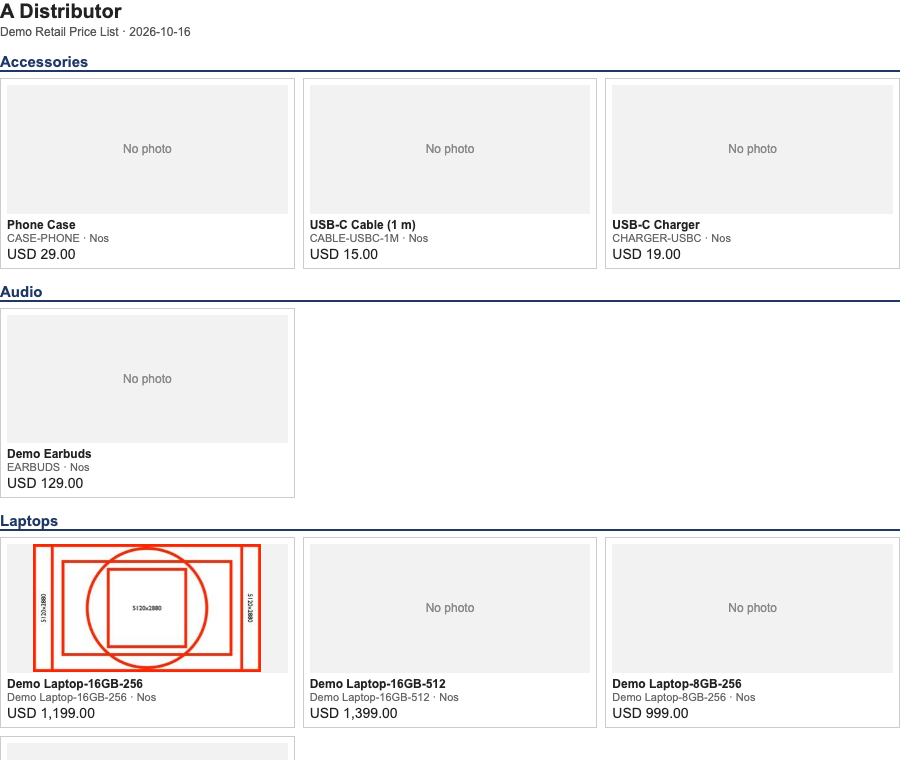

# S29 — a layout of its own for each distributor's invoice, and a price list with photos

A distributor sells to four or five other distributors, and each of them wants its own invoice layout. The distributor also sends each one a price list with a photo of every item, so that nearly identical products can be told apart. This sample does both without touching the till: **part 1** is two ways to give the back-office sales invoice a layout for each customer, and **part 2** is a small program that makes the photo price list as one page that prints to PDF.

## What the shop does

**Part 1 — the invoice.** The shop's administrator installs **one** of two packages (they are alternatives: they carry the same app name, so a site holds one).

| Package | What it adds | Who picks the layout |
|---|---|---|
| `branch_manifest.json` | one print format on *Sales Invoice*, `PP PRT Branch Invoice`: its body looks at the customer on the invoice and prints that customer's layout (A, B or C), or a plain layout for any other customer | **The invoice itself**, once the administrator makes the format the invoice's default |
| `each_manifest.json` | four print formats, `PP PRT Invoice A`, `B`, `C` and `Plain`: one layout each | **A person**, in the print dialog and the e-mail dialog, every time |

1. Put each distributor's name in `customers.json` (exactly as the customer's record is named), replace `logo.png`, edit the three layout files in `layouts/`, and run `python3 build.py`.
2. Install the package (the install screen, or `tools/deploy/deploy.py` on your sandbox).
3. **Branch package only:** in Desk, open **Customize Form** for *Sales Invoice* and set **Default Print Format** to `PP PRT Branch Invoice`. A package cannot set the default itself. ⚠ From then on **every** customer's invoice uses this template, and any customer not in `customers.json` gets the plain layout: copy your current default's body (its tax lines, tax numbers, anything your market requires) into `layouts/layout_plain.html` first.
4. Print an invoice for each distributor: each prints its own layout; an invoice for any other customer prints the plain one.

Each layout has a header, a column set and a footer of its own:

| Layout | Header | Columns | Footer |
|---|---|---|---|
| A (compact) | logo and company left, number and dates right | Item, Qty, Rate, Amount | net total, tax, total, the amount in words |
| B (detailed) | centred, a shaded band with the number | #, Code, Description, Unit, Qty, Rate, Disc %, Amount | net total, each tax line, grand total, the invoice's terms and two signature boxes |
| C (follows the customer's order) | the customer's own order number and date in a box | Item, the customer's own item code, Qty, Net rate, Net amount | remarks, each tax line, total due |
| Plain (any other customer) | company name, address and tax number | Description, Quantity, Price, Total | net total, each tax line, total (and the company's and customer's tax numbers in the header) |

**Switching and removing.** The two packages have different versions (0.1.3 and 0.1.4), so a site that has one can take the other as an update; a changed layout needs a higher version, because the install screen refuses a changed manifest at a version it has already accepted. Removing the package also removes the default print format setting that named it (read on a sandbox): the invoice then prints in the shop's own format again.

**Which package to choose.** Take the branch package when the invoice should pick the layout by itself. Take the per-customer package when a person should choose. **Nothing in the shop picks a print format by customer on its own:** the *Customer* record has no print-format field (its field list was read on a sandbox: 94 fields, the only print one is *Print Language*), so a layout chosen by customer lives in the template, and that is what the branch package does. (A setting on the customer would need the extension point **P-PRINTBYPARTY**.)

**Part 2 — the price list.** Anyone with a key that can read prices, items and files runs `catalogue.py`; it writes one page and, if asked, a spreadsheet file. Open the page in a browser and print it to PDF (tried in a Chromium browser): it is laid out for A4, one section for each item group, three items across, with each item's photo, name, code, unit and price. The photos sit inside the page, so the file can be e-mailed on its own.



*The first screen of a price list made on a sandbox, with photos on three items.*

**Bounds, said plainly.**
- **The back-office sales invoice only.** The till's receipt is separate (S4, `recipes/receipt_format.md`).
- **Every layout prints the invoice's own tax lines** (layout A the one tax figure, the others each line) and the tax numbers it carries; the sample checks that a taxed invoice's lines add up to its total. A layout of yours must keep doing so.
- **Drafts, cancelled invoices and returns print like any invoice:** no *Draft* or *Cancelled* mark and the same title for a return. Add one with the invoice's own status fields if the shop needs it. Labels are in English, and one logo is used for every company on the site.
- **A layout of your own gets none of our later fixes.** If the shop's own invoice layout changes, these layouts do not.
- **The layouts read the invoice and nothing else.** A template may not read the shop's other records: it may use only what the invoice already carries (its company address and tax number, the customer's address, its lines and taxes) and each amount as the document formats it. A figure the invoice does not carry cannot be printed. Before POS build 2.0.0.654 a template could read other rows only through helpers that ignore the viewer's rights; from that build a print format may read them through `ivn_rows` and `ivn_value`, with the viewer's rights (guide chapter 7). These layouts do not use them.
- **The branch matches the customer's record name exactly** (the customer's ID as the shop stores it, which is not the display name when the shop numbers its customers; any characters; a name that is empty or starts or ends with a space is refused). A renamed customer falls to the plain layout; a new distributor is a line in `customers.json`, a new layout file and a higher version to install.
- **Photos must be kept in the shop**: attach the file to the item **and set the item's *Image* field** (uploading a file does not set it; the program reads the *Image* field, and an item without one is a grey box). A photo kept at an outside address, a photo the shop will not give (deleted, or not readable by the key), a request the shop redirects to another host (the program refuses to follow it, so the key stays home), a file over 800 kB (`--max-image-kb`), a vector file and anything that is not a PNG, JPEG, GIF or WebP gets a grey *No photo* box and is listed when the program finishes. The program does not shrink a large photo: shrink it in the shop first.
- **The price page is a file, not a live view.** Run the program again when prices or photos change. It reads general prices only (a price for one customer, supplier or batch is skipped, and so is a price not valid today: *today* is the date on the machine running the program, or `--date`) and, where an item has two prices in one unit, prints the one with the later start date. A disabled item keeps its price row in the shop, so the program leaves it out and lists it. A rate prints with the decimals it is stored with (at least two), not rounded to the currency.
- **It makes the page on the machine that runs it:** the photos pass through that machine, and nothing is sent anywhere else. The program only reads; it never writes to the shop.
- **A print format on the price list itself is not part of this sample.** From POS build 2.0.0.654 a print format can list a document's rows through `ivn_rows` (the card *price-list-with-photos* shows one); before it, the program is the route. (A print format on the **item** with its photo does work: tried on a sandbox, the photo showed in the print and in the shop's PDF; the missing piece is listing a price list's rows.)

## Run it

```bash
# the manifests, from the layouts, the logo and customers.json — then check them
python3 samples/s29_print_pack/build.py
python3 tools/manifest/validate.py samples/s29_print_pack/branch_manifest.json
python3 tools/manifest/validate.py samples/s29_print_pack/each_manifest.json
```

```bash
# the price list with photos, and a spreadsheet file (a sandbox key; the program only reads)
BASE=https://<your-sandbox> KEY=<api key> SECRET=<api secret> \
  python3 samples/s29_print_pack/catalogue.py --price-list "<your price list>" --name "<the distributor>" \
  --out price_list.html --csv price_list.csv
```

```bash
# the tests (the template tests need jinja2 and say so when they are skipped), and the canaries
python3 -m unittest discover -s samples/s29_print_pack/tests -p 'test_*.py'
python3 samples/s29_print_pack/tests/canaries.py
```

## The files

| File | What |
|---|---|
| `layouts/layout_a.html`, `layout_b.html`, `layout_c.html`, `layout_plain.html` | the four layouts — readable templates, with comments |
| `customers.json` | which customer gets which layout (the sample's are placeholders) |
| `logo.png` | the placeholder logo (S4's, 294 bytes); replace it with the brand's |
| `build.py` | builds the two manifests; refuses a customers file that would break the template |
| `branch_manifest.json`, `each_manifest.json` | the manifests the installer reads (generated) |
| `catalogue.py` | the price list page and CSV (Python 3 standard library only) |
| `tests/` | the tests, the stand-ins and the canaries |

## Technical notes

### The walk

On a sandbox (`demo-1`, iVendNext POS app 2.0.0.650, 2026-10-16), two passes, everything made removed afterwards. **Pass 1:** both packages installed through `tools/deploy/deploy.py`; three customers and four **draft** invoices; each rendered through the shop's print view. The branch format printed layout A, B, C and the plain layout from one template (38 differing lines between A and B, 27 between A and C); every printed total equalled the booked one; with the default print format set on the invoice, a print with no format named chose the layout by customer; the per-customer set printed each format on its own invoice, and format B on customer A's invoice printed B (the format decides). **Pass 2 (the committed files, after review):** the same four drafts with two tax lines (8% and 2%, 33.32 on 208.20): every layout in both packages printed the net total, the tax (layout A the one figure, the others each line) and the booked total 241.52; with the default set, A, B, C and the stranger each printed their own layout; removing the package removed the default setting that named it, and the invoice printed in the shop's own format. The price list ran against the sandbox's 21 prices with photos on two items (a PNG and a JPEG) and a third item pointing at a photo file that no longer exists: 2 photos, 19 grey boxes, the missing file reported as *the picture could not be read: the shop answered HTTP 404* and the run finishing; an empty or misspelt list exits with an error. The page opened in a browser with its photos loaded and no request to any outside address, and printed to a three-page A4 PDF with no script in it. A throw-away print format on the **item** showed the item's photo in the print view and in the shop's own PDF.

### Not run

A **submitted** invoice (a submitted invoice cannot be put back, so only drafts were printed); a **return** invoice; the **print dialog**, the **e-mail dialog** and the **Customize Form** screen themselves (the format was named in the print view's address, and the default set by writing the record that screen writes); the invoice as the shop's own **PDF**; Arabic or any right-to-left layout; a list of 500+ items or photos over a few hundred kilobytes; a photo kept in the private files folder; a `.webp` photo against a real shop; a redirect from the shop's file store (tested against a local stand-in only).

### Why this way (R6)

*Part 1:* a template that branches on the customer (picked: the invoice chooses by itself, one format to maintain) · one format for each customer (offered too: a person chooses, no customer name lives in a template, but nothing makes the right one print) · edit the shop's own invoice format in place (rejected: the next update overwrites it, and a hand edit has no owner). *Part 2:* a self-contained page that prints to PDF (picked: about 270 lines of standard library, nothing to install, one file to e-mail) · a PDF library (rejected: an install for every user, and the layout is harder to change) · a print format on the price list (not offered: it cannot list the rows without **P-TEMPLATEHELPERS**).

### The tests

| File | What |
|---|---|
| `tests/test_s29.py` | the manifests are the build of the files and pass the checker; the checker refuses a script, a frame, an outside address and an event handler planted in a layout; a template reads only the invoice (no row reader, no upstream name, no figure worked out); the branch prints each customer's layout and the plain one for a stranger (needs jinja2); the price list holds every item once with its photo or a reported grey box, nothing outside (a redirect to another host is refused and the key never goes there), escaped names, a spreadsheet file that does not run as a formula, paged reads against a local stand-in |
| `tests/canaries.py` | 43 mutations: each guard removed must turn its test red |
