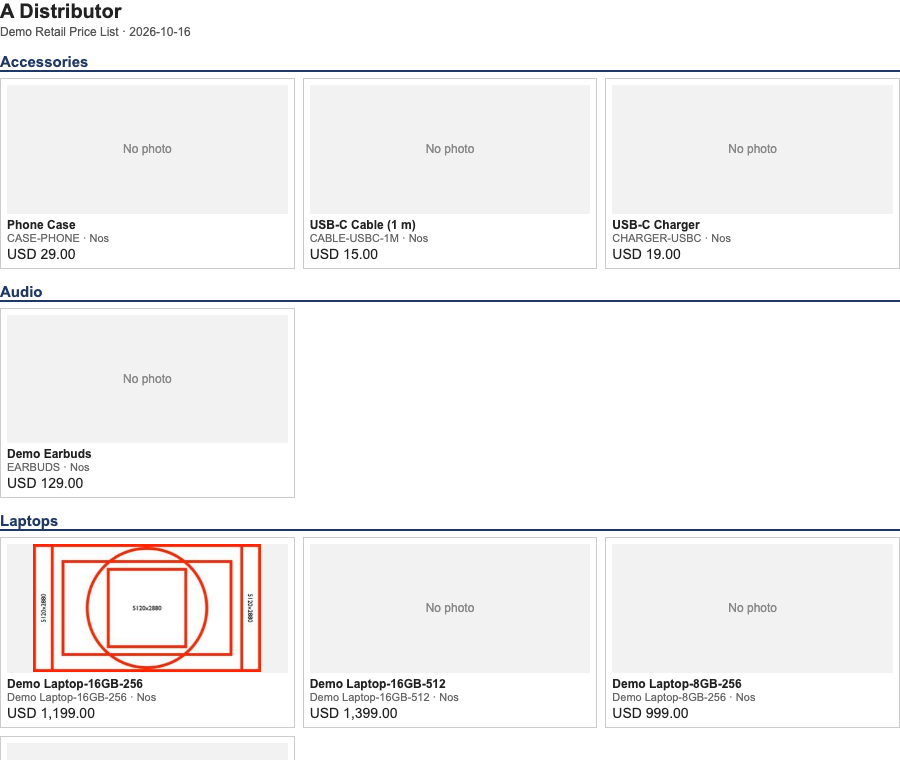

# S29 — a layout of its own for each distributor's invoice, and a price list with photos

A distributor sells to four or five other distributors, and each wants its own invoice layout. The distributor also sends each a price list with a photo of every item, so nearly identical products can be told apart. This sample does both without touching the till: two ways to give the back-office sales invoice a layout for each customer, and the photo price list two ways, a print format on the price list itself and a small program that makes it as one page that prints to PDF.



**Industries:** Distribution and warehousing

## Start from it

**Copy by hand: not an app made here.** Copy the folder, edit the three layouts in `layouts/` and `customers.json`, run `python3 build.py`, and install one invoice package from the App library's install screen.

## What to change

What a partner usually changes:

- **Who gets which layout:** each distributor's name in `customers.json`, exactly as the customer's record is named. A renamed customer falls to the plain layout.
- **The layouts:** `layouts/layout_a.html`, `layout_b.html`, `layout_c.html`, and `layout_plain.html` for any other customer. Copy your market's tax lines and tax numbers into the plain one first.
- **The logo:** replace `logo.png`.
- **Which package:** install **one** of `branch_manifest.json` (the invoice picks the layout by customer) or `each_manifest.json` (a person picks it in the print dialog). They carry the same app name, so a site holds one. `price_list_manifest.json` installs beside either.
- **The price list page:** `catalogue.py`, which reads general prices and each item's *Image* field; an item without one prints a grey box.

A changed layout needs a higher `version`.

More: the [recipe](../../recipes/print_pack.md).

**The customer sets:** for the branch package, **Default Print Format** to `PP PRT Branch Invoice` in **Customize Form** for *Sales Invoice*; a package cannot set it. From then on every customer's invoice uses that template.

## Run it

```bash
python3 samples/s29_print_pack/build.py
python3 tools/manifest/validate.py samples/s29_print_pack/branch_manifest.json
python3 -m unittest discover -s samples/s29_print_pack/tests -p 'test_*.py'
```

## Versions

### 1.0.0

- First version in the kit: a layout of its own for each distributor's invoice, and a price list with photos.
- A cut-short answer from a retailer's site is handled as an unknown outcome, like a site that cannot be reached, never a crash.
