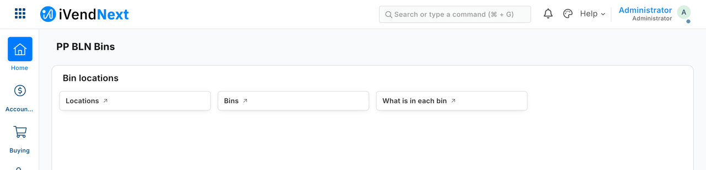

# S2 — bin locations (`pp_bln`): where stock sits inside a store

S2 records only **where** items sit inside a store (locations such as the back room or shop floor, aisles, bins and what is in each bin) and answers the cashier's **"Where is it?"** key. The retailer's stock and valuation stay in iVendNext. Its record types and its Desk workspace, *Bin locations*, install with the manifest, and a small service answers the key. A Retail Manager or a Stock Manager keeps the lists from the workspace: adds, changes and removes stock areas (*Locations*), aisles, bins and what is in each bin.



**Names:** a location, aisle or bin name is one name across all stores of a retailer (the records are named by it). A chain begins each store's with its own prefix, such as `AU-A1`; a second store that uses the same name is refused, and the Location, Aisle and Bin fields say so.

**Industries:** Electronics and phones, Fashion and footwear, Grocery, Hardware and DIY, Distribution and warehousing

**When to use it:** your product keeps its own data beside the retailer's (here, bins) and staff should see it in Desk and at the till.

## Start from it

```bash
ivn new acme_bins --from s2
```

## What to change

What a partner usually changes:

- a field on a bin or a location (`manifest.json`);
- what *Where is it?* says (`core.where_answer`);
- which records the key reads (`service/where.py`, `bin_rows`, and `item_names` for the items' names).

The App library's *Bin locations* is this sample. To move a customer's records from it to your version: `tools/deploy/copy_records.py ivendnext_bln <your app>`. A worked example, a *Zone* on each bin: [Make one of our apps your own](../../recipes/make_it_your_own.md).

## Run it

```bash
ivn check
ivn try
```

## Try it at the till

- Put an item on a sale and press the key Where is it? The till names the bin it sits in, calling each item by the name the sale shows.
- The key has not yet been pressed on a till by us; the same kind of key has been, for S1 and S6.
- Close the till day when you are done.

## Versions

### 1.1.5

- Manifest 0.1.7: the rights on the four bin record types are the app's own role's, `PP BLN Integration`, the role the install gives the app's user (they named `PP Integration`, which that user does not hold): it reads them all and writes a bin's contents (*Item In Bin*). A stock move the local service books (`/putaway`, `/pick`) needs rights on Stock Entry that the retailer gives that role. The bin label prints in the reader's direction (`dir="auto"`). The service is unchanged.

### 1.1.4

- The install makes the app's own user: the manifest registers *PP BLN Bins feed*, which follows the locations (they seldom change, so no queue builds up), and its description says so; a site then hands the hosted *Where is it?* that user's key, and an app made from S2 alone, or with S27, no longer answers *Bin locations is not set up yet* on every press. Manifest 0.1.6.
- Each read of a press may take what is left of its 2.2 seconds, where each was cut at 0.8 s: a slow site's first read no longer answers *The bins cannot be read right now* while the till still waits.
- The tests check the answer's facts (each item, its bin, the quantity there), not its sentence, so `core.where_answer` can be reworded with them green.

### 1.1.3

- *Where is it?* calls each item by the name the sale shows, beside its bin (*Long-grain white rice: shop floor AU-E1-49 (40)*), where it gave only the item code; an item with no bin is named too. On a long sale the names are cut to fit the till's answer, never the bin. The press carries only codes, so the key reads the items' names, and the app's own role may read items (manifest 0.1.5, `role_rights`). Until a site has updated to it, the key answers with codes as before. Needs POS build `2.1.0.691` or later for the read on Item; an update adds it from `2.1.0.696`.

### 1.1.2

- A Retail Manager or a Stock Manager may add, change and remove locations, aisles, bins and what is in each bin (manifest 0.1.4), as the App library's *Bin locations* does; before, a Retail Manager could only read them and a Stock Manager could not open them.
- Desk shows plain names (the workspace *Bin locations*, *Stock area*, *Aisle*, *Bin location*, *Item in bin*) through the manifest's `translations` block. No name changed: installed records keep theirs.
- The workspace opens the aisles too (*Aisles*): a bin needs an aisle, and there was no way in to add one.

### 1.1.1

- The first pass looks back to the day the service starts, not a fixed date.

### 1.1.0

- First version in the kit: the Where is it? till key, hosted as a function for many retailers.
- Each setting in app.json says its purpose (the line the Settings screen shows), whether it is required, and which settings go with it.
- A cut-short answer from a retailer's site is handled as an unknown outcome, like a site that cannot be reached, never a crash.
