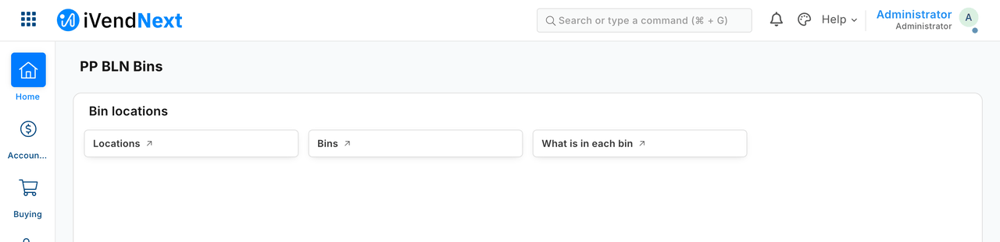

# S2 — bin locations (`pp_bln`): where stock sits inside a store

S2 records only **where** items sit inside a store (locations such as the back room or shop floor, aisles, bins and what is in each bin) and answers the cashier's **"Where is it?"** key. The retailer's stock and valuation stay in iVendNext. Its record types and its Desk workspace install with the manifest, and a small service answers the key.



**Industries:** Electronics and phones, Fashion, Grocery, Hardware and DIY, Distribution and warehousing

**When to use it:** your product keeps its own data beside the retailer's (here, bins) and staff should see it in Desk and at the till.

## Start from it

```bash
ivn new acme_bins --from s2
```

## What to change

What a partner usually changes:

- a field on a bin or a location (`manifest.json`);
- what *Where is it?* says (`core.where_answer`);
- which records the key reads (`service/where.py`, `bin_rows`).

The App library's *Bin locations* is this sample. To move a customer's records from it to your version: `tools/deploy/copy_records.py ivendnext_bln <your app>`. A worked example, a *Zone* on each bin: [Make one of our apps your own](../../recipes/make_it_your_own.md).

## Run it

```bash
ivn check
ivn try
```

## Try it at the till

- Put an item on a sale and press the key Where is it? The till names the bin it sits in.
- The key has not yet been pressed on a till by us; the same kind of key has been, for S1 and S6.
- Close the till day when you are done.

## Versions

### 1.1.1

- The first pass looks back to the day the service starts, not a fixed date.

### 1.1.0

- First version in the kit: the Where is it? till key, hosted as a function for many retailers.
- Each setting in app.json says its purpose (the line the Settings screen shows), whether it is required, and which settings go with it.
- A cut-short answer from a retailer's site is handled as an unknown outcome, like a site that cannot be reached, never a crash.
