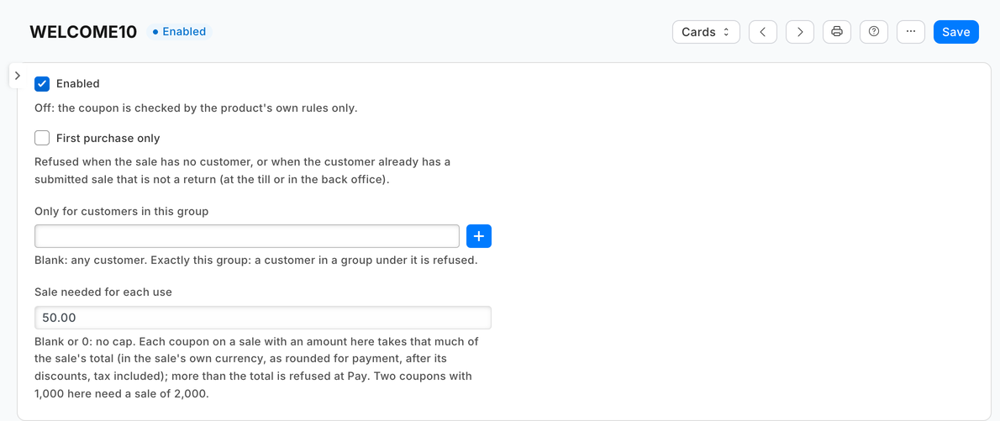

# S32 — Coupon rules (a check before payment that refuses a coupon the retailer restricted)

Rules a retailer adds to its own coupons, checked when the cashier presses **Pay**. One rule record per coupon, written in Desk, each off until ticked or set: first purchase only, only for customers in one group, and a sale of a set amount needed for each use. The till refuses with *"This sale can't be paid"* and says why; the cashier removes the coupon (or adds the new customer) and presses Pay again. A coupon with no rule is never refused.



**Industries:** Electronics and phones, Fashion and footwear, Pharmacy

## Start from it

```bash
ivn new acme_coupons --from s32
```

## What to change

What a partner usually changes:

- **The rules:** `on_check` in `coupons.py`, and `rules_of`, which reads the retailer's rule records.
- **The rule's fields:** the record type `PP CPN Rule` in `manifest.json`, one per coupon, named by it. Desk shows it as *Coupon rule* through the manifest's `translations` block.
- **The words the cashier reads:** the messages in `coupons.py`. The tests check each refusal's facts (the coupon, the group, the amounts, and that it fits the till's 140 characters whole), not its sentence, so a new wording keeps them green.
- **The app's id:** `IVN_LIBRARY_APP` in `app.json`.

More: the [recipe](../../recipes/coupon_rules.md).

**The customer sets:** a *Coupon rule* (`PP CPN Rule`) for each coupon to restrict, and the customer group a coupon is for.

The app's feed (the Registered Application *PP CPN Rules*, shown as *Coupon rules feed*) is its door to the site: it gives the app its own user and key, and the app reads no events from it yet, so a connection test that shows *Last read: never* is expected.

## Run it

```bash
ivn check
ivn try
```

## Try it at the till

- In Desk, write a rule for a coupon: First purchase only.
- Use that coupon for a customer who has bought before; the till stops it at Pay.
- Close the till day when you are done.

## Versions

### 1.2.2

- Desk shows the rules as *Coupon rule* (and the feed as *Coupon rules feed*) through the manifest's `translations` block. No name changed: installed rules keep theirs.
- The tests check each refusal's facts, not its sentence: a partner who rewords what the cashier reads keeps them green.
- The README says the feed reads no events yet, so *Last read: never* on a connection test is expected.

### 1.2.1

- The refusal says *cannot read your site*, and the manifest's Registered Application line says *your rule records*, where both said *shop*. No logic changed.

### 1.2.0

- The role's rights beyond the feed's reads move into the manifest (`role_rights`): the install gives the feed's user its reads and the manifest the rest, so the retailer's administrator grants none. Needs POS build `2.1.0.691` or later.

### 1.1.0

- A rule can ask for a sale of a set amount for each coupon used; a smaller sale is refused at Pay.
- The service reads the rules with every field, so it still answers retailers on the earlier version.
- Each setting in app.json says its purpose (the line the Settings screen shows), whether it is required, and which settings go with it.

### 1.0.0

- First version in the kit: a coupon for a first purchase only, or for one customer group.
