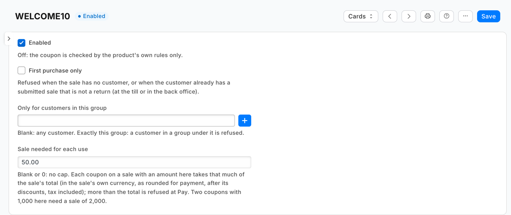

# S32 — Coupon rules (a check before payment that refuses a coupon the retailer restricted)

Rules a retailer adds to its own coupons, checked when the cashier presses **Pay**. One rule record per coupon, written in Desk, each off until ticked or set: first purchase only, only for customers in one group, and a sale of a set amount, before its discounts, needed for each use. The till refuses with *"This sale can't be paid"* and says why; the cashier removes the coupon (or adds the new customer) and presses Pay again. A coupon with no rule is never refused.



**Industries:** Electronics and phones, Fashion and footwear, Pharmacy

## Start from it

```bash
ivn new acme_coupons --from s32
```

## What to change

What a partner usually changes:

- **The rules:** `on_check` in `coupons.py`, and `rules_of`, which reads the retailer's rule records.
- **The rule's fields:** the record type `PP CPN Rule` in `manifest.json`, one per coupon, named by it. Desk shows it as *Coupon rule* through the manifest's `translations` block.
- **The words the cashier reads:** the messages in `coupons.py`; what the cashier does next ends each one and is named once at the top (`IN_GROUP`, `ADD_CUSTOMER`, `NEW_CUSTOMER`, `ADD_TO_SALE`, `ON_REFUND`, `ON_REFUND_MANY`). The tests check each refusal's facts (its next step, the coupon, the group, the amounts in order, and that it fits the till's 140 characters whole), not its sentence, so a new wording keeps them green. The till shows 140 characters at most and the coupon, the group and the amounts take the rest, so keep each next step to about 40 characters, as they are now (35 to 43). A wording too long turns the tests red with a message that names the word to shorten and how many characters its refusal leaves it.
- **The app's id:** `IVN_LIBRARY_APP` in `app.json`.

More: the [recipe](../../recipes/coupon_rules.md).

**The customer sets:** a *Coupon rule* (`PP CPN Rule`) for each coupon to restrict, and the customer group a coupon is for.

The app's feed (the Registered Application *PP CPN Rules*, shown as *Coupon rules feed*) is its door to the site: it gives the app its own user and key, and the app reads no events from it yet, so a connection test that shows *Last read: never* is expected.

## Run it

```bash
ivn check
ivn try
```

## Try it at the till

- In Desk, write a rule for a coupon: First purchase only.
- Use that coupon for a customer who has bought before; the till stops it at Pay.
- Close the till day when you are done.

## Versions

### 1.2.4

- The README says how long the cashier's next steps may be: the till shows 140 characters at most, so keep each to about 40, as they are now. A wording too long turns the tests red with a message that names the word to shorten in `coupons.py` and how many characters its refusal leaves it, or says the coupon's name was left out to fit. No service, rule or manifest change (manifest 0.3.3).

### 1.2.3

- *Sale needed for each use* is judged on the sale before its line discounts, so a coupon no longer counts against its own minimum: a $5.00 coupon that needs $30.00 is taken on a $33.63 basket, where 1.2.2 refused it at *this sale is USD 28.65*. A promotion's free or two-for-one article and a discount on the whole sale still count off, and a cashier's line discount is added back with the coupon's (the check is never sent a coupon's own amount). Tax stays in; the tax a discount took off is not added back. The refusal says *before discounts* and names that figure.

### 1.2.2

- Desk shows the rules as *Coupon rule* (and the feed as *Coupon rules feed*) through the manifest's `translations` block. No name changed: installed rules keep theirs.
- The tests check each refusal's facts, not its sentence: a partner who rewords what the cashier reads keeps them green. Each next step is named once in `coupons.py`, and the tests check that each refusal ends with the right one. The cashier's words are unchanged.
- The README says the feed reads no events yet, so *Last read: never* on a connection test is expected.

### 1.2.1

- The refusal says *cannot read your site*, and the manifest's Registered Application line says *your rule records*, where both said *shop*. No logic changed.

### 1.2.0

- The role's rights beyond the feed's reads move into the manifest (`role_rights`): the install gives the feed's user its reads and the manifest the rest, so the retailer's administrator grants none. Needs POS build `2.1.0.691` or later.

### 1.1.0

- A rule can ask for a sale of a set amount for each coupon used; a smaller sale is refused at Pay.
- The service reads the rules with every field, so it still answers retailers on the earlier version.
- Each setting in app.json says its purpose (the line the Settings screen shows), whether it is required, and which settings go with it.

### 1.0.0

- First version in the kit: a coupon for a first purchase only, or for one customer group.
