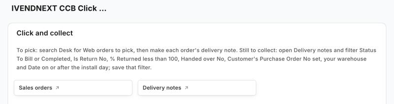
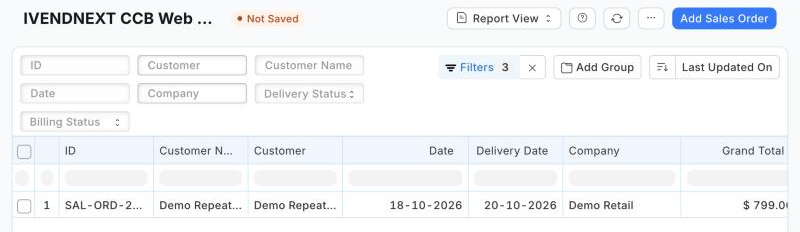
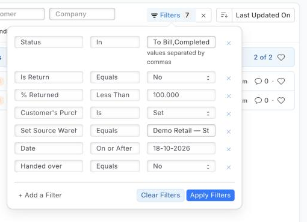
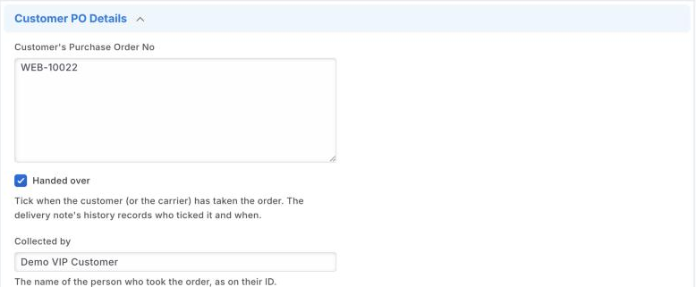
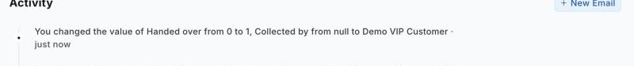

# S33 — Click and collect (`pp_ccb`): a Desk board for web orders

*Start from this sample: `python3 tools/manifest/start.py s33_click_and_collect --prefix "ACME CCB"` copies it into `apps/` of your repository under your own prefix (your company's first word, then a short name for the app) and checks it ([how](../../recipes/make_it_your_own.md)).*

A store's board for the web orders it must pick and hand over, in Desk, from a manifest alone. A report lists the web orders still to pick; two fields on the delivery note record the hand-over, and the Delivery Note list filtered on one of them lists the orders waiting for their customer. Nothing leaves the retailer's iVendNext: no service, no outside address.

**Industries:** Electronics and phones, Fashion, Grocery, Thrift and resale

It uses the manifest's `custom_fields`, `reports` and `workspaces`. **When to use it:** a retailer sells on the web and its customers collect in store, and you want every store to see the same lists without building a screen.

## What the retailer does

1. **Install the app.** It adds two fields to **Delivery Note**, a report and a workspace, **Click and collect**. It adds no record type and no role.
2. **Open the workspace** (search Desk for *Click and collect*). It opens the sales orders and the delivery notes, and says where the two lists are. **Web orders to pick** (search Desk for it) lists the submitted sales orders still to deliver that carry a web order number; filter it to your store's warehouse. Anyone who can read sales orders can open it. **Delivery notes**, filtered on **Status** To Bill or Completed, **Is Return** No, **% Returned** less than 100, **Handed over** No, **Customer's Purchase Order No** is set, **Set Source Warehouse** your store's warehouse, and **Date** on or after the day you install, lists the orders waiting for their customer; save that filter once as *Waiting for collection* (a saved list filter is each user's own: each person who hands orders over saves it once). Each filter matters: without Status a draft or canceled note waits, without Is Return a return waits, without % Returned an order returned before collection waits, without the order number the store's other deliveries wait.
3. **Pick an order** the usual way: from its sales order, make and submit its delivery note. A WooCommerce web store then tells the customer *Ready to collect* (the connector does that on the delivery note's submit, not this app). The order leaves the pick list and its note is waiting.
4. **Hand it over.** When the customer comes, open its delivery note from *Waiting for collection*, and on its **More Info** tab open **Customer PO Details**; tick **Handed over** and write **Collected by** (the name on their ID), and save. The note leaves the list. Its history (*Activity*) records who ticked it and when.

| What the store sees (a demo store) | |
|---|---|
| The workspace: the line saying where the two lists are, and the two lists |  |
| **Web orders to pick**, with one web order to pick (it opens with the sales order list's usual columns: see *Bounds*) |  |
| The waiting filter's seven conditions, each added under **Filter** › **+ Add a Filter** |  |
| The hand-over on a submitted note: **More Info** tab › **Customer PO Details** |  |
| The note's *Activity*: who ticked it and when |  |

**Where it shows.** In Desk only: the workspace, the report, and the two fields on the delivery note's form and list (**Handed over** is a list column and a list filter). Nothing is shown on the till, printed or sent.

**What leaves the retailer's iVendNext.** Nothing: the manifest names no outside address.

## The files

| File | What |
|---|---|
| `manifest.json` | the two fields (on the retailer's Delivery Note, settable after submit; *Handed over* a list column and filter), the Report Builder report (its filters as data), the workspace (the Sales Order and Delivery Note lists, and a line naming the report and the waiting filter) |
| `tests/test_manifest.py` | the manifest passes the kit's checker with no warning; the fields can be set after submit and carry no default; *Handed over* is a list column and filter; the report's filters are the list above and name no field the manifest adds; the workspace opens the sales orders and the delivery notes, never its own report; nothing leaves the retailer's iVendNext |
| `tests/canaries.py` | each test goes RED when the rule it guards is broken |

## Run it

The tests need nothing but Python:

```bash
python3 -m unittest discover -s samples/s33_click_and_collect/tests -p 'test_*.py'
python3 samples/s33_click_and_collect/tests/canaries.py
```

Install the manifest in a retailer's iVendNext through **Extension Packages** (guide chapter 3), then open the workspace.

## What is refused, and why

- **A default on the two fields**: the checker refuses a default on a field added to a retailer's own record type, because the server would apply it on every save of a delivery note.
- **A report that runs SQL or code**: only Report Builder reports, whose filters are data.
- **A report on Delivery Note that names *Handed over***: iVendNext checks a report's fields against the record type as it is before the install, so a report cannot use a field its own manifest adds (*not fields of Delivery Note*). That is why the waiting list is the Delivery Note list with its filter, not a report. `tools/check/check.py` and `tools/deploy/deploy.py` refuse it too (`tools/manifest/site_rules.py`).
- **A workspace shortcut to the manifest's own report**: iVendNext makes a workspace before the manifest's reports, so the link cannot be saved (*Could not find Row #1: Link To: …*). The workspace links the two lists and names the report; `site_rules.py` refuses such a shortcut too.

## Technical notes

### What counts as a web order

A sales order or delivery note with a customer's order number (`po_no`), which our WooCommerce connector fills with the web order's number. So a Desk order typed with a customer's order number shows too, and a web order shipped from a store's own warehouse shows as well (staff tick **Handed over** when the carrier takes it). The connector marks nothing on the order that says *collect*: it keeps that in its own import record.

### Why it is built this way (R6)

The till's own pickup board (*Picking → Ready → Handed over*) lists till sales only, so web orders never reach it. A board on a partner page cannot serve the counter: a page key on the till opens only over a sale with an item, and a Desk page has no write-back. So the smallest thing that gives every store the same lists is configuration, shipped as a manifest: the same fields and report a retailer could make with Customize Form and Report Builder, installed and removed in one step.

### The bench

Proven on our test bench on 2026-10-18 (APPF run 5, final run `pp-20261018T121126Z-34614`, iVendNext POS at beta's build): the manifest installed (two fields settable after submit, *Handed over* a list column and filter; the report on Sales Order, given by the retailer the roles that read sales orders (seven on our bench); the workspace with the two lists and its line) · a web order (a submitted sales order with a web order number) was on **Web orders to pick** and a Desk order beside it was not · its delivery note made and submitted: the order left the pick list and its note was on the waiting list (the Delivery Note list filtered as above, read as a Stock User) · a Stock User ticked **Handed over** and wrote **Collected by** on the SUBMITTED note: it left the waiting list, and its history named that user and the time · a return of that note (its web order number copied) was never waiting · the uninstall, with the hand-over still recorded, exported the two fields' values to a private file and left the schema as found; the notes stayed · no POS day opened. The same manifest, as the library's app, was rehearsed with developer mode off in an earlier run of the same day (`pp-20261018T120803Z-29420`): check, install, update, export and uninstall, reinstall, the schema before and after identical. The first two runs found what *What is refused* now says: a report naming the manifest's own field, and a workspace shortcut to its own report, are refused by iVendNext.

### Bounds, stated

- **A return before collection:** On today's iVendNext a delivery-note return does not update its original's % Returned (measured on our test bench), so an order returned before it is collected stays on the list: cancel its delivery note instead of returning it.
- **Who opens the report:** the manifest gives it no role list, so iVendNext gives it the roles that read sales orders **when the app is installed**; a role given that right later is added to the report in **Report** › *Roles*.
- **Notes from before the install** carry *Handed over* No, so a store's older web deliveries would wait too: add **Date** on or after the day you install to the saved filter.
- **A return or an amended note copies** *Handed over* and *Collected by* from its original (a manifest cannot mark them not-to-copy); the waiting filter leaves returns out, and an amended note's fields can be cleared by hand.
- **The report's columns:** on today's iVendNext it does not apply a manifest report's `columns`, so **Web orders to pick** opens with the sales order list's usual columns (seen on a demo store, 2026-10-18); the store adds *Customer's Purchase Order No* and *Set Source Warehouse* from the column settings. Asked of the product.
- **The titles** show the app's prefix in Desk (*IVENDNEXT CCB Click and collect*); Desk search on the plain name still finds them.

- The lists are Desk lists: the till does not show them.
- **Who and when** of a hand-over are the delivery note's own history, not fields.
- A web order booked as a sales invoice (the connector's other setting) has no sales order to pick; it shows once its delivery note exists.
- **Web orders to pick** shows each order until it is fully delivered; a partly delivered order stays on it.

## Versions

### 0.1.0

- First version in the kit: a Desk board for click and collect web orders.
