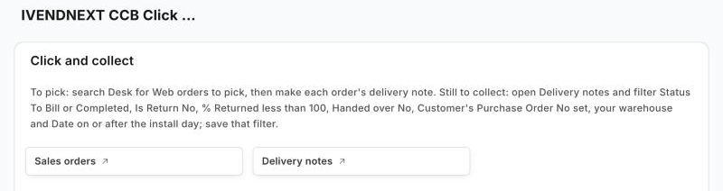

# S33 — Click and collect (`pp_ccb`): a Desk board for web orders

A store's board for the web orders it must pick and hand over, in Desk, with no code of its own. A report lists the web orders still to pick; two fields on the delivery note record the hand-over, and the Delivery Note list filtered on one of them lists the orders waiting for their customer. Nothing leaves the retailer's iVendNext: no service, no outside address.



**Industries:** every industry

**When to use it:** a retailer sells on the web and its customers collect in store, and you want every store to see the same lists without building a screen.

## Start from it

```bash
ivn new acme_collect --from s33
```

## What to change

What a partner usually changes:

- **The two fields on Delivery Note:** `pp_ccb_handed_over` and `pp_ccb_collected_by` in `custom_fields` in `manifest.json`.
- **The pick list:** the report's filters in `reports` in `manifest.json`.
- **The workspace:** `workspaces` in `manifest.json`, the two lists and the line that names the waiting filter.

More: the [recipe](../../recipes/click_and_collect.md).

**The customer sets:** each store's warehouse in the pick list's filter, and the waiting list's filter (Status, Handed over No, Set Source Warehouse, and Date on or after the day of install), saved once.

## Run it

```bash
ivn check
ivn try
```

## Versions

### 0.1.0

- First version in the kit: a Desk board for click and collect web orders.
